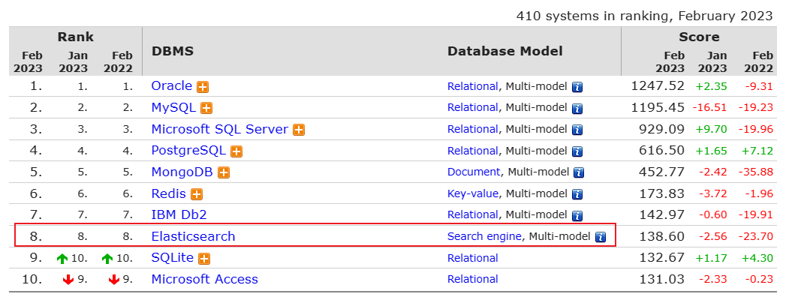
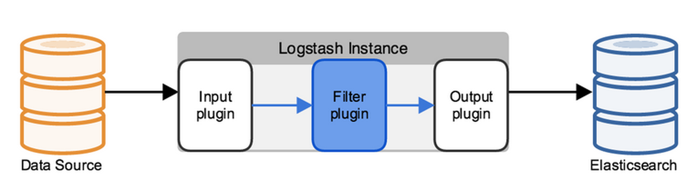
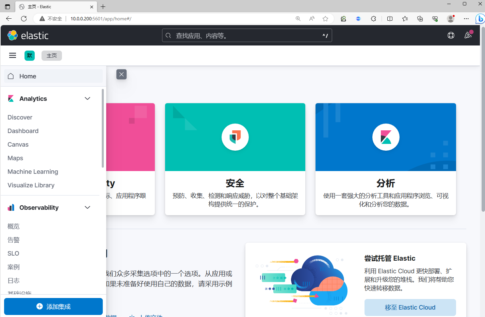
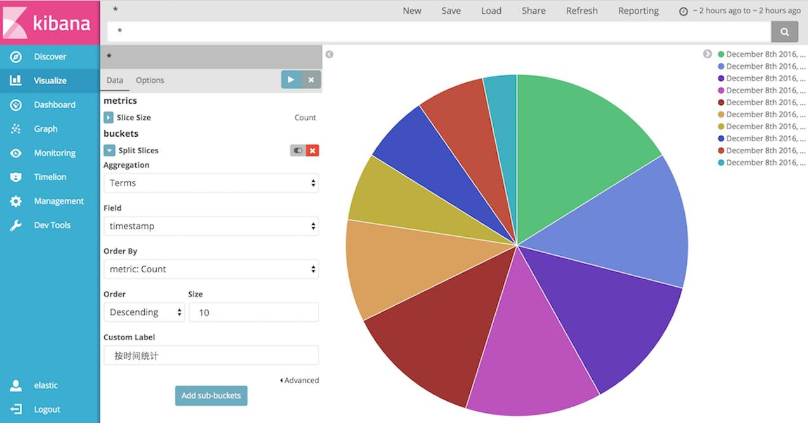

[← 返回ELK 日志分析目录]({{ '/subjects/ELK/' | relative_url }})



# 01 ELK 介绍

## 1. 为什么要集中分析日志

当线上请求超时、错误增多或服务分布在多台主机时，逐台登录查日志既慢又难以关联事件。集中采集可把来自不同服务的记录统一时间、来源和请求标识，再进行检索、聚合与可视化。不过，日志只能回答“发生了什么”；延迟分位数、吞吐量通常还需指标（Metrics），跨服务调用路径则可借助追踪（Tracing）。三类可观测数据相互补充。

### 1.1 ELK 与 Elastic Stack

ELK 得名于 **Elasticsearch、Logstash、Kibana**。加入 Beats 等采集组件后，常称 Elastic Stack。一个典型路径是：日志源 → Filebeat 等采集器 → 可选的 Logstash 解析与转换 → Elasticsearch 存储检索 → Kibana 查询展示。简单场景可让采集器直接写入 Elasticsearch，不必为了凑齐字母而部署所有组件。

| 组件 | 主要作用 | 使用判断 |
| --- | --- | --- |
| Elasticsearch | 建立索引、分布式存储、全文检索与聚合分析。 | 明确字段映射、分片、副本和保留期。 |
| Logstash | 从多种来源读取事件，解析字段并路由到目标。 | 复杂转换才需要；会带来额外资源与运维成本。 |
| Kibana | 提供数据视图、检索、可视化与管理界面。 | 依赖可访问的 Elasticsearch 数据及相应权限。 |
| Beats | 在数据源附近采集日志、指标或可用性探测。 | 按数据类型选择 Filebeat、Metricbeat、Heartbeat 等。 |

Fluentd 等采集/处理工具可以替代部分 Logstash 工作；“EFK”是常见组合之一，而不是另一套完全不同的存储引擎。是否采用某一组合应以数据量、解析难度、部署环境、许可证和运维成本决定。Elastic 产品的许可证与免费功能范围会随版本变化，不能笼统宣称所有组件、功能都“免费开源”。

### 1.2 Elasticsearch 如何组织数据

Elasticsearch 基于 Apache Lucene，面向文档进行近实时搜索和分析。写入文档后，到它能被搜索到之间通常有短暂刷新延迟；延迟受刷新设置与负载影响，不是固定的毫秒值。全文检索使用倒排索引等结构，数值和日期字段又有各自适合的索引与聚合方式。

| 概念 | 作用 |
| --- | --- |
| 集群（Cluster） | 一组协作的 Elasticsearch 节点。 |
| 节点（Node） | 运行 Elasticsearch 的实例，可承担主节点、数据、摄取等角色。 |
| 索引（Index） | 一组有关联映射与设置的文档；名称通常使用小写。 |
| 文档（Document） | 可索引的 JSON 数据记录。 |
| 字段（Field）与映射（Mapping） | 定义文档属性及其类型，影响检索和聚合方式。 |
| 主分片与副本 | 把索引数据分布到节点，并为故障恢复和读取提供冗余。 |

现代 Elasticsearch 已移除旧版的映射类型（`_type`）概念。不要再用“一个索引里多个 type 对应多张数据库表”的旧类比设计新索引；关系型数据库的表、行与 Elasticsearch 索引、文档只在入门层面有相似之处，约束、事务和查询模型并不相同。

分片让索引能够分布存储，副本应放在不同节点。副本提高可用性但不是备份；误删除也会同步到副本，因此仍需快照。更多分片并不必然带来更快查询，过多小分片反而会增加资源开销。索引设计应同时考虑日写入量、查询范围与保留周期。

### 1.3 Logstash 与 Kibana 的位置

Logstash 管道由输入、过滤和输出构成。例如从 Filebeat 接收一条 Nginx 文本日志，用解析器提取时间、状态码与来源 IP，再写入 Elasticsearch。若源数据已经结构化，或只需简单字段补充，可先评估是否能省去这层管道。Logstash 失败时还要考虑缓冲、重试和背压，不是“采集日志后自动就可靠”。

Kibana 通过数据视图查询 Elasticsearch，制作图表、地图和仪表板。它本身不存储业务日志，也不能凭空生成指标。开始可视化前，应先确认索引里有正确的字段类型和时间戳，再检查访问权限与查询时间范围。

后续章节依次介绍应用场景、架构、Elasticsearch 部署以及 Beats、Logstash 和 Kibana 的操作。建议先用少量数据打通一条完整链路，再扩大采集范围并制定保留、脱敏和告警策略。



<nav class="article-end" aria-label="章节导航">
  <a href="{{ '/subjects/ELK/' | relative_url }}">返回 ELK 日志分析目录</a>
  <a href="{{ '/subjects/ELK/02-elk-use-cases.html' | relative_url }}">下一篇：ELK 应用场景 →</a>
</nav>
