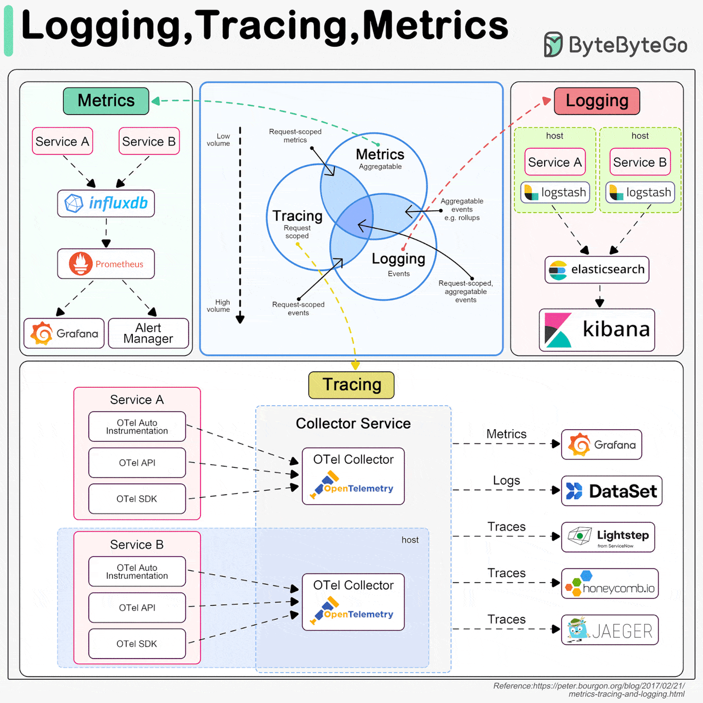
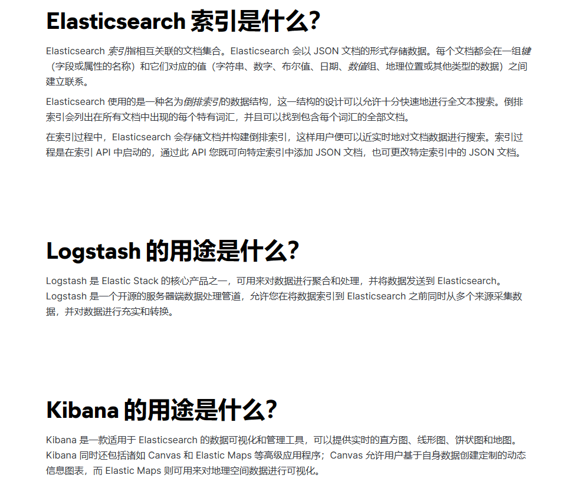
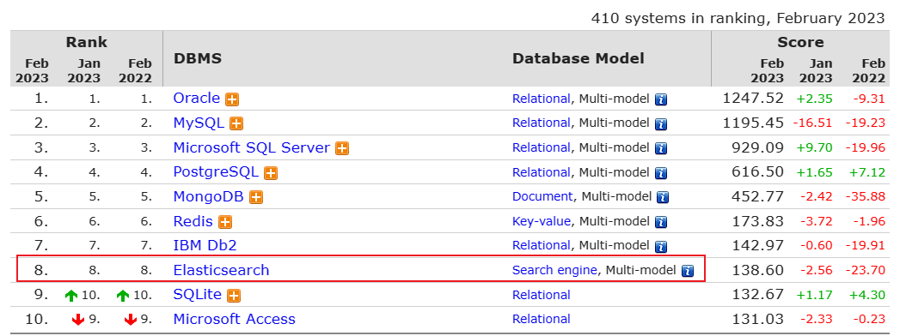
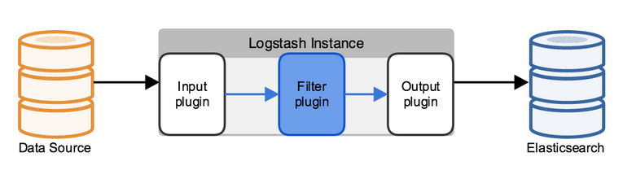
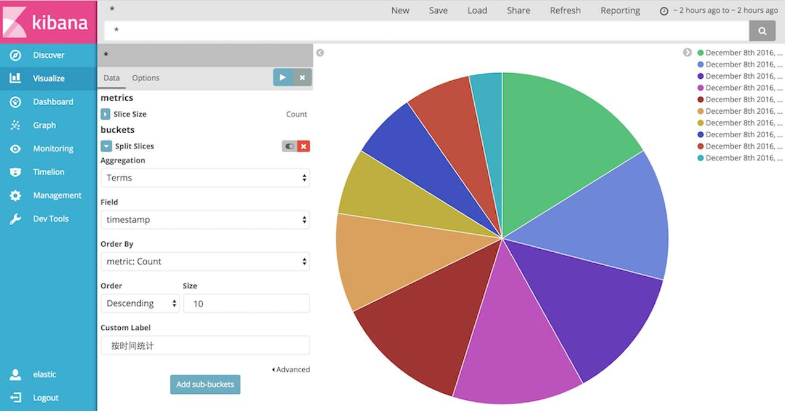

[← 返回ELK 日志分析目录]({{ '/subjects/ELK/' | relative_url }})



# 01 ELK 介绍
## 1 ELK 概述

### 1.1 ELK 介绍

生产中可能会遇到如下场景

场景一：页面提示超时了，到底是哪个服务响应慢了呢？

场景二：系统当前的处理能力如何，TPS、QPS 指标是多少呢？

场景三：线上服务部署在多台机器上，你挨个登录机器去查日志，感觉烦不烦？

需要通过各种监控系统解决以下问题

当今监控天下三分。被划分为基于Metrics（指标）监控、基于 Tracing（调用链）监控、基于 Logging（日志） 的监控。



### 什么是 Elastic Stack

稍有一定规模的IT架构中，系统和应用的相关日志通常会分散在很多台不同的主机和相应的文件中

如果系统和应用出现异常和问题，相关的开发和运维人员想要排查原因，就要先登录到应用运行所相应的主机，找到上面的相关日志文件再进行查找和分析，所以非常不方便，此外还会涉及到权限和安全问题

而ELK的出现就很好的解决这一问题

ELK 是由一家 Elastic 公司开发的三个开源项目的首字母缩写，即是三个相关的项目组成的系统



这三个项目分别是：Elasticsearch、Logstash 和 Kibana。三个项目各有不同的功能

Elasticsearch 是一个实时的全文搜索,存储库和分析引擎。 Logstash 是数据处理的管道，能够同时从多个来源采集数据，转换数据，然后将数据发送到诸如 Elasticsearch 等存储库中。 Kibana 则可以让用户在 Elasticsearch 中使用图形和图表对数据进行可视化。

Elastic Stack 是 原 ELK Stack 在 5.0 版本加入 Beats 套件后的新称呼。

Elastic Stack 是一套适用于数据采集、扩充、存储、分析和可视化的免费开源工具。

通常将 Elastic Stack 也称为 ELK Stack（代指 Elasticsearch、Logstash 和 Kibana）

目前 Elastic Stack 中除了Elasticsearch、Logstash 和 Kibana, 还包括一系列丰富的轻量型数据采集代理，这些代理统称为 Beats，可用来向 Elasticsearch 发送数据。

ELK 版本演进:  0.X,1.X,2,X,5.X,6,X,7.X,8.X ....

官网： https://www.elastic.co/

ELK 官方介绍：https://www.elastic.co/cn/what-is/elk-stack

ELK 下载链接：https://www.elastic.co/cn/downloads/

ELK 说明:  https://www.elastic.co/guide/cn/index.html

ELK 权威指南:  https://www.elastic.co/guide/cn/elasticsearch/guide/current/index.html

ELK stack的主要优点：

功能强大：Elasticsearch 是实时全文索引，具有强大的搜索功能配置相对简单：Elasticsearch 全部其于 JSON，Logstash使用模块化配置，Kibana的配置都比较简单。 检索性能高效：基于优秀的设计，每次查询可以实时响应，即使百亿级数据的查询也能达到秒级响应。 集群线性扩展：Elasticsearch 和 Logstash都可以灵活线性扩展前端操作方便：Kibana提供了比较美观UI前端，操作也比较简单

官方下载

<https://www.elastic.co/cn/downloads/>

EFK 由ElasticSearch、Fluentd和Kibana三个开源工具组成。

Fluentd是一个实时开源的数据收集器,和logstash功能相似,这三款开源工具的组合为日志数据提供了分布式的实时搜集与分析的监控系统。

Fluentd官网和文档:

<https://www.fluentd.org/>

<https://docs.fluentd.org/>

### Elasticsearch

### Elasticsearch 介绍


官方介绍

<https://www.elastic.co/cn/what-is/elasticsearch>

<https://db-engines.com/en/ranking>



Elasticsearch 是一个分布式的免费开源搜索和分析引擎，适用于包括文本、数字、地理空间、结构化和非结构化数据等在内的所有类型的数据。Elasticsearch 在 Apache Lucene 的基础上开发而成，由 Elasticsearch N.V.（即现在的 Elastic）于 2010 年首次发布。Elasticsearch 以其简单的 REST 风格 API、分布式特性、速度和可扩展性而闻名，是 Elastic Stack 的核心组件

Elasticsearch 支持数据的实时全文搜索搜索、支持分布式和高可用、提供API接口，可以处理大规模的各种日志数据的处理，比如: Nginx、Tomcat、系统日志等功能。

Elasticsearch 基于 Java 语言开发，利用全文搜索引擎 Apache Lucene 实现

为何使用 Elasticsearch？

Elasticsearch 很快。由于 Elasticsearch 是在 Apache Lucene 基础上构建而成的，所以在全文本搜索方面表现十分出色。Elasticsearch 同时还是一个近实时的搜索平台，这意味着从文档索引操作到文档变为可搜索状态之间的延时很短，一般只有一秒。因此，Elasticsearch 非常适用于对时间有严苛要求的用例，例如安全分析和基础设施监测。 Elasticsearch 具有分布式的本质特征。Elasticsearch 中存储的文档分布在不同的容器中，这些容器称为分片，可以进行复制以提供数据冗余副本，以防发生硬件故障。Elasticsearch 的分布式特性使得它可以扩展至数百台（甚至数千台）服务器，并处理 PB 量级的数据。 Elasticsearch 包含一系列广泛的功能。除了速度、可扩展性和弹性等优势以外，Elasticsearch 还有大量强大的内置功能（例如数据汇总和索引生命周期管理），可以方便用户更加高效地存储和搜索数据。 Elastic Stack 简化了数据采集、可视化和报告过程。通过与 Beats 和 Logstash 进行集成，用户能够在向 Elasticsearch 中索引数据之前轻松地处理数据。同时，Kibana 不仅可针对 Elasticsearch 数据提供实时可视化，同时还提供 UI 以便用户快速访问应用程序性能监测 (APM)、日志和基础设施指标等数据。

Elasticsearch 在速度和可扩展性方面都表现出色，而且还能够索引多种类型的内容，可用于多种场景：

应用程序搜索网站搜索企业搜索日志处理和分析基础设施指标和容器监测应用程序性能监测地理空间数据分析和可视化安全分析业务分析

### 原理

原始数据会从多个来源（包括日志、系统指标和网络应用程序）输入到 Elasticsearch 中。数据采集指在 Elasticsearch 中进行索引之前解析、标准化并充实这些原始数据的过程。这些数据在 Elasticsearch 中索引完成之后，用户便可针对他们的数据运行复杂的查询，并使用聚合来检索自身数据的复杂汇总。在 Kibana 中，用户可以基于自己的数据创建强大的可视化，分享仪表板，并对 Elastic Stack 进行管理。

Elasticsearch 索引指相互关联的文档集合。Elasticsearch 会以 JSON 文档的形式存储数据。每个文档都会在一组键（字段或属性的名称）和它们对应的值（字符串、数字、布尔值、日期、数组、地理位置或其他类型的数据）之间建立联系。

Elasticsearch 使用的是一种名为倒排索引的数据结构，这一结构的设计可以允许十分快速地进行全文本搜索。倒排索引会列出在所有文档中出现的每个特有词汇，并且可以找到包含每个词汇的全部文档。

在索引过程中，Elasticsearch 会存储文档并构建倒排索引，这样用户便可以近乎实时地对文档数据进行搜索。索引过程是在索引 API 中启动的，通过此 API 您既可向特定索引中添加 JSON 文档，也可更改特定索引中的 JSON 文档。

### 基本概念

Near Realtime(NRT) 几乎实时

Elasticsearch是一个几乎实时的搜索平台。意思是，从索引一个文档到这个文档可被搜索只需要一点点的延迟，这个时间一般为毫秒级。

Cluster 集群

群集是一个或多个节点（服务器）的集合， 这些节点共同保存整个数据，并在所有节点上提供联合索引和搜索功能。一个集群由一个唯一集群ID确定，并指定一个集群名（默认为“elasticsearch”）。该集群名非常重要，因为节点可以通过这个集群名加入群集，一个节点只能是群集的一部分。

确保在不同的环境中不要使用相同的群集名称，否则可能会导致连接错误的群集节点。

Node 节点

节点是单个服务器实例，它是群集的一部分，可以存储数据，并参与群集的索引和搜索功能。就像一个集群，节点的名称默认为一个随机的通用唯一标识符（UUID），确定在启动时分配给该节点。如果不希望默认，可以定义任何节点名。这个名字对管理很重要，目的是要确定网络服务器对应于ElasticSearch 群集节点。

我们可以通过群集名配置节点以连接特定的群集。默认情况下，每个节点设置加入名为“elasticSearch” 的集群。这意味着如果启动多个节点在网络上，假设他们能发现彼此都会自动形成和加入一个名为 “elasticsearch”的集群。

在单个群集中，您可以拥有尽可能多的节点。此外，如果“elasticsearch”在同一个网络中，没有其他节点正在运行，从单个节点的默认情况下会形成一个新的单节点名为"elasticsearch"的集群。

Index 索引

索引是具有相似特性的文档集合。例如，可以为客户数据提供索引，为产品目录建立另一个索引，以及为订单数据建立另一个索引。索引由名称（必须全部为小写）标识，该名称用于在对其中的文档执行索引、搜索、更新和删除操作时引用索引。在单个群集中，您可以定义尽可能多的索引。

注意: 索引名不支持大写字母

Type 类型

在索引中，可以定义一个或多个类型。类型是索引的逻辑类别/分区，其语义完全取决于您。一般来说， 类型定义为具有公共字段集的文档。例如，假设你运行一个博客平台，并将所有数据存储在一个索引中。在这个索引中，您可以为用户数据定义一种类型，为博客数据定义另一种类型，以及为注释数据定义另一类型。

Elasticsearch 版本对 type 概念的演变情况如下：

在 5.X 版本中，一个 index 下可以创建多个 type

在 6.X 版本中，一个 index 下只能存在一个 type

在 7.X 版本中，默认可以支持 type ,但可以禁用

在 8.X 版本中，直接就删除 type,即 index 不再支持 type

Document 文档

文档是可以被索引的信息的基本单位。例如，您可以为单个客户提供一个文档，单个产品提供另一个文档，以及单个订单提供另一个文档。本文件的表示形式为JSON（JavaScript Object Notation）格式，这是一种非常普遍的互联网数据交换格式。

在索引/类型中，您可以存储尽可能多的文档。请注意，尽管文档物理驻留在索引中，文档实际上必须索引或分配到索引中的类型。 Shards & Replicas 分片与副本

索引可以存储大量的数据，这些数据可能超过单个节点的硬件限制。例如，十亿个文件占用磁盘空间 1TB的单指标可能不适合对单个节点的磁盘, 或者仅从单个节点的搜索请求服务可能太慢

为了解决这一问题，Elasticsearch提供细分指标分成多个块称为分片的能力。当创建一个索引，可以简单地定义想要的分片数量。每个分片本身是一个全功能的、独立的“指数”，可以托管在集群中的任何节点。

Shards分片的重要性主要体现在以下两个特征：

分片允许您水平拆分或缩放内容的大小分片允许你分配和并行操作的碎片（可能在多个节点上）从而提高性能/吞吐量

这个机制中的碎片是分布式的以及其文件汇总到搜索请求是完全由ElasticSearch管理，对用户来说是透明的。

在同一个集群网络或云环境上，故障是任何时候都会出现的，拥有一个故障转移机制以防分片和结点因为某些原因离线或消失是非常有用的，并且被强烈推荐。为此，Elasticsearch允许你创建一个或多个拷贝，索引分片进入所谓的副本或称作复制品的分片，简称Replicas。

注意：ES的副本指不包括主分片的其它副本,即只包括备份，这与Kafka是不同的

Replicas的重要性主要体现在以下两个特征：

副本为分片或节点失败提供了高可用性。需要注意的是，一个副本的分片不会分配在同一个节点作为原始的或主分片，副本是从主分片那里复制过来的。 副本允许用户扩展你的搜索量或吞吐量，因为搜索可以在所有副本上并行执行。

相关概念在关系型数据库和ElasticSearch中的对应关系


关系型数据库 Elasticsearch

数据库 Database 索引 Index，支持全文检索

表 Table 类型 Type（废弃）

数据行 Row 文档 Document，但不需要固定结构，不同文档可以具有不同字段集合

数据列 Column 字段 Field

SQL语言 DSL(domain specific language) 是Elasticsearch提供的JSON风格的请求语句，

用来操作ES实现CRUD

详细说明：

概念说明

索引库 indices indices是index的复数，代表许多的索引，

类型是模拟mysql中的table概念，一个索引库下可以有不同类型的索引，比如商品

类型 type

索引，订单索引，其数据格式不同。不过这会导致索引库混乱，因此未来版本中会移除这个概念

文档 document 存入索引库原始的数据。比如每一条商品信息，就是一个文档

字段 field 文档中的属性

### Logstash

<https://www.elastic.co/cn/what-is/elasticsearch>



Logstash 是 Elastic Stack 的核心产品之一，可用来对数据进行聚合和处理，并将数据发送到 Elasticsearch。Logstash 是一个基于Java实现的开源的服务器端数据处理管道，允许您在将数据索引到 Elasticsearch 之前同时从多个来源采集数据，并对数据进行过滤和转换。

可以通过插件实现日志收集和转发，支持日志过滤，支持普通log、自定义json格式的日志解析。

### Kibana

Kibana 是一款适用于 Elasticsearch 的基于Javascript语言实现的数据可视化和管理工具，可以提供实时的直方图、线形图、饼状图和地图。Kibana 同时还包括诸如 Canvas 和 Elastic Maps 等高级应用程序； Canvas 允许用户基于自身数据创建定制的动态信息图表，而 Elastic Maps 则可用来对地理空间数据进行可视化。

官方文档

<https://www.elastic.co/cn/what-is/kibana>

主要是通过接口调用elasticsearch的数据，并进行前端数据可视化的展现。

Kibana 与 Elasticsearch 和更广意义上的 Elastic Stack 紧密的集成在一起，这一点使其成为支持以下场景的理想选择：

搜索、查看并可视化 Elasticsearch 中所索引的数据，并通过创建柱状图、饼图、表格、直方图和地图对数据进行分析。仪表板视图能将这些可视化元素组织到一起，然后通过浏览器进行分享，以提供对海量数据的实时分析视图，所支持的用例如下：

```text
1. 日志处理和分析
2. 基础设施指标和容器监测
3. 应用程序性能监测 (APM)
4. 地理空间数据分析和可视化
5. 安全分析
6. 业务分析
```

借助网络界面来监测和管理 Elastic Stack 实例并确保实例的安全

针对基于 Elastic Stack 开发的内置解决方案（面向可观测性、安全和企业搜索应用程序），将其访问权限集中到一起






<nav class="article-end" aria-label="章节导航">
  <a href="{{ '/subjects/ELK/' | relative_url }}">Back to ELK Log Analytics Index</a>
  <a href="{{ '/subjects/ELK/02-elk-use-cases.html' | relative_url }}">Next: ELK Use Cases →</a>
</nav>
