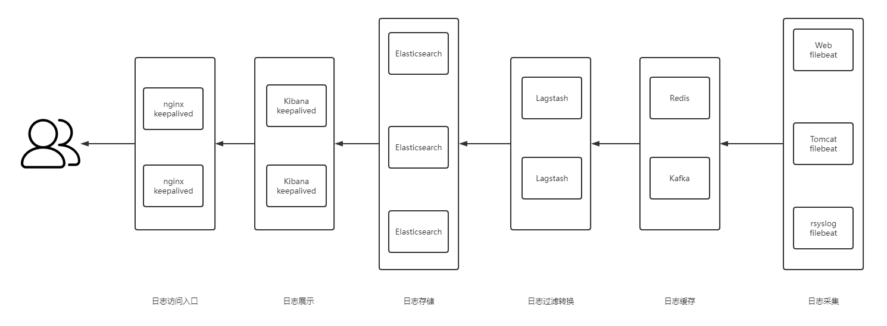

[← 返回ELK 日志分析目录]({{ '/subjects/ELK/' | relative_url }})



# 03 ELK 应用架构
### 1.3 ELK 应用架构

阅读架构图时，可以沿着数据流理解各组件的职责：

1. **采集**：应用、系统和网络设备产生日志；Filebeat 等轻量采集器读取日志并附加来源信息。
2. **处理**：需要解析原始文本、补充字段或路由到不同目标时，使用 Logstash。简单场景也可以由采集器直接写入 Elasticsearch。
3. **存储与检索**：Elasticsearch 将数据写入索引，提供全文检索和聚合查询。索引模板、分片与生命周期策略需要按数据量规划。
4. **展示**：Kibana 通过数据视图查询 Elasticsearch，提供检索、可视化与仪表板。

在高流量或需要削峰的架构中，可以在采集与处理之间加入 Kafka、Redis 等缓冲组件；这属于可选设计，不是 ELK 运行的必备条件。下一章先介绍各组件的替代方案，再分别展开部署方法。



<nav class="article-end" aria-label="章节导航">
  <a href="{{ '/subjects/ELK/02-elk-use-cases.html' | relative_url }}">← 上一篇：ELK 应用场景</a>
  <a href="{{ '/subjects/ELK/' | relative_url }}">返回 ELK 日志分析目录</a>
  <a href="{{ '/subjects/ELK/04-alternative-solutions.html' | relative_url }}">下一篇：替代方案 →</a>
</nav>
