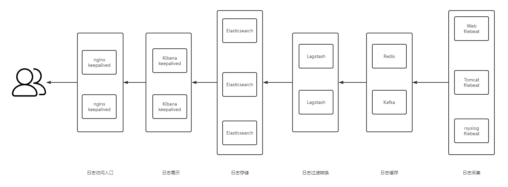

[← 返回ELK 日志分析目录]({{ '/subjects/ELK/' | relative_url }})



# 03 ELK 应用架构
### 1.3 ELK 应用架构



<nav class="article-end" aria-label="章节导航">
  <a href="{{ '/subjects/ELK/02-elk-use-cases.html' | relative_url }}">← Previous: ELK Use Cases</a>
  <a href="{{ '/subjects/ELK/' | relative_url }}">Back to ELK Log Analytics Index</a>
  <a href="{{ '/subjects/ELK/04-alternative-solutions.html' | relative_url }}">Next: Alternative Solutions →</a>
</nav>
