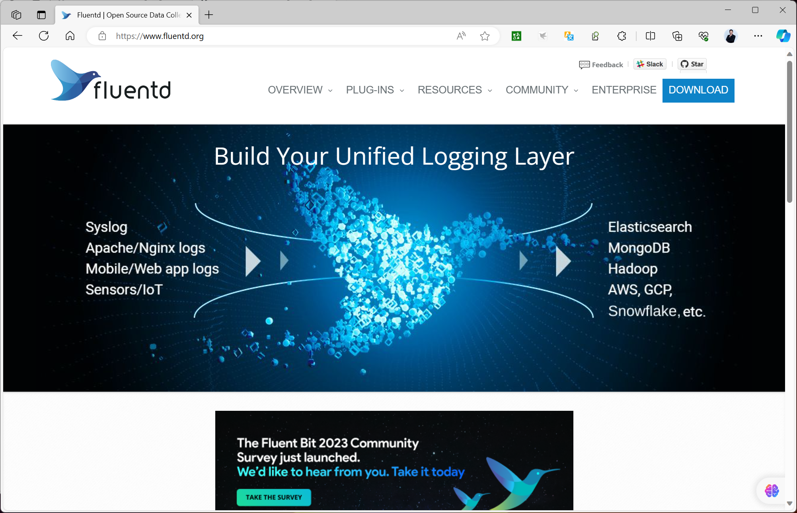
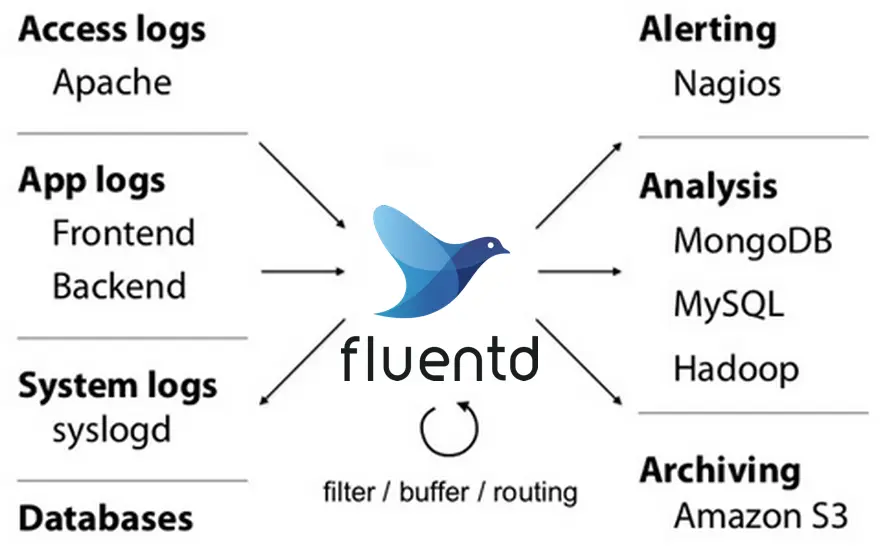
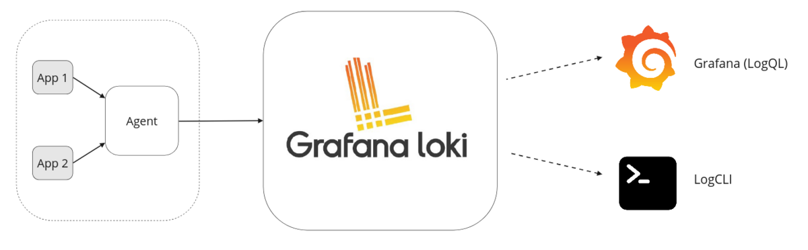

[← Back to ELK Log Analytics Index]({{ '/subjects/ELK/' | relative_url }})



# 04 Alternative Solutions
### 1.4 其它方案

### Fluentd 和 Fluent Bit

fluentd和fluent-bit都是有Treasure Data公司赞助开发的开源项目，这两个项目有很多相似之处

EFK：Elasticsearch，Fluentd，Fluent Bit，Kibana

ELK:  Elasticsearch，Logstash，filebeat，Kibana

### Fluentd

<https://www.fluentd.org/>



Fluentd 是开源社区中流行的日志收集工具，td-agent是其商业化版本，由Treasure Data公司维护，是本文选用的评测版本。

Fluentd 基于CRuby实现，并对性能表现关键的一些组件用C语言重新实现，整体性能不错。

Fluentd 作为一个很好的 Logstash 替代品，Fluentd 是 DevOps 的最爱，特别是对于 Kubernetes 部署，因为它具有丰富的插件库。

Fluentd 与 Logstash 一样，它可以将数据结构化为 JSON，并涉及日志数据处理的所有方面：收集、解析、缓冲和输出跨各种来源和目的地的数据。



优势

支持许多日志源和目的地。 灵活、可扩展的解析选项，支持多种输入格式。 拥有庞大的生态系统，包括成百上千个插件,以及用Ruby自行编写插件的功能。 支持Apache 许可证，版本2.0 供应商中立（CNCF项目） 如果企业需要中立的供应商，Fluentd是不错的选择。它还经常与Kubernetes和容器化环境一起使用。

缺点

解析前没有缓冲，可能会导致日志管道出现背压。 较于logstash，其插件支持相对少一些。

### Fluent Bit

Fluent Bit 基于Fluentd体系结构和设计经验实现

Fluent Bit 不仅是一款日志收集工具，作数据流处理工具，并充当将日志数据转发到Fluentd的运送工具。

Fluent Bit 很适合在 Kubernetes集群等容器化环境中运行

Fluent Bit 很节省资源，因为它占用的空间很小。

虽然Fluent Bit 经常用在Kubernetes 环境中,但也支持部署在裸机服务器、虚拟机和嵌入式设备上。

主要优势:

轻量级设计，内存占用量极小（通常不到1MB） 易于扩展的架构。 可插入式架构，有许多输入、过滤器和输出插件。 支持基于指标和基于日志的有效负载。 支持通过安全的连接将日志发送到存储后端。使用SQL，支持数据流处理。 支持Apache 许可证，版本2.0。供应商中立（CNCF项目）。 Fluent Bit从众多日志源收集日志和指标,并将它们发送到不同的目的地。 Fluent Bit真正大放异彩的地方在于嵌入式、边缘及其他资源受限的环境，因为精简的运行时环境结合众多的输入/输出选项至关重要

fluentd 和 fluent-bit 对比

fluentd fluent-bit

范围容器/服务器容器/服务器

语言 C和Ruby C

大小约40MB 约450KB

性能高性能高性能

作为Ruby Gem构建，主要依赖

除了一些安装编译插件（GCC、CMAKE）其它零

依赖关

gems

系

依赖。

插件支持超过650个可用插件大约35个可用插件

许可证 Apache许可证2.0版 Apache许可证2.0版

Fluentd是日志收集器，处理器和聚合器。 fluent-bit是一个日志收集器和处理器，因为它没有Fluentd等强大的聚合功能

两个项目相互补充，从而提供了完整的可靠轻量级日志解决方案，当然fluent-bit也可以独立完成日志收集。

### Loki


```text
#Loki文档网址：
https://grafana.com/docs/loki/latest/
#下载网址：
https://github.com/grafana/loki/releases
```

Loki 是由Grafana Labs团队开源的水平可扩展，高度可用的多租户日志聚合系统。基于 Go 语言开发 Loki 的设计具有很高的成本效益，并且易于操作。

Loki 受到 Prometheus启发,也使用标签来作为索引，而不是对全文进行检索，通过这些标签既可以查询日志的内容也可以查询到监控的数据签，极大地降低了日志索引的存储。

典型的基于 Loki 的日志堆栈由 3 个组件组成：

Loki ：主服务器，负责摄取和存储日志以及处理查询,功能和ES类似 Agent：使用 Loki 一起分发的 Promtail 或者 Grafana 代理。通过代理抓取日志，通过添加标签将日志转换为流，并通过 HTTP API 将流推送到 Loki，和filebeat功能相似 Grafana：用于 UI 展示，用于查询和显示日志数据。 您还可以使用 LogCLI 或直接使用 Loki API 从命令行查询日志，和Kibana功能相似

工作流程

在应用程序服务器上安装promtail来收集日志然后发送给Loki存储可以在Grafana UI界面通过添加Loki为数据源进行日志查询（如果Loki服务器性能不够，可以部署多个Loki进行存储及查询）。 作为一个日志系统不光只有查询分析日志的能力，还能对日志进行监控和报警。



与 ELK 比 较优势

ELK虽然功能丰富，但规模复杂，资源占用高，很多功能往往用不上 loki 不对日志进行全文索引。通过存储压缩非结构化日志和索引元数据，Loki 操作起来会更简单， 更省成本。 通过使用与 Prometheus 相同的标签记录流对日志进行索引和分组，这使得日志的扩展和操作效率更高。 安装部署简单快速，且受 Grafana 原生支持。 适用于中小型规模的环境中



<nav class="article-end" aria-label="章节导航">
  <a href="{{ '/subjects/ELK/03-elk-architecture.html' | relative_url }}">← Previous: ELK Architecture</a>
  <a href="{{ '/subjects/ELK/' | relative_url }}">Back to ELK Log Analytics Index</a>
  <a href="{{ '/subjects/ELK/05-elasticsearch-installation-overview.html' | relative_url }}">Next: Elasticsearch Installation Overview →</a>
</nav>
