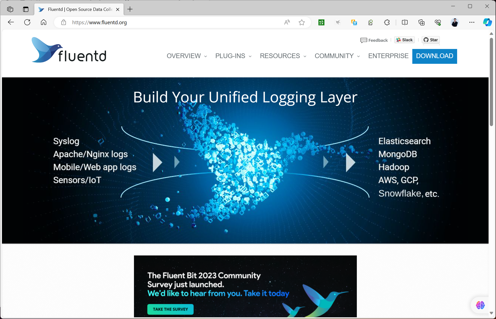
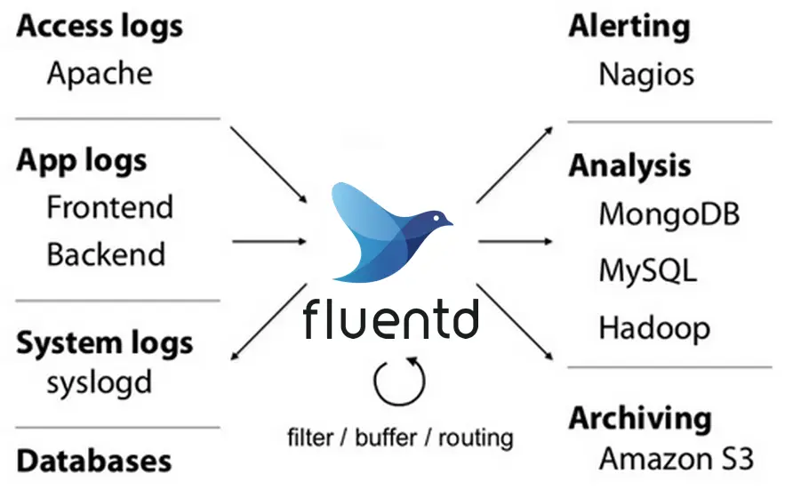
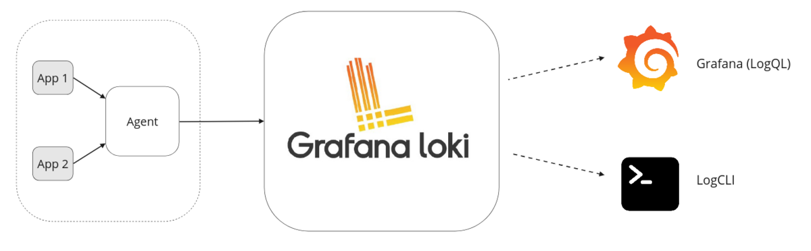

[← 返回ELK 日志分析目录]({{ '/subjects/ELK/' | relative_url }})



# 04 日志方案：Fluentd、Fluent Bit 与 Loki

ELK 不是日志平台的唯一组合。选择方案时，应分别考虑**采集与处理**、**存储与索引**、**查询与展示**三个环节，不能只根据工具名称判断能否互相替换。

### Fluentd 和 Fluent Bit

Fluentd 与 Fluent Bit 都能采集并转发日志，但定位不同：前者侧重灵活的解析、路由与聚合；后者更适合贴近日志源进行轻量采集。常说的 **EFK** 是 Elasticsearch、Fluentd、Kibana 的组合，也可以在节点端增加 Fluent Bit。**ELK** 原指 Elasticsearch、Logstash、Kibana；使用 Filebeat 采集时常写作 Elastic Stack，而不是把 Filebeat 算进字母“ELK”。

### Fluentd

<https://www.fluentd.org/>



Fluentd 是可扩展的日志收集与处理器。它通过输入、解析、过滤、缓冲和输出插件，把不同来源的日志送往 Elasticsearch、对象存储或其他后端。它可以承担 Logstash 的一部分工作，但迁移前要逐项核对插件、过滤规则、缓冲与失败重试行为，而不是直接替换进程。



其优势是插件和路由能力丰富，适合多来源、多目标的日志管道。相应地，插件组合、缓冲区容量及重试策略也会增加配置和运维成本；若输入速度长期高于输出速度，仍可能积压甚至丢日志。需要结合峰值流量与后端故障时长规划缓冲，而不是假定某个工具天然不会出现背压。

### Fluent Bit

Fluent Bit 通常部署在容器节点、虚拟机或边缘设备上，负责读取本地日志、添加元数据、做轻量过滤并转发。它可以直接发送到存储后端，也可以先发给 Fluentd 做进一步处理。实际内存使用量取决于输入量、缓冲、过滤器和输出阻塞情况，原资料中的固定“不到 1 MB”不能作为容量规划依据。

| 选择维度 | Fluentd | Fluent Bit |
| --- | --- | --- |
| 典型位置 | 日志处理与路由层，也可直接采集 | 靠近日志源的采集层，也可直接输出 |
| 实现与扩展 | 以 Ruby 生态和丰富插件见长 | 以 C 实现的轻量运行时，支持输入、过滤、输出插件 |
| 适合的处理 | 复杂解析、路由、聚合及多目标输出 | 采集、标签补充、基础过滤及可靠转发 |
| 规划重点 | 插件兼容性、CPU／内存、缓冲和重试 | 本地缓冲、背压、丢失策略和节点资源限制 |

二者可以组合，但不必强制串联。决定管道结构前，先画出日志从应用到最终存储的路径，以及每个环节故障时数据暂存在哪里。

### Loki


```text
#Loki文档网址：
https://grafana.com/docs/loki/latest/
#下载网址：
https://github.com/grafana/loki/releases
```

Loki 是以**标签索引日志流**为主要设计思路的日志存储与查询系统。它不像 Elasticsearch 那样为日志正文建立同样的全文索引；查询通常先用低基数标签缩小范围，再扫描匹配的日志内容。因此，合理设计标签很重要：服务名、环境等稳定字段适合作标签，而请求 ID 这类高基数值通常更适合留在日志正文。

一个常见路径是：采集器读取应用或节点日志，附加标签并推送给 Loki；Grafana 将 Loki 配为数据源，供读者查询、制作面板和告警。采集器可选 Grafana Alloy、Fluent Bit 等支持 Loki 的组件；旧资料提及的 Promtail 应结合当前维护状态再决定是否新部署。`logcli` 和 Loki API 也可用于命令行查询。



### 如何在 Elasticsearch 与 Loki 之间选择

如果业务需要对大量日志字段做灵活全文检索和复杂分析，Elasticsearch 的索引能力更合适，但索引与集群维护也有成本。若查询大多能先按服务、环境和时间范围收窄，Loki 的标签索引方式可能减少索引开销，并与 Grafana 监控面板自然结合。两者都需要规划保留周期、权限、备份与扩容；“Loki 一定更省钱”或“只适合中小规模”都过于绝对，应以真实日志量和查询模式测试。



<nav class="article-end" aria-label="章节导航">
  <a href="{{ '/subjects/ELK/03-elk-architecture.html' | relative_url }}">← 上一篇：ELK 架构</a>
  <a href="{{ '/subjects/ELK/' | relative_url }}">返回 ELK 日志分析专题目录</a>
  <a href="{{ '/subjects/ELK/05-elasticsearch-installation-overview.html' | relative_url }}">下一篇：Elasticsearch 安装概览 →</a>
</nav>
