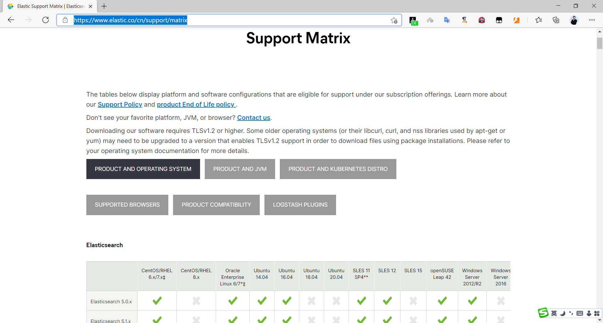

[← 返回ELK 日志分析目录]({{ '/subjects/ELK/' | relative_url }})



# 05 Elasticsearch 安装说明
## 2 Elasticsearch 部署和管理

Elasticsearch 是基于 Java 的分布式搜索与分析引擎，可对文本、数值、地理位置等数据建立索引并查询。部署前先确认所用版本的许可证、支持平台和与 Kibana、Beats 等组件的兼容关系；不要把不同大版本的安装命令混用。

### 2.1 Elasticsearch 安装说明

### 参考文档

<https://www.elastic.co/guide/en/elastic-stack/index.html>

<https://www.elastic.co/guide/en/elasticsearch/reference/master/install-elasticsearch.html>

### 部署方式如何选择

| 方式 | 适用情形 | 注意点 |
| --- | --- | --- |
| RPM / DEB 包 | 常规虚拟机或物理机 | 便于纳入系统服务管理，需检查数据目录和权限。 |
| 压缩包 | 自定义目录或快速验证 | 需要自行管理服务进程与开机启动。 |
| Docker | 容器化测试或部署 | 持久化数据与配置，并检查内存、文件描述符等宿主机限制。 |
| Kubernetes | 已有集群的编排场景 | 应配合持久卷、资源限制及合适的 Operator 或 Helm 配置。 |
| Ansible | 多节点批量部署 | 它是自动化手段，可与包或压缩包方式组合使用。 |

操作系统与 Java 版本的支持范围以官方支持矩阵为准；有些发行版自带 JDK，具体要求随版本变化。

<https://www.elastic.co/cn/support/matrix>



<nav class="article-end" aria-label="章节导航">
  <a href="{{ '/subjects/ELK/04-alternative-solutions.html' | relative_url }}">← 上一篇：替代方案</a>
  <a href="{{ '/subjects/ELK/' | relative_url }}">返回 ELK 日志分析目录</a>
  <a href="{{ '/subjects/ELK/06-elasticsearch-prerequisites.html' | relative_url }}">下一篇：Elasticsearch 部署前准备 →</a>
</nav>
