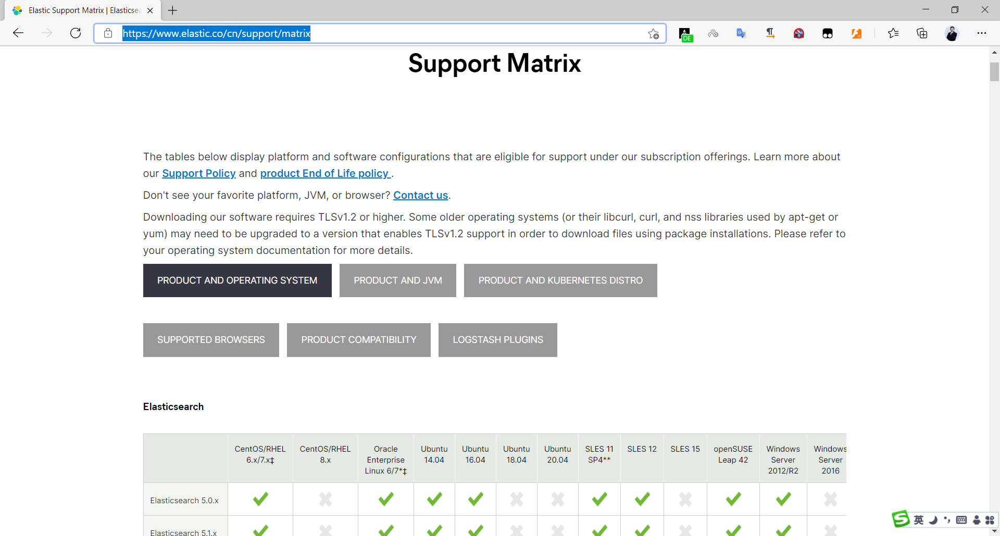

[← Back to ELK Log Analytics Index]({{ '/subjects/ELK/' | relative_url }})



# 05 Elasticsearch Installation Overview
## 2 Elasticsearch 部署和管理

Elasticsearch 是一个分布式的免费开源搜索和分析引擎，适用于包括文本、数字、地理空间、结构化和非结构化数据等在内的所有类型的数据

Elasticsearch 基于 Java 语言实现

### 2.1 Elasticsearch 安装说明

官方文档

<https://www.elastic.co/guide/en/elastic-stack/index.html>

<https://www.elastic.co/guide/en/elasticsearch/reference/master/install-elasticsearch.html>

部署方式

包安装二进制安装 Docker 部署 Kubernetes 部署 Ansible 批量部署

ES支持操作系统版本和 Java 版本官方说明

<https://www.elastic.co/cn/support/matrix>



<nav class="article-end" aria-label="章节导航">
  <a href="{{ '/subjects/ELK/04-alternative-solutions.html' | relative_url }}">← Previous: Alternative Solutions</a>
  <a href="{{ '/subjects/ELK/' | relative_url }}">Back to ELK Log Analytics Index</a>
  <a href="{{ '/subjects/ELK/06-elasticsearch-prerequisites.html' | relative_url }}">Next: Elasticsearch Prerequisites →</a>
</nav>
