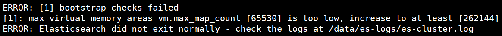
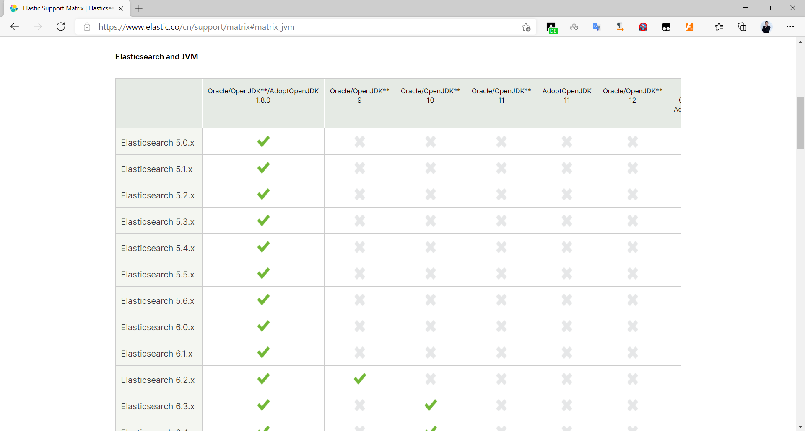

[← 返回ELK 日志分析目录]({{ '/subjects/ELK/' | relative_url }})



# 06 Elasticsearch 安装前准备
### 2.2 Elasticsearch 安装前准备

### 安装前环境初始化

```text
CPU 2C
内存4G或更多
操作系统: Ubuntu24.04,Ubuntu22.04,Ubuntu20.04,Ubuntu18.04,Rocky8.X,Centos 7.X
操作系统盘50G
主机名设置规则为nodeX.bowen.org
生产环境建议准备单独的数据磁盘
```

### 主机名

```bash
#各服务器配置自己的主机名
[root@ubuntu1804 ~]# hostnamectl set-hostname es-node1.bowen.org
```

### 关闭防火墙和SELinux

关闭防所有服务器的防火墙和 SELinux

```bash
#RHEL系列的系统执行下以下配置
[root@es-node1 ~]# systemctl disable firewalld
[root@es-node1 ~]# systemctl  disable NetworkManager
[root@es-node1 ~]# sed -i '/SELINUX/s/enforcing/disabled/' /etc/selinux/config
[root@es-node1 ~]# reboot
```

### 各服务器配置本地域名解析

```bash
[root@es-node1 ~]# vim /etc/hosts
10.0.0.101 es-node1.bowen.org
10.0.0.102 es-node2.bowen.org
10.0.0.103 es-node3.bowen.org
```

### 优化资源限制配置

<https://www.elastic.co/docs/deploy-manage/deploy/self-managed/important-system-configuration>

2.2.1.4.1 修改内核参数

内核参数 vm.max_map_count 用于限制一个进程可以拥有的VMA(虚拟内存区域)的数量

使用默认系统配置，二进制安装时会提示下面错误，包安装会自动修改此配置



```bash
#查看默认值
#ubuntu2404l默认值满足要求
[root@ubuntu2404 ~]#sysctl  -a |grep vm.max_map_count
vm.max_map_count = 1048576
[root@ubuntu2204 ~]#sysctl  -a |grep vm.max_map_count
vm.max_map_count = 65530
[root@es-node1 ~]#sysctl  -a |grep vm.max_map_count
vm.max_map_count = 65530
#修改配置
[root@es-node1 ~]#echo "vm.max_map_count = 262144" >> /etc/sysctl.conf
[root@es-node1 ~]#sysctl  -p
vm.max_map_count = 262144
```

```bash
#设置系统最大打开的文件描述符数
#Ubuntu24.04和22.04默认值已经满足要求
[root@ubuntu2404 ~]#sysctl fs.file-max
fs.file-max = 9223372036854775807
[root@ubuntu2204 ~]#sysctl fs.file-max
fs.file-max = 9223372036854775807
[root@es-node1 ~]#echo "fs.file-max = 1000000" >> /etc/sysctl.conf
```

范例: Ubuntu 基于包安装后会自动修改文件

```bash
[root@node1 ~]#cat /usr/lib/sysctl.d/elasticsearch.conf
vm.max_map_count=262144
```

2.2.1.4.2 修改资源限制配置(可选)

```bash
[root@es-node1 ~]#vi /etc/security/limits.conf
*                soft    core            unlimited
*                hard    core            unlimited
*                soft    nproc           1000000
*                hard    nproc           1000000
*                soft    nofile          1000000
*                hard    nofile          1000000
*                soft    memlock         32000
*                hard    memlock         32000
*                soft    msgqueue        8192000
*                hard    msgqueue        8192000
```

### 安装 Java 环境 (可选)

Elasticsearch 是基于java的应用,所以依赖JDK环境

注意: 安装7.X以后版本官方建议要安装集成JDK的包,所以无需再专门安装 JDK

关于JDK环境说明

```text
1.x 2.x 5.x 6.x都没有集成JDK的安装包，也就是需要自己安装java环境
7.x 版本的安装包分为带JDK和不带JDK两种包，带JDK的包在安装时不需要再安装java，如果不带JDK的包
仍然需要自己去安装java
8.X 版本内置JDK，不再支持自行安装的JDK
```

如果安装no-jdk的包,才需要安装java环境

官网JAVA版支持说明

<https://www.elastic.co/cn/support/matrix#matrix_jvm>



因为 Elasticsearch 服务运行需要 Java环境，如果要安装没有JDK的包，需要提前安装JAVA环境，可以使用以下方式安装

如果没有java 环境,安装elasticsearch时会出下面错误提示

```bash
[root@node1 ~]#dpkg -i elasticsearch-7.14.0-no-jdk-amd64.deb
Selecting previously unselected package elasticsearch.
(Reading database ... 71513 files and directories currently installed.)
Preparing to unpack elasticsearch-7.14.0-no-jdk-amd64.deb ...
Creating elasticsearch group... OK
Creating elasticsearch user... OK
Unpacking elasticsearch (7.14.0) ...
Setting up elasticsearch (7.14.0) ...
### NOT starting on installation, please execute the following statements to
configure elasticsearch service to start automatically using systemd
sudo systemctl daemon-reload
sudo systemctl enable elasticsearch.service
### You can start elasticsearch service by executing
sudo systemctl start elasticsearch.service
could not find java in bundled JDK at /usr/share/elasticsearch/jdk/bin/java
dpkg: error processing package elasticsearch (--install):
installed elasticsearch package post-installation script subprocess returned
error exit status 1
Processing triggers for ureadahead (0.100.0-21) ...
Processing triggers for systemd (237-3ubuntu10.42) ...
Errors were encountered while processing:
elasticsearch
```

方式一：直接使用包管理器yum/apt安装openjdk

```bash
[root@es-node1 ~]#yum -y install java-1.8.0-openjdk
[root@es-node1 ~]#apt update && apt -y install openjdk-8-jdk
```

方式二：本地安装在oracle官网下载rpm安装包：

```bash
[root@es-node1 ~]# yum -y install jdk-8u92-linux-x64.rpm
```

方式三：安装二进制包并自定义环境变量

下载地址：http://www.oracle.com/technetwork/java/javase/downloads/jdk8-downloads-2133151.html

```bash
[root@es-node1 ~]# tar xvf jdk-8u121-linux-x64.tar.gz -C /usr/local/
[root@es-node1 ~]# ln -sv /usr/local/jdk1.8.0_121 /usr/local/jdk
[root@es-node1 ~]# ln -sv /usr/local/jdk/bin/java /usr/bin/
[root@es-node1 ~]# vim /etc/profile
export HISTTIMEFORMAT="%F %T `whoami` "
export JAVA_HOME=/usr/local/jdk
export
CLASSPATH=.:$JAVA_HOME/jre/lib/rt.jar:$JAVA_HOME/lib/dt.jar:$JAVA_HOME/lib/tools
.jar
export PATH=$PATH:$JAVA_HOME/bin
[root@es-node1 ~]# source /etc/profile
[root@es-node1 ~]# java -version
java version "1.8.0_121" #确认可以出现当前的java版本号
Java(TM) SE Runtime Environment (build 1.8.0_121-b13)
Java HotSpot(TM) 64-Bit Server VM (build 25.121-b13, mixed mode)
```

7.X 有两种包: 包含jdk和no-jdk的包

8.X 只有包含JDK的包

注意: 官方提示no-jdk的包将被淘汰,建议使用包含JDK的包

下载地址：

```text
#包含JDK的版本下载
https://www.elastic.co/downloads/elasticsearch
https://mirrors.tuna.tsinghua.edu.cn/elasticstack/
#不包含JDK的版本下载
https://www.elastic.co/cn/downloads/elasticsearch-no-jdk
```

范例: 查看两种包

```bash
[root@node1 ~]#ll -h elasticsearch-7.14.0-*
-rw-r--r-- 1 root root 329M Aug 15 19:39 elasticsearch-7.14.0-amd64.deb
-rw-r--r-- 1 root root 183M Aug 15 19:38 elasticsearch-7.14.0-no-jdk-amd64.deb
```



<nav class="article-end" aria-label="章节导航">
  <a href="{{ '/subjects/ELK/05-elasticsearch-installation-overview.html' | relative_url }}">← Previous: Elasticsearch Installation Overview</a>
  <a href="{{ '/subjects/ELK/' | relative_url }}">Back to ELK Log Analytics Index</a>
  <a href="{{ '/subjects/ELK/07-installing-elasticsearch.html' | relative_url }}">Next: Installing Elasticsearch →</a>
</nav>
