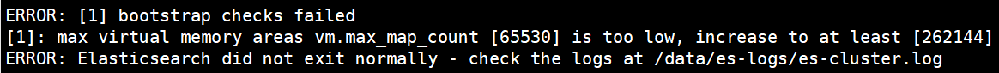
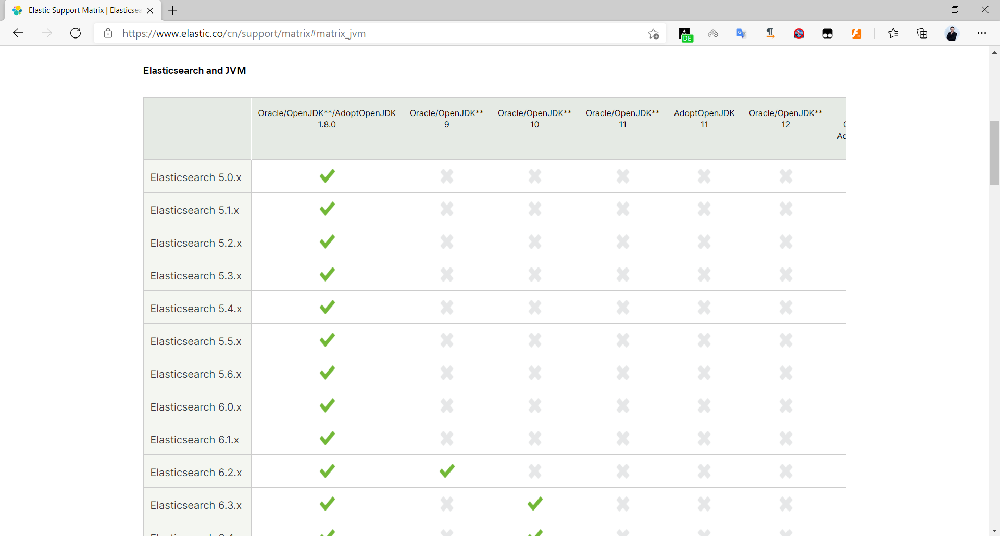

[← 返回ELK 日志分析目录]({{ '/subjects/ELK/' | relative_url }})



# 06 Elasticsearch 安装前准备
### 2.2 Elasticsearch 安装前准备

### 2.2.1 明确版本与资源需求

先选择 Elasticsearch 版本，再对照[官方支持矩阵](https://www.elastic.co/support/matrix)核对操作系统、Java 和其他 Elastic Stack 组件。原资料把 Ubuntu 18.04、CentOS 7 与较新版本并列为可用平台，不能作为当前版本的支持承诺。

测试环境可以从较小规格起步；生产环境的 CPU、内存和磁盘容量应根据日写入量、保留周期、分片副本、查询并发与故障容忍目标估算。数据目录最好与系统盘分开，预留分片迁移和索引合并空间。

### 2.2.2 网络、名称与安全

为每个节点设置唯一且稳定的名称和地址，并确保节点之间传输端口可达。例如三节点实验环境可分别命名为 `es-node1`、`es-node2`、`es-node3`，通过 DNS 或一致的 `/etc/hosts` 解析。`network.host`、发现地址和 TLS/认证配置需在所有节点之间匹配。

**不要为了安装而关闭防火墙、SELinux 或 NetworkManager。** 应按实际部署方式开放所需端口，并保留系统安全策略。若启用 Elasticsearch 自身的安全功能，还需规划证书、凭据与访问权限。关闭这些系统组件会扩大暴露面，也会掩盖配置问题。

### 2.2.3 内核与服务资源限制

[官方重要系统配置文档](https://www.elastic.co/docs/deploy-manage/deploy/self-managed/important-system-configuration)列出了生产部署需检查的系统参数。`vm.max_map_count` 限制进程可用的虚拟内存映射区域数。先查看当前值，再按目标版本要求调整，不要重复向配置文件追加相互冲突的行：

```bash
sysctl vm.max_map_count
printf 'vm.max_map_count=262144\n' | sudo tee /etc/sysctl.d/99-elasticsearch.conf
sudo sysctl --system
sysctl vm.max_map_count
```

示例值 `262144` 适用于许多 Elasticsearch 版本，但仍须对照当前版本文档；部分发行版或安装包已设置更高值。若作为 systemd 服务运行，打开文件数、进程数及内存锁定等限制还需检查服务单元配置，单纯修改 `/etc/security/limits.conf` 未必影响 systemd 服务。不要无依据把所有限制设为 `1000000`。



### 2.2.4 Java 运行环境

Elasticsearch 基于 JVM。当前常见的官方发行包通常自带经过验证的 JDK；先检查所下载包是否包含 JDK，再决定是否需要单独安装。旧版 `no-jdk` 包和 Java 8 安装命令只适用于特定历史版本，不能套用于新的 Elasticsearch。

如果确实使用不带 JDK 的特定发行包，应根据该 Elasticsearch 版本的[Java 支持矩阵](https://www.elastic.co/support/matrix#matrix_jvm)安装兼容版本，并按文档设置服务使用的 Java 路径。不要通过把任意 `java` 可执行文件软链接到 `/usr/bin` 来绕过版本要求。



完成这些准备后，再进入下一篇的安装步骤。安装成功不等于集群已可用，仍须检查服务日志、节点发现、集群健康状态与权限设置。



<nav class="article-end" aria-label="章节导航">
  <a href="{{ '/subjects/ELK/05-elasticsearch-installation-overview.html' | relative_url }}">← 上一篇：Elasticsearch 安装说明</a>
  <a href="{{ '/subjects/ELK/' | relative_url }}">返回 ELK 日志分析目录</a>
  <a href="{{ '/subjects/ELK/07-installing-elasticsearch.html' | relative_url }}">下一篇：安装 Elasticsearch →</a>
</nav>
