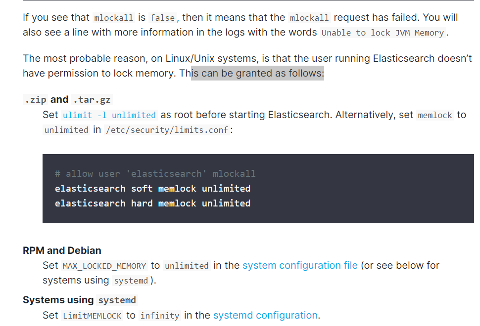
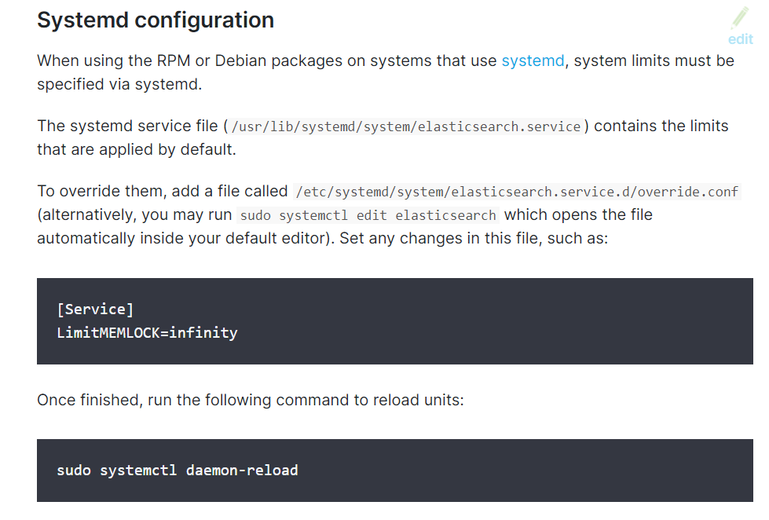
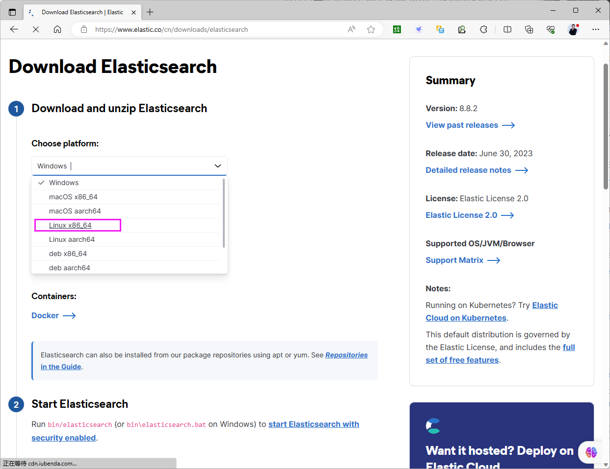
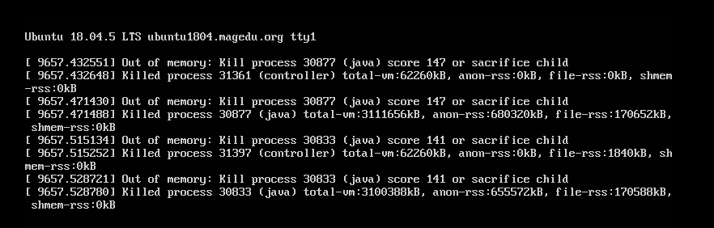
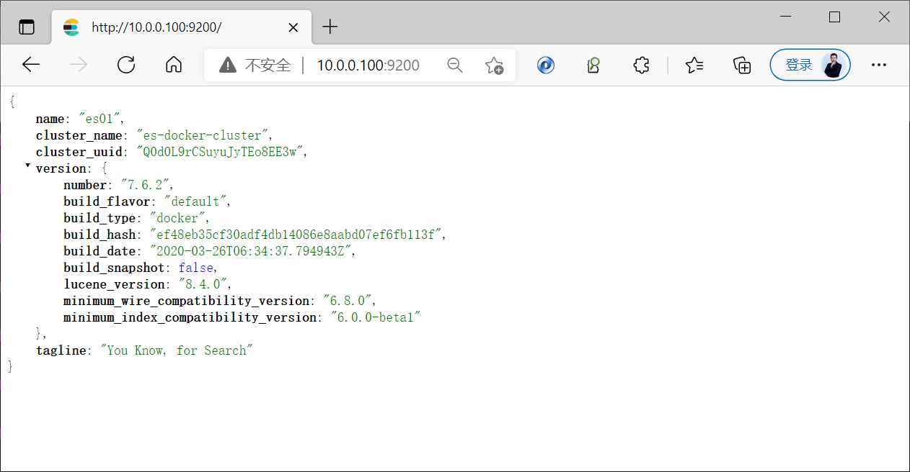
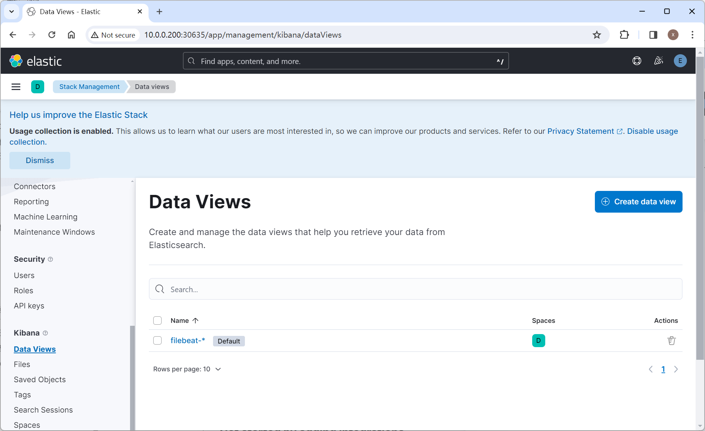
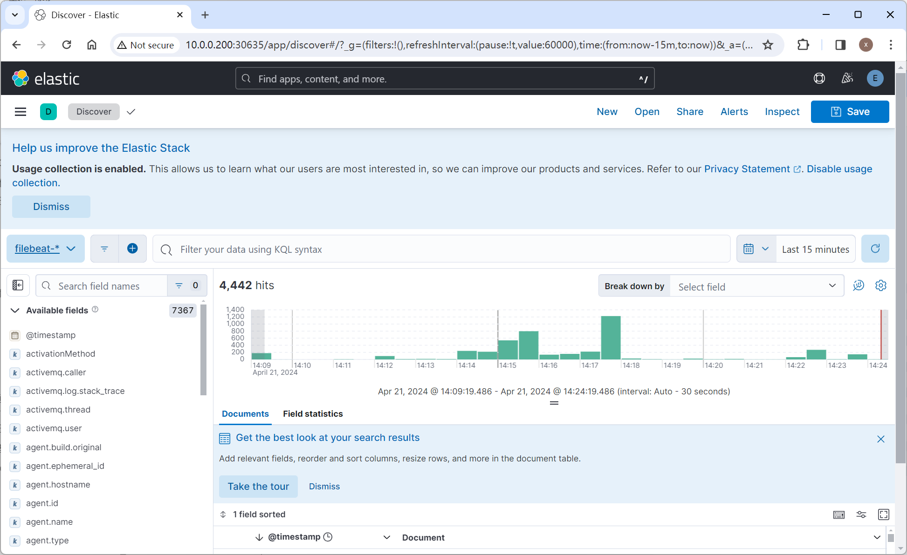

[← 返回 ELK 日志分析目录]({{ '/subjects/ELK/' | relative_url }})



# 07 安装 Elasticsearch

安装方式可以选系统包、官方归档文件、Docker 或 Kubernetes ECK。先选**同一版本系列**完成一条路径，不要把 7.x 无认证示例、8.x/9.x 安全自动配置和不同版本的命令拼成一份配置。本文先讲安装与验证，再解释各方式的差异。版本、下载地址与系统要求以 [Elasticsearch 官方文档](https://www.elastic.co/guide/en/elasticsearch/reference/current/install-elasticsearch.html)为准。

## 1. 系统包安装：先跑通单节点

DEB/RPM 包会创建 `elasticsearch` 服务用户、数据目录和 systemd 单元。下面以官方 DEB 包为例；`VERSION` 应替换为已确认兼容的版本，安装前校验下载文件。较新的官方发行版通常自带 JDK，不必照旧教程为 no-JDK 包创建指向 `/usr/bin/java` 的假路径。

```bash
VERSION=8.14.0
wget "https://artifacts.elastic.co/downloads/elasticsearch/elasticsearch-${VERSION}-amd64.deb"
sudo dpkg -i "elasticsearch-${VERSION}-amd64.deb"
sudo systemctl daemon-reload
sudo systemctl enable --now elasticsearch
sudo systemctl status elasticsearch --no-pager
```

8.x/9.x 的新安装通常自动启用用户认证和 HTTP/传输层 TLS。安装输出可能含初始 `elastic` 密码和证书信息，必须按凭据处理；原教程展示的密码、令牌与 IP 只属于历史截图，不能直接复用。若没有保存初始密码，可按当前版本说明在节点上执行：

```bash
sudo /usr/share/elasticsearch/bin/elasticsearch-reset-password -u elastic
```

取安装时生成的 HTTP CA 证书，用 HTTPS 验证服务；用 `-k` 跳过证书验证仅适合临时诊断。HTTP 的 `9200` 用于 REST API，传输端口 `9300` 用于节点间通信，不应拿 `curl` 对 9300 做 HTTP 请求。

```bash
curl --cacert /etc/elasticsearch/certs/http_ca.crt -u elastic \
  https://127.0.0.1:9200/
curl --cacert /etc/elasticsearch/certs/http_ca.crt -u elastic \
  'https://127.0.0.1:9200/_cluster/health?pretty'
sudo ss -lntp | grep -E ':(9200|9300)\b'
```

`curl http://127.0.0.1:9200` 收到空响应时，先考虑服务实际启用了 HTTPS，而不是立刻关闭安全功能。若旧版 7.x 实验包默认未启用安全设置，应依据**那个版本**的配置访问；不能把 7.x 的 HTTP 结果当作 8.x/9.x 的通用行为。

## 2. 节点与集群配置

单节点可以先使用包安装的默认配置。组建多节点集群时，各节点的 `cluster.name` 相同、`node.name` 唯一；`discovery.seed_hosts` 列出可用于发现的节点。端口应只对需要访问的内网主机开放，不宜直接设置 `network.host: 0.0.0.0` 后暴露公网。下例说明核心字段，不替代多节点的证书、节点注册和防火墙配置：

```yaml
cluster.name: logs-cluster
node.name: es-node-1
path.data: /var/lib/elasticsearch
path.logs: /var/log/elasticsearch
network.host: 10.0.0.101
discovery.seed_hosts: ["10.0.0.101", "10.0.0.102", "10.0.0.103"]
cluster.initial_master_nodes: ["es-node-1", "es-node-2", "es-node-3"]
```

`cluster.initial_master_nodes` 仅用于**全新集群的首次引导**，其中名称应与可参与主节点选举的 `node.name` 对应；集群形成后应移除此引导配置，向已有集群加节点也不要重新初始化。8.x/9.x 可用 enrollment token 引导新节点并延续 TLS 配置；不要靠关闭 `xpack.security.enabled` 来绕过节点加入问题。旧教程里把 `node.roles` 的多个互斥例子和已废弃的 `node.master`、`discovery.zen.ping.unicast.hosts` 放在同一块中，它们并非可同时粘贴的配置。

改用自定义数据或日志目录时，先创建并赋予服务用户写权限；不修改路径则沿用包默认目录。修改配置后核对日志和健康状态，不能只看 9200 是否监听：

```bash
sudo install -d -o elasticsearch -g elasticsearch /data/es-data /data/es-logs
sudo systemctl restart elasticsearch
sudo journalctl -u elasticsearch -n 100 --no-pager
```

## 3. 内存与启动检查

Elasticsearch 的 JVM 堆之外还需要文件系统缓存和堆外内存。较新版本支持自动堆设置；仅在有测量依据时手工设置相同的 `Xms` 与 `Xmx`，并为操作系统留出空间。“物理内存一半、上限约 30 GB”是常见起点而非对所有工作负载都适用的公式；分片数量与大小也要依据索引吞吐、恢复时间和实际节点规格估算。不要直接套用“1 GB 堆对应 48–96 GB 数据”的固定比例。

若启用 `bootstrap.memory_lock: true`，系统必须允许服务锁定内存，否则非本地地址启动时会因 bootstrap check 失败。先读日志中的具体检查项，再通过 systemd 覆盖配置提供限制，而不是直接修改发行包的 unit 文件：





```bash
sudo systemctl edit elasticsearch
# 在打开的编辑器中写入：
# [Service]
# LimitMEMLOCK=infinity
sudo systemctl daemon-reload
sudo systemctl restart elasticsearch
sudo systemctl show elasticsearch -p LimitMEMLOCK
```

只有确实需要内存锁定时才启用该设置。其他 bootstrap check（如 `vm.max_map_count`、文件描述符）也应根据报错逐项处理。健康状态还需核对预期节点数和未分配分片；单节点设置副本可能正常呈 yellow，green 不等于所有预期节点都在线。

## 4. 官方 tar.gz 安装的区别

归档安装不自动提供发行版的 systemd 服务配置，适合需要自己管理安装路径与进程的场景。不要像原文那样下载 8.8.2 却解压 7.6.2，也不要将 7.x 的服务文件原样用于 8.x。



```bash
VERSION=8.14.0
wget "https://artifacts.elastic.co/downloads/elasticsearch/elasticsearch-${VERSION}-linux-x86_64.tar.gz"
sudo tar -xzf "elasticsearch-${VERSION}-linux-x86_64.tar.gz" -C /opt/
sudo useradd --system --home /opt/elasticsearch --shell /usr/sbin/nologin elasticsearch
sudo ln -s "/opt/elasticsearch-${VERSION}" /opt/elasticsearch
sudo chown -R elasticsearch:elasticsearch "/opt/elasticsearch-${VERSION}"
sudo -u elasticsearch /opt/elasticsearch/bin/elasticsearch
```

首次前台启动时记录生成的凭据。归档安装的配置位于 `/opt/elasticsearch/config`；数据目录和服务管理需另行规划。长期运行时应为当前版本编写并验证 systemd 单元，不能依赖终端后台进程。不要以 root 启动 Elasticsearch。

## 5. Docker：先验证单节点，再考虑集群

容器宿主机需满足 Elasticsearch 的内核及内存要求。下面的旧版 7.x 命令仅是说明 `discovery.type=single-node` 的隔离实验，不代表 8.x/9.x 的安全默认值：

```bash
docker run --name es-lab --rm \
  -p 127.0.0.1:9200:9200 \
  -e discovery.type=single-node \
  docker.elastic.co/elasticsearch/elasticsearch:7.17.0
```

多节点需要稳定的节点名、持久卷、资源限制、发现地址和版本匹配的安全设置。原文两个 Compose 样例中的 YAML 缩进与长命令被 PDF 换行破坏，不能复制执行；一个样例又混用了 7.5.2 镜像和 7.6.2 的输出。以下示意配置使用**同一 7.x 版本的隔离实验环境**，只用于观察选举与分片分配，不作为生产安全配置：

```yaml
services:
  es01:
    image: docker.elastic.co/elasticsearch/elasticsearch:7.17.0
    environment:
      - node.name=es01
      - cluster.name=es-lab
      - discovery.seed_hosts=es02,es03
      - cluster.initial_master_nodes=es01,es02,es03
      - ES_JAVA_OPTS=-Xms512m -Xmx512m
    ports:
      - "127.0.0.1:9200:9200"
    volumes:
      - es01-data:/usr/share/elasticsearch/data
  es02:
    image: docker.elastic.co/elasticsearch/elasticsearch:7.17.0
    environment:
      - node.name=es02
      - cluster.name=es-lab
      - discovery.seed_hosts=es01,es03
      - cluster.initial_master_nodes=es01,es02,es03
      - ES_JAVA_OPTS=-Xms512m -Xmx512m
    volumes:
      - es02-data:/usr/share/elasticsearch/data
  es03:
    image: docker.elastic.co/elasticsearch/elasticsearch:7.17.0
    environment:
      - node.name=es03
      - cluster.name=es-lab
      - discovery.seed_hosts=es01,es02
      - cluster.initial_master_nodes=es01,es02,es03
      - ES_JAVA_OPTS=-Xms512m -Xmx512m
    volumes:
      - es03-data:/usr/share/elasticsearch/data
volumes:
  es01-data:
  es02-data:
  es03-data:
```

```bash
docker compose config
docker compose up -d
curl -s 'http://127.0.0.1:9200/_cluster/health?pretty'
curl -s 'http://127.0.0.1:9200/_cat/nodes?v'
```

如果容器因 `vm.max_map_count` 或内存限制失败，先看日志再调整宿主机设置。下面的截图对应原实验中的内存不足、内核检查失败和三节点形成后的结果，不应从“容器已启动”直接推断集群健康。






## 6. Kubernetes：ECK Operator

ECK（Elastic Cloud on Kubernetes）负责协调 Elasticsearch、Kibana 和 Beats 的 Kubernetes 资源。先按 [当前 ECK 文档](https://www.elastic.co/guide/en/cloud-on-k8s/current/k8s-quickstart.html)选兼容的 Operator 与 Stack 版本，并为 Pod 准备足够资源及合适的 StorageClass。原文两处 ECK 版本和示例输出不一致，以下统一用 2.12.1 Operator 与 8.14.0 Stack 作为**历史演示组合**；新部署前应重新核对支持矩阵。

```bash
kubectl apply -f https://download.elastic.co/downloads/eck/2.12.1/crds.yaml
kubectl apply -f https://download.elastic.co/downloads/eck/2.12.1/operator.yaml
kubectl -n elastic-system rollout status statefulset/elastic-operator
kubectl create namespace demo
```

先建 1 节点示例以确认 Operator、存储和安全配置，再扩为多节点。下面的 `node.store.allow_mmap: false` 便于资源受限演示，正式环境应按平台能力评估。

```yaml
apiVersion: elasticsearch.k8s.elastic.co/v1
kind: Elasticsearch
metadata:
  name: my-es-cluster
  namespace: demo
spec:
  version: 8.14.0
  nodeSets:
    - name: default
      count: 1
      config:
        node.store.allow_mmap: false
      volumeClaimTemplates:
        - metadata:
            name: elasticsearch-data
          spec:
            accessModes: ["ReadWriteOnce"]
            resources:
              requests:
                storage: 20Gi
            storageClassName: STORAGE_CLASS
```

保存为 `elasticsearch.yaml` 后应用并查看 CR、Pod 与服务。要扩为 3 节点，先确认存储、节点内存与副本规划，再将 `count` 调为 3 观察滚动调整。原文展示的 NFS StorageClass 仅属于旧集群；存储可用性与性能需另行评估。

```bash
kubectl apply -f elasticsearch.yaml
kubectl -n demo get elasticsearch my-es-cluster
kubectl -n demo get pods,svc
kubectl -n demo port-forward service/my-es-cluster-es-http 9200:9200
```

另开终端，从 ECK 创建的 Secret 读取初始管理员密码。不要打印到共享日志或把它直接放入 Pod 环境变量；以下为本机临时验证，随后应使用最小权限账户与 CA 证书。

```bash
PASSWORD="$(kubectl -n demo get secret my-es-cluster-es-elastic-user \
  -o go-template='{{.data.elastic | base64decode}}')"
curl -u "elastic:$PASSWORD" -k https://127.0.0.1:9200/_cluster/health?pretty
```

Kibana 资源通过 `elasticsearchRef` 指向同一命名空间内的集群，ECK 会处理连接凭据。不要为省事直接禁用 Kibana TLS 并把管理界面公开在 LoadBalancer 上；先使用端口转发验证。

```yaml
apiVersion: kibana.k8s.elastic.co/v1
kind: Kibana
metadata:
  name: kibana
  namespace: demo
spec:
  version: 8.14.0
  count: 1
  elasticsearchRef:
    name: my-es-cluster
```

原案例还在 ECK 中部署了 Filebeat DaemonSet：它读取每个节点的容器日志，借助 Kubernetes autodiscover 加元数据，最终写入 Elasticsearch。此步骤需要容器日志 hostPath、ServiceAccount/RBAC 和与运行时匹配的日志路径，不能直接复制原文缩进已损坏的清单。先确定集群使用的容器运行时、要采集的命名空间及权限范围，再按 [ECK Beats 文档](https://www.elastic.co/guide/en/cloud-on-k8s/current/k8s-beat-configuration.html)创建 Beat 资源，并以 `kubectl -n demo get beats`、DaemonSet 就绪数和 Elasticsearch 数据流验证。若 Kibana 的 Discover 没有日志，先确认 Filebeat 已采集并生成 `.ds-filebeat-*` 数据流，再检查数据视图和时间范围；数据视图并非总会自动生成。

以下连续截图保留原案例的浏览器提示、Kibana 登录、数据视图和 Discover 查询。浏览器提示应根据证书、地址与具体错误排查，不应简单地“换浏览器”。







完成任一安装路径后，最终都应核对服务状态、预期节点数、分片健康、认证和持久化存储，而不只是看到一个“启动成功”的页面。



<nav class="article-end" aria-label="章节导航">
  <a href="{{ '/subjects/ELK/06-elasticsearch-prerequisites.html' | relative_url }}">← 上一篇：Elasticsearch 安装准备</a>
  <a href="{{ '/subjects/ELK/' | relative_url }}">返回 ELK 日志分析目录</a>
  <a href="{{ '/subjects/ELK/08-accessing-elasticsearch.html' | relative_url }}">下一篇：访问 Elasticsearch →</a>
</nav>
