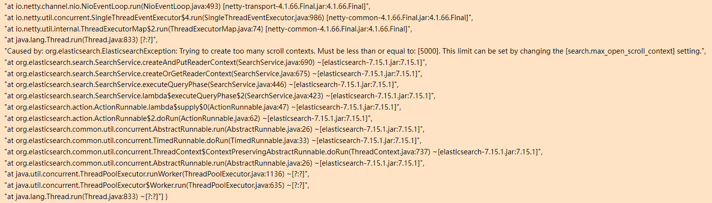

[← 返回 ELK 日志分析目录]({{ '/subjects/ELK/' | relative_url }})



# 08 访问 Elasticsearch

Elasticsearch 通过 HTTP REST API 提供集群管理、索引管理和文档检索。命令行可用 `curl`，图形界面可用 Kibana 的 Dev Tools；下一篇介绍旧环境常见的 Head 与 Cerebro。它们最终都调用同一类 API，不需要把“插件”安装到每个 Elasticsearch 节点。下面的命令以**未启用认证的本机实验环境**为例；开启安全功能的集群应使用 HTTPS、可信 CA 和具有最小权限的凭据。

## 1. 从集群状态定位问题

```bash
ES=http://127.0.0.1:9200
curl -s "$ES/_cluster/health?pretty"
curl -s "$ES/_cat/nodes?v"
curl -s "$ES/_cat/indices?v"
curl -s "$ES/_cat/shards?v"
```

`_cluster/health` 返回机器易解析的 JSON，`_cat/*` 更适合人直接阅读。健康状态含义为：**green** 表示主、副分片均已分配；**yellow** 表示主分片已分配，但有副本未分配，单节点且设置副本时也会出现；**red** 表示至少有主分片未分配，部分数据可能不可读写，并不自动证明数据已永久丢失。即便状态为 green，还要核对 `number_of_nodes` 是否达到预期、是否有写入失败以及磁盘水位。

`_cat/nodes` 的星号表示当前选举出的主节点；`_cat/indices` 的 `pri` 和 `rep` 分别是每个索引的主分片数与副本数。旧教程贴出的几十行真实输出只是某一时刻的快照，读者应运行上述命令观察自己集群的数据，而不是从旧 IP、索引名和文档数推断当前环境。

## 2. 创建索引并检查设置

以下示例统一使用 `books-demo`，避免原文在 `index1`、`index2` 与其他历史索引之间跳转。该索引在双节点以上集群设置 1 个主分片、1 个副本；单节点实验可将副本数改为 0。主分片数应依据数据量和容量规划确定，而非机械等于节点数。

```bash
curl -sS -X PUT "$ES/books-demo" -H 'Content-Type: application/json' -d '{
  "settings": {
    "number_of_shards": 1,
    "number_of_replicas": 1
  },
  "mappings": {
    "properties": {
      "name": {"type": "text", "fields": {"keyword": {"type": "keyword"}}},
      "author": {"type": "keyword"},
      "version": {"type": "keyword"}
    }
  }
}'
curl -s "$ES/books-demo/_settings?pretty"
curl -s "$ES/_cat/shards/books-demo?v"
```

`number_of_replicas` 可以动态调整；主分片数通常不能用普通设置 API 原地修改，需要规划拆分、收缩或重建索引。模板可能覆盖版本默认值，因此以索引实际 `_settings` 为准。节点数据目录使用索引 UUID，**不要通过手工修改目录管理索引**。

## 3. 写入、读取与查询文档

现代版本使用 `/{index}/_doc/{id}` 路径；旧版映射类型路径 `/{index}/{type}/{id}` 属于历史语法，不应与 8.x 示例混用。不指定 ID 时用 POST，让 Elasticsearch 自动生成；指定 ID 时用 PUT，同一个 ID 再次 PUT 会替换整个文档。

```bash
curl -sS -X POST "$ES/books-demo/_doc" -H 'Content-Type: application/json' \
  -d '{"name":"Linux 入门","author":"作者甲","version":"1.0"}'
curl -sS -X PUT "$ES/books-demo/_doc/3?refresh=wait_for" \
  -H 'Content-Type: application/json' \
  -d '{"name":"Go 入门","author":"作者乙","version":"1.0"}'
curl -s "$ES/books-demo/_doc/3?pretty"
```

`refresh=wait_for` 让后续搜索等待刷新；按 ID 的 GET 不依赖搜索刷新。查看全部文档和按 `name` 检索如下：

```bash
curl -s "$ES/books-demo/_search?pretty"
curl -sS -X GET "$ES/books-demo/_search?pretty" \
  -H 'Content-Type: application/json' \
  -d '{"query":{"match":{"name":"Go 入门"}}}'
```

`match` 会分析全文字段，适合 `name`；`term` 不分析查询值，适合精确匹配 `author`、`version` 或 `name.keyword`。因此原文对分词后的 `name` 直接使用 `term` 查询，不能保证得到期望结果。批量按 ID 读取可使用 `_mget`：

```bash
curl -sS -X GET "$ES/_mget?pretty" -H 'Content-Type: application/json' -d '{
  "docs": [
    {"_index":"books-demo","_id":"3"},
    {"_index":"books-demo","_id":"4"}
  ]
}'
```

## 4. 更新与删除

局部更新使用 `_update` 并传入 `doc`；向 `_doc/3` PUT 完整 JSON 则是替换，不等于只修改指定字段。

```bash
curl -sS -X POST "$ES/books-demo/_update/3?refresh=wait_for" \
  -H 'Content-Type: application/json' \
  -d '{"doc":{"version":"2.0"}}'
curl -s "$ES/books-demo/_doc/3?pretty"
curl -sS -X DELETE "$ES/books-demo/_doc/3"
```

删除整个索引前应核对名称、备份与权限，确认不再需要其全部文档：

```bash
curl -sS -X DELETE "$ES/books-demo"
```

原文演示过将 `action.destructive_requires_name` 关闭后删除 `*` 或 `_all`。那会绕过防误删保护，不是学习 CRUD 所需步骤，也可能清除业务索引；本例保持保护开启，只删除明确命名的演示索引。

## 5. 一则查询故障：scroll 上下文耗尽

旧案例的日志截图显示与 scroll 上下文数量相关的异常。它说明“负载看起来不高”仍可能有查询资源耗尽，但**不能仅凭这张截图认定所有搜索故障都是同一原因**。



排查时先读当前 Elasticsearch 日志与报错，再检查使用 scroll 的客户端是否及时清理上下文、`scroll` 保留时长是否过长、是否把 scroll 用于用户实时翻页。需要遍历大量文档时，可按当前版本文档评估 `search_after` 配合 PIT。只有在明确容量评估后才考虑调整 `search.max_open_scroll_context`，不要直接把旧示例的 8000 当作推荐值。

## 6. 集群健康检查脚本

脚本应把连接失败、非 JSON 响应及非 green 状态明确区分。下面只演示本机无认证的实验环境；生产环境的 HTTPS、认证、超时和告警渠道应按现有监控系统配置。

```python
#!/usr/bin/env python3
import json
import sys
import urllib.error
import urllib.request

url = "http://127.0.0.1:9200/_cluster/health"
try:
    with urllib.request.urlopen(url, timeout=5) as response:
        data = json.load(response)
except (urllib.error.URLError, TimeoutError, ValueError) as exc:
    print(f"UNKNOWN: 无法读取集群健康状态：{exc}")
    sys.exit(2)

status = data.get("status")
nodes = data.get("number_of_nodes")
if status == "green":
    print(f"OK: status={status}, nodes={nodes}")
    sys.exit(0)
print(f"WARNING: status={status}, nodes={nodes}, "
      f"unassigned={data.get('unassigned_shards')}")
sys.exit(1)
```

单节点且配置副本时，yellow 可能是预期状态；实际告警阈值还应加入预期节点数和业务索引检查。故意停止节点来验证脚本只适合隔离测试环境。



<nav class="article-end" aria-label="章节导航">
  <a href="{{ '/subjects/ELK/07-installing-elasticsearch.html' | relative_url }}">← 上一篇：安装 Elasticsearch</a>
  <a href="{{ '/subjects/ELK/' | relative_url }}">返回 ELK 日志分析目录</a>
  <a href="{{ '/subjects/ELK/09-elasticsearch-plugins.html' | relative_url }}">下一篇：Elasticsearch 管理工具 →</a>
</nav>
