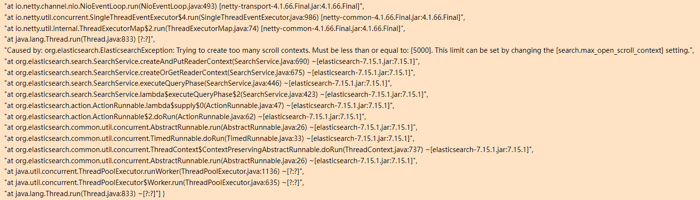

[← 返回ELK 日志分析目录]({{ '/subjects/ELK/' | relative_url }})



# 08 Elasticsearch 访问
### 2.4 Elasticsearch 访问

官方文档

<https://www.elastic.co/guide/en/elasticsearch/reference/master/rest-apis.html>

Elasticsearch  支持各种语言使用 RESTful API 通过端口 9200 与之进行通信，可以用你习惯的 web 客户端访问 Elasticsearch

可以用三种方式和 Elasticsearch进行交互

curl 命令和其它浏览器: 基于命令行,操作不方便插件:  在node节点上安装head,Cerebro 等插件,实现图形操作,查看数据方便 Kibana:  需要java环境并配置,图形操作,显示格式丰富

### Shell 命令

<https://www.elastic.co/guide/en/elasticsearch/reference/current/query-dsl-match-query.html>

<https://nasuyun.com/docs/api/>

Elasticsearch 提供了功能十分丰富、多种表现形式的查询 DSL(Domain Specific Language领域特定语言)语言

DSL 查询使用 JSON 格式的请求体与 Elasticsearch 交互，可以实现各种各样的增删改查等功能

### 查看 ES 集群状态

访问 ES

```text
#查看支持的指令
curl http://127.0.0.1:9200/_cat
#查看es集群状态
curl http://127.0.0.1:9200/_cat/health
curl 'http://127.0.0.1:9200/_cat/health?v'
#查看集群分健康性,获取到的是一个json格式的返回值，那就可以通过python等工具对其中的信息进行分析
#注意：status 字段为green才是正常状态
curl  http://127.0.0.1:9200/_cluster/health?pretty=true
#查看所有的节点信息
curl 'http://127.0.0.1:9200/_cat/nodes?v'
#列出所有的索引 以及每个索引的相关信息
curl 'http://127.0.0.1:9200/_cat/indices?v'
```

范例:

```bash
[root@node1 ~]#curl 127.0.0.1:9200/_cat
=^.^=
/_cat/allocation
/_cat/shards
/_cat/shards/{index}
/_cat/master
/_cat/nodes
/_cat/tasks
/_cat/indices
....
#Master节点
[root@node1 ~]#curl http://127.0.0.1:9200/_cat/master
1bAjwKegT3e7VVyNEmWMCw 10.0.0.201 10.0.0.201 node-1
#集群节点
[root@node1 ~]#curl 'http://127.0.0.1:9200/_cat/nodes'
10.0.0.103 29 93 0 0.16 0.07 0.05 cdfhilmrstw - node-3
10.0.0.102 16 83 0 0.00 0.02 0.00 cdfhilmrstw * node-2
10.0.0.101 18 92 0 0.10 0.11 0.05 cdfhilmrstw - node-1
[root@node1 ~]#curl 'http://127.0.0.1:9200/_cat/nodes?v'
ip         heap.percent ram.percent cpu load_1m load_5m load_15m node.role
master name
10.0.0.103           29          93   0    0.19    0.07     0.05 cdfhilmrstw -
node-3
10.0.0.102           16          83   0    0.00    0.02     0.00 cdfhilmrstw *
node-2
10.0.0.101           16          92   0    0.12    0.12     0.05 cdfhilmrstw -
node-1
[root@node1 ~]#curl 'http://127.0.0.1:9200/_cat/nodes?human'
10.0.0.103 29 93 0 0.16 0.07 0.05 cdfhilmrstw - node-3
10.0.0.102 16 83 0 0.00 0.02 0.00 cdfhilmrstw * node-2
10.0.0.101 17 92 3 0.11 0.12 0.05 cdfhilmrstw - node-1
#查看es集群状态
[root@es-node1 ~]#curl 'http://127.0.0.1:9200/_cat/health'
1629117359 12:35:59 es-cluster green 3 3 6 3 0 0 0 0 - 100.0%
[root@es-node1 ~]#curl '127.0.0.1:9200/_cat/health?v'
epoch      timestamp cluster    status node.total node.data shards pri relo init
unassign pending_tasks max_task_wait_time active_shards_percent
1612877997 13:39:57  es-cluster green           3         3     80  40    0    0
0             0                  -                100.0%
[root@es-node1 ~]#curl -sXGET http://127.0.0.1:9200/_cluster/health?pretty=true
{
"cluster_name" : "es-cluster",
"status" : "green",
"timed_out" : false,
"number_of_nodes" : 3,
"number_of_data_nodes" : 3,
"active_primary_shards" : 6,
"active_shards" : 12,
"relocating_shards" : 0,
"initializing_shards" : 0,
"unassigned_shards" : 0,
"delayed_unassigned_shards" : 0,
"number_of_pending_tasks" : 0,
"number_of_in_flight_fetch" : 0,
"task_max_waiting_in_queue_millis" : 0,
"active_shards_percent_as_number" : 100.0
}
#查看所有的节点信息
[root@es-node1 ~]#curl '127.0.0.1:9200/_cat/nodes?v'
ip         heap.percent ram.percent cpu load_1m load_5m load_15m node.role
master name
10.0.0.101           20          44   0    0.03    0.02     0.00 dilm      -
es-node1
10.0.0.102           27          97   4    0.29    0.14     0.10 dilm      -
es-node2
10.0.0.103           20          96   0    0.00    0.00     0.00 dilm      *
es-node3
#列出所有的索引 以及每个索引的相关信息
[root@es-node1 ~]#curl '127.0.0.1:9200/_cat/indices?v'
health status index                                  uuid                   pri
rep docs.count docs.deleted store.size pri.store.size
green  open   nginx-accesslog-0.107-2021.02.04       fSg_AiIOSaeYPVrjCEABBg   1
1        593            0    367.8kb        204.1kb
green  open   nginx-accesslog-0.107-2021.02.03       Hxj6RKkhTIWrW-7b7WE-iw   1
1       1393            0    562.7kb        281.3kb
green  open   nginx-accesslog-0.107-2021.02.02       8SSfUh5wT0WWcBxAa0UrCQ   1
1       1181            0    572.8kb        286.4kb
green  open   logfile-2021.01.26                     cBxWy995SrS9LAET660t9w   1
1       1110            0    496.2kb        248.1kb
green  open   redis-syslog-0.107-2021.02.09          aaw2g8MBSberZFZKCHMQyg   1
1       6313            0      7.6mb          3.7mb
green  open   metricbeat-7.6.2-2021.02.07-000001     MSq7BXQ6TXWFfvKkSzFUlQ   1
1     116861            0     70.3mb         35.2mb
green  open   linux-syslog-tomcat-2021.01.31         6booHIoiThyoui00cmqzOA   1
1      11829            0        5mb          2.5mb
green  open   linux-2021.01.31                       VGGXaz38R0meynC6ciUcOQ   1
1      38309            0     11.8mb          5.9mb
green  open   linux-2021.02.02                       UkJA4drJRNG3AvNw5cB-dQ   1
1       5824            0      3.7mb          1.8mb
green  open   .kibana_task_manager_1                 s1zixAaTTX6Zwe1pSFAujw   1
1          2            1     47.7kb         26.8kb
green  open   linux-2021.02.01                       R1YNBVR8TjW1pYk85UNDBw   1
1       3361            0      1.9mb        997.6kb
green  open   linux-2021.02.07                       iVWNy0iaT8qggnVVrNVJaA   1
1       5688            0      3.7mb          1.8mb
green  open   linux-2021.02.04                       xchTONa5TuWtaiOxK3xQVg   1
1       5318            0      3.4mb          1.7mb
green  open   heartbeat-7.6.2-2021.02.07-000001      NoX252O_RkefMbxAB0Xkqg   1
1      14871            0      8.3mb          4.1mb
green  open   linux-2021.02.09                       r1asaolISzyDRJCfmrwanQ   1
1       3447            0        2mb            1mb
green  open   syslog-0.104-2021.02.09                z9bhHeATTnyc89juzyOz5A   1
1       3447            0      2.1mb            1mb
green  open   filebeat-7.6.2-2021.02.07-000001       grcnt8nyRUa8tta8vbHA-A   1
1      17156            0      5.8mb          2.9mb
green  open   .apm-agent-configuration               o8F-g6SXRSaMGYWXMF_gCg   1
1          0            0       566b           283b
green  open   syslog-redis-0.107-2021.02.09          J23OBOm_RR6fXN2Iask-fw   1
1        208            0    405.8kb        221.6kb
green  open   java-error-log-0.107-2021.05           3k-_LqHJSjugaou0R2UBpQ   1
1        320            0    353.6kb        170.6kb
green  open   redis-nginx-errorlog-0.107-2021.02.09  LiJqBQ4fTnG08wEV9bbvGQ   1
1         11            0    192.8kb        106.1kb
green  open   .kibana_1                              a3GysbtUS7WlEyeLKuVsvg   1
1         35            9    480.7kb        240.3kb
green  open   syslog-0.107-2021.02.04                kz7RCKXtTPa8EqjNATi0ng   1
1       2586            0      1.5mb        769.1kb
green  open   syslog-0.107-2021.02.07                noUBswW2QFSLIt9B_0Eyzg   1
1       1913            0        1mb        537.1kb
green  open   redis-nginx-accesslog-0.107-2021.02.09 pG1f2h_NRUi7VdG9XeqCDg   1
1         18            0    283.4kb        154.4kb
green  open   bowen-index2                          32A1_WR4QEKmTfKFe61JjA   1
1          0            0       566b           283b
green  open   ilm-history-1-000001                   tEhIudx1SUGEKjI5VUzcTw   1
1         36            0    100.7kb         50.3kb
green  open   bowen-index1                          TPUrqHNdRT2lCNVPMPF2eg   5
1          0            0      2.7kb          1.3kb
green  open   syslog-0.104-2021.02.01                PyL3mHqJRRuznGu5P-wNjQ   1
1       3361            0      1.9mb       1017.5kb
green  open   nginx-errorlog-0.107-2021.02.04        -8h-9e1GSJyitqI9kIkQVg   1
1          6            0     19.9kb          9.9kb
green  open   syslog-haproxy-0.107-2021.02.04        XKsuoHPKQR27LdGttZRUiA   1
1        132            0    205.8kb        102.9kb
green  open   syslog-0.104-2021.02.02                M0p-uU4XTViN6TJDx10hkw   1
1       5824            0      3.7mb          1.8mb
green  open   syslog-haproxy-0.107-2021.02.07        mz_fap9DTpGIb9Y_dhr6MQ   1
1       1913            0        1mb        514.3kb
green  open   syslog-0.104-2021.02.04                MFjeKZsnR0u1R3onL_2zxA   1
1       5318            0      3.4mb          1.7mb
green  open   nginx-errorlog-redis-0.107-2021.02.09  V8No1ik3T6mN2FLdDnKYiA   1
1          1            0     41.2kb         20.6kb
green  open   syslog-0.104-2021.02.07                pXl_MaBkRTi4j7ilt65kPA   1
1       5688            0      3.6mb          1.8mb
#查看指定索引信息
[root@es-node1 ~]#curl -XPOST '127.0.0.1:9200/nginx-errorlog-0.107-
2021.02.04/_search?pretty'
{
"took" : 7,
"timed_out" : false,
"_shards" : {
"total" : 1,
"successful" : 1,
"skipped" : 0,
"failed" : 0
},
```

### 创建和查看索引

<https://www.elastic.co/guide/en/elasticsearch/reference/current/indices-create-index.html>

范例:

```json
#elasticsearch 7.X 默认创建1个分片1个副本,之前版本默认5分版1副本
#创建索引index1,简单输出
[root@node1 ~]#curl -XPUT '127.0.0.1:9200/index1'
{"acknowledged":true,"shards_acknowledged":true,"index":"index1"}
#创建索引index2,格式化输出
[root@node1 ~]#curl -XPUT '127.0.0.1:9200/index2?pretty'
{
"acknowledged" : true,
"shards_acknowledged" : true,
"index" : "index2"
}
#查看所有索引
[root@es-node1 ~]#curl 'http://127.0.0.1:9200/_cat/indices?v'
[root@node1 ~]#curl  '127.0.0.1:9200/index1?pretty'
{
"index1" : {
"aliases" : { },
"mappings" : { },
"settings" : {
"index" : {
"routing" : {
"allocation" : {
"include" : {
"_tier_preference" : "data_content"
}
}
},
"number_of_shards" : "1",
"provided_name" : "index1",
"creation_date" : "1629086229360",
"number_of_replicas" : "1",
"uuid" : "t-t7GOq0RSOig6a1Fjv5Ug",
"version" : {
"created" : "7140099"
}
}
}
}
}
#创建3个分片和2个副本的索引
[root@node1 ~]#curl -XPUT '127.0.0.1:9200/index2' -H 'Content-Type:
application/json' -d '
{
"settings": {
"index": {
"number_of_shards": 3,
"number_of_replicas": 2
}
}
}'
{"acknowledged":true,"shards_acknowledged":true,"index":"index2"}
#调整副本数为1,但不能调整分片数
[root@node1 ~]#curl -XPUT '127.0.0.1:9200/index2/_settings' -H 'Content-Type:
application/json' -d '
{
"settings": {
"number_of_replicas": 1
}
}'
{"acknowledged":true}
#早期版本，如es1.X,2.X可以直在下面数据目录下直接看到index的名称，5.X版本后只会显示下面信息
#说明：TPUrqHNdRT2lCNVPMPF2eg表示索引ID
#/var/lib/elasticsearch/indices/索引ID/分片ID
[root@es-node1 ~]#ll /data/es-data/nodes/0/indices/
total 12
drwxr-xr-x 3 elasticsearch elasticsearch 4096 Jan 26 23:19 ./
drwxr-xr-x 4 elasticsearch elasticsearch 4096 Jan 26 23:19 ../
drwxr-xr-x 7 elasticsearch elasticsearch 4096 Jan 26 23:19
TPUrqHNdRT2lCNVPMPF2eg/
[root@es-node2 ~]#ll /data/es-data/nodes/0/indices/
total 20
drwxr-xr-x 5 elasticsearch elasticsearch 4096 Jan 26 23:49 ./
drwxr-xr-x 4 elasticsearch elasticsearch 4096 Jan 26 23:15 ../
drwxr-xr-x 4 elasticsearch elasticsearch 4096 Jan 26 23:15
32A1_WR4QEKmTfKFe61JjA/
drwxr-xr-x 4 elasticsearch elasticsearch 4096 Jan 26 23:49
cBxWy995SrS9LAET660t9w/
drwxr-xr-x 6 elasticsearch elasticsearch 4096 Jan 26 23:19
TPUrqHNdRT2lCNVPMPF2eg/
[root@es-node3 ~]#ll /data/es-data/nodes/0/indices/
total 20
drwxr-xr-x 5 elasticsearch elasticsearch 4096 Jan 26 23:49 ./
drwxr-xr-x 4 elasticsearch elasticsearch 4096 Jan 26 23:15 ../
drwxr-xr-x 4 elasticsearch elasticsearch 4096 Jan 26 23:15
32A1_WR4QEKmTfKFe61JjA/
drwxr-xr-x 4 elasticsearch elasticsearch 4096 Jan 26 23:49
cBxWy995SrS9LAET660t9w/
drwxr-xr-x 6 elasticsearch elasticsearch 4096 Jan 26 23:19
TPUrqHNdRT2lCNVPMPF2eg/
```

### 插入文档

范例:

```json
#创建文档时不指定_id，会自动生成
#8.X版本后因为删除了type,所以索引操作：{index}/{type}/需要修改成PUT {index}/_doc/
#index1是索引数据库,book是type
#8.X版本之后
[root@node1 ~]#curl -XPOST http://127.0.0.1:9200/index1/_doc/ -H 'Content-Type:
application/json' -d '{"name":"linux", "author": "bowenxiaochun", "version":
"1.0"}'
{"_index":"index1","_id":"lUoyZ4YB_OQHDsGwVbGC","_version":1,"result":"created",
"_shards":{"total":2,"successful":2,"failed":0},"_seq_no":0,"_primary_term":1}
#7.X之前
[root@node1 ~]#curl -XPOST http://127.0.0.1:9200/index1/book/ -H 'Content-Type:
application/json' -d '{"name":"linux", "author": "bowenxiaochun", "version":
"1.0"}'
{"_index":"index1","_type":"book","_id":"isQ3TXsB1gLtFVg76of5","_version":1,"res
ult":"created","_shards":
{"total":2,"successful":2,"failed":0},"_seq_no":0,"_primary_term":1}
```

```json
[root@node1 ~]#curl -XPOST 'http://127.0.0.1:9200/index1/_doc?pretty' -H
'Content-Type: application/json' -d '{"name":"python", "author": "xuwei",
"version": "1.0"}'
{
"_index" : "index1",
"_type" : "book",
"_id" : "i8Q5TXsB1gLtFVg7vodl",
"_version" : 1,
"result" : "created",
"_shards" : {
"total" : 2,
"successful" : 2,
"failed" : 0
},
"_seq_no" : 1,
"_primary_term" : 1
}
#创建文档时指定_id为3
#index1是索引数据库,book是type,3是document记录
[root@node1 ~]#curl -XPOST 'http://127.0.0.1:9200/index1/_doc/3?pretty' -H
'Content-Type: application/json' -d '{"name":"golang", "author": "zhang",
"version": "1.0"}'
[root@node1 ~]#curl -XPOST 'http://127.0.0.1:9200/index1/book/3?pretty' -H
'Content-Type: application/json' -d '{"name":"golang", "author": "zhang",
"version": "1.0"}'
{
"_index" : "index1",
"_type" : "book",
"_id" : "3",
"_version" : 1,
"result" : "created",
"_shards" : {
"total" : 2,
"successful" : 2,
"failed" : 0
},
"_seq_no" : 2,
"_primary_term" : 1
}
#数据存放的磁盘位置
[root@node1 ~]#tree /data/es-data/ -d
/data/es-data/
└── nodes
└── 0
├── indices
│   ├── KnAuNXCPQS6CqzqXY3Plgw
│   │   ├── 0
│   │   │   ├── index
│   │   │   ├── _state
│   │   │   └── translog
│   │   └── _state
│   └── t-t7GOq0RSOig6a1Fjv5Ug
│       ├── 0
│       │   ├── index
│       │   ├── _state
│       │   └── translog
│       └── _state
├── snapshot_cache
└── _state
17 directories
```

### 查询文档

范例:

```json
#查询索引的中所有文档
[root@node1 ~]#curl  'http://127.0.0.1:9200/index1/_search?pretty'
{
"took" : 4,
"timed_out" : false,
"_shards" : {
"total" : 1,
"successful" : 1,
"skipped" : 0,
"failed" : 0
},
"hits" : {
"total" : {
"value" : 3,
"relation" : "eq"
},
"max_score" : 1.0,
"hits" : [
{
"_index" : "index1",
"_type" : "book",
"_id" : "isQ3TXsB1gLtFVg76of5",
"_score" : 1.0,
"_source" : {
"name" : "linux",
"author" : "bowenxiaocohun",
"version" : "1.0"
}
},
{
"_index" : "index1",
"_type" : "book",
"_id" : "i8Q5TXsB1gLtFVg7vodl",
"_score" : 1.0,
"_source" : {
"name" : "python",
"author" : "wuwei",
"version" : "1.0"
}
},
{
"_index" : "index1",
"_type" : "book",
"_id" : "3",
"_score" : 1.0,
"_source" : {
"name" : "golang",
"author" : "zhang",
"version" : "1.0"
}
}
]
}
}
#指定ID查询
#curl -XGET 'http://127.0.0.1:9200/{index}/{type}/{id}'
#8.X版: curl -XGET 'http://127.0.0.1:9200/{index}/_doc/{id}'
#新版本
[root@node1 ~]#curl  'http://127.0.0.1:9200/index1/_doc/3?pretty'
#旧版本
[root@node1 ~]#curl  'http://127.0.0.1:9200/index1/book/3?pretty'
{
"_index" : "index1",
"_type" : "book",
"_id" : "3",
"_version" : 1,
"_seq_no" : 2,
"_primary_term" : 1,
"found" : true,
"_source" : {
"name" : "golang",
"author" : "zhang",
"version" : "1.0"
}
}
#按条件进行查询,两种方式
#新版
[root@node1 ~]#curl  'http://127.0.0.1:9200/index1/_search?q=name:linux&pretty'
[root@node1 ~]#curl -s  http://127.0.0.1:9200/index1/_search?pretty -H 'Content-
Type: application/json' -d '{"query":{"term":{"name":"linux"}}}'
#结果显示如下
{
"took" : 1,
"timed_out" : false,
"_shards" : {
"total" : 1,
"successful" : 1,
"skipped" : 0,
"failed" : 0
},
"hits" : {
"total" : {
"value" : 2,
"relation" : "eq"
},
"max_score" : 0.6931471,
"hits" : [
{
"_index" : "index1",
"_id" : "BcQ_vIcBSG2P0YRg254g",
"_score" : 0.6931471,
"_source" : {
"name" : "linux",
"author" : "bowenxiaochun",
"version" : "1.0"
}
},
{
"_index" : "index1",
"_id" : "B8R5vIcBSG2P0YRgwp52",
"_score" : 0.6931471,
"_source" : {
"name" : "linux",
"author" : "bowenxiaochun",
"version" : "1.0"
}
}
]
}
}
```

```json
#旧版
[root@node1 ~]#curl  'http://127.0.0.1:9200/index1/book/_search?
q=name:linux&pretty'
{
"took" : 4,
"timed_out" : false,
"_shards" : {
"total" : 1,
"successful" : 1,
"skipped" : 0,
"failed" : 0
},
"hits" : {
"total" : {
"value" : 1,
"relation" : "eq"
},
"max_score" : 0.9808291,
"hits" : [
{
"_index" : "index1",
"_type" : "book",
"_id" : "isQ3TXsB1gLtFVg76of5",
"_score" : 0.9808291,
"_source" : {
"name" : "linux",
"author" : "bowenxiaocohun",
"version" : "1.0"
}
}
]
}
}
#批量查询
GET /_mget
{
"docs" : [
{
"_index" : "test",
"_type" : "_doc",
"_id" : "1"
},
{
"_index" : "test",
"_type" : "_doc",
"_id" : "2"
}
]
}
```

### 更新文档

范例:

```json
#8.X
[root@node1 ~]#curl -XPOST 'http://127.0.0.1:9200/index1/_doc/3' -H 'Content-
Type: application/json' -d '{"version": "2.0","name":"golang","author": "zhang"}'
#7.X之前
[root@node1 ~]#curl -XPOST 'http://127.0.0.1:9200/index1/book/3' -H 'Content-
Type: application/json' -d '{"version": "2.0","name":"golang","author": "zhang"}'
{"_index":"index1","_type":"book","_id":"3","_version":3,"result":"updated","_sh
ards":{"total":2,"successful":2,"failed":0},"_seq_no":5,"_primary_term":1}
[root@node1 ~]#curl  'http://127.0.0.1:9200/index1/_doc/3?pretty'
[root@node1 ~]#curl  'http://127.0.0.1:9200/index1/book/3?pretty'
{
"_index" : "index1",
"_type" : "book",
"_id" : "3",
"_version" : 3,
"_seq_no" : 5,
"_primary_term" : 1,
"found" : true,
"_source" : {
"version" : "2.0",
"name" : "golang",
"author" : "zhang"
}
}
```

### 删除文档

```text
#8.X版本
curl -XDELETE http://ES服务器:9200/<索引名称>/_doc/<文档id>
#7.X版本前
curl -XDELETE http://ES服务器:9200/<索引名称>/type/<文档id>
```

范例: 删除指定文档

```json
#8.X
[root@node1 ~]#curl -XDELETE 'http://127.0.0.1:9200/index1/_doc/3'
{"_index":"index1","_id":"3","_version":2,"result":"deleted","_shards":
{"total":2,"successful":1,"failed":0},"_seq_no":4,"_primary_term":1}
#确认已删除
[root@node1 ~]#curl  'http://127.0.0.1:9200/index1/_doc/3?pretty'
{
"_index" : "index1",
"_id" : "3",
"found" : false
}
#7.X版本前
[root@node1 ~]#curl -XDELETE
'http://127.0.0.1:9200/index1/book/i8Q5TXsB1gLtFVg7vodl'
{"_index":"index1","_type":"book","_id":"i8Q5TXsB1gLtFVg7vodl","_version":2,"res
ult":"deleted","_shards":
{"total":2,"successful":2,"failed":0},"_seq_no":3,"_primary_term":1
```

### 删除索引

范例:删除指定索引

```bash
[root@es-node1 ~]#curl -XDELETE http://127.0.0.1:9200/index2
{"acknowledged":true}
#查看索引是否删除
[root@es-node1 ~]#curl 'http://127.0.0.1:9200/_cat/indices?pretty'
#删除多个指定索引
curl -XDELETE 'http://127.0.0.1:9200/index_one,index_two
#删除通配符多个索引,需要设置action.destructive_requires_name: false
curl -XDELETE 'http://127.0.0.1:9200/index_*'
```

范例: 删除所有索引

```bash
#在集群所有节点上设置action.destructive_requires_name: false
[root@es-node1 ~]#vim /etc/elasticsearch/elasticsearch.yml
#最后加一行
#----------------------- END SECURITY AUTO CONFIGURATION ------------------------
-
action.destructive_requires_name: false
#危险命令
[root@es-node1 ~]#curl -X DELETE "http://127.0.0.1:9200/*"
[root@es-node1 ~]#curl -X DELETE "127.0.0.1:9200/_all"
#以下无需配置
[root@es-node1 ~]#for i in `curl 'http://127.0.0.1:9200/_cat/indices?v'|awk
'{print $3}'`;do curl -XDELETE http://127.0.0.1:9200/$i;done
```

### 生产故障

```text
#故障说明:负载不高，但是有的索引会查询不出来,查看到下面的日志信息
```



```bash
#原因说明:在Elasticsearch中，search.max_open_scroll_context 参数用于限制集群中可以同时打
开的 scroll 上下文的数量。这个参数的默认值在不同版本的 Elasticsearch 中可能会有所不同，但根
据搜索结果显示，在某些版本的 Elasticsearch 中，默认值可能是 500  或 2000 。这个默认值是为了
防止过多的 scroll 上下文同时打开导致资源耗尽。如果需要处理大量的数据，可能需要根据实际情况调整
这个参数的值。
#查询默认值
[root@ubuntu2204 ~]#curl -X GET localhost:9200/_cluster/settings
{"persistent":{},"transient":{}}
#集群只需要在一个节点修改此值
[root@ubuntu2204 ~]#curl -X PUT localhost:9200/_cluster/settings -H 'Content-
Type: application/json' -d'{"persistent" : {"search.max_open_scroll_context":
8000}, "transient": {"search.max_open_scroll_context": 8000}}'
#验证结果
[root@ubuntu2204 ~]#curl -X GET localhost:9200/_cluster/settings
{"persistent":{"search":{"max_open_scroll_context":"8000"}},"transient":
{"search":{"max_open_scroll_context":"8000"}}}
```

### Python 脚本：集群健康性检查

```bash
[root@es-node1 ~]# apt -y install python3
[root@es-node1 ~]# cat es-cluster-monitor.py
#!/usr/bin/python3
#coding:utf-8
from email.mime.text import MIMEText
from email.utils import formataddr
import smtplib
import subprocess
import json
body = ""
false="false"
#用另外一个进程运行curl返回结果从stdout中读取
obj = subprocess.Popen(("curl -sXGET http://127.0.0.1:9200/_cluster/health?
pretty=true"),shell=True, stdout=subprocess.PIPE) #
data = obj.stdout.read()
#print(type(data)) # 应该是字符串类型或bytes类型
#print(data) # 确认返回的json形式的
es_dict = json.loads(data) if data else {}  # 把json字符串解析为字典
status = es_dict.get("status") # 通过字典查找status
if status == "green":
print("OK")
else:
print("Not OK")
```

```bash
[root@es-node1 ~]# chmod +x es-cluster-monitor.py
[root@es-node1 ~]#./es-cluster-monitor.py
OK
#将第二个节点停止服务
[root@es-node2 ~]# systemctl stop elasticsearch
#再次查看状态
[root@es-node1 ~]# python es-cluster-monitor.py
Not OK
```



<nav class="article-end" aria-label="章节导航">
  <a href="{{ '/subjects/ELK/07-installing-elasticsearch.html' | relative_url }}">← Previous: Installing Elasticsearch</a>
  <a href="{{ '/subjects/ELK/' | relative_url }}">Back to ELK Log Analytics Index</a>
  <a href="{{ '/subjects/ELK/09-elasticsearch-plugins.html' | relative_url }}">Next: Elasticsearch Plugins →</a>
</nav>
