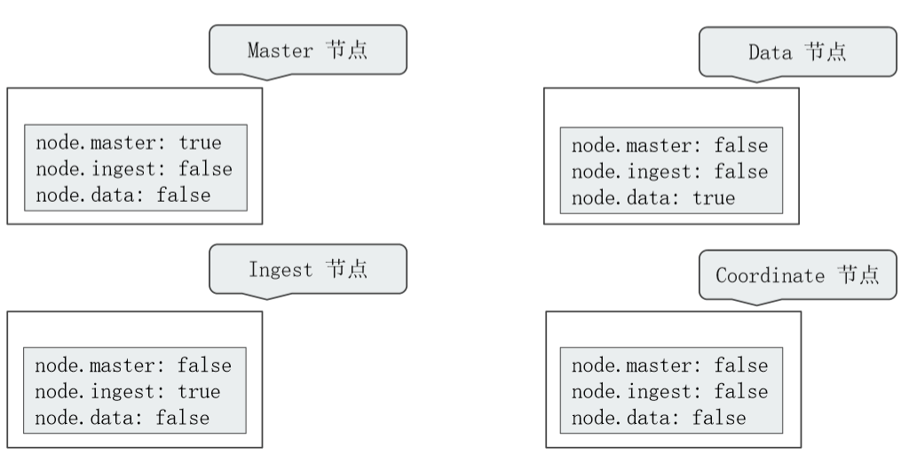
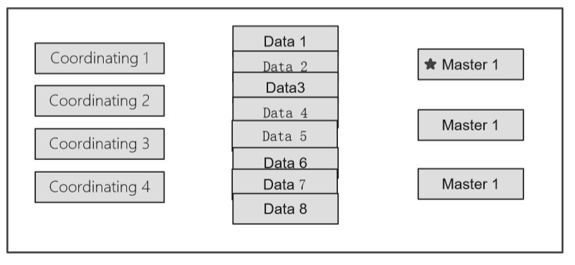
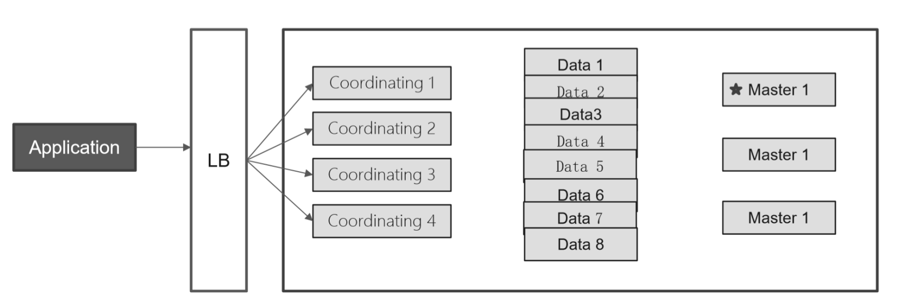
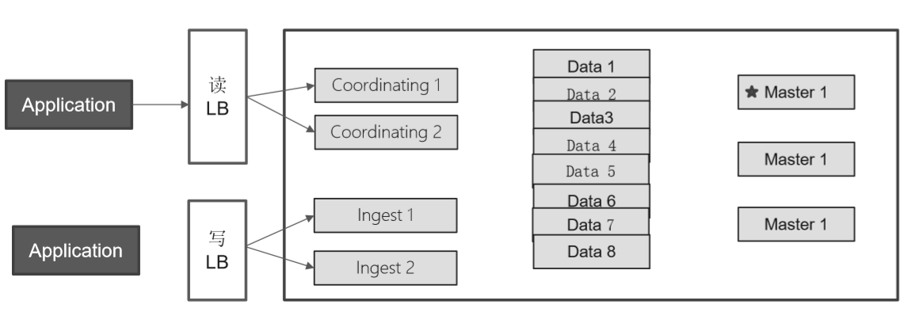
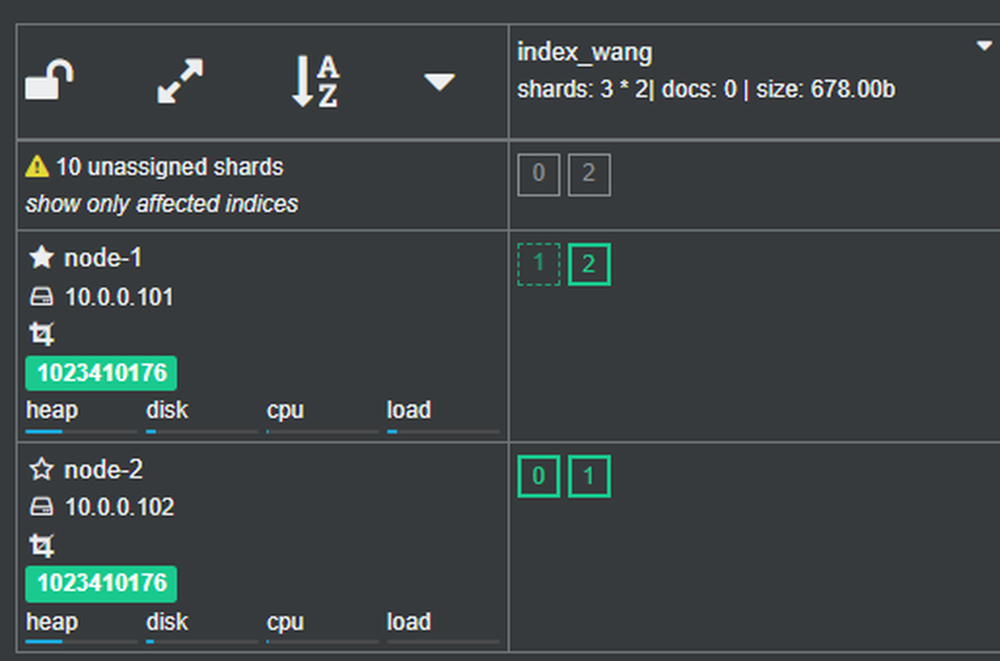
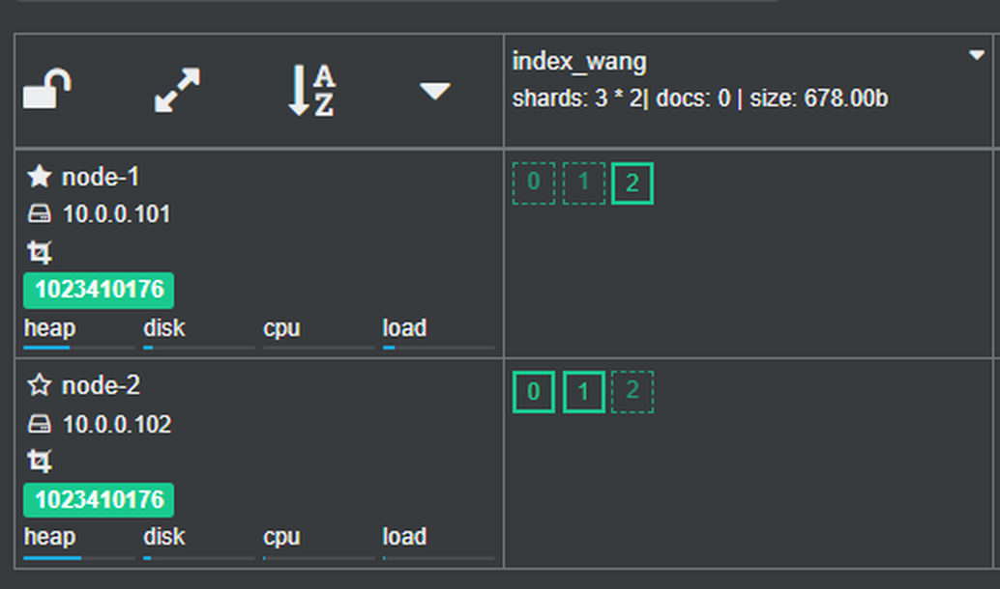
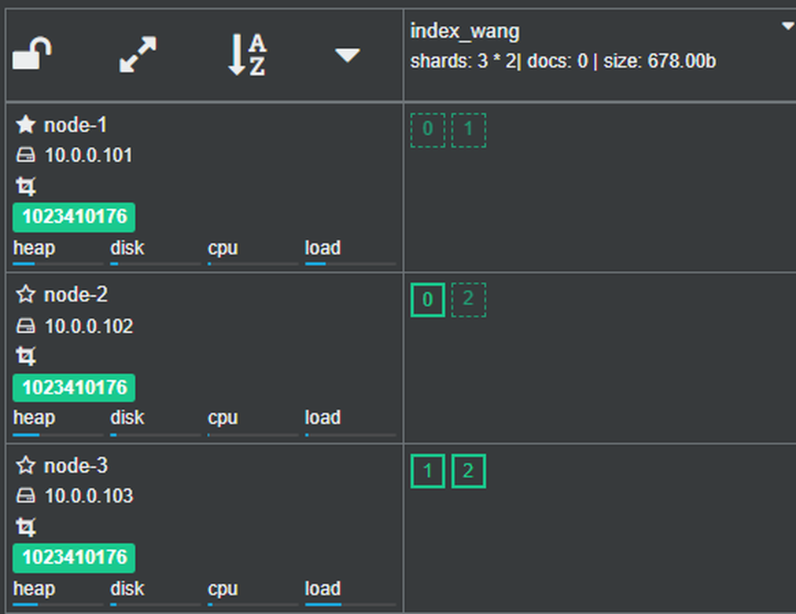
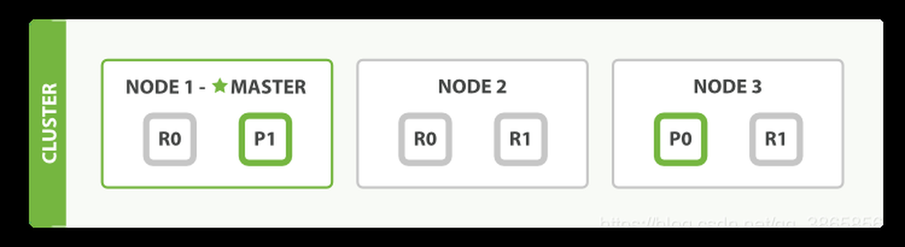
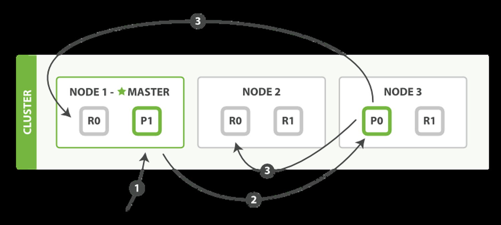
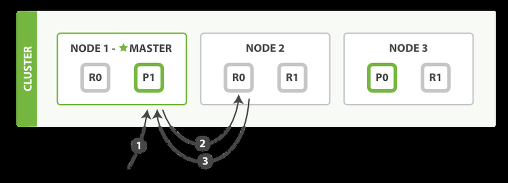

[← 返回ELK 日志分析目录]({{ '/subjects/ELK/' | relative_url }})



# 10 Elasticsearch 集群工作原理
### 2.6 Elasticsearch 集群工作原理

参考：[Elasticsearch 官方文档](https://www.elastic.co/guide/en/elasticsearch/reference/current/index.html)。以下以现代版本的节点角色和分片概念说明工作原理；不同大版本的配置项可能不同，不要把旧版 `node.master`、`node.data` 与当前 `node.roles` 混用。

### 2.6.1 集群、节点与角色

多个节点组成一个 Elasticsearch 集群。集群可以分散数据与查询负载，也能通过副本提高可用性，但扩容并不会自动保证“PB 级容量”或所有故障都无影响；索引设计、磁盘、网络和副本策略仍是关键。

| 角色 | 主要职责 |
| --- | --- |
| 主节点（master） | 发布集群状态，处理索引与分片分配等集群级变更；同一时刻通常有一个被选出的主节点。 |
| 具备主节点资格（master-eligible） | 参与集群协调和选举；生产环境通常规划多个候选节点以避免单点。 |
| 数据节点（data / 数据层角色） | 保存主分片和副本分片，执行与数据相关的索引和查询工作。 |
| 摄取节点（ingest） | 执行摄取管道，在写入前解析或转换文档。 |
| 仅协调节点 | 不承担数据、主节点等角色，但接收请求并汇总其他节点的结果。所有节点本身都有一定协调能力。 |
| 机器学习等专门角色 | 执行对应功能，是否可用与发行版和许可证有关。 |



现代版本可在 `elasticsearch.yml` 中通过 `node.roles` 指定角色，例如 `node.roles: [data, ingest]`；仅协调节点可设置 `node.roles: []`。仅协调节点仍需要内存处理查询汇总，不能简单按“低配置节点”规划。小集群可以让节点兼任角色；规模扩大后再按负载分离主节点、数据节点与摄取/协调节点。







### 2.6.2 集群状态与主节点选举

主节点负责发布集群状态，其他节点据此了解节点成员、索引元数据与分片位置。`cluster.initial_master_nodes` 只用于**首次引导新集群**，不是每次新增节点或故障转移时要修改的“候选节点列表”。当前 Elasticsearch 使用集群协调机制处理选举；原资料对旧版 Zen Discovery、`minimum_master_nodes` 和固定 Node ID 排序的叙述不适用于所有现代版本。

候选主节点能否形成法定多数，会影响是否能选出主节点和继续执行集群级操作。但“损坏超过一半节点则整个集群必然无法服务”也过于绝对：还要看哪些节点失效、是否丢失主分片以及客户端请求类型。生产运维应监控候选主节点和集群健康状态，而非只看总节点数。

### 2.6.3 主分片、副本与健康状态

一个索引由若干**主分片**构成，每个主分片可有零个或多个**副本分片**。副本应尽量位于不同节点，既可承担部分读取，也可在主分片失效时被提升。副本不是独立备份：误删除、错误写入或集群级故障仍需可恢复的快照。

| 状态 | 含义 |
| --- | --- |
| 绿色 | 主分片与要求的副本都已分配。 |
| 黄色 | 所有主分片已分配，但至少一个副本尚未分配。 |
| 红色 | 至少一个主分片未分配，相关数据可能不可用。 |

主分片数在创建索引时确定，不能像副本数那样随意在线修改；调整通常涉及拆分、收缩或重建索引。分片过多会增加元数据和资源开销，并非越多越快。不要把旧版默认分片数当作所有版本的固定默认值。可以用**限定前缀**的组合索引模板统一新索引设置，而不是把模板模式写成 `*` 影响整个集群：

```http
PUT /_index_template/logs-default
{
  "index_patterns": ["logs-*"],
  "template": {
    "settings": {
      "number_of_shards": 3,
      "number_of_replicas": 1
    }
  }
}
```

这里的数字仅是示例，应根据数据量、节点数和恢复目标选择。分片迁移期间可用 `_cat/shards` 和 `_cluster/health` 观察进度。

### 2.6.4 故障转移与请求路由


假设三节点集群中一台节点失效，若其上有主分片，而其他节点保留对应可用副本，集群可提升副本为新的主分片；随后再创建缺失的副本。过程中健康状态可能先为红色或黄色，再恢复为绿色，但具体状态取决于哪些分片仍可用、分配约束和剩余磁盘空间，不能预设每次都走同一顺序。








客户端可以把请求发给集群中可达的节点，由接收请求的节点协调。文档的默认路由由 `_id` 决定，也可显式指定 `_routing`；它会把文档定位到某个主分片。可用“对路由值哈希，再映射到主分片”理解基本思路，但实际算法还受分区路由等设置影响，不能把一条简化取模公式当作完整实现。



写入时，协调节点定位主分片，主分片处理操作并复制到副本；何时向客户端确认与当前配置、活跃分片及失败情况有关，不能笼统说“主分片写完就总会立即确认”。读取文档可由合适的主/副本分片承担。搜索通常先在相关分片执行查询，再由协调节点汇总结果；复杂聚合可能消耗大量协调节点内存。





**写入确认、持久化与搜索可见性是三个不同问题。** `refresh` 让新数据可被搜索到，通常存在短暂延迟；它不是主副本复制的替代品，也不是灾难恢复备份。排查“写入成功但立即搜索不到”时，应先确认刷新行为和查询条件，再调查分片故障。



<nav class="article-end" aria-label="章节导航">
  <a href="{{ '/subjects/ELK/09-elasticsearch-plugins.html' | relative_url }}">← 上一篇：Elasticsearch 插件</a>
  <a href="{{ '/subjects/ELK/' | relative_url }}">返回 ELK 日志分析目录</a>
  <a href="{{ '/subjects/ELK/11-scaling-elasticsearch-clusters.html' | relative_url }}">下一篇：Elasticsearch 集群扩容和缩容 →</a>
</nav>
