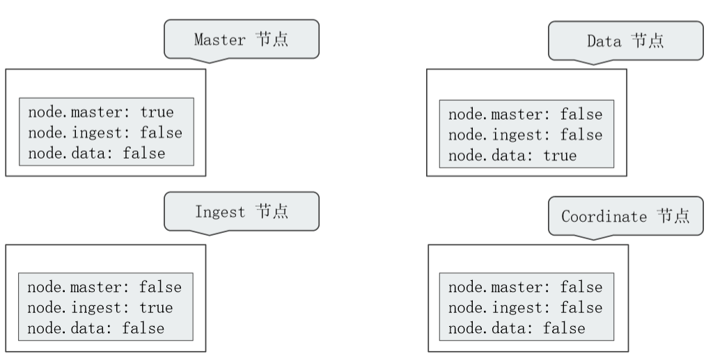
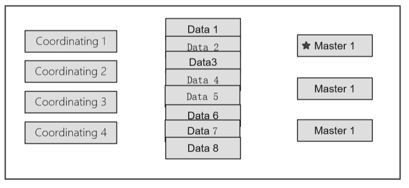
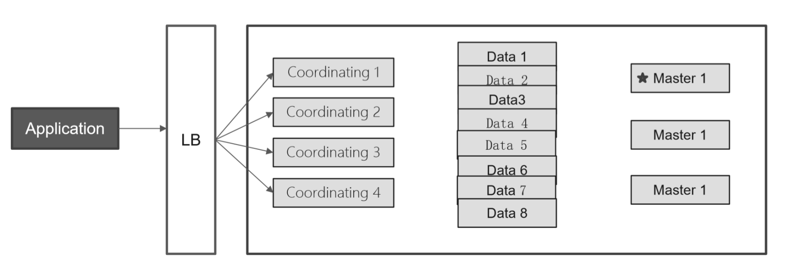
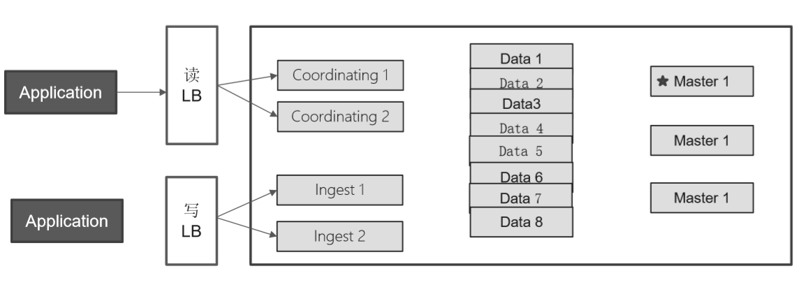
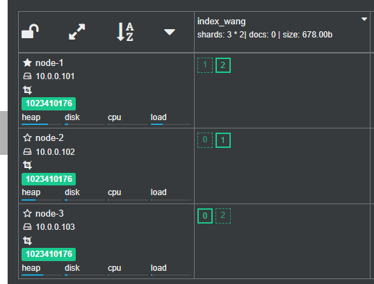
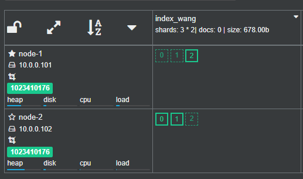
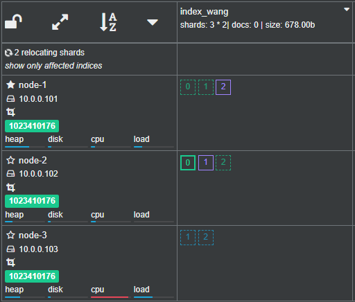
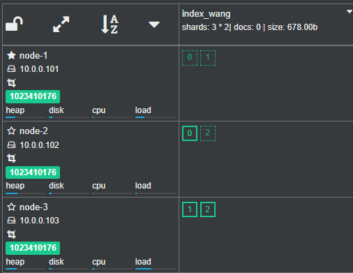
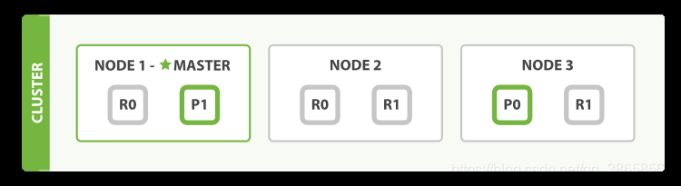
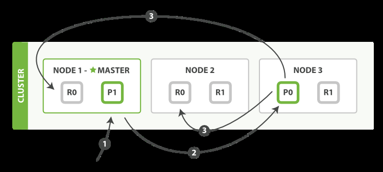

[← 返回ELK 日志分析目录]({{ '/subjects/ELK/' | relative_url }})



# 10 Elasticsearch 集群工作原理
### 2.6 Elasticsearch 集群工作原理

官方说明

<https://www.elastic.co/guide/en/elasticsearch/reference/current/index.html>

单机节点 ES 存在单点可用性和性能问题,可以实现Elasticsearch多机的集群解决

Elasticsearch 支持集群模式

能够提高Elasticsearch可用性，即使部分节点停止服务，整个集群依然可以正常服务能够增大Elasticsearch的性能和容量，如内存、磁盘，使得Elasticsearch集群可以支持PB级的数据

### ES 节点分类和规划

### 节点分类

Elasticsearch 集群的每个节点的角色有所不同,但都会保存集群状态Cluster State的相关的数据信息

节点信息：每个节点名称和地址索引信息：所有索引的名称，配置等

Elasticsearch 节点可以承担以下角色：

Master 节点

ES集群中只有一个 Master 节点，用于控制和管理整个集群的操作

Master 节点负责增删索引,增删节点,分片shard的重新分配

Master 主要维护Cluster State，包括节点名称,节点连接地址,索引名称和配置信息等

Master 接受集群状态的变化并推送给所有其它节点,集群中各节点都有一份完整的集群状态信息， 都由master node负责维护

Master 节点不需要涉及到文档级别的变更和搜索等操作

协调创建索引请求或查询请求，将请求分发到相关的node上。

当Cluster State有新数据产生后， Master 会将数据同步给其他 Node 节点

Master节点通过超过一半的节点投票选举产生的

可以设置node.master: true 指定为是否参与Master节点选举, 默认true

Data 节点

存储数据的节点即为 data 节点

当创建索引后，索引的数据会存储至某个数据节点

Data 节点消耗内存和磁盘IO的性能比较大

配置node.data: true, 就是Data节点，默认为 true,即默认所有节点都是 Data 节点类型

Ingest 节点

Ingest 节点是 Elasticsearch 5.0 新增的节点类型和功能。 如果集群中有大量数据预处理需求（如日志解析、字段提取等），可以引入专门的 Ingest 节点。 功能类似logstash

将 Ingest 节点与 Data 节点分离，避免数据预处理影响数据存储和查询性能。

负责数据预处理（如管道处理、数据转换等）

Ingest 节点的基础原理是：节点接收到数据之后，根据请求参数中指定的管道流 id，找到对应的已注册管道流，对数据进行处理，然后将处理过后的数据，按照 Elasticsearch 标准的 indexing 流程继续运行。

Ingest 节点开启方式为：在 elasticsearch.yml 中定义：node.ingest: true

Coordinating 节点(协调)

当集群规模较大时，建议引入专门的 Coordinating 节点。

Coordinating 节点不存储数据，仅负责接收客户端请求并分发到其他节点。

这可以减轻 Data 节点的负载，提高查询性能。

处理请求的节点即为 coordinating 节点，该节点类型为所有节点的默认角色，不能取消

coordinating 节点主要将请求路由到正确的节点处理。比如创建索引的请求会由 coordinating 路由到 master 节点处理

当配置 node.master:false、node.data:false、node.ingest: false 则只充当 Coordinating 节点

Coordinating 节点在 Cerebro 等插件中数据页面不会显示出来

Machine Learning 节点

负责机器学习任务（如异常检测等）。

如果使用 Elasticsearch 的机器学习功能，可以配置专门的 Machine Learning 节点。

这些节点需要较高的 CPU 和内存资源。

Machine Learning节点开启方式为：在 elasticsearch.yml 中定义 node.ml: true (需要 enable x-pack)

Master-eligible 初始化时有资格选举Master的节点

集群初始化时有权利参于选举Master角色的节点

只在集群第一次初始化时进行设置有效，后续配置无效

由 cluster.initial_master_nodes 配置节点地址

### 节点参数配置

一个节点在默认情况下会同时扮演： master eligible ，data node 和 ingest node

节点类型配置参数默认值

master eligible node.master true

data node.data true

ingest node.ingest true

coodrinating only 无设置上面三个参数全部为 false

machine learning node.ml true (需要 enable x-pack)

### 节点规划

单一职责的节点: 一个节点只承担一个角色



Dedicated master nodes：负责集群状态（cluster state）的管理

从高可用 & 避免脑裂的角色出发,一般在生产环境中配置 3 台,一个集群只有 1 台活跃的主节点

使用低配置的 CPU ,RAM 和磁盘

Dedicated data nodes: 负责数据存储及处理客户端请求

使用高配置的 CPU,RAM 和磁盘

Dedicated ingest nodes: 负责数据处理

使用高配置的 CPU ; 中等配置的 RAM; 低配置的磁盘

Dedicate Coordinating Only Node (Client Node)

配置：将 Master ，Data ，Ingest 都配置成 Flase

Medium / High CUP; Medium / High RAM;Low Disk

生产环境中，建议为一些大的集群配置 Coordinating Only Nodes,扮演 Load Balancers。 降低 Master 和 Data Nodes 的负载负载搜索结果的 Gather / Reduce有时候无法预知客户端会发生怎样的请求大量占用内存的结合操作，一个深度聚合可能引发 OOM

### 节点架构

基本部署：

增减节点，水平扩展

当磁盘容量无法满足需求时，可以增加数据节点；磁盘读写压力大时，增加数据节点



水平扩展：Coordinating Only Node

当系统中有大量的复杂查询及聚合时候，增加 Coordinating 节点，增加查询的性能



读写分离



### ES 集群选举

ES集群的选举是由master-eligble（有资格充当的master节点）发起

当该节点发现当前节点不是master，并且该节点通过ZenDiscovery模块ping其他节点，如果发现超过 mininum_master_nodes个节点无法连接master时，就会发起新的选举

选举时,优先选举ClusterStateVersion最大的Node节点，如果ClusterStateVersion相同，则选举Node ID最小的Node ClusterStateVersion是集群的状态版本号，每一次集群选举ClusterStateVersion都会更新，因此最大的 ClusterStateVersion是与原有集群数据最接近或者是相同的，这样就尽可能的避免数据丢失。

Node的ID是在第一次服务启动时随机生成的，直接选用最小ID的Node，主要是为了选举的稳定性，尽量少出现选举不出来的问题。

每个集群中只有一个Master节点

每个集群中损坏的节点不能超过集群一半以上,否则集群将无法提供服务

### ES 集群分片 Shard 和副本 Replication

### 分片 Shard

ES 中存储的数据可能会很大,有时会达到PB级别，单节点的容量和性能可以无法满足

基于容量和性能等原因,可以将一个索引数据分割成多个小的分片

再将每个分片分布至不同的节点,从而实现数据的分布存储,实现性能和容量的水平扩展

在读取时,可以实现多节点的并行读取,提升性能

除此之外,如果一个分片的主机宕机,也不影响其它节点分片的读取

横向扩展即增加服务器，当有新的Node节点加入到集群中时，集群会动态的重新进行均匀分配和负载

例如原来有两个Node节点，每个节点上有3个分片，即共6个分片,如果再添加一个node节点到集群中， 集群会动态的将此6个分片分配到这三个节点上，最终每个节点上有2个分片。

7,X 默认每个索引只有一个分片

### 副本 Replication

将一个索引分成多个数据分片,仍然存在数据的单点问题,可以对每一个分片进行复制生成副本,即备份,实现数据的高可用

ES的分片分为主分片（primary shard）和副本分片（复制replica shard），而且通常分布在不同节点

主分片实现数据读写,副本分片只支持读

在索引中的每个分片只有一个主分片,而对应的副本分片可以有多个,一个副本本质上就是一个主分片的备份

每个分片的主分片在创建索引时自动指定且后续不能人为更改

ES 7.X 默认每个索引只有一个主分片和一个副本分片

### 默认分片配置

默认情况下，elasticsearch将分片相关的配置从配置文件中的属性移除了，可以借助于一个默认的模板接口将索引的分片属性更改成我们想要的分片效果。

```text
#配置5分片和1副本
]#curl -XPUT 'http://127.0.0.1:9200/_template/template_http_request_record' -H
'Content-Type: application/json' -d '{"index_patterns": ["*"],"settings":
{"number_of_shards": 5,"number_of_replicas": 1}}'
{"acknowledged":true}
#属性解析：
接口地址：_template/template_http_request_record
索引类型：index_patterns
分片数量：number_of_shards
副本数量：number_of_replicas
```

### 数据同步机制

Elasticsearch主要依赖 Zen Discovery 协议来管理集群中节点的加入和离开，以及选举主节点（master node）。

Zen Discovery是Elasticsearch自带的一个协议，不依赖于任何外部服务。

然而，Elasticsearch对于一致性的处理与传统的一致性协议（如Raft或Paxos）有所不同。它采取了一种“最终一致性”（eventual consistency）的模型。

每个索引在Elasticsearch中被分成多个分片（shard），每个分片都有一个主分片和零个或多个副本分片。

主分片负责处理所有的写操作，并将写操作复制到其副本分片。当主分片失败时，一个副本分片会被提升为新的主分片。

Elasticsearch为了提高写操作的性能，允许在主分片写入数据后立即确认写操作，而不需要等待数据被所有副本分片确认写入。这就意味着，在某些情况下，主分片可能会确认写操作成功，而实际上副本分片还没有完全写入数据。这就可能导致数据在短时间内在主分片和副本分片之间不一致。然而，一旦所有副本分片都确认写入了数据，那么系统就会达到“最终一致性”。

为了保证搜索的准确性，Elasticsearch还引入了一个"refresh"机制，每隔一定时间（默认为1秒）将最新的数据加载到内存中，使其可以被搜索到。这个过程是在主分片和所有副本分片上独立进行的，所以可能存在在短时间内搜索结果在不同分片之间有些许不一致的情况，但随着时间的推移，所有分片上的数据都会达到一致状态。

综上所述，Elasticsearch通过Zen Discovery协议管理节点和选举，通过主分片和副本分片的机制保证数据的最终一致性，并通过"refresh"机制保证数据的搜索准确性。

### ES 集群故障转移

故障转移指的是，当集群中有节点发生故障时，ES集群会进行自动修复



假设由3个节点的ES集群组成,有一个索引index_bowen，三个主分片，三个副本分片，如果其中一个节点宕机

ES集群的故障转移流程如下

重新选举

假设当前Master节点 node3 节点宕机,同时也导致 node3 的原有的P0和R2分片丢失

node1 和 node2 发现 Master节点 node3 无法响应

过一段时间后会重新发起 master 选举

比如这次选择 node1 为 新 master 节点；此时集群状态变为 Red 状态

其实无论选举出的新Master节点是哪个节点，都不影响后续的分片的重新分布结果


主分片调整新的Master节点 node1 发现在原来在node3上的主分片 P0 丢失

将 node2 上的 R0 提升为主分片

此时所有的主分片都正常分配，但0和2分片没有副本分片

集群状态变为 Yellow状态

副本分片调整

node1 将 P0 和 P2 主分片重新生成新的副本分片 R0、R1，此时集群状态变为 Green



后续修复好node3节点后，Master 不会重新选举，但会自动将各个分片重新均匀分配

保证主分片尽可能分布在每个节点上

副本分片也尽可能分布不同的节点上

重新分配的过程需要一段时间才能完成





### ES 文档路由

### ES 文档路由原理

ES文档是分布式存储，当在ES集群访问或存储一个文档时，由下面的算法决定此文档到底存放在哪个主分片中,再结合集群状态找到存放此主分片的节点主机

```text
shard = hash(routing) % number_of_primary_shards
hash                     #哈希算法可以保证将数据均匀分散在分片中
routing                  #用于指定用于hash计算的一个可变参数，默认是文档id，也可以自定义
number_of_primary_shards #主分片数
#注意：该算法与主分片数相关，一旦确定后便不能更改主分片，因为主分片数的变化会导致所有分片需要重新
分配
```



可以发送请求到集群中的任一节点。每个节点都知道集群中任一文档位置， 每个节点都有能力接收请求, 再接将请求转发到真正存储数据的节点上

### ES 文档创建删除流程



客户端向集群中某个节点 Node1 发送新建索引文档或者删除索引文档请求 Node1节点使用文档的 _id 通过上面的算法确定文档属于分片 0 因为分片 0 的主分片目前被分配在 Node3 上,请求会被转发到 Node3 Node3 在主分片上面执行创建或删除请求 Node3 执行如果成功，它将请求并行转发到 Node1 和 Node2 的副本分片上 Node3 将向协调节点Node1 报告成功协调节点Node1 客户端报告成功。

### ES 文档读取流程

可以从主分片或者从其它任意副本分片读取文档 ，读取流程如下图所示 ：


客户端向集群中某个节点 Node1 发送读取请求节点使用文档的 _id 来确定文档属于分片 0 。分片 0 的主副本分片存在于所有的三个节点上在处理读取请求时，协调节点在每次请求的时候都会通过轮询所有的主副本分片来达到负载均衡， 此次它将请求转发到 Node2 Node2 将文档返回给 Node1 ，然后将文档返回给客户端



<nav class="article-end" aria-label="章节导航">
  <a href="{{ '/subjects/ELK/09-elasticsearch-plugins.html' | relative_url }}">← Previous: Elasticsearch Plugins</a>
  <a href="{{ '/subjects/ELK/' | relative_url }}">Back to ELK Log Analytics Index</a>
  <a href="{{ '/subjects/ELK/11-scaling-elasticsearch-clusters.html' | relative_url }}">Next: Scaling Elasticsearch Clusters →</a>
</nav>
