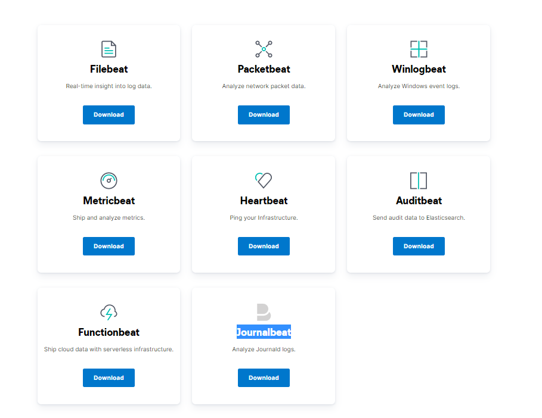
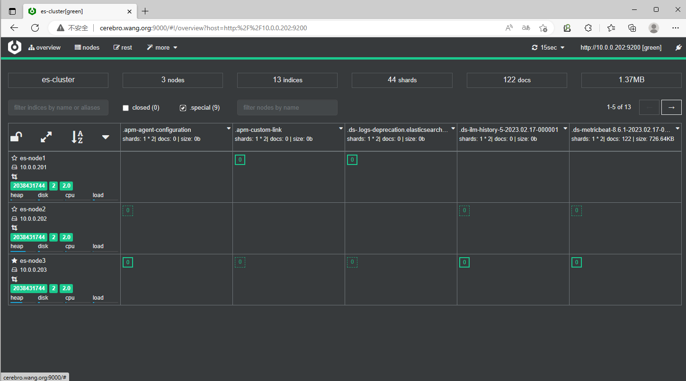
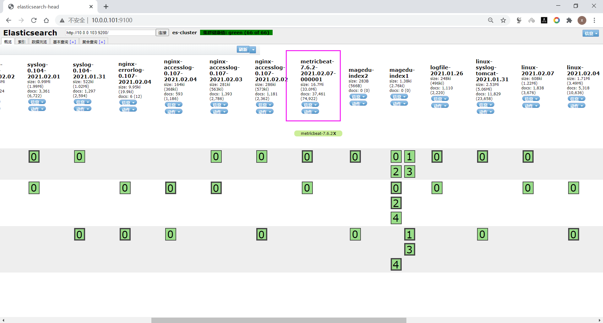
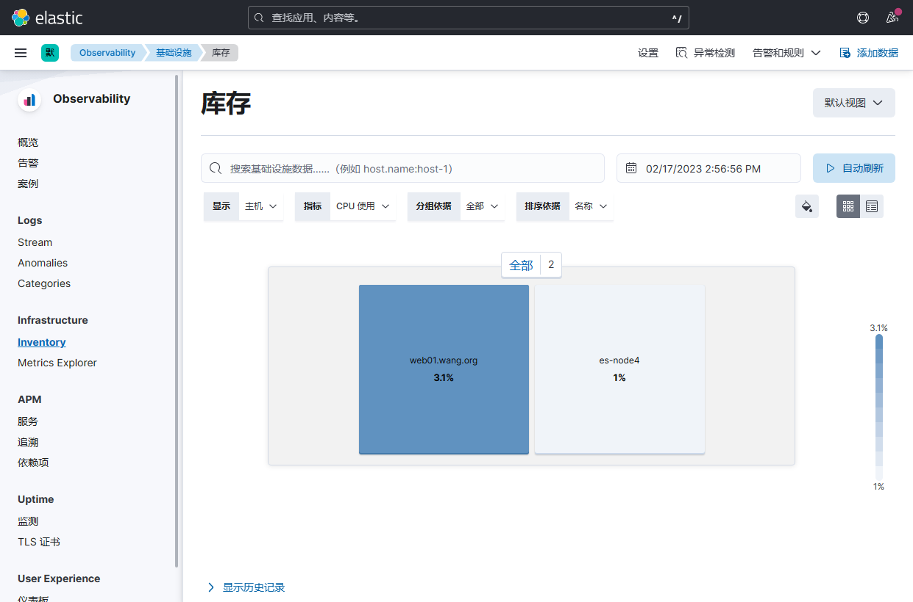
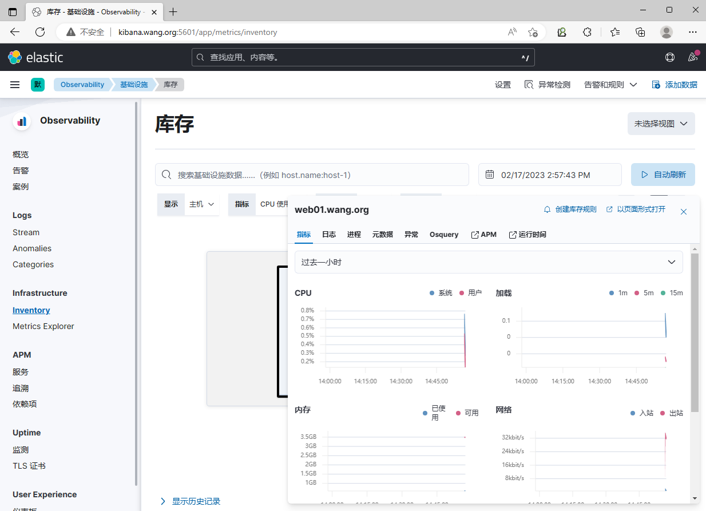
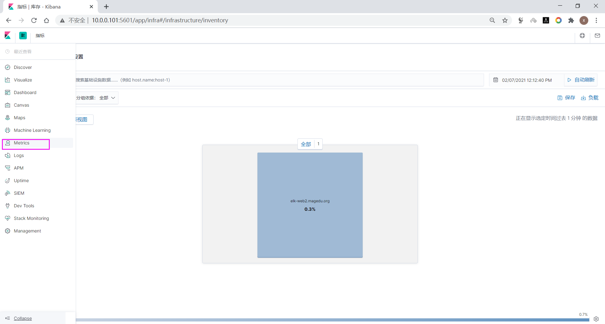
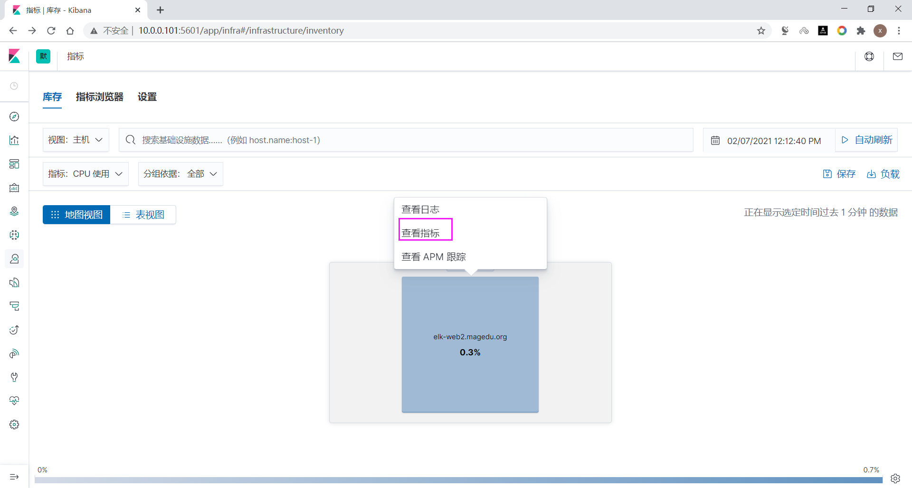
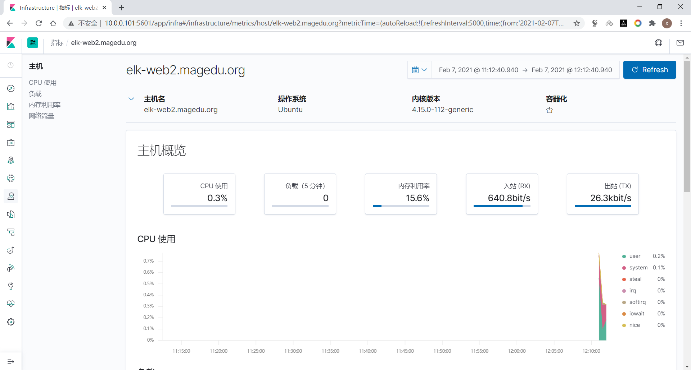

[← Back to ELK Log Analytics Index]({{ '/subjects/ELK/' | relative_url }})



# 13 Monitoring Performance with Metricbeat
## 3 Beats 收集数据

Beats 是一个免费且开放的平台，集合了多种单一用途数据采集器。它们从成百上千或成千上万台机器和系统向 Logstash 或 Elasticsearch 发送数据。

虽然利用 logstash 就可以收集日志，功能强大，但由于 Logstash 是基于Java实现，需要在采集日志的主机上安装JAVA环境

logstash运行时最少也会需要额外的500M的以上的内存，会消耗比较多的内存和磁盘空间，

可以采有基于Go开发的 Beat 工具代替 Logstash 收集日志，部署更为方便，而且只占用10M左右的内存空间及更小的磁盘空间。


官方链接

<https://www.elastic.co/cn/beats/>

Github 链接

<https://github.com/elastic/beats>

下载链接

<https://www.elastic.co/cn/downloads/beats>

Beats 是一些工具集,包括以下,其中 filebeat 应用最为广泛



Beat Description

Auditbeat Collect your Linux audit framework data and monitor the integrity of your

files.

Filebeat Tails and ships log files

Functionbeat Read and ships events from serverless infrastructure.

Heartbeat Ping remote services for availability

Metricbeat Fetches sets of metrics from the operating system and services

Packetbeat Monitors the network and applications by sniffing packets

Winlogbeat Fetches and ships Windows Event logs

Osquerybeat Runs Osquery and manages interraction with it.

```text
filebeat:收集日志文件数据。最常用的工具
packetbeat:用于收集网络数据。一般用zabbix实现此功能
metricbeat:从OS和服务收集指标数据，比如系统运行状态、CPU 内存利用率等。
winlogbeat: 从Windows平台日志收集工具。
heartbeat: 定时探测服务是否可用。支持ICMP、TCP 和 HTTP，也支持TLS、身份验证和代理
auditbeat:收集审计日志
Functionbeat:使用无服务器基础架构提供云数据。面向云端数据的无服务器采集器，处理云数据
```

注意:  Beats 版本要和 Elasticsearch 相同的版本，否则可能会出错

### 3.1 利用 Metricbeat 监控性能相关指标

Metricbeat 可以收集指标数据，比如系统运行状态、CPU、内存利用率等。

生产中一般用 zabbix 等专门的监控系统实现此功能

官方配置说明

<https://www.elastic.co/guide/en/beats/metricbeat/current/configuring-howto-metricbeat.html>

### 下载 metricbeat 并安装

下载链接

<https://www.elastic.co/cn/downloads/beats/metricbeat>

<https://mirrors.tuna.tsinghua.edu.cn/elasticstack/8.x/apt/pool/main/m/metricbeat/>

<https://mirrors.tuna.tsinghua.edu.cn/elasticstack/7.x/apt/pool/main/m/metricbeat/>

注意：安装前建议先修改主机名，确保每个主机名称唯一

```bash
[root@ubuntu2404 ~]#hostnamectl set-hostname web01.bowen.org
[root@ubuntu2404 ~]#exit
```

范例:

```bash
#新版下载
[root@elk-web2 ~]#wget
https://mirrors.tuna.tsinghua.edu.cn/elasticstack/8.x/apt/pool/main/m/metricbeat
/metricbeat-8.6.1-amd64.deb
#旧版下载
[root@elk-web2 ~]#wget
https://mirrors.tuna.tsinghua.edu.cn/elasticstack/7.x/apt/pool/main/m/metricbeat
/metricbeat-7.6.2-amd64.deb
[root@elk-web2 ~]#dpkg -i metricbeat-7.6.2-amd64.deb
```

### 修改配置

```bash
[root@elk-web2 ~]#vim /etc/metricbeat/metricbeat.yml
#setup.kibana:
#   host: "10.0.0.101:5601"  #指向kabana服务器地址和端口，非必须项，即使不设置Kibana也可
以通过ES获取Metrics信息
#-------------------------- Elasticsearch output ------------------------------
output.elasticsearch:
# Array of hosts to connect to.
hosts: ["10.0.0.101:9200","10.0.0.102:9200","10.0.0.103:9200"]   #指向任意一个ELK集
群节点即可
[root@elk-web2 ~]#grep -Ev "#|^$" /etc/metricbeat/metricbeat.yml
metricbeat.config.modules:
path: ${path.config}/modules.d/*.yml
reload.enabled: false
setup.template.settings:
index.number_of_shards: 1
index.codec: best_compression
setup.kibana:
host: "10.0.0.101:5601"
output.elasticsearch:
hosts: ["10.0.0.101:9200","10.0.0.102:9200","10.0.0.103:9200"]
processors:
- add_host_metadata: ~
- add_cloud_metadata: ~
- add_docker_metadata: ~
- add_kubernetes_metadata: ~
```

### 启动服务

```bash
[root@elk-web2 ~]#systemctl enable --now  metricbeat.service
Synchronizing state of metricbeat.service with SysV service script with
/lib/systemd/systemd-sysv-install.
Executing: /lib/systemd/systemd-sysv-install enable metricbeat
[root@elk-web2 ~]#systemctl status metricbeat.service
```

● metricbeat.service - Metricbeat is a lightweight shipper for metrics.

```text
Loaded: loaded (/lib/systemd/system/metricbeat.service; enabled; vendor
preset: enabled)
Active: active (running) since Sun 2021-02-07 12:11:13 CST; 1s ago
Docs: https://www.elastic.co/products/beats/metricbeat
Main PID: 1741 (metricbeat)
Tasks: 10 (limit: 2290)
CGroup: /system.slice/metricbeat.service
└─1741 /usr/share/metricbeat/bin/metricbeat -e -c
/etc/metricbeat/metricbeat.yml -path.home /usr/share/metricbeat -path.config
/etc/metricbeat -pa
Feb 07 12:11:14 elk-web2.bowen.org metricbeat[1741]: 2021-02-07T12:11:14.440+0800
INFO        pipeline/output.go:95        Connecting to backoff(elas
Feb 07 12:11:14 elk-web2.bowen.org metricbeat[1741]: 2021-02-07T12:11:14.453+0800
INFO        elasticsearch/client.go:757        Attempting to connec
Feb 07 12:11:14 elk-web2.bowen.org metricbeat[1741]: 2021-02-07T12:11:14.503+0800
INFO        [license]        licenser/es_callback.go:50        Elas
Feb 07 12:11:14 elk-web2.bowen.org metricbeat[1741]: 2021-02-07T12:11:14.528+0800
INFO        [index-management]        idxmgmt/std.go:258        Aut
Feb 07 12:11:14 elk-web2.bowen.org metricbeat[1741]: 2021-02-07T12:11:14.621+0800
INFO        [index-management]        idxmgmt/std.go:271        ILM
Feb 07 12:11:14 elk-web2.bowen.org metricbeat[1741]: 2021-02-07T12:11:14.622+0800
INFO        [index-management]        idxmgmt/std.go:410        Set
Feb 07 12:11:14 elk-web2.bowen.org metricbeat[1741]: 2021-02-07T12:11:14.622+0800
INFO        [index-management]        idxmgmt/std.go:415        Set
Feb 07 12:11:14 elk-web2.bowen.org metricbeat[1741]: 2021-02-07T12:11:14.622+0800
INFO        [index-management]        idxmgmt/std.go:449        Set
Feb 07 12:11:14 elk-web2.bowen.org metricbeat[1741]: 2021-02-07T12:11:14.622+0800
INFO        [index-management]        idxmgmt/std.go:453        Set
Feb 07 12:11:14 elk-web2.bowen.org metricbeat[1741]: 2021-02-07T12:11:14.628+0800
INFO        template/load.go:169        Existing template will be o
lines 1-19/19 (END)
```

### Head 插件查看索引

新版

.ds-metricbeat-<时间>-<版本>



旧版

metricbeat-<时间>-<版本>



### 通过 Kibana 查看收集的性能指标

8.X版本界面

Observability --- 基础设施- invertory 库存







7.X 界面







<nav class="article-end" aria-label="章节导航">
  <a href="{{ '/subjects/ELK/12-elasticsearch-hot-and-cold-data-tiers.html' | relative_url }}">← Previous: Elasticsearch Hot and Cold Data Tiers</a>
  <a href="{{ '/subjects/ELK/' | relative_url }}">Back to ELK Log Analytics Index</a>
  <a href="{{ '/subjects/ELK/14-monitoring-with-heartbeat.html' | relative_url }}">Next: Monitoring with Heartbeat →</a>
</nav>
