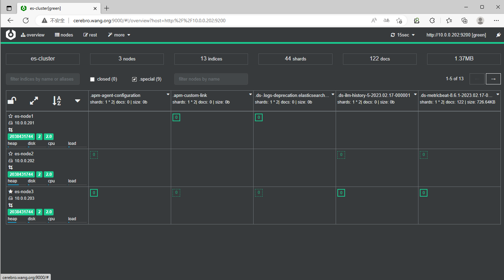
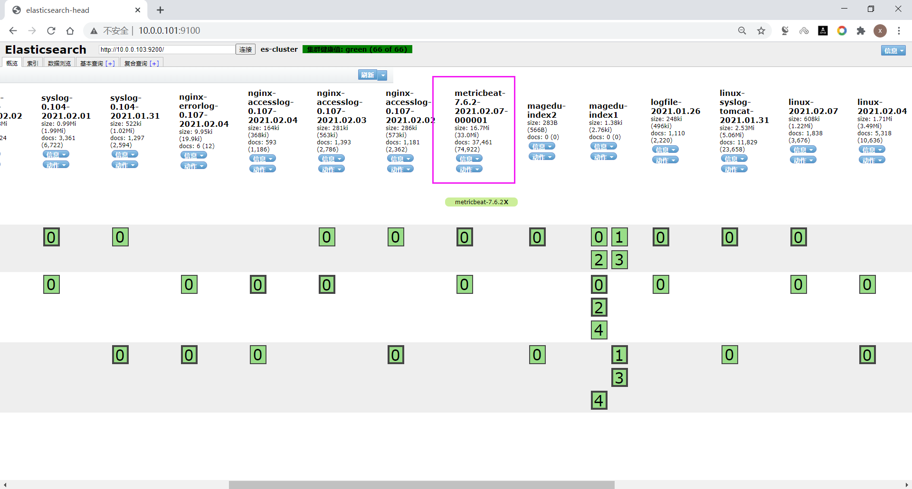
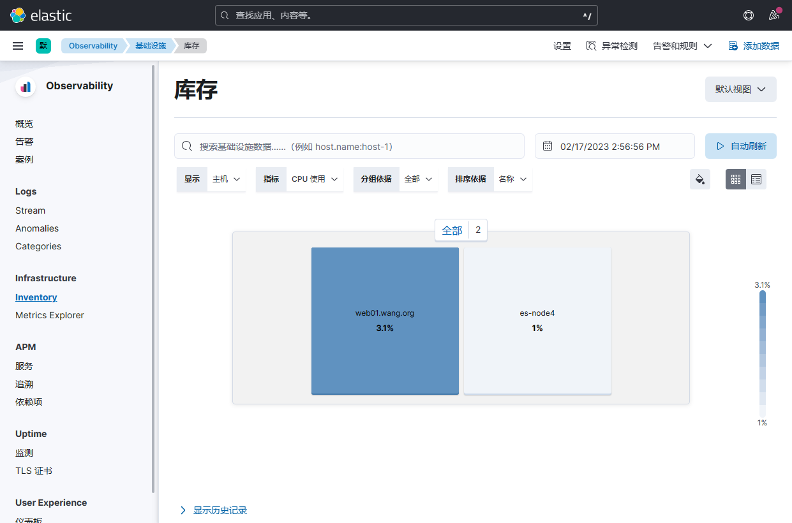
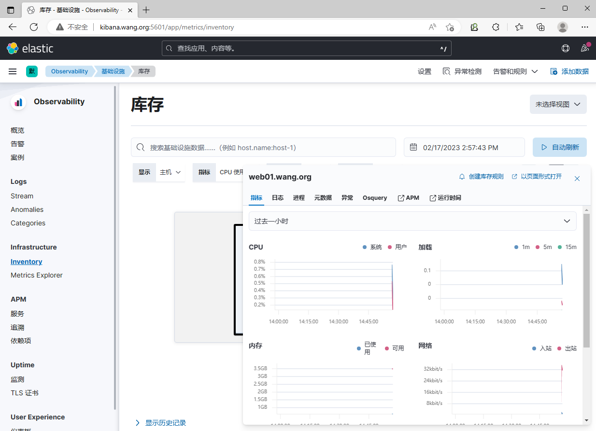
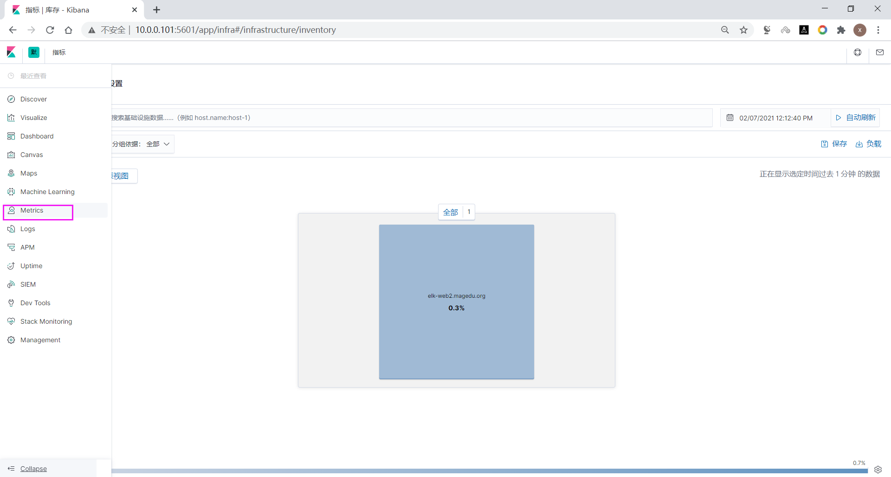
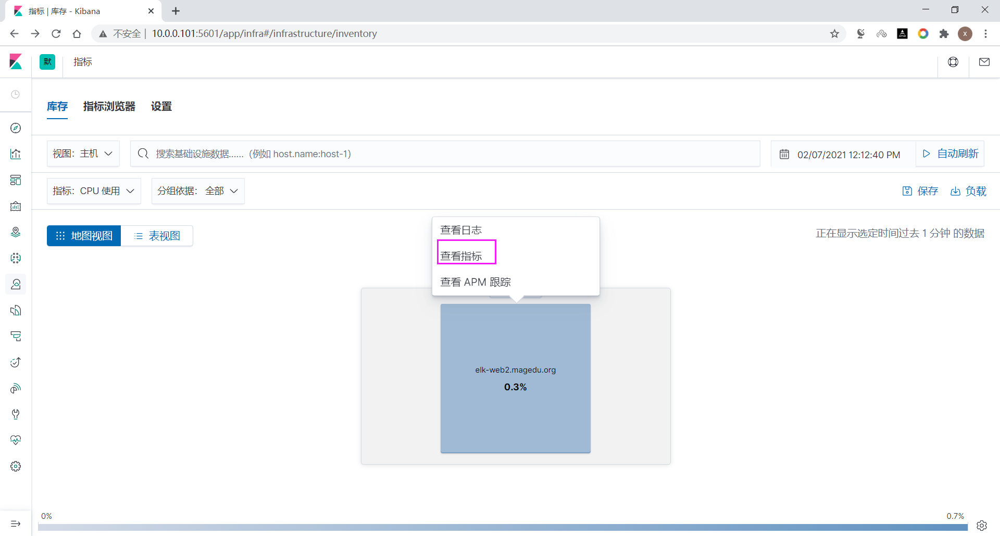
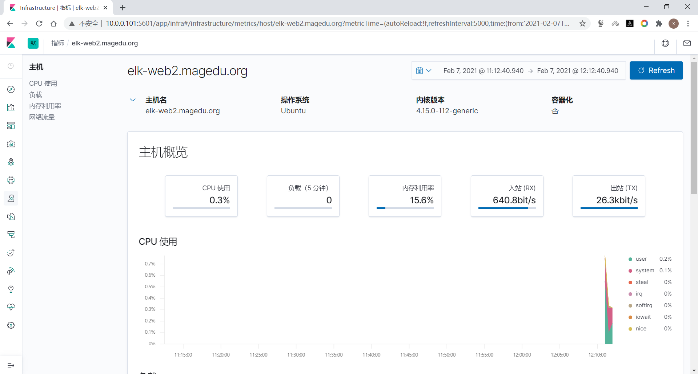

[← 返回ELK 日志分析目录]({{ '/subjects/ELK/' | relative_url }})



# 13 利用 Metricbeat 监控性能相关指标
## 3 Beats 收集数据

Beats 是一组用途不同的轻量采集器：Filebeat 主要读取日志，Metricbeat 采集系统与服务指标，Heartbeat 定期探测服务可用性。它们可以向 Elasticsearch 或 Logstash 发送事件；是否需要 Logstash 取决于解析和路由需求。Beats 与 Logstash 的资源消耗依配置和负载而变化，不能用“固定 10 MB”或“至少 500 MB”作为容量估算。


| 工具 | 主要用途 |
| --- | --- |
| Filebeat | 读取并传输日志文件。 |
| Metricbeat | 采集操作系统与服务指标。 |
| Heartbeat | 通过 HTTP、TCP、ICMP 等方式探测可用性。 |
| Auditbeat / Winlogbeat / Packetbeat | 分别面向审计、Windows 事件和网络流量等场景。 |

Beats 产品线会演进，旧资料中的 Functionbeat 等组件不一定适用于新版本。应以[官方 Beats 文档](https://www.elastic.co/beats/)和所用版本的功能说明为准。


### 3.1 Metricbeat 采集系统指标

Metricbeat 可以采集 CPU、内存、文件系统和网络等指标，还可通过模块采集 Elasticsearch、MySQL 等服务指标。它不是告警系统本身；采集、存储、可视化与告警应分别规划。Metricbeat 与 Elasticsearch 的版本兼容性需按官方矩阵核对，最好保持同一主版本。

1. 从[官方 Metricbeat 下载页](https://www.elastic.co/downloads/beats/metricbeat)获取与宿主机和集群版本匹配的安装包；为每个主机设置唯一且稳定的名称。
2. 安装后保留已有的模块加载配置，只修改输出目标及需要启用的模块。若 Elasticsearch 开启安全功能，使用 HTTPS、受限账号和 CA 证书。
3. 启动前校验配置与连接，启动后通过日志、索引/数据流和 Kibana 验证数据确已写入。

例如输出配置的关键结构如下，域名、凭据和证书路径都要按实际环境替换；不要将实际密码提交到仓库：

```yaml
output.elasticsearch:
  hosts: ["https://es.example.org:9200"]
  username: "<Metricbeat 专用账号>"
  password: "<账号密码>"
  ssl.certificate_authorities: ["/etc/metricbeat/http_ca.crt"]

setup.kibana:
  host: "https://kibana.example.org:5601"
```

`setup.kibana` 用于加载 Kibana 资产，不是把指标发送给 Kibana；指标仍由 `output.elasticsearch` 写入。若未部署 Kibana，可以暂不配置 `setup.kibana`。完成配置后可运行：

```bash
sudo metricbeat test config -e
sudo metricbeat test output -e
sudo systemctl enable --now metricbeat
sudo journalctl -u metricbeat -n 50 --no-pager
```

测试命令只有在替换了上面示例占位值、证书和账号后才会成功。

### 在 Elasticsearch 中核对采集结果

较新的版本可能把 Metricbeat 数据写入数据流，其后备索引常以 `.ds-metricbeat-` 开头；应以当前部署的实际数据流和索引名称为准，不要依赖某个固定命名模式。可用 Kibana 数据视图或 Elasticsearch API 检查最近事件。



较早版本常见 `metricbeat-` 前缀的索引。下面的旧版截图仅用于辨认界面，不表示当前版本必须安装 Head 插件。



### 在 Kibana 中查看性能指标

在支持的 Kibana 版本中，可从“可观测性 / 基础设施”等入口查看主机指标；菜单名称会随版本变化。先确认时间范围覆盖最近采样，再按主机名和指标字段筛选。







以下为 7.x 版本界面，供对照使用：







<nav class="article-end" aria-label="章节导航">
  <a href="{{ '/subjects/ELK/12-elasticsearch-hot-and-cold-data-tiers.html' | relative_url }}">← 上一篇：Elasticsearch 数据冷热分离</a>
  <a href="{{ '/subjects/ELK/' | relative_url }}">返回 ELK 日志分析目录</a>
  <a href="{{ '/subjects/ELK/14-monitoring-with-heartbeat.html' | relative_url }}">下一篇：利用 Heartbeat 监控 →</a>
</nav>
