[← 返回ELK 日志分析目录]({{ '/subjects/ELK/' | relative_url }})



# 15 利用 Filebeat 收集日志
### 3.3 利用 Filebeat 收集日志

Filebeat 是用于转发和集中日志数据的轻量级传送程序。作为服务器上的代理安装，Filebeat监视您指定的日志文件或位置，收集日志事件，并将它们转发到Elasticsearch或Logstash进行索引。

Logstash 也可以直接收集日志,但需要安装JDK并且会占用至少 500M 以上的内存

生产一般使用filebeat代替logstash, 基于go开发,部署方便,重要的是只需要10M多内存,比较节约资源.

filebeat 支持从日志文件,Syslog,Redis,Docker,TCP,UDP,标准输入等读取数据,对数据做简单处理，再输出至Elasticsearch,logstash,Redis,Kafka等

Filebeat的工作方式如下：

启动Filebeat时，它将启动一个或多个输入源，这些输入将在为日志数据指定的位置中查找。 对于Filebeat所找到的每个日志，Filebeat都会启动收集器harvester进程。 每个收集器harvester都读取一个日志以获取新内容，并将新日志数据发送到libbeat libbeat会汇总事件并将汇总的数据发送到为Filebeat配置的输出。

Filebeat 官方说明

<https://www.elastic.co/guide/en/beats/filebeat/current/filebeat-overview.html>

<https://www.elastic.co/guide/en/beats/filebeat/current/configuring-howto-filebeat.html>

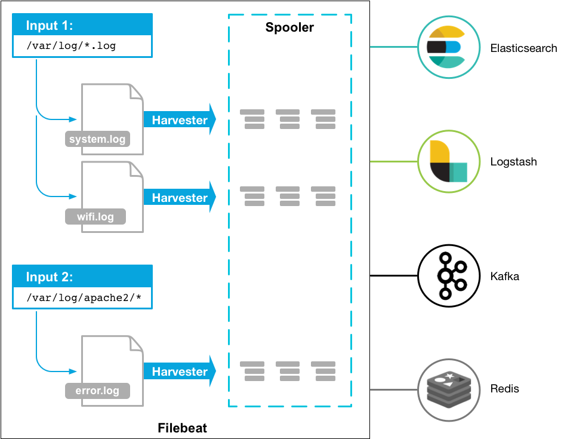


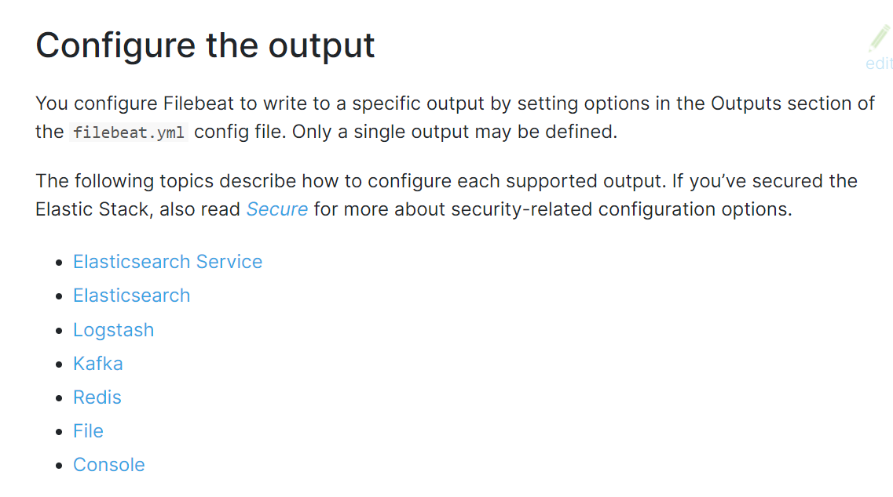

输入和输入官方说明

<https://www.elastic.co/guide/en/beats/filebeat/current/configuration-filebeat-options.html>

<https://www.elastic.co/guide/en/beats/filebeat/current/configuring-output.html>

注意: Filebeat 支持多个输入,但不支持同时有多个输出，如果多输出，会报错如下

```text
Exiting: error unpacking config data: more than one namespace configured
accessing 'output' (source:'/etc/filebeat/stdout_file.yml')
```

### 安装 Filebeat 和配置说明

安装说明

<https://www.elastic.co/guide/en/beats/filebeat/current/setup-repositories.html>

<https://www.elastic.co/guide/en/beats/filebeat/current/running-on-docker.html>

<https://www.elastic.co/guide/en/beats/filebeat/current/running-on-kubernetes.html>

下载链接

<https://www.elastic.co/cn/downloads/beats/filebeat>

<https://mirrors.tuna.tsinghua.edu.cn/elasticstack/8.x/apt/pool/main/f/filebeat/>

### 安装 Filebeat

范例：包安装

```bash
#新版下载
[root@elk-web1 ~]#wget
https://mirrors.tuna.tsinghua.edu.cn/elasticstack/8.x/apt/pool/main/f/filebeat/f
ilebeat-8.6.1-amd64.deb
#旧版下载
[root@elk-web1 ~]#wget
https://mirrors.tuna.tsinghua.edu.cn/elasticstack/7.x/apt/pool/main/f/filebeat/f
ilebeat-7.6.2-amd64.deb
#安装
[root@elk-web1 ~]#dpkg -i filebeat-7.6.2-amd64.deb
#默认没有启动
[root@elk-web1 ~]#systemctl enable --now filebeat
#filebeat以root身份启动
[root@elk-web1 ~]#systemctl start filebeatps aux|grep filebeat
root        1261  0.3  5.1 1282348 103184 ?      Ssl  12:02   0:00
/usr/share/filebeat/bin/filebeat --environment systemd -c
/etc/filebeat/filebeat.yml --path.home /usr/share/filebeat --path.config
/etc/filebeat --path.data /var/lib/filebeat --path.logs /var/log/filebeat
#先停止服务,方便后续调试
[root@elk-web1 ~]#systemctl stop filebeat
```

范例：Docker 安装

```text
#https://www.elastic.co/guide/en/beats/filebeat/current/running-on-docker.html
docker run -d \
--name=filebeat \
--user=root \
--volume="$(pwd)/filebeat.docker.yml:/usr/share/filebeat/filebeat.yml:ro" \
--volume="/var/lib/docker/containers:/var/lib/docker/containers:ro" \
--volume="/var/run/docker.sock:/var/run/docker.sock:ro" \
docker.elastic.co/beats/filebeat:8.9.0 filebeat -e --strict.perms=false \
-E output.elasticsearch.hosts=["elasticsearch:9200"]
```

范例：基于 kubernetes 安装

```yaml
#https://www.elastic.co/guide/en/beats/filebeat/current/running-on-
kubernetes.html
[root@master1 ~]#curl -L -O
https://raw.githubusercontent.com/elastic/beats/8.9/deploy/kubernetes/filebeat-
kubernetes.yaml
[root@master1 ~]#cat filebeat-kubernetes.yaml
apiVersion: v1
kind: ServiceAccount
metadata:
name: filebeat
namespace: kube-system
labels:
k8s-app: filebeat
---
apiVersion: rbac.authorization.k8s.io/v1
kind: ClusterRole
metadata:
name: filebeat
labels:
k8s-app: filebeat
rules:
- apiGroups: [""] # "" indicates the core API group
resources:
- namespaces
- pods
- nodes
verbs:
- get
- watch
- list
- apiGroups: ["apps"]
resources:
- replicasets
verbs: ["get", "list", "watch"]
- apiGroups: ["batch"]
resources:
- jobs
verbs: ["get", "list", "watch"]
---
apiVersion: rbac.authorization.k8s.io/v1
kind: Role
metadata:
name: filebeat
# should be the namespace where filebeat is running
namespace: kube-system
labels:
k8s-app: filebeat
rules:
- apiGroups:
- coordination.k8s.io
resources:
- leases
verbs: ["get", "create", "update"]
---
apiVersion: rbac.authorization.k8s.io/v1
kind: Role
metadata:
name: filebeat-kubeadm-config
namespace: kube-system
labels:
k8s-app: filebeat
rules:
- apiGroups: [""]
resources:
- configmaps
resourceNames:
- kubeadm-config
verbs: ["get"]
---
apiVersion: rbac.authorization.k8s.io/v1
kind: ClusterRoleBinding
metadata:
name: filebeat
subjects:
- kind: ServiceAccount
name: filebeat
namespace: kube-system
roleRef:
kind: ClusterRole
name: filebeat
apiGroup: rbac.authorization.k8s.io
---
apiVersion: rbac.authorization.k8s.io/v1
kind: RoleBinding
metadata:
name: filebeat
namespace: kube-system
subjects:
- kind: ServiceAccount
name: filebeat
namespace: kube-system
roleRef:
kind: Role
name: filebeat
apiGroup: rbac.authorization.k8s.io
---
apiVersion: rbac.authorization.k8s.io/v1
kind: RoleBinding
metadata:
name: filebeat-kubeadm-config
namespace: kube-system
subjects:
- kind: ServiceAccount
name: filebeat
namespace: kube-system
roleRef:
kind: Role
name: filebeat-kubeadm-config
apiGroup: rbac.authorization.k8s.io
---
apiVersion: v1
kind: ConfigMap
metadata:
name: filebeat-config
namespace: kube-system
labels:
k8s-app: filebeat
data:
filebeat.yml: |-
filebeat.inputs:
- type: container
paths:
- /var/log/containers/*.log
processors:
- add_kubernetes_metadata:
host: ${NODE_NAME}
matchers:
- logs_path:
logs_path: "/var/log/containers/"
# To enable hints based autodiscover, remove `filebeat.inputs` configuration
and uncomment this:
#filebeat.autodiscover:
#  providers:
#    - type: kubernetes
#      node: ${NODE_NAME}
#      hints.enabled: true
#      hints.default_config:
#        type: container
#        paths:
#          - /var/log/containers/*${data.kubernetes.container.id}.log
processors:
- add_cloud_metadata:
- add_host_metadata:
cloud.id: ${ELASTIC_CLOUD_ID}
cloud.auth: ${ELASTIC_CLOUD_AUTH}
output.elasticsearch:
hosts: ['${ELASTICSEARCH_HOST:elasticsearch}:${ELASTICSEARCH_PORT:9200}']
username: ${ELASTICSEARCH_USERNAME}
password: ${ELASTICSEARCH_PASSWORD}
---
apiVersion: apps/v1
kind: DaemonSet
metadata:
name: filebeat
namespace: kube-system
labels:
k8s-app: filebeat
spec:
selector:
matchLabels:
k8s-app: filebeat
template:
metadata:
labels:
k8s-app: filebeat
spec:
serviceAccountName: filebeat
terminationGracePeriodSeconds: 30
hostNetwork: true
dnsPolicy: ClusterFirstWithHostNet
containers:
- name: filebeat
image: docker.elastic.co/beats/filebeat:8.9.0
args: [
"-c", "/etc/filebeat.yml",
"-e",
]
env:
- name: ELASTICSEARCH_HOST
value: elasticsearch
- name: ELASTICSEARCH_PORT
value: "9200"
- name: ELASTICSEARCH_USERNAME
value: elastic
- name: ELASTICSEARCH_PASSWORD
value: changeme
- name: ELASTIC_CLOUD_ID
value:
- name: ELASTIC_CLOUD_AUTH
value:
- name: NODE_NAME
valueFrom:
fieldRef:
fieldPath: spec.nodeName
securityContext:
runAsUser: 0
# If using Red Hat OpenShift uncomment this:
#privileged: true
resources:
limits:
memory: 200Mi
requests:
cpu: 100m
memory: 100Mi
volumeMounts:
- name: config
mountPath: /etc/filebeat.yml
readOnly: true
subPath: filebeat.yml
- name: data
mountPath: /usr/share/filebeat/data
- name: varlibdockercontainers
mountPath: /var/lib/docker/containers
readOnly: true
- name: varlog
mountPath: /var/log
readOnly: true
volumes:
- name: config
configMap:
defaultMode: 0640
name: filebeat-config
- name: varlibdockercontainers
hostPath:
path: /var/lib/docker/containers
- name: varlog
hostPath:
path: /var/log
# data folder stores a registry of read status for all files, so we don't
send everything again on a Filebeat pod restart
- name: data
hostPath:
# When filebeat runs as non-root user, this directory needs to be
writable by group (g+w).
path: /var/lib/filebeat-data
type: DirectoryOrCreate
---
```

### Filebeat 配置

配置文件官方说明

<https://www.elastic.co/guide/en/beats/filebeat/current/configuring-howto-filebeat.html>

<https://www.elastic.co/guide/en/beats/filebeat/8.3/configuration-general-options.html>

Filebeat的 默认配置文件是/etc/filebeat/filebeat.yml，遵循YAML语法。常见配置包括如下

Filebeat Output Shipper Logging(可选) Run Options（可选）

filebeat.yml的格式说明

```text
input_type: log
#指定输入类型
paths
#支持基本的正则，所有golang glob都支持,支持/var/log/*/*.log
encoding
#plain, latin1, utf-8, utf-16be-bom, utf-16be, utf-16le, big5, gb18030, gbk, hz-
gb-2312,
euc-kr, euc-jp, iso-2022-jp, shift-jis, and so on
exclude_lines
#支持正则 排除匹配的行，如果有多行，合并成一个单一行来进行过滤
include_lines
#支持正则 include_lines执行完毕之后会执行exclude_lines。
exclude_files
#支持正则 排除匹配的文件
exclude_files: ['.gz$']
tags
#列表中添加标签，用过过滤
filebeat.inputs:
- paths: ["/var/log/app/*.json"]
tags: ["json"]
fields
#可选字段，选择额外的字段进行输出
#可以是标量值，元组，字典等嵌套类型
ignore_older
#可以指定Filebeat忽略指定时间段以外修改的日志内容
#文件被忽略之前，确保文件不在被读取，必须设置ignore older时间范围大于close_inactive
#如果一个文件正在读取时候被设置忽略，它会取得到close_inactive后关闭文件，然后文件被忽略
close_*
#close_ *配置选项用于在特定标准或时间之后关闭harvester。 关闭harvester意味着关闭文件处理程
序。 如果在harvester关闭后文件被更新，则在scan_frequency过后，文件将被重新拾取。 但是，如果
在harvester关闭时移动或删除文件，Filebeat将无法再次接收文件，并且harvester未读取的任何数据都
将丢失。
close_inactive
#启动选项时，如果在制定时间没有被读取，将关闭文件句柄
#读取的最后一条日志定义为下一次读取的起始点，而不是基于文件的修改时间
#如果关闭的文件发生变化，一个新的harverster将在scan_frequency运行后被启动
#建议至少设置一个大于读取日志频率的值，配置多个prospector来实现针对不同更新速度的日志文件
#使用内部时间戳机制，来反映记录日志的读取，每次读取到最后一行日志时开始倒计时
#使用2h 5m 来表示
recursive_glob.enabled
#递归匹配日志文件，默认false
close_rename
#当选项启动，如果文件被重命名和移动，filebeat关闭文件的处理读取
close_removed
#当选项启动，文件被删除时，filebeat关闭文件的处理读取
#这个选项启动后，必须启动clean_removed
close_eof
#适合只写一次日志的文件，然后filebeat关闭文件的处理读取
close_timeout
#当选项启动时，filebeat会给每个harvester设置预定义时间，不管这个文件是否被读取，达到设定时间
后，将被关闭
close_timeout 不能等于ignore_older,会导致文件更新时，不会被读取
#如果output一直没有输出日志事件，这个timeout是不会被启动的，至少要要有一个事件发送，然后
haverter将被关闭
#设置0 表示不启动
clean_inactived
#从注册表文件中删除先前收获的文件的状态
#设置必须大于ignore_older+scan_frequency，以确保在文件仍在收集时没有删除任何状态
#配置选项有助于减小注册表文件的大小，特别是如果每天都生成大量的新文件
#此配置选项也可用于防止在Linux上重用inode的Filebeat问题
clean_removed
#启动选项后，如果文件在磁盘上找不到，将从注册表中清除filebeat
#如果关闭close removed 必须关闭clean removed
scan_frequency
#prospector检查指定用于收获的路径中的新文件的频率,默认10s
document_type
#类型事件，被用于设置输出文档的type字段，默认是log
harvester_buffer_size
#每次harvester读取文件缓冲字节数，默认是16384
max_bytes
#对于多行日志信息，很有用，最大字节数
json
#这些选项使Filebeat解码日志结构化为JSON消息，逐行进行解码json
keys_under_root
#设置key为输出文档的顶级目录
overwrite_keys
#覆盖其他字段
add_error_key
#定义一个json_error
message_key
#指定json 关键建作为过滤和多行设置，与之关联的值必须是string
multiline
#控制filebeat如何处理跨多行日志的选项，多行日志通常发生在java堆栈中
multiline.pattern: '^\['
multiline.negate: true
multiline.match: after
上面匹配是将多行日志所有不是以[符号开头的行合并成一行它可以将下面的多行日志进行合并成一行
multiline.pattern
指定匹配的正则表达式，filebeat支持的regexp模式与logstash支持的模式有所不同
pattern regexp
multiline.negate
定义上面的模式匹配条件的动作是 否定的，默认是false
假如模式匹配条件'^b'，默认是false模式，表示讲按照模式匹配进行匹配 将不是以b开头的日志行进行合并
如果是true，表示将不以b开头的日志行进行合并
multiline.match
#指定Filebeat如何将匹配行组合成事件,在之前或者之后，取决于上面所指定的negate
multiline.max_lines
#可以组合成一个事件的最大行数，超过将丢弃，默认500
multiline.timeout
#定义超时时间，如果开始一个新的事件在超时时间内没有发现匹配，也将发送日志，默认是5s
tail_files
#如果此选项设置为true，Filebeat将在每个文件的末尾开始读取新文件，而不是开头
#此选项适用于Filebeat尚未处理的文件
symlinks
#符号链接选项允许Filebeat除常规文件外,可以收集符号链接。收集符号链接时，即使为符号链接的路径，
Filebeat也会打开并读取原始文件。
backoff
#backoff选项指定Filebeat如何积极地抓取新文件进行更新。默认1s
#backoff选项定义Filebeat在达到EOF之后再次检查文件之间等待的时间。
max_backoff
#在达到EOF之后再次检查文件之前Filebeat等待的最长时间
backoff_factor
#指定backoff尝试等待时间几次，默认是2
harvester_limit
#harvester_limit选项限制一个prospector并行启动的harvester数量，直接影响文件打开数
enabled
#控制prospector的启动和关闭
filebeat global
spool_size
#事件发送的阀值，超过阀值，强制刷新网络连接
filebeat.spool_size: 2048
publish_async
#异步发送事件，实验性功能
idle_timeout
#事件发送的超时时间，即使没有超过阀值，也会强制刷新网络连接
filebeat.idle_timeout: 5s
registry_file
#注册表文件的名称，如果使用相对路径，则被认为是相对于数据路径
#有关详细信息，请参阅目录布局部分 默认值为${path.data}/registry
filebeat.registry_file: registry
config_dir
#包含额外的prospector配置文件的目录的完整路径
#每个配置文件必须以.yml结尾
#每个配置文件也必须指定完整的Filebeat配置层次结构，即使只处理文件的prospector部分。
#所有全局选项（如spool_size）将被忽略
#必须是绝对路径
filebeat.config_dir: path/to/configs
shutdown_timeout
#Filebeat等待发布者在Filebeat关闭之前完成发送事件的时间。
Filebeat General
name
#设置名字，如果配置为空，则用该服务器的主机名
name: "my-shipper"
queue_size
#单个事件内部队列的长度 默认1000
bulk_queue_size
#批量事件内部队列的长度
max_procs
#设置最大使用cpu数量
```

范例：

```bash
[root@ubuntu2204 ~]#which filebeat
/usr/bin/filebeat
[root@ubuntu2204 ~]#file /usr/bin/filebeat
/usr/bin/filebeat: Bourne-Again shell script, ASCII text executable
[root@ubuntu2204 ~]#cat /usr/bin/filebeat
#!/usr/bin/env bash
# Script to run Filebeat in foreground with the same path settings that
# the init script / systemd unit file would do.
umask 0027
exec /usr/share/filebeat/bin/filebeat \
--path.home /usr/share/filebeat \
--path.config /etc/filebeat \
--path.data /var/lib/filebeat \
--path.logs /var/log/filebeat \
"$@"
[root@ubuntu2204 ~]#filebeat --help
Usage:
filebeat [flags]
filebeat [command]
Available Commands:
export      Export current config or index template
generate    Generate Filebeat modules, filesets and fields.yml
help        Help about any command
keystore    Manage secrets keystore
modules     Manage configured modules
run         Run filebeat
setup       Setup index template, dashboards and ML jobs
test        Test config
version     Show current version info
Flags:
-E, --E setting=value              Configuration overwrite
-M, --M setting=value              Module configuration overwrite
-N, --N                            Disable actual publishing for testing
-c, --c string                     Configuration file, relative to path.config
(default "filebeat.yml") #相对路径不是当前路径
--cpuprofile string            Write cpu profile to file
-d, --d string                     Enable certain debug selectors
-e, --e                            Log to stderr and disable syslog/file
output
--environment environmentVar   set environment being ran in (default
default)
-h, --help                         help for filebeat
--httpprof string              Start pprof http server
--memprofile string            Write memory profile to this file
--modules string               List of enabled modules (comma separated)
--once                         Run filebeat only once until all harvesters
reach EOF
--path.config string           Configuration path (default "")
--path.data string             Data path (default "")
--path.home string             Home path (default "")
--path.logs string             Logs path (default "")
--plugin pluginList            Load additional plugins
--strict.perms                 Strict permission checking on config files
(default true)
-v, --v                            Log at INFO level
Use "filebeat [command] --help" for more information about a command.
```

范例：添加新字段

```text
#默认配置文件中添加新字段
vim /etc/filebeat/filebeat.yml
- type : log
enabled: true
paths:
- /var/log/syslog
fields:
project: test-syslog         #添加fields.project和fields.env字段,可用于区分不同的
日志
env: test
tags: ["syslog","test"]        #添加标签,也可以用于区分不同的日志
#语法检查
filebeat test config  -c  /etc/filebeat/filebeat.yml
```

### 案例: 从标准输入读取再输出至标准输出

### 创建配置

范例：解析文本，不能解析json格式文本

```bash
[root@elk-web1 ~]#vim /etc/filebeat/stdin.yml
filebeat.inputs:
- type: stdin
enabled: true
tags: ["stdin-tags","myapp"] #添加新字段名tags，可以用于判断不同类型的输入，实现不同的输
出
fields:
status_code: "200"  #添加新字段名fields.status_code，可以用于判断不同类型的输入，实
现不同的输出
author: "bowenxiaochun"
#output.console:
#  pretty: true
#  enable: true
output.console:
pretty: true
enable: true
#语法检查，注意：stdin.yml的相对路径是相对于/etc/filebeat的路径，而不是当前路径
[root@ubuntu2204 ~]#filebeat test config  -c stdin.yml
Config OK
```

### 执行读取

范例：解析文本，不能解析json格式文本

```json
#从指定文件中读取配置
#-e 表示Log to stderr and disable syslog/file output
[root@elk-web1 ~]#filebeat -e -c /etc/filebeat/stdin.yml
#下面命令默认就会从/etc/filebeat/目录中加载stdin.yml文件，而非当前目录
[root@elk-web1 ~]#filebeat -e -c stdin.yml
.....
hello,es  #输入信后再回车,输出如下
#新版
{
"@timestamp": "2023-05-04T02:47:49.440Z",
"@metadata": {
"beat": "filebeat",
"type": "_doc",
"version": "8.7.0"
},
"log": {
"offset": 0,
"file": {
"path": ""
}
},
"message": "hello,es",
"input": {
"type": "stdin"
},
"ecs": {
"version": "8.0.0"
},
"host": {
"name": "app01.bowen.org"
},
"agent": {
"type": "filebeat",
"version": "8.7.0",
"ephemeral_id": "4dd7df24-e28a-4e97-8d6c-e9734bdf2d54",
"id": "52660032-fd95-4716-bcf1-3d291dc794fa",
"name": "app01.bowen.org"
}
}
#输入json格式数据
{"name" : "bowenxiaochun", "age" : "18", "phone" : "0123456789"}
{
"@timestamp": "2023-12-08T07:24:06.780Z",
"@metadata": {
"beat": "filebeat",
"type": "_doc",
"version": "8.11.1"
},
"agent": {
"version": "8.11.1",
"ephemeral_id": "35c0d6c9-ea9b-4d3a-bf83-e231ad2bf23c",
"id": "5328e641-8f0f-4fb9-8a0b-6e3453093a8b",
"name": "web01",
"type": "filebeat"
},
"message": "{\"name\" : \"bowenxiaochun\", \"age\" : \"18\", \"phone\" :
\"0123456789\"}", #没有解析json
"log": {
"offset": 0,
"file": {
"path": ""
}
},
"input": {
"type": "stdin"
},
"ecs": {
"version": "8.0.0"
},
"host": {
"name": "web01"
}
}
```

```json
#旧版
{
"@timestamp": "2022-07-09T14:48:22.446Z",
"@metadata": {
"beat": "filebeat",
"type": "_doc",
"version": "7.17.5"
},
"agent": {
"name": "es-web01",
"type": "filebeat",
"version": "7.17.5",
"hostname": "es-web01",
"ephemeral_id": "8918da58-f04c-4b74-9dfe-4e53952c2530",
"id": "fffb2178-8110-400c-b3f9-ce8920aeb61a"
},
"message": "hello,es", #真正的数据只有此行，其它都是Filebeat添加的元数据
"log": {
"offset": 0,
"file": {
"path": ""
}
},
"input": {
"type": "stdin"
},
"ecs": {
"version": "1.12.0"
},
"host": {
"name": "es-web01"
}
}
```

范例：解析json格式文本

```json
[root@ubuntu2204 ~]#cat /etc/filebeat/test.yml
filebeat.inputs:
- type: stdin
json.keys_under_root: true  #解析json
output.console:
pretty: true
[root@ubuntu2204 ~]#filebeat   -c test.yml
hello,world
{
"@timestamp": "2023-12-08T07:28:08.330Z",
"@metadata": {
"beat": "filebeat",
"type": "_doc",
"version": "8.11.1"
},
"agent": {
"id": "5328e641-8f0f-4fb9-8a0b-6e3453093a8b",
"name": "web01",
"type": "filebeat",
"version": "8.11.1",
"ephemeral_id": "2238ae51-4ed4-4e28-90d0-1a0cd9425267"
},
"ecs": {
"version": "8.0.0"
},
"log": {
"offset": 0,
"file": {
"path": ""
}
},
"json": {},
"message": "hello,world",        #非json 不解析
"input": {
"type": "stdin"
},
"host": {
"name": "web01"
}
}
{"name" : "bowenxiaochun", "age" : "18", "phone" : "0123456789"}  #输入json格式，进
行解析
{
"@timestamp": "2023-12-08T07:28:16.474Z",
"@metadata": {
"beat": "filebeat",
"type": "_doc",
"version": "8.11.1"
},
"host": {
"name": "web01"
},
"agent": {
"version": "8.11.1",
"ephemeral_id": "2238ae51-4ed4-4e28-90d0-1a0cd9425267",
"id": "5328e641-8f0f-4fb9-8a0b-6e3453093a8b",
"name": "web01",
"type": "filebeat"
},
"log": {
"offset": 0,
"file": {
"path": ""
}
},
"name": "bowenxiaochun",                     #解析结果
"age": "18",
"phone": "0123456789",
"input": {
"type": "stdin"
},
"ecs": {
"version": "8.0.0"
}
}
```

### 案例: 从标准输入读取再输出至 Json 格式的文件

### 创建配置

```bash
[root@elk-web1 ~]#vim /etc/filebeat/stdout_file.yml
filebeat.inputs:
- type: stdin
enabled: true
json.keys_under_root: true #默认False会将json数据存储至message，true则会将数据以独立
字段存储,并且删除message字段，如果是文本还是放在message字段中
output.file:
path: "/tmp"
filename: "filebeat.log"
```

### 执行读取

```json
[root@elk-web1 ~]#filebeat -e -c /etc/filebeat/stdout_file.yml
.....
#输入如下Json格式信息，再回车后输出如下
{"name": "bowenxiaochun", "age": 18, "phone": "0123456789"}
[root@elk-web1 ~]#cat /tmp/filebeat.log
{"@timestamp":"2022-08-01T13:53:48.259Z","@metadata":
{"beat":"filebeat","type":"_doc","version":"7.17.5"},"host":
{"name":"ubuntu2004.bowen.org"},"agent":
{"hostname":"ubuntu2004.bowen.org","ephemeral_id":"e17c1494-889d-49fb-b3d7-
5cb573b1f152","id":"d1fdb707-5e4f-47b3-944b-
8f6d1477190a","name":"ubuntu2004.bowen.org","type":"filebeat","version":"7.17.5"}
,"ecs":{"version":"1.12.0"},"log":{"offset":0,"file":{"path":""}},"json":
{},"message":"","input":{"type":"stdin"}}
#Json格式整理
[root@elk-web1 ~]#apt -y install jq
#8.X版本生成的文件名,json.keys_under_root: false
[root@elk-web1 ~]#cat /tmp/filebeat.log-20230217.ndjson  |jq
#8.X版本生成的文件名,json.keys_under_root: true
[root@elk-web1 ~]#cat /tmp/filebeat.log-20230217-1.ndjson|jq
{
"@timestamp": "2023-02-17T08:10:48.661Z",
"@metadata": {
"beat": "filebeat",
"type": "_doc",
"version": "8.6.1"
},
"name": "bowenxiaochun", #生成独立字段的Json数据
"age": "18",
"input": {
"type": "stdin"
},
"agent": {
"version": "8.6.1",
"ephemeral_id": "c8a10f29-0368-4c69-a7ef-19526f7a8775",
"id": "e2f80340-fa87-4842-9a93-e7f5510866fa",
"name": "elk-web1.bowen.org",
"type": "filebeat"
},
"ecs": {
"version": "8.0.0"
},
"host": {
"name": "elk-web1.bowen.org"
},
"log": {
"offset": 0,
"file": {
"path": ""
}
},
"phone": "0123456789"
}
#7.X版本生成的文件名
[root@elk-web1 ~]#cat /tmp/filebeat.log  | jq
{
"@timestamp": "2022-08-01T13:42:23.524Z",
"@metadata": {
"beat": "filebeat",
"type": "_doc",
"version": "7.17.5"
},
"input": {
"type": "stdin"
},
"ecs": {
"version": "1.12.0"
},
"host": {
"name": "ubuntu2004.bowen.org"
},
"agent": {
"name": "ubuntu2004.bowen.org",
"type": "filebeat",
"version": "7.17.5",
"hostname": "ubuntu2004.bowen.org",
"ephemeral_id": "4465f007-7cce-4a0d-981a-d34ecd8b3fc0",
"id": "d1fdb707-5e4f-47b3-944b-8f6d1477190a"
},
"log": {
"offset": 0,
"file": {
"path": ""
}
},
"name": "bowenxiaochun",
"age": "18",
"phone": "0123456789"
}
```

### 案例: 从文件读取再输出至标准输出

<https://www.elastic.co/guide/en/beats/filebeat/current/filebeat-input-log.html>

<https://www.elastic.co/docs/reference/beats/filebeat/filebeat-input-filestream>

filebeat  的INPUT中支持log(旧版)和filestream(新版)两种方式读取文件

filebeat 会将每个文件的读取数据的相关信息记录在/var/lib/filebeat/registry/filebeat/log.json文件中,可以实现日志采集的持续性,而不会重复采集

当日志文件大小发生变化时，filebeat会接着上一次记录的位置继续向下读取新的内容当日志文件大小没有变化，但是内容发生变化，filebeat会将文件的全部内容重新读取一遍

### 创建配置

范例: 9.X 读取Json文件并输出

```bash
#https://www.elastic.co/docs/reference/beats/filebeat/filebeat-input-
filestream#_parsers
[root@ubuntu2204 ~]#cat /etc/filebeat/test.yml
filebeat.inputs:
- type: filestream
id: my-filestream-id
enabled: true
paths:
- /var/log/test.log         #注意:文件不能太小,要求超过1024字节
parsers:
- ndjson:
target: ""    #解析结果存放在指定字段下,如果为空,则保存在根下
#message_key: message   #对哪个字段做json解析,可选
output.console:
pretty: true
enable: true
```

```json
#输入json解析出来的结果
[root@ubuntu2204 ~]#echo '{"name": "bowenxiaochun", "age": 18, "phone":
"0123456789"}' >> /var/log/test.log
#观察结果
[root@ubuntu2204 ~]#filebeat   -c /etc/filebeat/test.yml
{
"@timestamp": "2025-07-31T00:53:44.586Z",
"@metadata": {
"beat": "filebeat",
"type": "_doc",
"version": "9.0.4"
},
"host": {
"name": "ubuntu2204"
},
"agent": {
"ephemeral_id": "e66d9c54-77f0-46a1-8151-828cc42ce479",
"id": "6d6d42be-f6b3-489d-9932-3765a8a138a4",
"name": "ubuntu2204",
"type": "filebeat",
"version": "9.0.4"
},
"log": {
"offset": 2375,
"file": {
"path": "/var/log/test.log",
"device_id": "64768",
"inode": "1966618",
"fingerprint":
"c46d9dac02610378a06061c484bacf296e87e6b12637118ab60750cc5ff5a70f"
}
},
"phone": "0123456789",
"name": "bowenxiaochun",
"age": 18,
"input": {
"type": "filestream"
},
"ecs": {
"version": "8.0.0"
}
}
```

范例：8.X 以前版本读取Json文件并输出

```bash
[root@elk-web1 ~]#vim /etc/filebeat/file.yml
filebeat.inputs:
- type: filestream    #此指令配置json.keys_under_root: true 也不支持Json格式解析
#type: log      #旧版，将来废弃
enabled: true
paths:
#- /var/log/syslog
- /var/log/test.log #注意:要求文件不能太小
output.console:
pretty: true
enable: true
```

范例：8.X 以前版本不同的文件生成不同的tag

```bash
[root@web01 filebeat]#cat file_console.yml
filebeat.inputs:
- type: log
paths:
- /var/log/syslog
json.keys_under_root: true
tags: ["syslog"]
#- syslog
- type: log
paths:
- /var/log/test.log
json.keys_under_root: true
tags: ["testlog"]
output.console:
pretty: true
```

范例：8.X 以前版本不同的文件生成不同的fields

```bash
#示例1：
[root@ubuntu2204 ~]#cat /etc/filebeat/test_field.yml
filebeat.inputs:
- type: log
paths:
- /var/log/app1.log
json.keys_under_root: true
tags: ["app1_tag"]
fields:
type: "app1"
- type: log
paths:
- /var/log/app2.log
json.keys_under_root: true
tags: ["app2_tag"]
fields:
type: "app2"
output.console:
pretty: true
```

```bash
#示例2
[root@web01 filebeat]#cat file_console.yml
filebeat.inputs:
- type: log
paths:
- /var/log/syslog
json.keys_under_root: true
tags: ["syslog"]
fields:
type: "syslog"
- type: log
paths:
- /var/log/test.log
json.keys_under_root: true
tags: ["testlog"]
fields:
type: "testlog"
output.console:
pretty: true
```

### 执行读取

```json
[root@elk-web1 ~]#filebeat -e -c /etc/filebeat/file.yml
......
#执行生成文件内容后echo 'hello,bowen' > /var/log/filebeat.log,可以看到下面的输出信息
{
"@timestamp": "2022-07-09T14:55:14.839Z",
"@metadata": {
"beat": "filebeat",
"type": "_doc",
"version": "7.17.5"
},
"log": {
"offset": 0,
"file": {
"path": "/var/log/filebeat.log"
}
},
"message": "hello,bowen",
"input": {
"type": "log"
},
"ecs": {
"version": "1.12.0"
},
"host": {
"name": "elk-web1"
},
"agent": {
"name": "elk-web1",
"type": "filebeat",
"version": "7.17.5",
"hostname": "elk-web1",
"ephemeral_id": "c9b4cd1d-1a9d-4531-83ec-0a53fd532dfc",
"id": "fffb2178-8110-400c-b3f9-ce8920aeb61a"
}
}
```

```bash
#注意：json格式最外层必须加单引号‘’，否则不会解析
[root@elk-web1 ~]#echo '{"name" : "bowenxiaochun", "age" : "18", "phone" :
"0123456789"}' >> /var/log/test.log
```

```bash
#filebeat记录日志文件读取的当前位置，以防止重复读取日志
[root@ubuntu2204 ~]#cat  /var/lib/filebeat/registry/filebeat/log.json
{"op":"set","id":1}
{"k":"filebeat::logs::native::6160448-64768","v":{"id":"native::6160448-
64768","prev_id":"","offset":0,"FileStateOS":
{"inode":6160448,"device":64768},"identifier_name":"native","source":"/var/log/t
est.log","timestamp":[2062577195773,1688720765],"ttl":-1,"type":"log"}}
{"op":"set","id":2}
{"k":"filebeat::logs::native::6160448-64768","v":{"timestamp":
[2062580770610,1688720766],"ttl":-1,"type":"log","identifier_name":"native","pre
v_id":"","source":"/var/log/test.log","offset":291,"id":"native::6160448-
64768","FileStateOS":{"inode":6160448,"device":64768}}}
{"op":"set","id":3}
{"k":"filebeat::logs::native::6160448-64768","v":
{"source":"/var/log/test.log","offset":291,"timestamp":
[2062580770610,1688720766],"type":"log","id":"native::6160448-
64768","prev_id":"","identifier_name":"native","ttl":-1,"FileStateOS":
{"inode":6160448,"device":64768}}}
{"op":"set","id":4}
{"k":"filebeat::logs::native::6160448-64768","v":
{"source":"/var/log/test.log","timestamp":
[2061658539859,1688720781],"FileStateOS":
{"inode":6160448,"device":64768},"identifier_name":"native","id":"native::616044
8-64768","prev_id":"","offset":291,"ttl":-1,"type":"log"}}
{"op":"set","id":5}
{"k":"filebeat::logs::native::6160448-64768","v":
{"prev_id":"","source":"/var/log/test.log","offset":291,"ttl":-1,"identifier_nam
e":"native","id":"native::6160448-64768","timestamp":
[2061658539859,1688720781],"type":"log","FileStateOS":
{"device":64768,"inode":6160448}}}
```

### 案例: 利用 Filebeat 收集系统日志到 ELasticsearch

<https://www.elastic.co/guide/en/beats/filebeat/current/elasticsearch-output.html>

Filebeat收集的日志在Elasticsearch中默认生成的索引名称为

```text
#8.X版本以后
.ds-filebeat-<版本>-<时间>-<ID>
#7.x版本以前
filebeat-<版本>-<时间>-<ID>
```

### 修改配置

范例

```bash
[root@web01 ~]#cat /etc/filebeat/stdin-es.yaml
filebeat.inputs:
- type: stdin
json.keys_under_root: true  #解析json
output.elasticsearch:
hosts: ["http://10.0.0.101:9200"]
```

```bash
[root@web01 ~]#filebeat -c /etc/filebeat/stdin-es.yaml
hello,world
{"name" : "bowenxiaochun", "age" : "18", "phone" : "0123456789"}
```

范例：9.X 版本后

```bash
[root@web01 ~]#cat  /etc/filebeat/filebeat.yml
filebeat.inputs:
- type: filestream
id: my-filestream-id
enabled: true
paths:
- /var/log/syslog         #注意:文件不能太小,要求超过1024字节
parsers:
- ndjson:
target: ""    #解析结果存放在指定字段下,如果为空,则保存在根下
#message_key: message   #对哪个字段做json解析,可选
#-------------------------- Elasticsearch output ------------------------------
output.elasticsearch:
hosts: ["10.0.0.101:9200","10.0.0.102:9200","10.0.0.103:9200"]   #指定ELK集群任意
节点的地址和端口,多个地址容错
#启动服务
[root@elk-web1 ~]#systemctl enable --now filebeat.service
```

范例：8.X版本前

```bash
#方法1
#先备份文件
[root@elk-web1 ~]#cp /etc/filebeat/filebeat.yml{,.bak}
[root@elk-web1 ~]#vim /etc/filebeat/filebeat.yml
#删除所有原有内容，只添加下面内容
filebeat.inputs:
- type: log
json.keys_under_root: true
enabled: true           #开启日志
paths:
- /var/log/syslog            #指定收集的日志文件
#-------------------------- Elasticsearch output ------------------------------
output.elasticsearch:
hosts: ["10.0.0.101:9200","10.0.0.102:9200","10.0.0.103:9200"]   #指定ELK集群任意
节点的地址和端口,多个地址容错
#方法2
#或者修改syslog.conf
[root@elk-web1 ~]#vim /etc/rsyslog.conf
*.*  /var/log/system.log
[root@elk-web1 ~]#systemctl restart rsyslog.service
[root@elk-web1 ~]#vim /etc/filebeat/filebeat.yml
filebeat.inputs:
- type: log
enabled: true              #开启日志
paths:
- /var/log/system.log      #指定收集的日志文件
#-------------------------- Elasticsearch output ------------------------------
output.elasticsearch:
hosts: ["10.0.0.101:9200","10.0.0.102:9200","10.0.0.103:9200"]   #指定ELK集群任意
节点的地址和端口,多个地址容错
#启动服务
[root@elk-web1 ~]#systemctl enable --now filebeat.service
#注意：json格式最外层必须加单引号‘’，否则不会解析
[root@elk-web1 ~]#echo '{"name" : "bowenxiaochun", "age" : "18", "phone" :
"6666666666666666"}' >> /var/log/system.log
```

### 插件查看索引

测试用ssh登录,用插件查看日志

注意:8.X版后索引名默认为.ds-filebeat---

新版

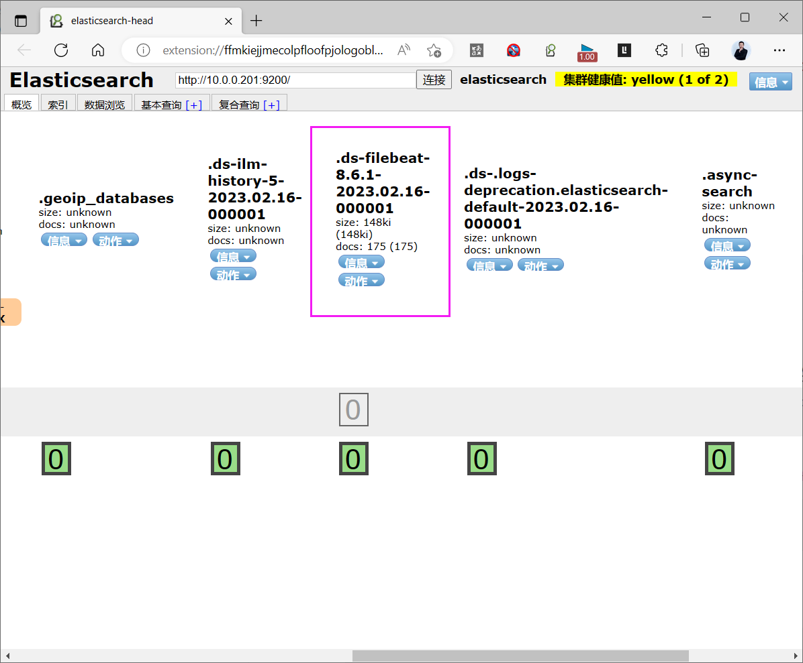

旧版

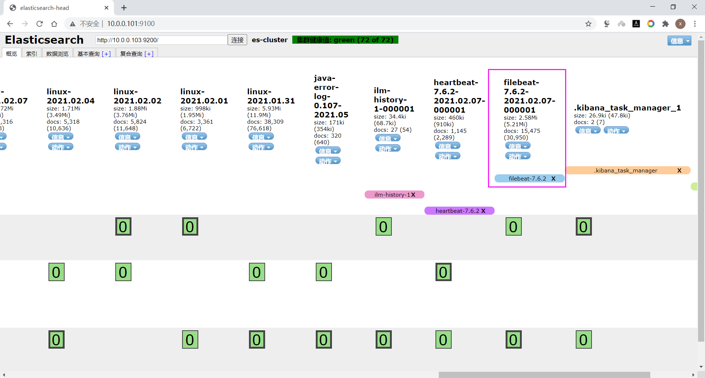

### 通过 Kibana 查看收集的日志信息

新版

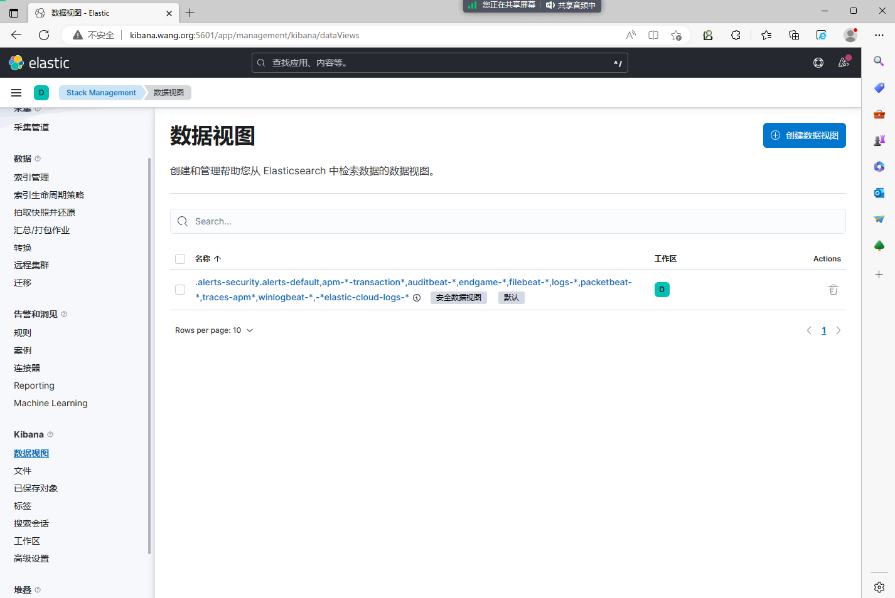


旧版

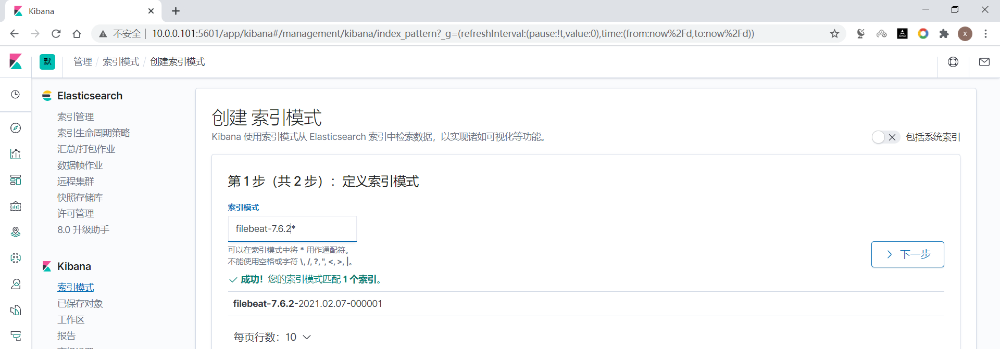

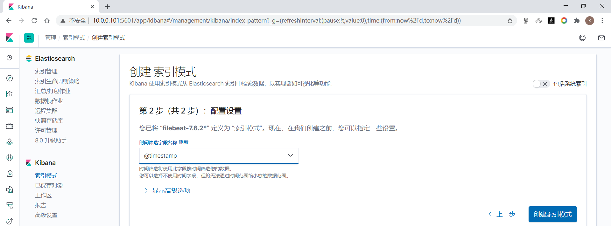

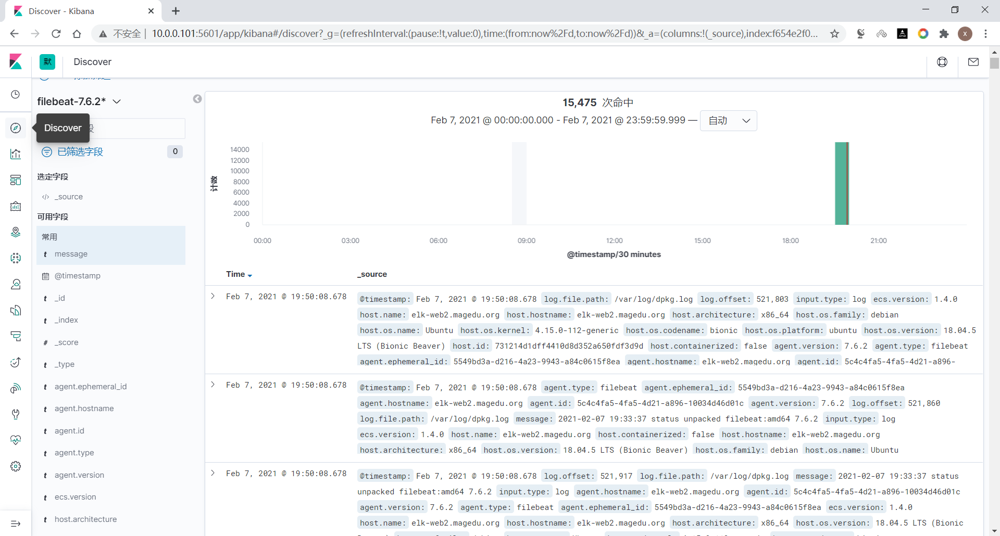

### 案例: 自定义索引名称收集日志到 ELasticsearch

### 修改配置

范例：9.X版本以后自定义索引名称收集所有系统日志到 ELasticsearch

```bash
[root@web01 ~]#cat  /etc/filebeat/filebeat.yml
filebeat.inputs:
- type: filestream
id: my-filestream-id
enabled: true
paths:
- /var/log/syslog         #注意:文件不能太小,要求超过1024字节
parsers:
- ndjson:
target: ""    #解析结果存放在指定字段下,如果为空,则保存在根下
#message_key: message   #对哪个字段做json解析,可选
#-------------------------- Elasticsearch output ------------------------------
output.elasticsearch:
hosts: ["10.0.0.101:9200","10.0.0.102:9200","10.0.0.103:9200"]   #指定ELK集群任意
节点的地址和端口,多个地址容错
index: "bowen-%{[agent.version]}-%{+yyyy.MM.dd}" #自定义索引名称，8.X的索引为.ds-
bowen, agent.version是filebeat添加的元数据字段
#注意: 8.X版生成的索引名为 .ds-bowen-%{[agent.version]}-日期-日期-00000n
#注意：如果自定义索引名称，没有添加下面三行的配置会导致filebeat无法启动，提示错误日志如下
#filebeat:Exiting: setup.template .name and setup.template .pattern have to be
set if index name is modifiedsystemd: #filebeat.service: main process exited,
code=exited，status=1/FAILURE
setup.ilm.enabled: false #关闭索引生命周期ilm功能，默认开启时索引名称只能为filebeat-*，自
定义索引名必须修改为false
setup.template.name: "bowen" #定义模板名称,要自定义索引名称,必须指定此项,否则无法启动
setup.template.pattern: "bowen-*" #定义模板的匹配索引名称,要自定义索引名称,必须指定此项,否
则无法启动
setup.template.settings:
index.number_of_shards: 3
index.number_of_replicas: 1
```

范例：8.X以前版本自定义索引名称收集所有系统日志到 ELasticsearch

```bash
[root@elk-web1 ~]#vi /etc/rsyslog.conf
.....
*.*  /var/log/system.log
[root@elk-web1 ~]#systemctl restart rsyslog
[root@elk-web1 ~]#vim /etc/filebeat/filebeat.yml
filebeat.inputs:
- type: log
json.keys_under_root: true
enabled: true                       #开启日志
paths:
- /var/log/system.log               #指定收集的日志文件
include_lines: ['sshd','failed', 'password']  #只过滤指定包含关健字的日志
#include_lines: ['^ERR', '^WARN']  #只过滤指定包含关健字的日志
#exclude_lines: ['Debug']           #排除包含关健字的日志
#exclude_files: ['.gz$']            #排除文件名包含关健字的日志文件
output.elasticsearch:
hosts: ["10.0.0.101:9200"]        #指定ES集群服务器地址和端口
index: "bowen-%{[agent.version]}-%{+yyyy.MM.dd}" #自定义索引名称，8.X的索引为.ds-
bowen, agent.version是filebeat添加的元数据字段
#注意: 8.X版生成的索引名为 .ds-bowen-%{[agent.version]}-日期-日期-00000n
#注意：如果自定义索引名称，没有添加下面三行的配置会导致filebeat无法启动，提示错误日志如下
#filebeat:Exiting: setup.template .name and setup.template .pattern have to be
set if index name is modifiedsystemd: #filebeat.service: main process exited,
code=exited，status=1/FAILURE
setup.ilm.enabled: false #关闭索引生命周期ilm功能，默认开启时索引名称只能为filebeat-*，自
定义索引名必须修改为false
setup.template.name: "bowen" #定义模板名称,要自定义索引名称,必须指定此项,否则无法启动
setup.template.pattern: "bowen-*" #定义模板的匹配索引名称,要自定义索引名称,必须指定此项,否
则无法启动
setup.template.settings:
index.number_of_shards: 3
index.number_of_replicas: 1
```

默认情况下 Filebeat 写入到 ES 的索引分片为1，副本数为1，如果需要修改分片和副本数，可以通过如下实现

```text
#方法1，修改filebeat.yml配置文件，此方式只适合直接连接ES时才有效，适用度不高
#注意:如果模板已经存在,需要先删除模板和索引才能生效,利用kibana或者cerebro（8.X不支持）插件
(more--index templates--existing templates--输入搜索的模板名bowen)
vim /etc/filebeat/filebeat.yml
setup.template.settings:
index.number_of_shards: 3
index.number_of_replicas: 1
#生效后，在cerebro插件中more--index templates--existing templates--输入搜索的模板名
bowen 中可以看到以下的分片和副本配置，8.X不支持
#settings中number_of_shards和number_of_replication
#方法2：也可以通过修下面方式修改,8.X不支持
1.停止filebeat服务
2.在cerebro web页面修改：修改模板settings 配置，调整分片以及副本
3.删除模板关联的索引
4.启动filebeat产生新的索引
```

范例： 自定义索引名称收集Nginx日志到 ELasticsearch

```bash
[root@elk-web1 ~]#apt update && apt -y install nginx
[root@elk-web1 ~]#vim /etc/filebeat/filebeat.yml
filebeat.inputs:
- type: log
enabled: true                             #开启日志
paths:
- /var/log/nginx/access.log               #指定收集的日志文件
output.elasticsearch:
hosts: ["10.0.0.101:9200"]        #指定ES集群服务器地址和端口
index: "nginx-access-%{[agent.version]}-%{+yyyy.MM.dd}" #自定义索引名称
setup.ilm.enabled: false
setup.template.name: "nginx" #定义模板名称,要自定义索引名称,必须指定此项,否则无法启动
setup.template.pattern: "nginx-*" #定义模板的匹配索引名称,要自定义索引名称,必须指定此项,
否则无法启动
setup.template.settings:
index.number_of_shards: 3
index.number_of_replicas: 1
```

### 启动服务

```bash
[root@elk-web1 ~]#systemctl enable --now filebeat.service
```

### 插件查看索引

新版索引名

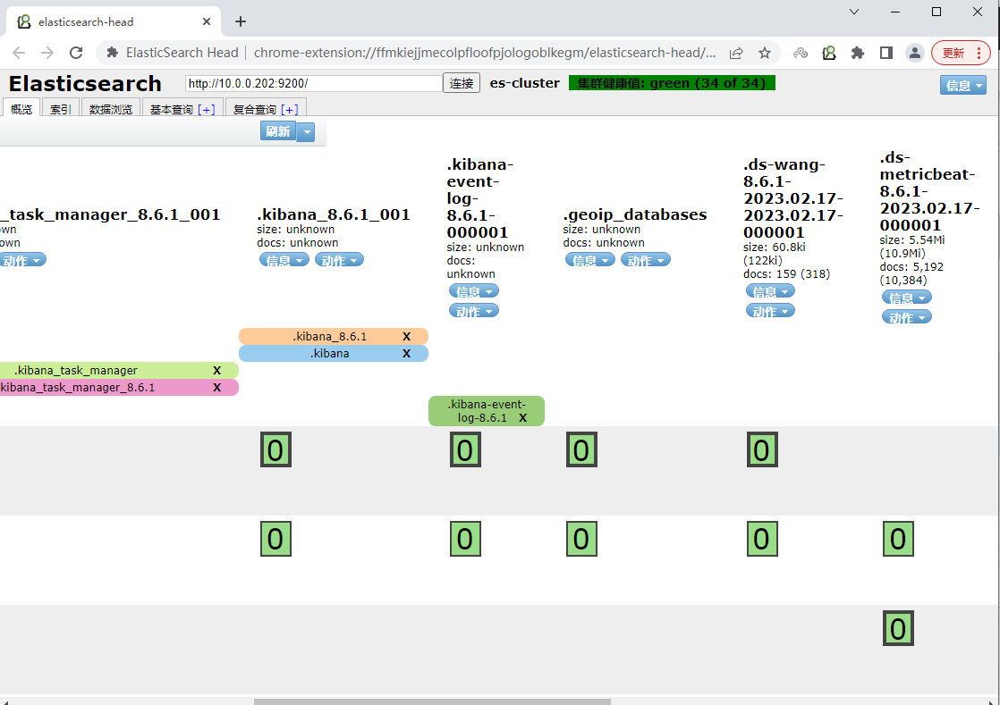

旧版索引名

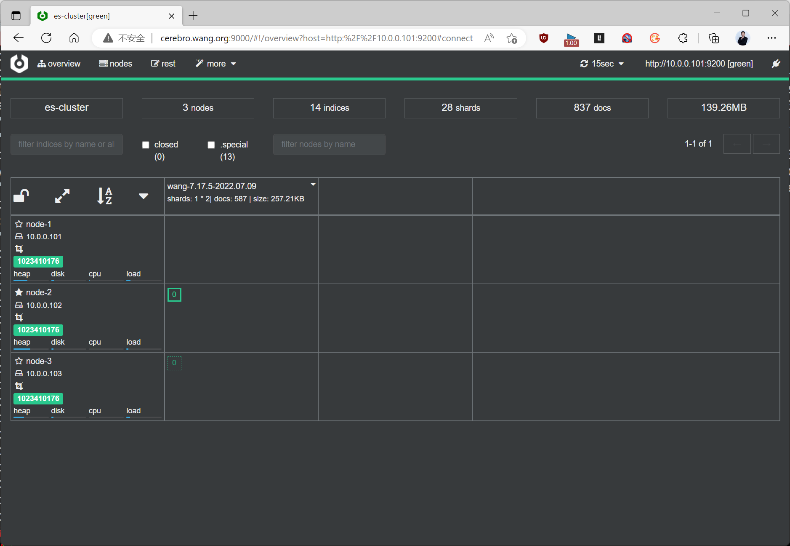

### 通过kibana查看收集的日志信息

新版

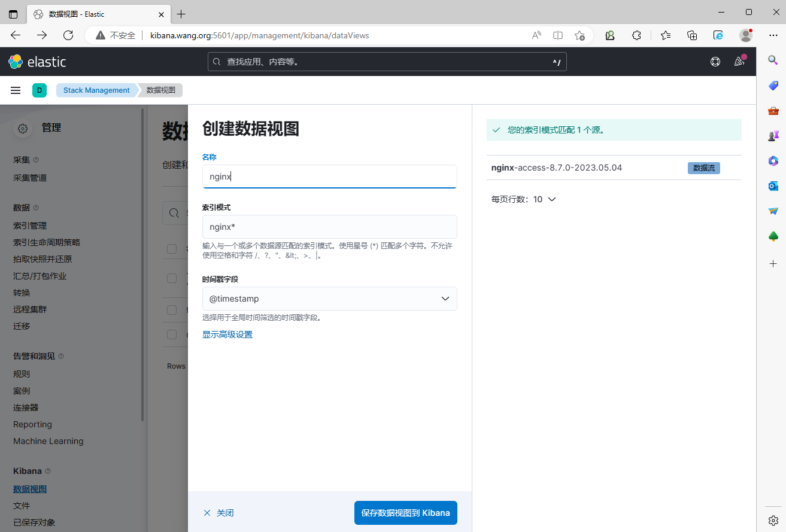

旧版

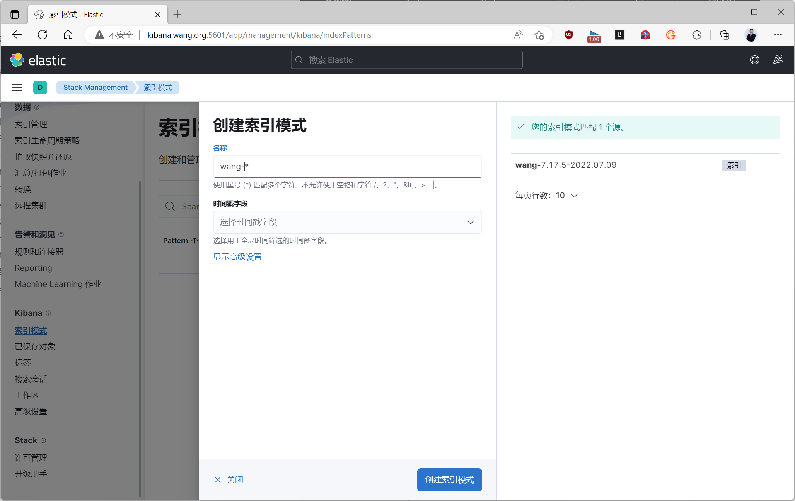

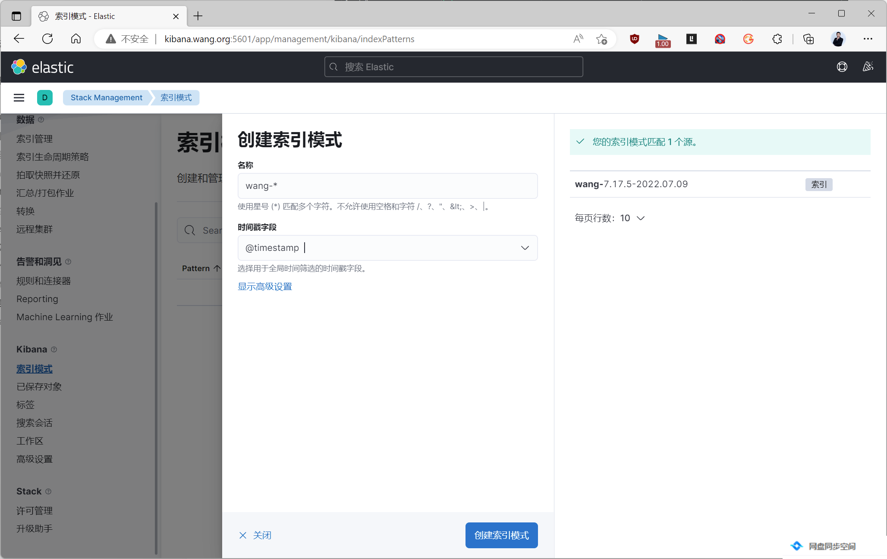

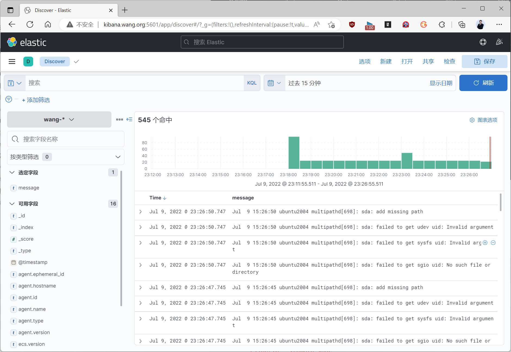

### 案例: 利用 tags 收集 Nginx的 Json 格式访问日志和错误日志到 Elasticsearch 不同的索引

官方文档

<https://www.elastic.co/guide/en/beats/filebeat/7.6/filebeat-input-log.html>

<https://www.elastic.co/guide/en/beats/filebeat/7.6/redis-output.html>

生产环境中经常需要获取Web访问用户的信息，比如:访问网站的PV、UV、状态码、用户来自哪个地区，访问时间等可以通过收集的Nginx的J访问日志实现

默认Nginx的每一次访问生成的访问日志是一行文本,ES没办法直接提取有效信息,不利于后续针对特定信息的分析

可以将Nginx访问日志转换为JSON格式解决这一问题

### 安装 nginx 配置访问日志使用 Json 格式

```bash
#安装Nginx
[root@elk-web1 ~]#apt update && apt -y install nginx
#修改nginx访问日志为Json格式
[root@elk-web1 ~]#vim /etc/nginx/nginx.conf
.....
log_format access_json '{"@timestamp":"$time_iso8601",'
'"host":"$server_addr",'
'"clientip":"$remote_addr",'
'"size":$body_bytes_sent,'
'"responsetime":$request_time,'
'"upstreamtime":"$upstream_response_time",'
'"upstreamhost":"$upstream_addr",'
'"http_host":"$host",'
'"uri":"$uri",'
'"domain":"$host",'
'"xff":"$http_x_forwarded_for",'
'"referer":"$http_referer",'
'"tcp_xff":"$proxy_protocol_addr",'
'"http_user_agent":"$http_user_agent",'
'"status":"$status"}';
access_log  /var/log/nginx/access_json.log access_json ;
#access_log /var/log/nginx/access.log;
error_log /var/log/nginx/error.log;
......
#默认开启nginx的错误日志,但如果是ubuntu,还需要修改下面行才能记录错误日志
[root@elk-web1 ~]#vim /etc/nginx/sites-available/default
location / {
# First attempt to serve request as file, then
# as directory, then fall back to displaying a 404.
#try_files $uri $uri/ =404; #将此行注释
[root@elk-web1 ~]#systemctl restart nginx
[root@elk-web1 ~]#ll /var/log/nginx/
total 1012
-rw-r--r-- 1 root root 1029780 Aug 25 15:34 access_json.log
-rw-r--r-- 1 root root     196 Aug 25 15:34 error.log
#用浏览器访问几次,包括404等错误访问,查看日志是否记录
[root@elk-web1 ~]#tail  /var/log/nginx/access_json.log
{"@timestamp":"2022-07-
10T14:07:47+00:00","host":"10.0.0.104","clientip":"10.0.0.1","size":3543,"respon
setime":0.000,"upstreamtime":"-","upstreamhost":"-
","http_host":"10.0.0.104","uri":"/index.html","domain":"10.0.0.104","xff":"-
","referer":"-","tcp_xff":"-","http_user_agent":"Mozilla/5.0 (Windows NT 10.0;
Win64; x64) AppleWebKit/537.36 (KHTML, like Gecko) Chrome/103.0.5060.114
Safari/537.36 Edg/103.0.1264.49","status":"200"}
{"@timestamp":"2022-07-
10T14:07:47+00:00","host":"10.0.0.104","clientip":"10.0.0.1","size":197,"respons
etime":0.000,"upstreamtime":"-","upstreamhost":"-
","http_host":"10.0.0.104","uri":"/icons/ubuntu-
logo.png","domain":"10.0.0.104","xff":"-
","referer":"http://10.0.0.104/","tcp_xff":"-","http_user_agent":"Mozilla/5.0
(Windows NT 10.0; Win64; x64) AppleWebKit/537.36 (KHTML, like Gecko)
Chrome/103.0.5060.114 Safari/537.36 Edg/103.0.1264.49","status":"404"}
[root@elk-web1 ~]#tail  /var/log/nginx/error.log
2022/07/10 14:07:47 [error] 63684#63684: *1 open() "/var/www/html/icons/ubuntu-
logo.png" failed (2: No such file or directory), client: 10.0.0.1, server: _,
request: "GET /icons/ubuntu-logo.png HTTP/1.1", host: "10.0.0.104", referrer:
"http://10.0.0.104/"
2022/07/10 14:07:47 [error] 63684#63684: *1 open() "/var/www/html/favicon.ico"
failed (2: No such file or directory), client: 10.0.0.1, server: _, request: "GET
/favicon.ico HTTP/1.1", host: "10.0.0.104", referrer: "http://10.0.0.104/"
2022/07/10 14:07:47 [error] 63684#63684: *1 open() "/var/www/html/icons/ubuntu-
logo.png" failed (2: No such file or directory), client: 10.0.0.1, server: _,
request: "GET /icons/ubuntu-logo.png HTTP/1.1", host: "10.0.0.104", referrer:
"http://10.0.0.104/"
2022/07/10 14:07:47 [error] 63684#63684: *1 open() "/var/www/html/favicon.ico"
failed (2: No such file or directory), client: 10.0.0.1, server: _, request: "GET
/favicon.ico HTTP/1.1", host: "10.0.0.104", referrer: "http://10.0.0.104/"
```

### 修改 Filebeat 配置文件

```bash
#要收集多台nginx服务器日志到同名的ES的索引中,只要filebeat的配置都使用如下相同的配置即可
#可以ES中通过filebeat输出中自动添加agent_name字段中记录的每个主机的主机名(要确保每个主机的主
机名不同)来区分日志来自于哪个主机
[root@elk-web1 ~]#cat  /etc/filebeat/filebeat.yml
filebeat.inputs:
- type: log
enabled: true
paths:
- /var/log/nginx/access_json.log
json.keys_under_root: true #默认false,只识别为普通文本,会将全部日志数据存储至message字
段，改为true则会以Json格式存储
json.overwrite_keys: true  #设为true,使用json格式日志中自定义的key替代默认的message字
段,此项可选
tags: ["nginx-access"]     #指定tag,用于分类
- type: log
enabled: true
paths:
- /var/log/nginx/error.log
tags: ["nginx-error"]
output.elasticsearch:
hosts: ["10.0.0.101:9200","10.0.0.102:9200","10.0.0.103:9200"]
indices:
- index: "nginx-access-%{[agent.version]}-%{+yyy.MM.dd}"
when.contains:
tags: "nginx-access"   #如果记志中有access的tag,就记录到nginx-access的索引中
- index: "nginx-error-%{[agent.version]}-%{+yyy.MM.dd}"
when.contains:
tags: "nginx-error"   #如果记志中有error的tag,就记录到nginx-error的索引中
setup.ilm.enabled: false #关闭索引生命周期ilm功能，默认开启时索引名称只能为filebeat-*
setup.template.name: "nginx" #定义模板名称,要自定义索引名称,必须指定此项,否则无法启动
setup.template.pattern: "nginx-*" #定义模板的匹配索引名称,要自定义索引名称,必须指定此项,
否则无法启动
setup.template.settings:
index.number_of_shards: 3
index.number_of_replicas: 1
[root@elk-web1 ~]#systemctl restart filebeat.service
```

### 插件查看索引

新版8.X

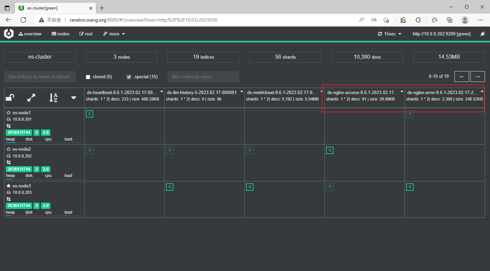

旧版7.X

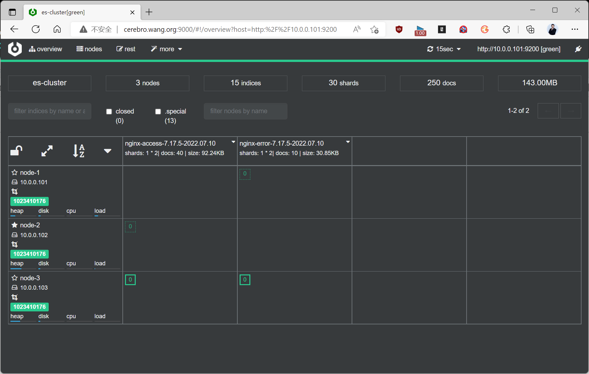

### 在 Kibana 验证日志数据

注意: Nginx 访问日志中的@timestamp被filebeat用日志收集的时间覆盖

新版: 8.X 以后创建数据视图

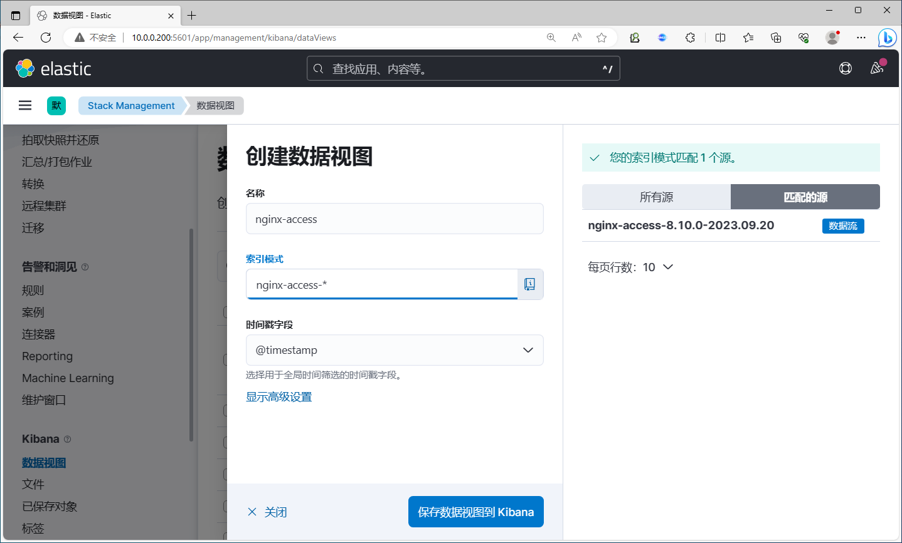

旧版：7.X 版之前创建索引模式


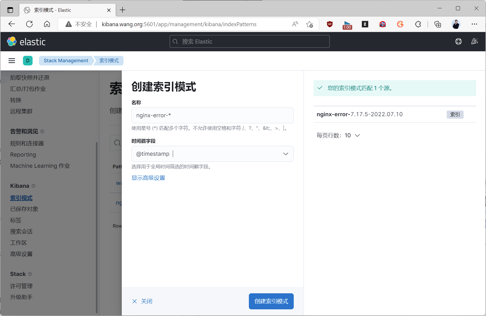

查看索引

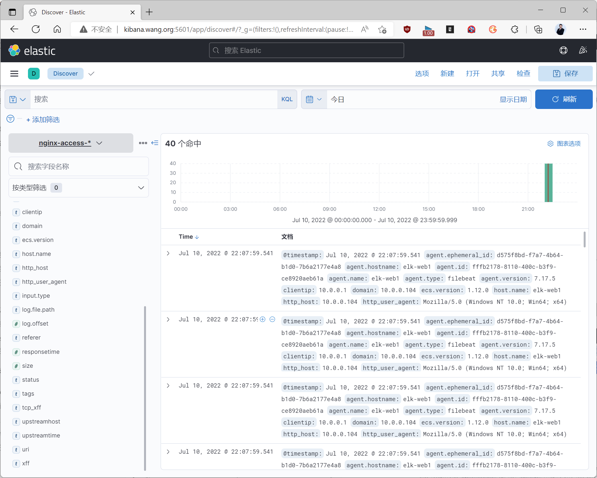

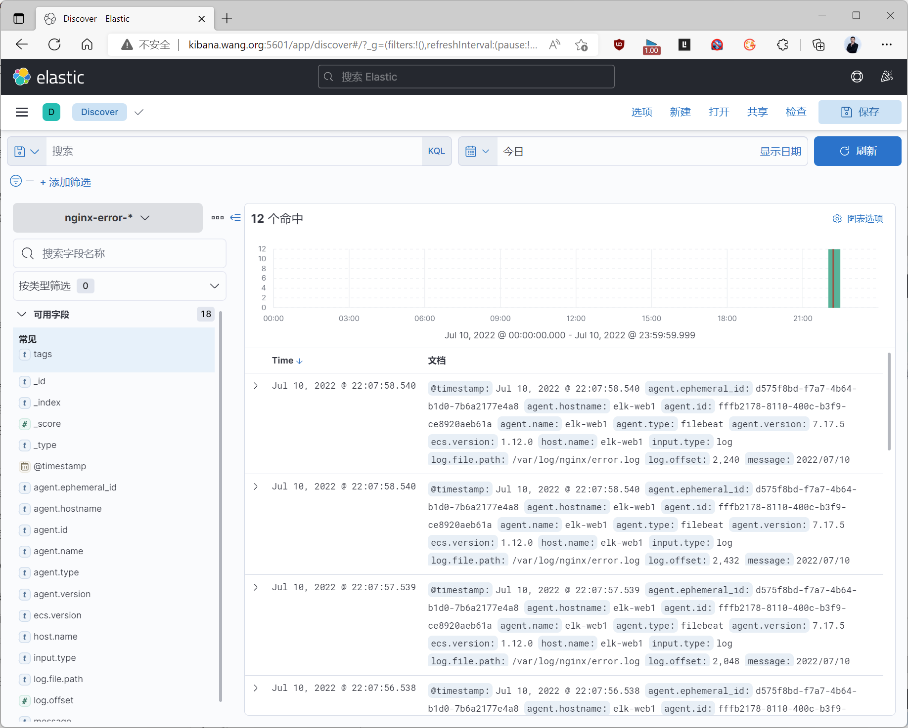

### 范例: 利用 fields 收集 Nginx的同一个访问日志中不同响应码的行到 Elasticsearch 不同的索引

```bash
[root@elk-web1 ~]#cat  /etc/filebeat/filebeat.yml
filebeat.inputs:
- type: log
enabled: true
paths:
- /var/log/nginx/access.log
include_lines: ['404']  #文件中包含404的行，grep 404 /var/log/nginx/access.log
fields:
status_code: "404"
- type: log
enabled: true
paths:
- /var/log/nginx/access.log
include_lines: ['200']    #文件中包含200的行，grep 200 /var/log/nginx/access.log
fields:
status_code: "200"
- type: log
enabled: true
paths:
- /var/log/nginx/access.log
include_lines: ['304']
fields:
status_code: "304"
# 输出到es的配置 - 通过when语句进行字段的条件判断
output.elasticsearch:
hosts: ["http://10.0.0.201:9200"]
#index: "myapp-404-%{+yyyy.MM.dd}"
#index: "myapp-%{[fields.status_code]}"
indices:
- index: "myapp-error-404-%{+yyyy.MM.dd}"
when.equals:
fields.status_code: "404"
- index: "myapp-ok-200-%{+yyyy.MM.dd}"
when.equals:
fields.status_code: "200"
- index: "myapp-red-304-%{+yyyy.MM.dd}"
when.equals:
fields.status_code: "304"
# 设定定制索引名称的配置
setup.ilm.enabled: false
#设定定制索引名称的配置格式1
setup.template:
enabled: true  #默认值，可选
name: "myapp"
pattern: "myapp-*"
#设定定制索引名称的配置格式2
setup.template.name: "myapp" #定义模板名称,要自定义索引名称,必须指定此项,否则无法启动
setup.template.pattern: "myapp-*" #定义模板的匹配索引名称,要自定义索引名称,必须指定此项,
否则无法启动
```

### 案例: 利用 Filebeat 收集 Tomat 的 Json 格式的访问日志和错误日志到 Elasticsearch

### 安装 Tomcat 并配置使用 Json 格式的访问日志

```bash
#安装Tomcat,可以包安装或者二进制安装
[root@ubuntu2404 ~]#apt update && apt -y install tomcat10
[root@ubuntu2204 ~]#apt update && apt -y install tomcat9
[root@ubuntu2004 ~]#apt update && apt -y install tomcat9 tomcat9-admin
[root@ubuntu2004 ~]#ll /var/lib/tomcat9/
total 20
drwxr-xr-x  5 root   root   4096 Aug  3 10:55 ./
drwxr-xr-x 44 root   root   4096 Aug  3 10:55 ../
lrwxrwxrwx  1 root   root     12 Jul 21 02:09 conf -> /etc/tomcat9/
drwxr-xr-x  2 tomcat tomcat 4096 Jul 21 02:09 lib/
lrwxrwxrwx  1 root   root     17 Jul 21 02:09 logs -> ../../log/tomcat9/
drwxr-xr-x  2 root   root   4096 Aug  3 10:55 policy/
drwxrwxr-x  3 tomcat tomcat 4096 Aug  3 10:55 webapps/
lrwxrwxrwx  1 root   root     19 Jul 21 02:09 work -> ../../cache/tomcat9/
[root@ubuntu2004 ~]#ll /var/lib/tomcat9/webapps/
total 12
drwxrwxr-x 3 tomcat tomcat 4096 Aug  3 10:55 ./
drwxr-xr-x 5 root   root   4096 Aug  3 10:55 ../
drwxr-xr-x 3 root   root   4096 Aug  3 10:55 ROOT/
[root@ubuntu2004 ~]#ls /etc/tomcat9/
Catalina  catalina.properties  context.xml  jaspic-providers.xml
logging.properties  policy.d  server.xml  tomcat-users.xml  web.xml
#修改 Tomcat 的访问日志为Json格式
#包安装
[root@ubuntu2004 ~]#vim /etc/tomcat9/server.xml
#二进制安装
[root@elk-web1 ~]#vim /usr/local/tomcat/conf/server.xml
.......
<Valve className="org.apache.catalina.valves.AccessLogValve" directory="logs"
prefix="localhost_access_log" suffix=".txt"
########################添加下面行,注意是一行,不要换行
#####################################
pattern="
{&quot;clientip&quot;:&quot;%h&quot;,&quot;ClientUser&quot;:&quot;%l&quot;,&quot
;authenticated&quot;:&quot;%u&quot;,&quot;AccessTime&quot;:&quot;%t&quot;,&quot;
method&quot;:&quot;%r&quot;,&quot;status&quot;:&quot;%s&quot;,&quot;SendBytes&qu
ot;:&quot;%b&quot;,&quot;Query?
string&quot;:&quot;%q&quot;,&quot;partner&quot;:&quot;%
{Referer}i&quot;,&quot;AgentVersion&quot;:&quot;%{User-Agent}i&quot;}"/>
################################################################################
######
</Host>
</Engine>
</Service>
</Server>
[root@elk-web1 ~]#systemctl restart tomcat9
#访问几次tomcat的页面,可以看到如下的Json格式日志
#包安装日志路径
[root@elk-web1 ~]#tail -n1 /var/log/tomcat9/localhost_access_log.2023-07-10.txt
#二进制安装日志路径
[root@elk-web1 ~]#tail -n1 /usr/local/tomcat/logs/localhost_access_log.2022-07-
11.txt
{"clientip":"10.0.0.1","ClientUser":"-","authenticated":"-","AccessTime":"
[11/Jul/2022:14:33:22 +0000]","method":"GET /
HTTP/1.1","status":"200","SendBytes":"11230","Query?string":"","partner":"-
","AgentVersion":"Mozilla/5.0 (Windows NT 10.0; Win64; x64) AppleWebKit/537.36
(KHTML, like Gecko) Chrome/103.0.5060.114 Safari/537.36 Edg/103.0.1264.49"}
```

### 修改 Filebeat 配置文件

```bash
[root@elk-web1 ~]#cat /etc/filebeat/filebeat.yml
filebeat.inputs:
- type: log
enabled: true
paths:
#- /usr/local/tomcat/logs/localhost_access_log.*  #二进制安装
- /var/log/tomcat9/localhost_access_log.*         #包安装
- /var/log/tomcat10/localhost_access_log.*         #包安装
json.keys_under_root: true  #默认False会将json数据存储至message，改为true则会独立
message外存储
json.overwrite_keys: false  #设为true,覆盖默认的message字段，使用自定义json格式中的
key
tags: ["tomcat-access"]
- type: log
enabled: true
paths:
#- /usr/local/tomcat/logs/catalina.*.log  #二进制安装
- /var/log/tomcat9/catalina.*.log       #包安装
- /var/log/tomcat10/catalina.*.log       #包安装
tags: ["tomcat-error"]
output.elasticsearch:
hosts: ["10.0.0.101:9200"]        #指定ELK集群服务器地址和端口
indices:
- index: "tomcat-access-%{[agent.version]}-%{+yyyy.MM.dd}"
when.contains:
tags: "tomcat-access"
- index: "tomcat-error-%{[agent.version]}-%{+yyyy.MM.dd}"
when.contains:
tags: "tomcat-error"
setup.ilm.enabled: false
setup.template.name: "tomcat"
setup.template.pattern: "tomcat-*"
setup.template.settings:
index.number_of_shards: 3
index.number_of_replicas: 1
```

### 插件查看索引

8.X

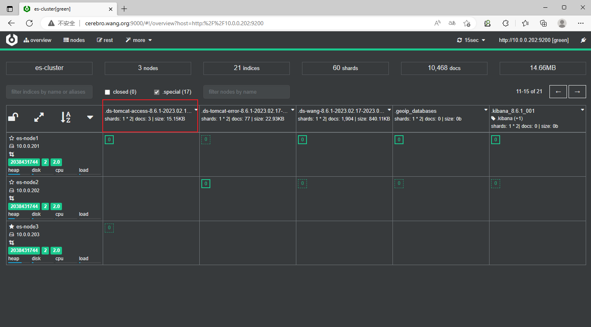

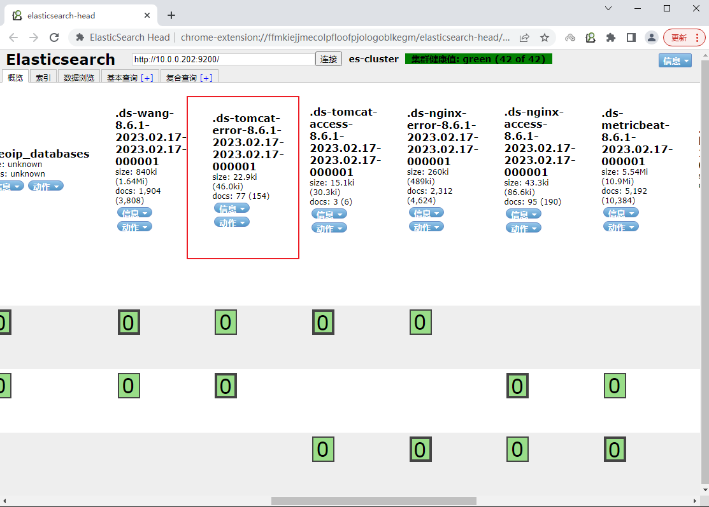

7.X

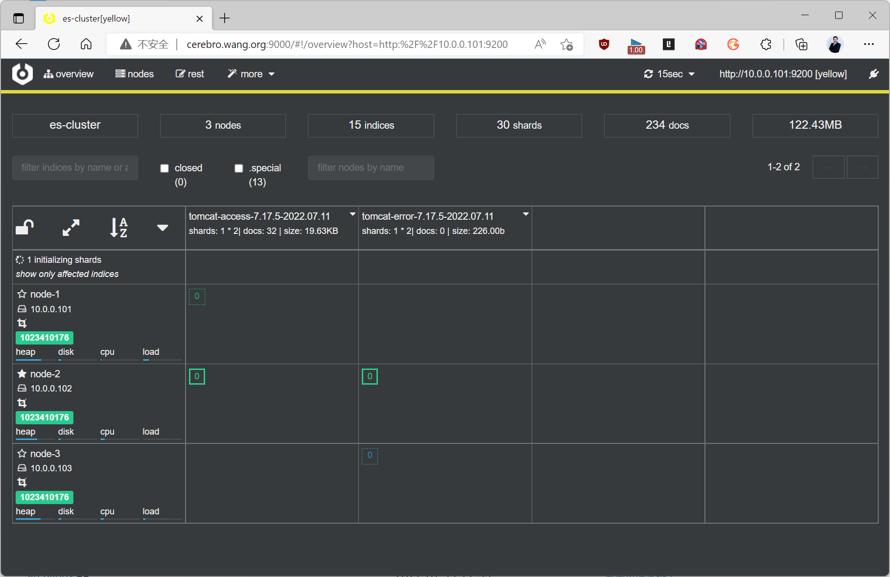

### 通过 Kibana 查看收集的日志信息

8.X

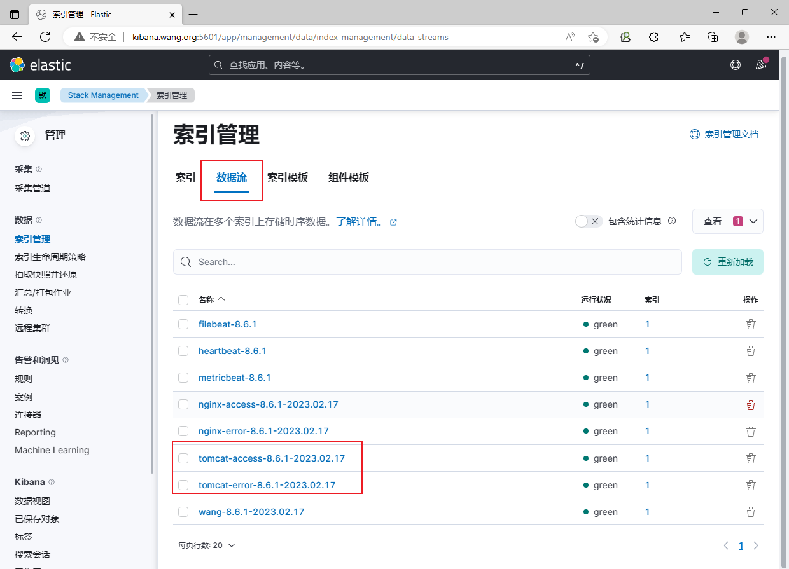

创建数据视图

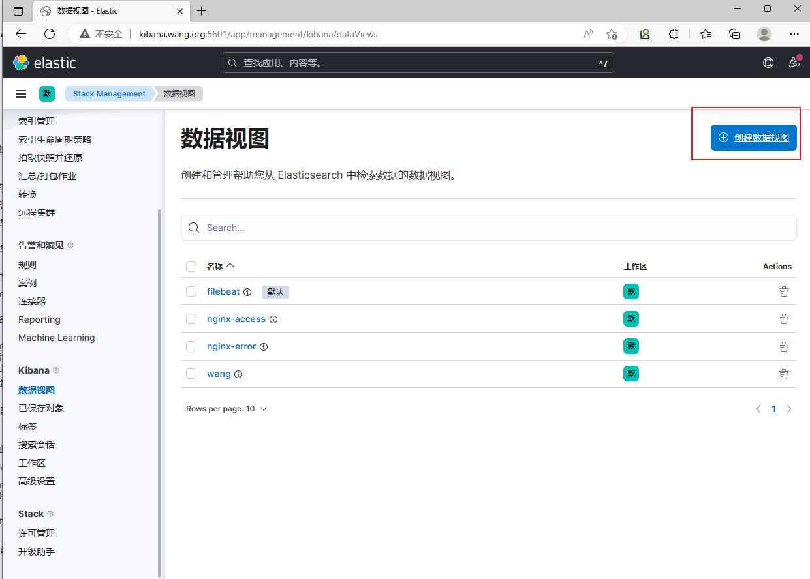

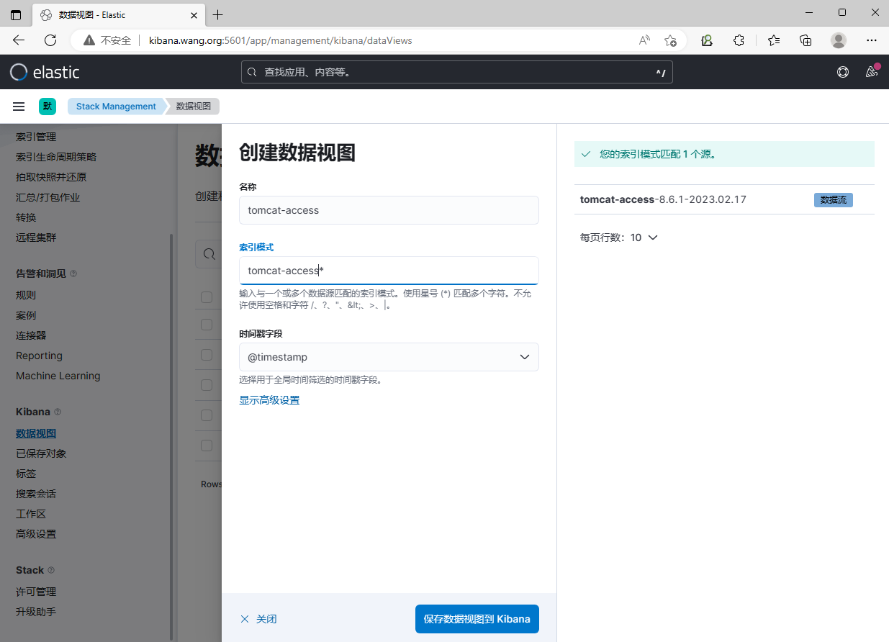

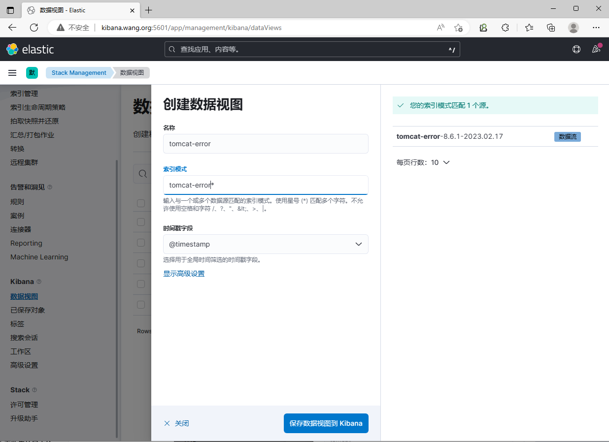

创建访问日志的索引模式


创建错误日志的索引模式

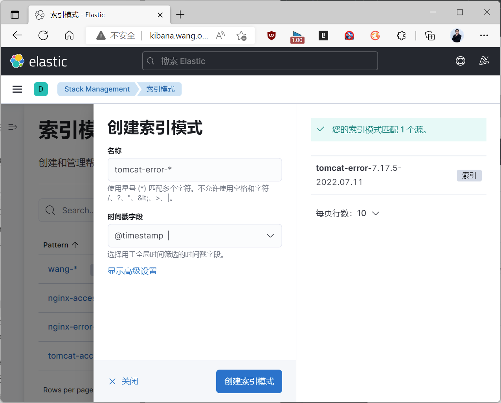

查看访问日志索引

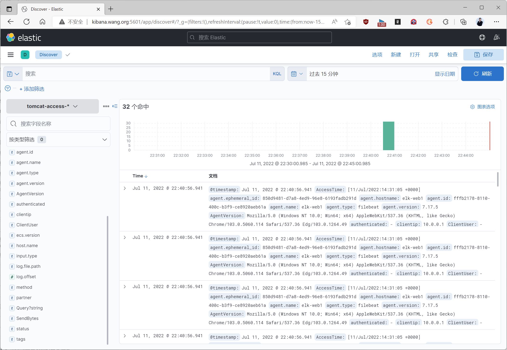

选中agent.name字段

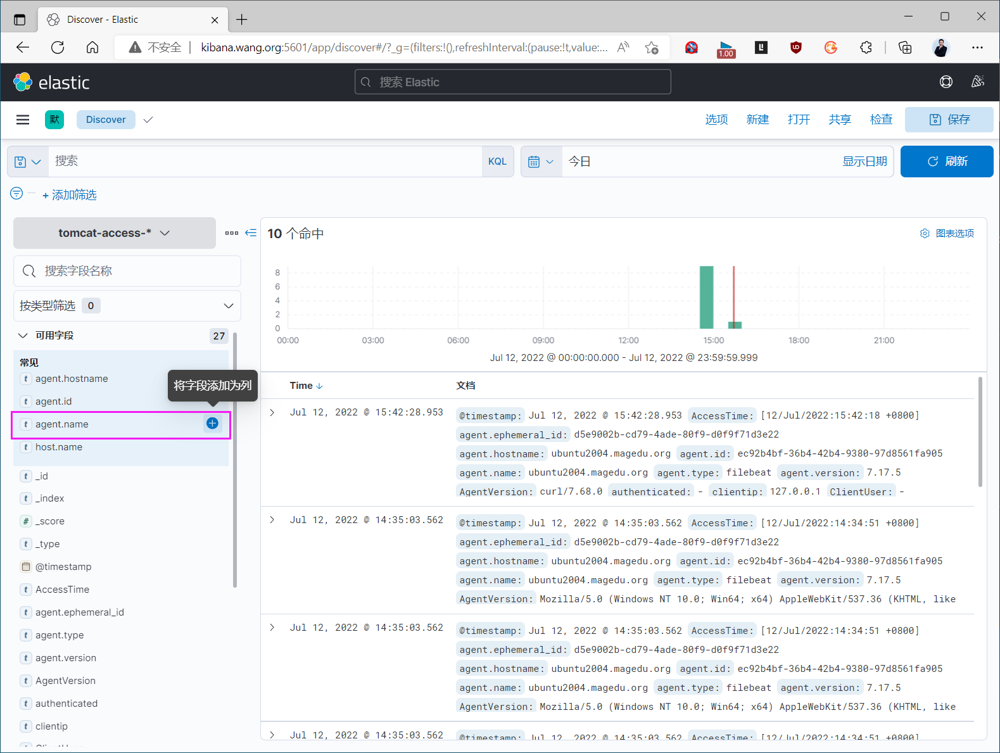

只显示指定字段,所以可以将多个tomcat主机的日志合并成一个索引,利用,再利用此字段区别不同的主机

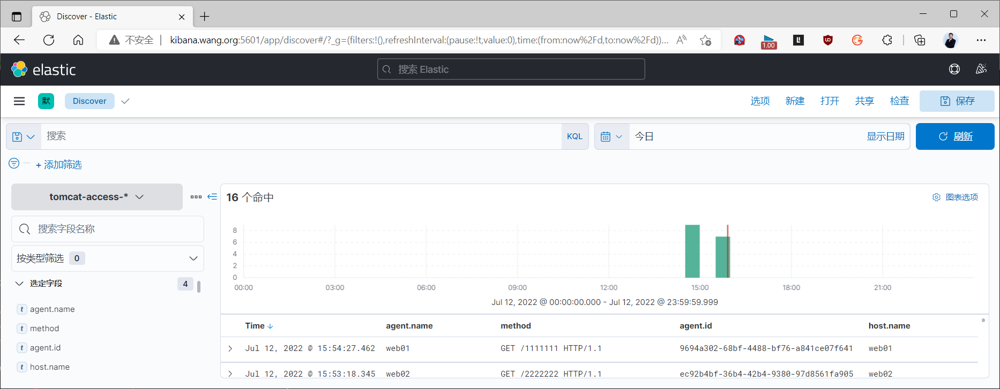

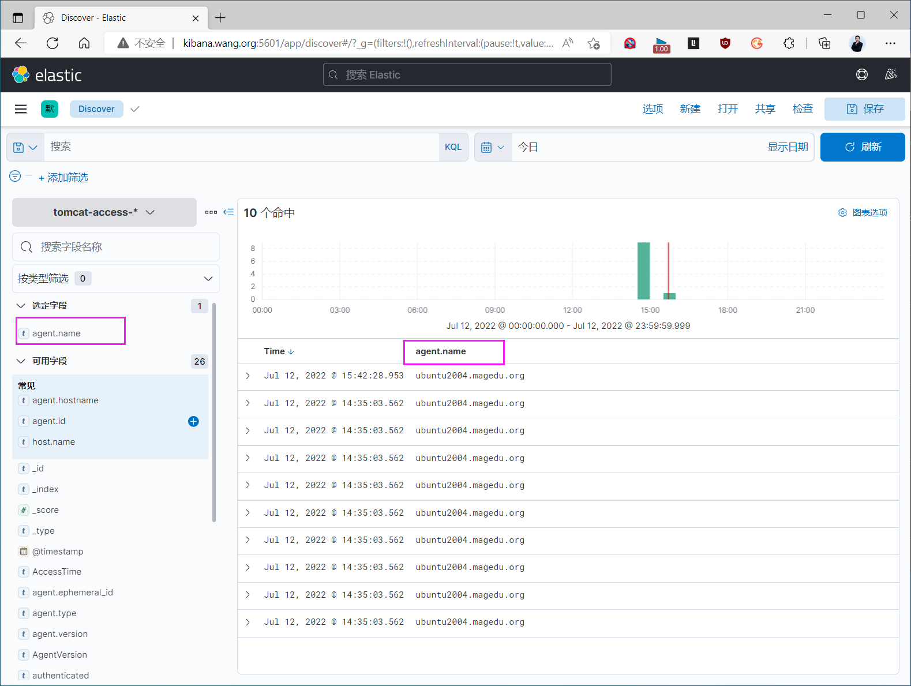

查看错误日志索引

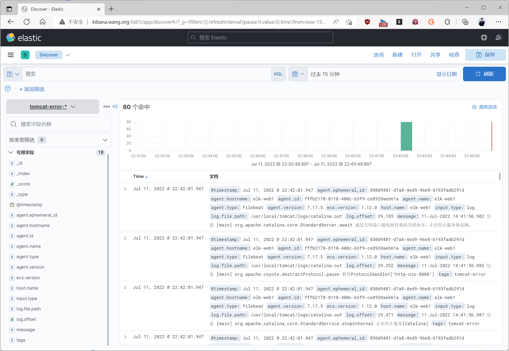

### 案例: 利用 Filebeat 收集 Tomat 的多行错误日志到 Elasticsearch

### Tomcat 错误日志解析

Tomcat 是 Java 应用,当只出现一个错误时,会显示很多行的错误日志,如下所示

```bash
#包安装
[root@ubuntu2004 ~]#tail -f /var/log/tomcat9/catalina.2021-12-03.log
.....
03-Dec-2022 20:58:24.379 警告 [Thread-2]
org.apache.catalina.loader.WebappClassLoaderBase.clearReferencesObjectStreamClas
sCaches 无法清除web应用程序[ROOT]的ObjectStreamClass$缓存中的软引用
java.lang.ClassCastException: class java.io.ObjectStreamClass$Caches$1
cannot be cast to class java.util.Map (java.io.ObjectStreamClass$Caches$1 and
java.util.Map are in module java.base of loader 'bootstrap')
at
org.apache.catalina.loader.WebappClassLoaderBase.clearCache(WebappClassLoaderBas
e.java:2325)
at
org.apache.catalina.loader.WebappClassLoaderBase.clearReferencesObjectStreamClas
sCaches(WebappClassLoaderBase.java:2300)
at
org.apache.catalina.loader.WebappClassLoaderBase.clearReferences(WebappClassLoad
erBase.java:1669)
at
org.apache.catalina.loader.WebappClassLoaderBase.stop(WebappClassLoaderBase.java
:1597)
at
org.apache.catalina.loader.WebappLoader.stopInternal(WebappLoader.java:463)
at org.apache.catalina.util.LifecycleBase.stop(LifecycleBase.java:257)
at
org.apache.catalina.core.StandardContext.stopInternal(StandardContext.java:5515)
at org.apache.catalina.util.LifecycleBase.stop(LifecycleBase.java:257)
at
org.apache.catalina.core.ContainerBase$StopChild.call(ContainerBase.java:1412)
at
org.apache.catalina.core.ContainerBase$StopChild.call(ContainerBase.java:1401)
at java.base/java.util.concurrent.FutureTask.run(FutureTask.java:264)
at
org.apache.tomcat.util.threads.InlineExecutorService.execute(InlineExecutorServi
ce.java:75)
at
java.base/java.util.concurrent.AbstractExecutorService.submit(AbstractExecutorSe
rvice.java:140)
at
org.apache.catalina.core.ContainerBase.stopInternal(ContainerBase.java:986)
at org.apache.catalina.util.LifecycleBase.stop(LifecycleBase.java:257)
at
org.apache.catalina.core.ContainerBase$StopChild.call(ContainerBase.java:1412)
at
org.apache.catalina.core.ContainerBase$StopChild.call(ContainerBase.java:1401)
at java.base/java.util.concurrent.FutureTask.run(FutureTask.java:264)
at
org.apache.tomcat.util.threads.InlineExecutorService.execute(InlineExecutorServi
ce.java:75)
at
java.base/java.util.concurrent.AbstractExecutorService.submit(AbstractExecutorSe
rvice.java:140)
at
org.apache.catalina.core.ContainerBase.stopInternal(ContainerBase.java:986)
at org.apache.catalina.util.LifecycleBase.stop(LifecycleBase.java:257)
at
org.apache.catalina.core.StandardService.stopInternal(StandardService.java:497)
at org.apache.catalina.util.LifecycleBase.stop(LifecycleBase.java:257)
at
org.apache.catalina.core.StandardServer.stopInternal(StandardServer.java:979)
at org.apache.catalina.util.LifecycleBase.stop(LifecycleBase.java:257)
at org.apache.catalina.startup.Catalina.stop(Catalina.java:849)
at
org.apache.catalina.startup.Catalina$CatalinaShutdownHook.run(Catalina.java:996)
03-Dec-2021 20:58:24.388 警告 [Thread-2]
org.apache.catalina.loader.WebappClassLoaderBase.clearReferencesObjectStreamClas
sCaches 无法清除web应用程序[host-manager]的ObjectStreamClass$缓存中的软引用
java.lang.ClassCastException: class java.io.ObjectStreamClass$Caches$1
cannot be cast to class java.util.Map (java.io.ObjectStreamClass$Caches$1 and
java.util.Map are in module java.base of loader 'bootstrap')
.....
#二进制安装
[root@ubuntu2004 ~]#tail  /usr/local/tomcat/logs/catalina.out
12-Jul-2021 14:05:58.190 WARNING [main]
org.apache.catalina.startup.Catalina.parseServerXml Unable to load server
configuration from [/usr/local/apache-tomcat-9.0.64/conf/server.xml]
org.xml.sax.SAXParseException; systemId: file:/usr/local/apache-tomcat-
8.5.61/conf/server.xml; lineNumber: 22; columnNumber: 1; Content is not allowed
in prolog.
at
com.sun.org.apache.xerces.internal.parsers.AbstractSAXParser.parse(AbstractSAXPa
rser.java:1243)
at
com.sun.org.apache.xerces.internal.jaxp.SAXParserImpl$JAXPSAXParser.parse(SAXPar
serImpl.java:644)
at org.apache.tomcat.util.digester.Digester.parse(Digester.java:1535)
at
org.apache.catalina.startup.Catalina.parseServerXml(Catalina.java:617)
at org.apache.catalina.startup.Catalina.load(Catalina.java:709)
at org.apache.catalina.startup.Catalina.load(Catalina.java:746)
at sun.reflect.NativeMethodAccessorImpl.invoke0(Native Method)
at
sun.reflect.NativeMethodAccessorImpl.invoke(NativeMethodAccessorImpl.java:62)
at
sun.reflect.DelegatingMethodAccessorImpl.invoke(DelegatingMethodAccessorImpl.jav
a:43)
at java.lang.reflect.Method.invoke(Method.java:498)
at org.apache.catalina.startup.Bootstrap.load(Bootstrap.java:305)
at org.apache.catalina.startup.Bootstrap.main(Bootstrap.java:475)
12-Jul-2021 14:05:58.191 SEVERE [main]
org.apache.catalina.startup.Catalina.start Cannot start server, server instance
is not configured
```

Java 应用的一个错误导致生成的多行日志其实是同一个事件的日志的内容而ES默认是根据每一行来区别不同的日志,就会导致一个错误对应多行错误信息会生成很多行的ES文档记录

可以将一个错误对应的多个行合并成一个ES的文档记录来解决此问题

官方文档

<https://www.elastic.co/guide/en/beats/filebeat/current/multiline-examples.html>

<https://www.elastic.co/guide/en/beats/filebeat/7.0/multiline-examples.html>

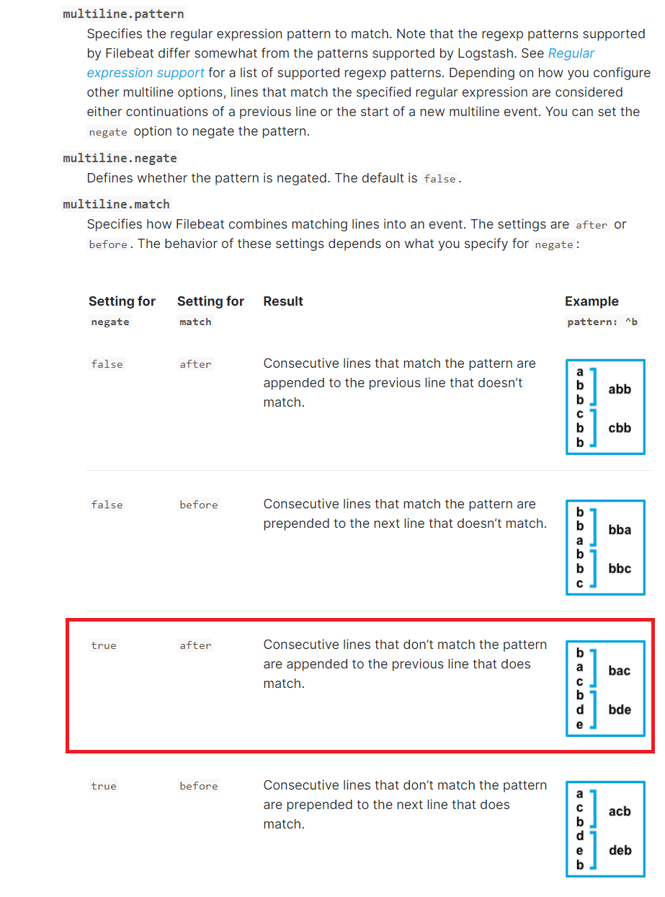

```text
#https://www.elastic.co/docs/reference/beats/filebeat/multiline-
examples#multiline
#filestream input
parsers:
- multiline:
type: pattern
pattern: '^\['
negate: true
match: after
#log input
multiline.type: pattern
multiline.pattern: '^\['
multiline.negate: true
multiline.match: after
```

### 安装 Tomcat 并配置

```xml
#包或者二进制安装Tomcat
[root@ubuntu2404 ~]#apt update && apt -y install tomcat10
[root@ubuntu2004 ~]#apt update && apt -y install tomcat9 tomcat9-admin
#包安装
[root@elk-web1 ~]#vim /etc/tomcat10/server.xml
#二进制安装Tomcat修改 Tomcat 的访问日志格式为 Json
[root@elk-web1 ~]#vim /usr/local/tomcat/conf/server.xml
.......
<Valve className="org.apache.catalina.valves.AccessLogValve" directory="logs"
prefix="localhost_access_log" suffix=".txt"
########################添加下面行,注意是一行,不要换行
#####################################
pattern="
{&quot;clientip&quot;:&quot;%h&quot;,&quot;ClientUser&quot;:&quot;%l&quot;,&quot
;authenticated&quot;:&quot;%u&quot;,&quot;AccessTime&quot;:&quot;%t&quot;,&quot;
method&quot;:&quot;%r&quot;,&quot;status&quot;:&quot;%s&quot;,&quot;SendBytes&qu
ot;:&quot;%b&quot;,&quot;Query?
string&quot;:&quot;%q&quot;,&quot;partner&quot;:&quot;%
{Referer}i&quot;,&quot;AgentVersion&quot;:&quot;%{User-Agent}i&quot;}"/>
######################################################################
</Host>
</Engine>
</Service>
</Server>
[root@elk-web1 ~]#systemctl restart tomcat
```

### 修改 Filebeat 配置文件

```bash
[root@elk-web1 ~]#cat /etc/filebeat/filebeat.yml
filebeat.inputs:
- type: log
enabled: true
paths:
#- /usr/local/tomcat/logs/localhost_access_log.* #二进制安装
#- /var/log/tomcat9/localhost_access_log.* #包安装
- /var/log/tomcat10/localhost_access_log.* #包安装
json.keys_under_root: true
json.overwrite_keys: false
tags: ["tomcat-access"]
- type: log
enabled: true
paths:
#- /usr/local/tomcat/logs/catalina.*.log #二进制安装
#- /var/log/tomcat9/catalina.*.log #包安装
- /var/log/tomcat10/catalina.*.log #包安装
tags: ["tomcat-error"]
#格式1
multiline.type: pattern            #此为默认值,可省略
multiline.pattern: '^[0-3][0-9]-'  #正则表达式匹配以两位,或者为'^\d{2}'
multiline.negate: true             #negate否定无效
multiline.match: after
multiline.max_lines: 5000          #默认只合并500行,指定最大合并5000行
#格式2
filebeat.inputs:
- type: filestream
parsers:
- multiline:
type: pattern
pattern: '^[0-3][0-9]-'
negate: true
match: after
output.elasticsearch:
hosts: ["10.0.0.101:9200"]
indices:
- index: "tomcat-access-%{[agent.version]}-%{+yyy.MM.dd}"
when.contains:
tags: "tomcat-access"
- index: "tomcat-error-%{[agent.version]}-%{+yyy.MM.dd}"
when.contains:
tags: "tomcat-error"
setup.ilm.enabled: false
setup.template.name: "tomcat"
setup.template.pattern: "tomcat-*"
```

### 插件查看索引

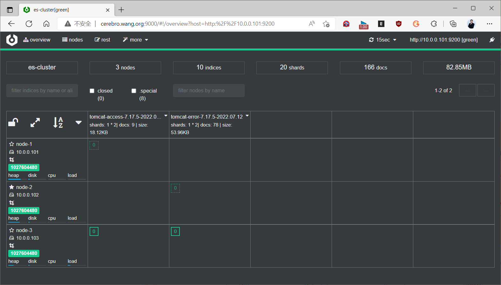

### 通过 Kibana 查看收集的日志信息

创建访问日志的索引模式


创建错误日志的索引模式

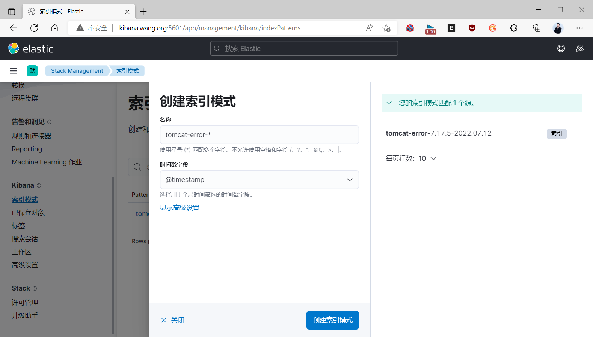

查看错误索引,可以看到多行合并为一个日志

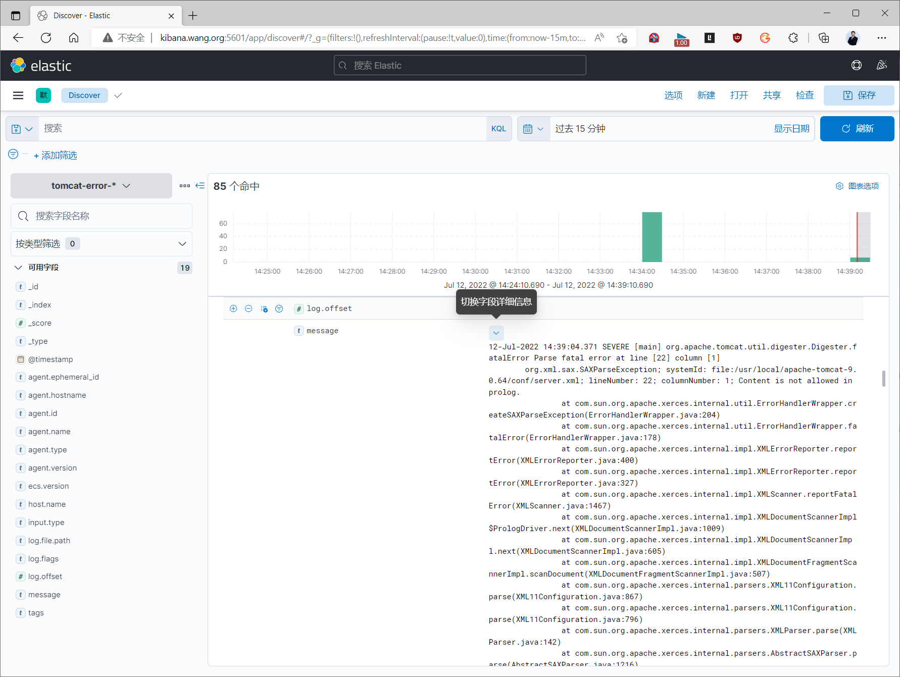

### 案例: 利用 Filebeat 收集 Nginx 日志到 Redis

官方文档

<https://www.elastic.co/guide/en/beats/filebeat/master/redis-output.html>

<https://www.elastic.co/guide/en/beats/filebeat/7.6/filebeat-input-log.html>

<https://www.elastic.co/guide/en/beats/filebeat/7.6/redis-output.html>

将 filebeat收集的日志,发送至Redis 格式如下

```text
output.redis:
hosts: ["localhost:6379"]
password: "my_password"
key: "filebeat"
db: 0
timeout: 5
```

范例:

```text
output.redis:
hosts: ["10.0.0.105:6379"]
password: "123456"
db: "0"
key: "filebeat" #所有日志都存放在key名称为filebeat的列表中，llen filebeat可查看长度，
即日志记录数
#keys: #也可以用下面的不同日志存放在不同的key的形式
#  - key: "nginx_access"
#    when.contains:
#    tags: "access"
#  - key: "nginx_error"
#    when.contains:
#    tags: "error"
```

### 安装 Nginx 配置访问日志使用 Json格式

```bash
[root@centos8 ~]#vim /etc/nginx/nginx.conf
.....
log_format access_json '{"@timestamp":"$time_iso8601",'
'"host":"$server_addr",'
'"clientip":"$remote_addr",'
'"size":$body_bytes_sent,'
'"responsetime":$request_time,'
'"upstreamtime":"$upstream_response_time",'
'"upstreamhost":"$upstream_addr",'
'"http_host":"$host",'
'"uri":"$uri",'
'"domain":"$host",'
'"xff":"$http_x_forwarded_for",'
'"referer":"$http_referer",'
'"tcp_xff":"$proxy_protocol_addr",'
'"http_user_agent":"$http_user_agent",'
'"status":"$status"}';
```

```bash
access_log  /var/log/nginx/access_json.log access_json ;
......
[root@centos8 ~]#ll /var/log/nginx/
total 1012
-rw-r--r-- 1 root root 1029780 Aug 25 15:34 access_json.log
-rw-r--r-- 1 root root     196 Aug 25 15:34 error.log
```

```bash
[root@centos8 ~]#tail -n1  /var/log/nginx/access_json.log
{"@timestamp":"2021-04-
21T03:05:14+08:00","host":"172.17.180.135","clientip":"103.229.183.40","size":47
89,"responsetime":0.047,"upstreamtime":"0.046","upstreamhost":"127.0.0.1:9000","
http_host":"www.bowenxiaochun.com","uri":"/index.php","domain":"www.bowenxiaochun.
com","xff":"-","referer":"-","tcp_xff":"","http_user_agent":"python-
requests/2.25.1","status":"200"}
```

### 安装和配置 Redis

```bash
[root@ubuntu1804 ~]#apt -y install redis
[root@ubuntu1804 ~]#sed -i.bak '/^bind.*/c bind 0.0.0.0'  /etc/redis/redis.conf
[root@ubuntu1804 ~]#systemctl restart  redis
```

### 修改 Filebeat 配置文件

```bash
[root@centos8 ~]#cat  /etc/filebeat/filebeat.yml
filebeat.inputs:
- type: log
enabled: true
paths:
- /var/log/nginx/access_json.log
json.keys_under_root: true #默认False会将json数据存储至message，改为true则会独立
message外存储
json.overwrite_keys: true  #设为true,覆盖默认的message字段，使用自定义json格式中的
key
tags: ["nginx-access"]
- type: log
enabled: true
paths:
- /var/log/nginx/error.log
tags: ["nginx-error"]
output.redis:
hosts: ["10.0.0.104:6379"]
key: "filebeat"
#password: "123456"
#db: 0
[root@centos8 ~]#systemctl restart filebeat.service
```

### 在 Redis 验证日志数据

```bash
[root@ubuntu1804 ~]#redis-cli
127.0.0.1:6379> keys *
1) "filebeat"
127.0.0.1:6379> type filebeat
list
127.0.0.1:6379> llen filebeat
(integer) 2097
127.0.0.1:6379> LINDEX filebeat 2096
"{\"@timestamp\":\"2021-08-25T07:57:46.000Z\",\"@metadata\":
{\"beat\":\"filebeat\",\"type\":\"_doc\",\"version\":\"7.6.2\"},\"http_user_agen
t\":\"curl/7.58.0\",\"upstreamhost\":\"-\",\"input\":
{\"type\":\"log\"},\"agent\":{\"type\":\"filebeat\",\"ephemeral_id\":\"04ea5e3e-
e79f-47c0-8947-
d9c84057d4f6\",\"hostname\":\"centos8.bowen.org\",\"id\":\"308f47e9-779a-4f44-
8dfc-
a3fe2d12b844\",\"version\":\"7.6.2\"},\"size\":3971,\"uri\":\"/404.html\",\"doma
in\":\"10.0.0.8\",\"referer\":\"-\",\"upstreamtime\":\"-\",\"xff\":\"-
\",\"http_host\":\"10.0.0.8\",\"tags\":[\"nginx-access\"],\"log\":
{\"offset\":1030081,\"file\":
{\"path\":\"/var/log/nginx/access_json.log\"}},\"host\":
{\"name\":\"centos8.bowen.org\"},\"status\":\"404\",\"responsetime\":0,\"ecs\":
{\"version\":\"1.4.0\"},\"clientip\":\"10.0.0.101\",\"tcp_xff\":\"\"}"
127.0.0.1:6379> LINDEX filebeat 2095
"{\"@timestamp\":\"2021-08-25T07:57:55.179Z\",\"@metadata\":
{\"beat\":\"filebeat\",\"type\":\"_doc\",\"version\":\"7.6.2\"},\"log\":
{\"file\":
{\"path\":\"/var/log/nginx/error.log\"},\"offset\":402},\"message\":\"2021/08/25
15:57:46 [error] 24983#0: *3 open() \\\"/usr/share/nginx/html/error2.html\\\"
failed (2: No such file or directory), client: 10.0.0.101, server: _, request:
\\\"GET /error2.html HTTP/1.1\\\", host: \\\"10.0.0.8\\\"\",\"tags\":[\"nginx-
error\"],\"input\":{\"type\":\"log\"},\"ecs\":{\"version\":\"1.4.0\"},\"host\":
{\"name\":\"centos8.bowen.org\"},\"agent\":{\"id\":\"308f47e9-779a-4f44-8dfc-
a3fe2d12b844\",\"version\":\"7.6.2\",\"type\":\"filebeat\",\"ephemeral_id\":\"04
ea5e3e-e79f-47c0-8947-d9c84057d4f6\",\"hostname\":\"centos8.bowen.org\"}}"
127.0.0.1:6379>
```

### 案例: 从标准输入读取再输出至 Kafka

<https://www.elastic.co/guide/en/beats/filebeat/current/kafka-output.html>

范例

```bash
[root@elk-web1 ~]#vim /etc/filebeat/filebeat-kafka.yml
filebeat.inputs:
- type: stdin
enabled: true
output.kafka:
hosts: ["10.0.0.201:9092", "10.0.0.202:9092", "10.0.0.203:9092"]
topic: filebeat-log       #指定kafka的topic
partition.round_robin:
reachable_only: true    #true表示只发布到可用的分区，不可用分区就不发布，false 时表示
所有分区，如果一个节点down，会block
required_acks: 1          #如果为0，不启用确认机制，错误消息可能会丢失，1等待写入主分区
（默认），-1等待写入副本分区
compression: gzip
max_message_bytes: 1000000 #每条消息最大长度，以字节为单位，如果超过将丢弃
```

```bash
[root@elk-web1 ~]#filebeat -e -c /etc/filebeat/filebeat-kafka.yml
```

```text
#查看kafka是否收到数据
[kafka ~]#/usr/local/kafka/bin/kafka-topics.sh --list --bootstrap-server
10.0.0.201:9092
[kafka ~]#/usr/local/kafka/bin/kafka-console-consumer.sh --topic filebeat-log --
bootstrap-server 10.0.0.201:9092 --from-beginning
```

### 案例: 从标准输入读取再输出至 Logstash

```bash
[root@elk-web1 ~]#vim /etc/filebeat/filebeat.yml
filebeat.inputs:
- type: stdin
enabled: true
output.logstash:
hosts: ["10.0.0.104:5044","10.0.0.105:5044"]
index: filebeat
loadbalance: true    #默认为false,只随机输出至一个可用的logstash,设为true,则输出至全部
logstash
worker: 1            #线程数量
compression_level: 3 #压缩比
```



<nav class="article-end" aria-label="章节导航">
  <a href="{{ '/subjects/ELK/14-monitoring-with-heartbeat.html' | relative_url }}">← Previous: Monitoring with Heartbeat</a>
  <a href="{{ '/subjects/ELK/' | relative_url }}">Back to ELK Log Analytics Index</a>
  <a href="{{ '/subjects/ELK/16-introduction-to-logstash.html' | relative_url }}">Next: Introduction to Logstash →</a>
</nav>
