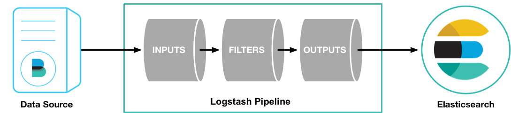

[← 返回ELK 日志分析目录]({{ '/subjects/ELK/' | relative_url }})



# 16 Logstash 介绍
## 4 Logstash 过滤

### 4.1 Logstash 介绍

Logstash 是免费且开放的服务器端数据处理管道，能够从多个来源采集数据，转换数据，然后将数据发送到您最喜欢的一个或多个“存储库”中

Logstash 是整个ELK中拥有最丰富插件的一个组件,而且支持可以水平伸缩

Logstash 基于 Java 和 Ruby 语言开发

Logstash  官网:

<https://www.elastic.co/cn/logstash/>

Logstash 官方说明

<https://www.elastic.co/guide/en/logstash/current/index.html>

<https://www.elastic.co/guide/en/logstash/7.6/index.html>

Logstash 架构：

输入 Input：用于日志收集,常见插件: Stdin、File、Kafka、Redis、Filebeat、Http 过滤 Filter：日志过滤和转换,常用插件: grok、date、geoip、mutate、useragent 输出 Output：将过滤转换过的日志输出, 常见插件: File,Stdout,Elasticsearch,MySQL,Redis,Kafka

Logstash 和 Filebeat 比较

Logstash 功能更丰富,可以支持直接将非Josn 格式的日志统一转换为Json格式,且支持多目标输出, 和filebeat相比有更为强大的过滤转换功能 Logstash 资源消耗更多,不适合在每个需要收集日志的主机上安装



<nav class="article-end" aria-label="章节导航">
  <a href="{{ '/subjects/ELK/15-collecting-logs-with-filebeat.html' | relative_url }}">← Previous: Collecting Logs with Filebeat</a>
  <a href="{{ '/subjects/ELK/' | relative_url }}">Back to ELK Log Analytics Index</a>
  <a href="{{ '/subjects/ELK/17-installing-logstash.html' | relative_url }}">Next: Installing Logstash →</a>
</nav>
