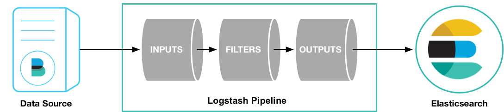

[← 返回ELK 日志分析目录]({{ '/subjects/ELK/' | relative_url }})



# 16 Logstash 介绍
## 4 Logstash 过滤

### 4.1 Logstash 介绍

Logstash 是服务器端数据处理管道，负责从数据源读取事件、按规则转换字段，再输出到一个或多个目标。它的插件生态覆盖多种输入、过滤和输出方式；多实例可以分担吞吐，但还需考虑队列、下游写入能力和配置一致性。Logstash 运行于 JVM，插件生态中也使用 Ruby。

### 参考资料

<https://www.elastic.co/cn/logstash/>

<https://www.elastic.co/guide/en/logstash/current/index.html>

<https://www.elastic.co/guide/en/logstash/7.6/index.html>

### 数据流：输入、过滤、输出

| 阶段 | 作用 | 常见插件示例 |
| --- | --- | --- |
| Input | 从来源读取事件 | `stdin`、`file`、`beats`、`kafka`、`redis`、`http` |
| Filter | 解析、补充和转换字段 | `grok`、`date`、`geoip`、`mutate`、`useragent` |
| Output | 将处理后的事件写入目标 | `stdout`、`file`、`elasticsearch`、`redis`、`kafka` |

并非每条管道都需要过滤阶段。例如 Filebeat 已输出结构化 JSON 时，可以只做少量字段整理。将原始日志解析为 JSON 字段时，必须先确定日志格式、时区和异常记录的处理方式。

### 与 Filebeat 的分工

Filebeat 更适合部署在日志源附近，低资源开销地读取文件并传输事件；Logstash 更擅长复杂解析、字段转换和多目标路由，但资源开销也更高。常见组合是 **Filebeat → Logstash → Elasticsearch**；若不需要复杂处理，也可以 **Filebeat → Elasticsearch**，不必在每台主机上安装 Logstash。



<nav class="article-end" aria-label="章节导航">
  <a href="{{ '/subjects/ELK/15-collecting-logs-with-filebeat.html' | relative_url }}">← 上一篇：使用 Filebeat 采集日志</a>
  <a href="{{ '/subjects/ELK/' | relative_url }}">返回 ELK 日志分析目录</a>
  <a href="{{ '/subjects/ELK/17-installing-logstash.html' | relative_url }}">下一篇：安装 Logstash →</a>
</nav>
