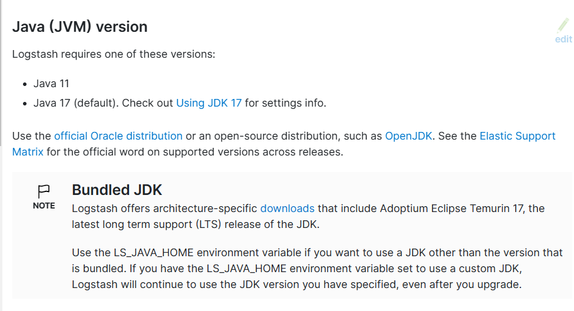

[← 返回ELK 日志分析目录]({{ '/subjects/ELK/' | relative_url }})



# 17 Logstash 安装
### 4.2 Logstash 安装

Logstash 可通过软件包、压缩包或容器镜像部署。先确定 Elasticsearch 与 Logstash 的版本兼容关系、预期数据源、输出目标及服务账号权限，再选择安装方式。参考[官方安装文档](https://www.elastic.co/guide/en/logstash/current/installing-logstash.html)。

### 4.2.1 Java 与版本准备

当前常见的官方 Logstash 发行包自带 JDK；是否另装 Java 取决于具体版本和包类型。不要同时照抄 Java 8、11、17、21 的安装命令，更不要通过关闭防火墙、SELinux 或把 Logstash 服务改为 root 来绕过权限问题。



从[官方 Logstash 下载页](https://www.elastic.co/downloads/logstash)获取与主机平台匹配的包。以 Debian/Ubuntu 为例，下载后在包所在目录执行（文件名按实际版本替换）：

```bash
sudo apt install ./logstash-8.17.0-amd64.deb
sudo systemctl enable --now logstash
sudo systemctl status logstash --no-pager
sudo journalctl -u logstash -n 50 --no-pager
```

这里的 `8.17.0` 仅是包名示例，应与实际 Elasticsearch 版本兼容。RHEL 系统使用相应 RPM 包和包管理器；不要将旧版 7.6.2 的路径与新版配置混用。

### 4.2.2 区分设置文件与管道文件

包安装时，`/etc/logstash/logstash.yml` 管理节点与管道运行参数；`/etc/logstash/pipelines.yml` 指定管道配置位置，常见路径是 `/etc/logstash/conf.d/*.conf`。管道本身由 `input`、可选 `filter` 和 `output` 构成。先用一个不连接外部系统的例子验证运行环境：

```text
input { stdin {} }
output { stdout { codec => rubydebug } }
```

将其保存为 `test.conf` 后，可在测试环境用 Logstash 命令检查并运行。服务模式下应把文件放入配置目录，并确认 `logstash` 用户对输入文件、队列目录和日志目录有**所需的最小权限**。若无法读取源文件，优先调整文件所属组或采集方案，而不是把整个服务改成 root。

`pipeline.workers`、`pipeline.batch.size`、JVM 堆大小等参数会影响吞吐和内存，先测量瓶颈再调整。原资料把配置、注释和 `ps` 输出粘在同一代码块中，并给出固定值 `1000`，不适合当通用优化建议。

### 4.2.3 容器方式的配置位置

官方容器镜像通常从 `/usr/share/logstash/pipeline/` 读取管道配置，从 `/usr/share/logstash/config/` 读取运行设置。绑定挂载前，先在宿主机准备文件并检查容器内的读取权限；若用自定义镜像，应删除或替换基础镜像的示例管道，避免两套管道同时运行。

```bash
docker run --rm -it \
  -v "$PWD/pipeline:/usr/share/logstash/pipeline:ro" \
  docker.elastic.co/logstash/logstash:8.17.0
```

如果配置里含密码，应使用 Logstash keystore 或合适的密钥管理机制。环境变量和绑定挂载的配置会有不同的优先级及可见性；选定一种清晰的配置来源，不要把敏感值写进镜像或仓库。容器镜像标签同样应与实际集群版本匹配。



<nav class="article-end" aria-label="章节导航">
  <a href="{{ '/subjects/ELK/16-introduction-to-logstash.html' | relative_url }}">← 上一篇：Logstash 介绍</a>
  <a href="{{ '/subjects/ELK/' | relative_url }}">返回 ELK 日志分析目录</a>
  <a href="{{ '/subjects/ELK/18-using-logstash.html' | relative_url }}">下一篇：Logstash 使用 →</a>
</nav>
