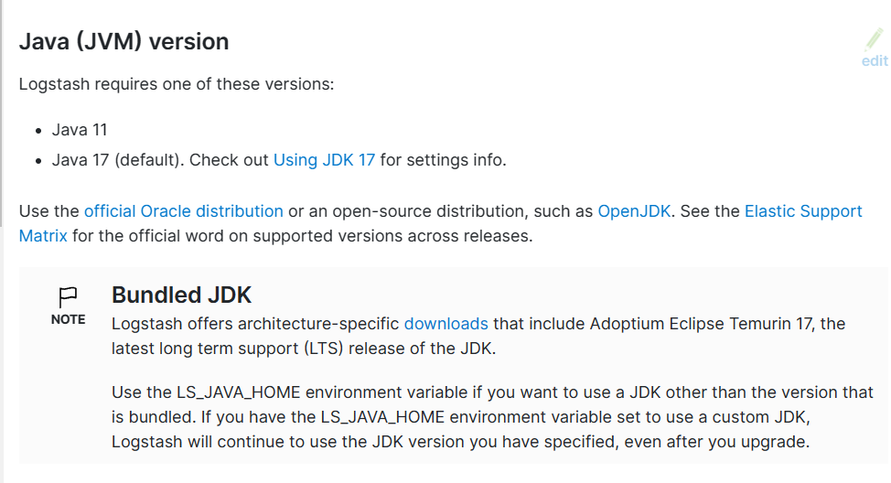

[← 返回ELK 日志分析目录]({{ '/subjects/ELK/' | relative_url }})



# 17 Logstash 安装
### 4.2 Logstash 安装

安装要求

<https://www.elastic.co/guide/en/logstash/current/getting-started-with-logstash.html>

安装方法

<https://www.elastic.co/guide/en/logstash/current/installing-logstash.html>

可以支持下面安装方法

二进制包仓库 Docker 容器

### 环境准备安装 Java 环境

注意: 8.X版本之后的logstash包已经内置了JDK无需安装

新版 Logstash 要求 JAVA 要求 11和17

<https://www.elastic.co/guide/en/logstash/current/getting-started-with-logstash.html>



### Ubuntu 环境准备

```bash
#9.X要求安装JDK17或21,9.X版logstash包已经内置了JDK无需安装
#8.X要求安装JDK11或17,8.X版logstash包已经内置了JDK无需安装
[root@logstash ~]#apt update && apt -y install openjdk-17-jdk
[root@logstash ~]#apt update && apt -y install openjdk-11-jdk
#7.X要求安装JDK8
[root@logstash ~]#apt -y install openjdk-8-jdk
```

### CentOS 环境准备

关闭防火墙和 SELinux

```bash
[root@logstash ~]# systemctl disable --now firewalld
[root@logstash ~]# sed -i '/SELINUX/s/enforcing/disabled/' /etc/selinux/config
[root@logstash ~]# setenforce 0
```

安装 Java 环境

```bash
#安装oracle 的JDK
[root@logstash ~]# yum install jdk-8u121-linux-x64.rpm
[root@logstash ~]# java -version
java version "1.8.0_121"
Java(TM) SE Runtime Environment (build 1.8.0_121-b13)
Java HotSpot(TM) 64-Bit Server VM (build 25.121-b13, mixed mode)
#或者安装OpenJDK
[root@logstash ~]# yum -y install java-1.8.0-openjdk
[root@logstash ~]# java -version
openjdk version "1.8.0_302"
OpenJDK Runtime Environment (build 1.8.0_302-b08)
OpenJDK 64-Bit Server VM (build 25.302-b08, mixed mode)
```

### 包安装 Logstash

注意:  Logstash 版本要和 Elasticsearch 相同的版本，否则可能会出错

Logstash 官方下载链接:

<https://www.elastic.co/cn/downloads/logstash>

<https://www.elastic.co/cn/downloads/past-releases#logstash>

镜像网站下载链接

<https://mirrors.tuna.tsinghua.edu.cn/elasticstack/>

### Ubuntu 安装 Logstash

范例：8.X版本的包安装

```bash
[root@logstash ~]#wget
https://mirrors.tuna.tsinghua.edu.cn/elasticstack/8.x/apt/pool/main/l/logstash/l
ogstash-8.6.1-amd64.deb
[root@logstash ~]#dpkg -i logstash-8.6.1-amd64.deb
[root@logstash ~]#systemctl enable --now logstash.service
```

范例：7.X版本的包安装

```bash
[root@logstash ~]#wget
https://mirrors.tuna.tsinghua.edu.cn/elasticstack/7.x/apt/pool/main/l/logstash/l
ogstash-7.6.2-amd64.deb
[root@logstash ~]#dpkg -i logstash-7.6.2-amd64.deb
Selecting previously unselected package logstash.
(Reading database ... 74411 files and directories currently installed.)
Preparing to unpack logstash-7.6.2.deb ...
Unpacking logstash (1:7.6.2-1) ...
Setting up logstash (1:7.6.2-1) ...
Using provided startup.options file: /etc/logstash/startup.options
OpenJDK 64-Bit Server VM warning: Option UseConcMarkSweepGC was deprecated in
version 9.0 and will likely be removed in a future release.
WARNING: An illegal reflective access operation has occurred
WARNING: Illegal reflective access by com.headius.backport9.modules.Modules to
method sun.nio.ch.NativeThread.signal(long)
WARNING: Please consider reporting this to the maintainers of
com.headius.backport9.modules.Modules
WARNING: Use --illegal-access=warn to enable warnings of further illegal
reflective access operations
WARNING: All illegal access operations will be denied in a future release
/usr/share/logstash/vendor/bundle/jruby/2.5.0/gems/pleaserun-
0.0.30/lib/pleaserun/platform/base.rb:112: warning: constant ::Fixnum is
deprecated
Successfully created system startup script for Logstash
[root@logstash ~]#systemctl enable --now logstash.service
#生成专有用户logstash,以此用户启动服务,后续使用时可能会存在权限问题
[root@logstash ~]#id logstash
用户id=998(logstash) 组id=999(logstash) 组=999(logstash)
[root@logstash ~]#ps aux|grep logstash
logstash    1217  162 19.8 3648608 394320 ?      SNsl 12:25   0:19
/usr/share/logstash/jdk/bin/java -Xms1g -Xmx1g -Djava.awt.headless=true -
Dfile.encoding=UTF-8 -Djruby.compile.invokedynamic=true -
XX:+HeapDumpOnOutOfMemoryError -Djava.security.egd=file:/dev/urandom -
Dlog4j2.isThreadContextMapInheritable=true -Djruby.regexp.interruptible=true -
Djdk.io.File.enableADS=true --add-
exports=jdk.compiler/com.sun.tools.javac.api=ALL-UNNAMED --add-
exports=jdk.compiler/com.sun.tools.javac.file=ALL-UNNAMED --add-
exports=jdk.compiler/com.sun.tools.javac.parser=ALL-UNNAMED --add-
exports=jdk.compiler/com.sun.tools.javac.tree=ALL-UNNAMED --add-
exports=jdk.compiler/com.sun.tools.javac.util=ALL-UNNAMED --add-
opens=java.base/java.security=ALL-UNNAMED --add-opens=java.base/java.io=ALL-
UNNAMED --add-opens=java.base/java.nio.channels=ALL-UNNAMED --add-
opens=java.base/sun.nio.ch=ALL-UNNAMED --add-
opens=java.management/sun.management=ALL-UNNAMED -cp
/usr/share/logstash/vendor/jruby/lib/jruby.jar:/usr/share/logstash/logstash-
core/lib/jars/checker-qual-3.12.0.jar:/usr/share/logstash/logstash-
core/lib/jars/commons-codec-1.15.jar:/usr/share/logstash/logstash-
core/lib/jars/commons-compiler-3.1.0.jar:/usr/share/logstash/logstash-
core/lib/jars/commons-logging-1.2.jar:/usr/share/logstash/logstash-
core/lib/jars/error_prone_annotations-2.11.0.jar:/usr/share/logstash/logstash-
core/lib/jars/failureaccess-1.0.1.jar:/usr/share/logstash/logstash-
core/lib/jars/google-java-format-1.15.0.jar:/usr/share/logstash/logstash-
core/lib/jars/guava-31.1-jre.jar:/usr/share/logstash/logstash-
core/lib/jars/httpclient-4.5.13.jar:/usr/share/logstash/logstash-
core/lib/jars/httpcore-4.4.14.jar:/usr/share/logstash/logstash-
core/lib/jars/j2objc-annotations-1.3.jar:/usr/share/logstash/logstash-
core/lib/jars/jackson-annotations-2.13.3.jar:/usr/share/logstash/logstash-
core/lib/jars/jackson-core-2.13.3.jar:/usr/share/logstash/logstash-
core/lib/jars/jackson-databind-2.13.3.jar:/usr/share/logstash/logstash-
core/lib/jars/jackson-dataformat-cbor-2.13.3.jar:/usr/share/logstash/logstash-
core/lib/jars/jackson-dataformat-yaml-2.13.3.jar:/usr/share/logstash/logstash-
core/lib/jars/janino-3.1.0.jar:/usr/share/logstash/logstash-
core/lib/jars/javassist-3.29.0-GA.jar:/usr/share/logstash/logstash-
core/lib/jars/jsr305-3.0.2.jar:/usr/share/logstash/logstash-core/lib/jars/jvm-
options-parser-8.6.1.jar:/usr/share/logstash/logstash-
core/lib/jars/listenablefuture-9999.0-empty-to-avoid-conflict-with-
guava.jar:/usr/share/logstash/logstash-core/lib/jars/log4j-1.2-api-
2.17.1.jar:/usr/share/logstash/logstash-core/lib/jars/log4j-api-
2.17.1.jar:/usr/share/logstash/logstash-core/lib/jars/log4j-core-
2.17.1.jar:/usr/share/logstash/logstash-core/lib/jars/log4j-jcl-
2.17.1.jar:/usr/share/logstash/logstash-core/lib/jars/log4j-slf4j-impl-
2.17.1.jar:/usr/share/logstash/logstash-core/lib/jars/logstash-
core.jar:/usr/share/logstash/logstash-core/lib/jars/reflections-
0.10.2.jar:/usr/share/logstash/logstash-core/lib/jars/slf4j-api-
1.7.32.jar:/usr/share/logstash/logstash-core/lib/jars/snakeyaml-1.30.jar
org.logstash.Logstash --path.settings /etc/logstash
```

### RHEL系列安装 Logstash

范例: 包安装

```bash
[root@logstash ~]#wget
https://mirrors.tuna.tsinghua.edu.cn/elasticstack/7.x/yum/7.6.2/logstash-
7.6.2.rpm
[root@logstash ~]#yum install logstash-7.6.2.rpm
[root@logstash ~]#chown logstash.logstash /usr/share/logstash/data/queue –R #权限
更改为logstash用户和组，否则启动的时候日志报错
```

### 修改 Logstash 配置(可选)

```bash
#默认配置可以不做修改
[root@logstash ~]#vim /etc/logstash/logstash.yml
[root@logstash ~]#grep -Ev '#|^$' /etc/logstash/logstash.yml
node.name: logstash-node01
pipeline.workers: 2
pipeline.batch.size: 1000    #批量从IPNPUT读取的消息个数，可以根据ES的性能做性能优化
pipeline.batch.delay: 5      #处理下一个事件前的最长等待时长，以毫秒ms为单位,可以根据ES的
性能做性能优化
path.data: /var/lib/logstash #默认值
path.logs: /var/log/logstash #默认值
#内存优化
[root@logstash ~]#vim /etc/logstash/jvm.options
-Xms1g
-Xmx1g
#Logstash默认以logstash用户运行,如果logstash需要收集本机的日志,可能会有权限问题,可以修改为
root
[root@logstash ~]#vim /lib/systemd/system/logstash.service
[Service]
User=root
Group=root
#查看子配置文件路径:/etc/logstash/conf.d/*.conf
[root@logstash ~]#cat /etc/logstash/pipelines.yml
# This file is where you define your pipelines. You can define multiple.
# For more information on multiple pipelines, see the documentation:
#   https://www.elastic.co/guide/en/logstash/current/multiple-pipelines.html
- pipeline.id: main
path.config: "/etc/logstash/conf.d/*.conf"
[root@logstash ~]#systemctl daemon-reload && systemctl restart logstash
```

### 基于 docker 安装 logstash

<https://www.elastic.co/guide/en/logstash/current/docker.html>

<https://www.elastic.co/guide/en/logstash/7.17/docker-config.html>

Logstash differentiates between two types of configuration: Settings and Pipeline Configuration.

Pipeline Configuration

It is essential to place your pipeline configuration where it can be found by Logstash. By default, the container will look in /usr/share/logstash/pipeline/ for pipeline configuration files. In this example we use a bind-mounted volume to provide the configuration via the docker run command:

```text
docker run --rm -it -v ~/pipeline/:/usr/share/logstash/pipeline/
docker.elastic.co/logstash/logstash:7.17.12
```

Every file in the host directory ~/pipeline/ will then be parsed by Logstash as pipeline configuration.

If you don’t provide configuration to Logstash, it will run with a minimal config that listens for messages from the Beats input plugin and echoes any that are received to stdout . In this case, the startup logs will be similar to the following:

```text
Sending Logstash logs to /usr/share/logstash/logs which is now configured via
log4j2.properties.
[2016-10-26T05:11:34,992][INFO ][logstash.inputs.beats    ] Beats inputs:
Starting input listener {:address=>"0.0.0.0:5044"}
[2016-10-26T05:11:35,068][INFO ][logstash.pipeline        ] Starting pipeline
{"id"=>"main", "pipeline.workers"=>4, "pipeline.batch.size"=>125,
"pipeline.batch.delay"=>5, "pipeline.max_inflight"=>500}
[2016-10-26T05:11:35,078][INFO ][org.logstash.beats.Server] Starting server on
port: 5044
[2016-10-26T05:11:35,078][INFO ][logstash.pipeline        ] Pipeline main
started
[2016-10-26T05:11:35,105][INFO ][logstash.agent           ] Successfully started
Logstash API endpoint {:port=>9600}
```

This is the default configuration for the image, defined in /usr/share/logstash/pipeline/logstash.conf . If this is the behaviour that you are observing, ensure that your pipeline configuration is being picked up correctly, and that you are replacing either logstash.conf or the entire pipeline directory.

Settings

The image provides several methods for configuring settings. The conventional approach is to provide a custom logstash.yml file, but it’s also possible to use environment variables to define settings.

Bind-mounted settings files

Settings files can also be provided through bind-mounts. Logstash expects to find them at /usr/share/logstash/config/ .

It’s possible to provide an entire directory containing all needed files:

```text
docker run --rm -it -v ~/settings/:/usr/share/logstash/config/
docker.elastic.co/logstash/logstash:7.17.12
```

Alternatively, a single file can be mounted:

```text
docker run --rm -it -v
~/settings/logstash.yml:/usr/share/logstash/config/logstash.yml
docker.elastic.co/logstash/logstash:7.17.12
```

Bind-mounted configuration files will retain the same permissions and ownership within the container that they have on the host system. Be sure to set permissions such that the files will be readable and, ideally, not writeable by the container’s logstash user (UID 1000).

Custom Images

Bind-mounted configuration is not the only option, naturally. If you prefer the Immutable Infrastructure approach, you can prepare a custom image containing your configuration by using a Dockerfile like this one:

```dockerfile
FROM docker.elastic.co/logstash/logstash:7.17.12
RUN rm -f /usr/share/logstash/pipeline/logstash.conf
ADD pipeline/ /usr/share/logstash/pipeline/
ADD config/ /usr/share/logstash/config/
```

Be sure to replace or delete logstash.conf in your custom image, so that you don’t retain the example config from the base image.

Environment variable configuration

Under Docker, Logstash settings can be configured via environment variables. When the container starts, a helper process checks the environment for variables that can be mapped to Logstash settings. Settings that are found in the environment override those in the logstash.yml as the container starts up.

For compatibility with container orchestration systems, these environment variables are written in all capitals, with underscores as word separators.

Some example translations are shown here:

Table 1. Example Docker Environment Variables

Environment Variable Logstash Setting

```text
PIPELINE_WORKERS
pipeline.workers
LOG_LEVEL
log.level
MONITORING_ENABLED
monitoring.enabled
```

In general, any setting listed in the settings documentation can be configured with this technique.

Defining settings with environment variables causes logstash.yml to be modified in place. This behaviour is likely undesirable if logstash.yml was bind-mounted from the host system. Thus, it is not recommended to combine the bind-mount technique with the environment variable technique. It is best to choose a single method for defining Logstash settings.

Docker defaults

The following settings have different default values when using the Docker images:

http.host 0.0.0.0

```text
monitoring.elasticsearch.hosts
http://elasticsearch:9200
```



<nav class="article-end" aria-label="章节导航">
  <a href="{{ '/subjects/ELK/16-introduction-to-logstash.html' | relative_url }}">← Previous: Introduction to Logstash</a>
  <a href="{{ '/subjects/ELK/' | relative_url }}">Back to ELK Log Analytics Index</a>
  <a href="{{ '/subjects/ELK/18-using-logstash.html' | relative_url }}">Next: Using Logstash →</a>
</nav>
