[← 返回 ELK 日志分析目录]({{ '/subjects/ELK/' | relative_url }})



# 18 Logstash 使用

Logstash 管道由 **input → filter → output** 组成：输入负责接收事件，过滤器解析与转换字段，输出决定去向。一个管道可以包含多个输入和输出；不同于 Filebeat 的单一输出类型，Logstash 可按条件把事件送往不同目标。本章按“先用标准输入看清事件 → 接入日志来源 → 逐步过滤 → 写入目标并验证”的顺序学习插件，避免原教程中大量跨版本运行日志打断阅读。


<details>
<summary>Logstash 命令与插件目录（3 张）</summary>

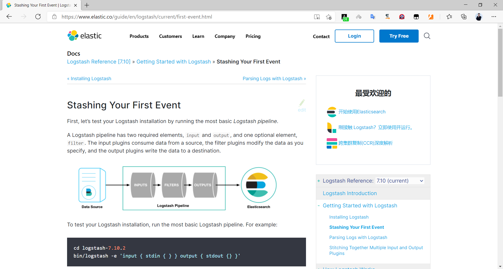

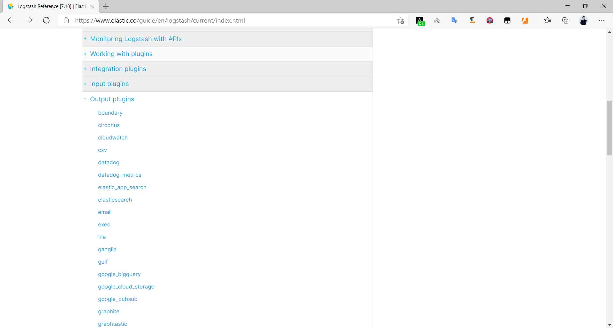

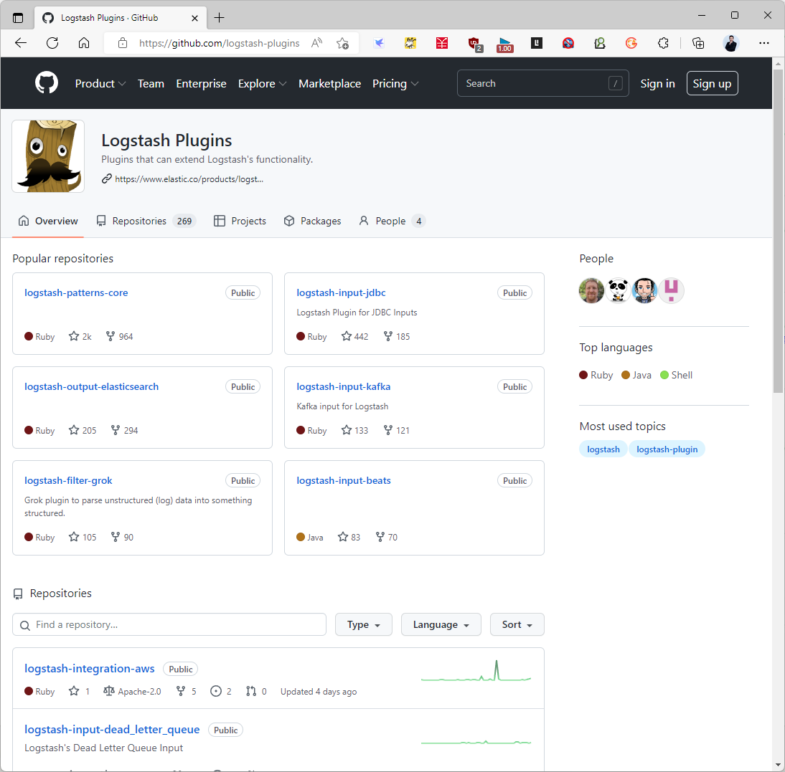

</details>


## 1. 运行、检查与调试

DEB/RPM 包常把命令放在 `/usr/share/logstash/bin/logstash`，配置放在 `/etc/logstash`。先确认版本及插件，再对**明确指定的文件**做语法检查：

```bash
/usr/share/logstash/bin/logstash --version
/usr/share/logstash/bin/logstash-plugin list
sudo -u logstash /usr/share/logstash/bin/logstash \
  --path.settings /etc/logstash \
  -f /etc/logstash/conf.d/demo.conf --config.test_and_exit
```

`-f` 接收文件或目录；指定目录时多个配置片段可能被合并，调试独立示例应指定单个文件。`-e` 用于直接传配置字符串，`--config.reload.automatic` 可在开发时自动重载。不同版本对 root 运行限制不同，应使用服务用户，并给予它所需的数据目录、日志文件读取权限；不要用 `chmod 777 /usr/share/logstash/data` 解决权限问题。当前版本的命令行选项以 `--help` 为准。

## 2. 从标准输入理解 codec

`plain` codec 将一行保存在 `message`；`json` codec 会把合法 JSON 解码为字段，非 JSON 行则可能带 `_jsonparsefailure` 标签。只保留一份配置，即可观察差异：

```ruby
input {
  stdin { codec => json }
}
output {
  stdout { codec => rubydebug }
}
```

输入 `{"name":"示例","age":18}` 后应看到独立的 `name` 与 `age`；输入 `hello` 则应关注解析失败标签。`@timestamp` 是事件处理时产生的时间；若日志本身含时间字段，还需要后文的 date 过滤器。示例可保存为 `/etc/logstash/conf.d/stdin-demo.conf` 并以前述命令验证，随后以前台方式运行。

## 3. 选择输入插件

### file：本地文件与 sincedb

```ruby
input {
  file {
    path => "/var/log/app/*.log"
    start_position => "beginning"
    sincedb_path => "/var/lib/logstash/app.sincedb"
    tags => ["app-file"]
  }
}
output { stdout { codec => rubydebug } }
```

`start_position => "beginning"` 只对**尚未记录读取进度的文件**生效。Logstash 会在 sincedb 中记住文件标识与偏移，重启后继续；手工清空 sincedb 可能导致重复采集。先检查服务用户能否读取文件、写入 sincedb，再向文件追加新行验证。文件若是每行 JSON，才配置 `codec => json`；文本和 JSON 混在一起会产生解析失败事件。

### http、Beats、Redis、Kafka 与网络输入

HTTP input 可用来测试外部推送。若配置 `codec => json`，请求体也要是真正的 JSON，且建议提供正确的 `Content-Type`；旧示例发送 `test log message` 却期待 JSON 解码，产生 `_jsonparsefailure` 是预期结果。

```ruby
input {
  http { host => "127.0.0.1" port => 6666 codec => json }
}
output { stdout { codec => rubydebug } }
```

```bash
curl -X POST http://127.0.0.1:6666/ \
  -H 'Content-Type: application/json' \
  -d '{"name":"示例","age":18}'
```

HTTP、TCP、UDP 输入若要供其他主机使用，应改为指定内网监听地址并配置网络限制和所需 TLS；不能无保护地把接收端口暴露公网。HTTP 调试工具截图显示提交请求与观察输出的过程，关键是核对请求体和 codec，而非使用特定工具。


<details>
<summary>HTTP 请求调试界面（1 张）</summary>

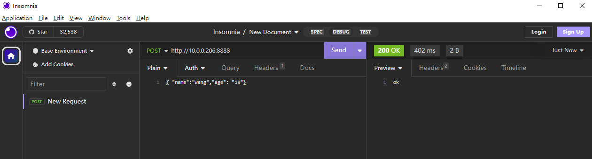

</details>


Filebeat 发送到 Logstash 时，一端启用 `output.logstash.hosts`，另一端启用 Beats input 监听 5044：

```yaml
output.logstash:
  hosts: ["LOGSTASH_HOST:5044"]
```

```ruby
input { beats { port => 5044 } }
output { stdout { codec => rubydebug } }
```

Redis input 从指定数据库的 List 消费；`host`、`db`、`key`、认证必须与生产者一致。消费会从列表中弹出元素，**不是每处理一条就删除整个键所代表的所有数据**。Redis List 只提供有限的缓冲能力，需监控长度和持久化。

```ruby
input {
  redis {
    host => "REDIS_HOST"
    port => 6379
    password => "${REDIS_PASSWORD}"
    db => 0
    key => "filebeat"
    data_type => "list"
  }
}
```

Kafka input 的同一 `group_id` 中消费者分摊分区；不同组各自取得消息副本。`auto_offset_reset => "earliest"` 只影响没有已提交 offset 的消费组，不能让旧组任意重读历史消息。

```ruby
input {
  kafka {
    bootstrap_servers => "KAFKA_1:9092,KAFKA_2:9092"
    topics => ["filebeat-log"]
    group_id => "logstash-filebeat"
    codec => json
    auto_offset_reset => "earliest"
  }
}
```

`syslog` input 负责解析协议头，不能因为消息正文看起来像 JSON 就对整条 syslog 事件直接套 JSON codec；旧文的 `_jsonparsefailure` 正说明两层格式不同。监听 514 是特权端口，普通服务用户需要合适的端口转发或能力配置。TCP/UDP input 适合明确约定消息边界与编码的来源；TCP 流要考虑分帧，UDP 还要考虑丢包，不能仅凭 `nc` 打通就认为可靠采集。

## 4. 过滤器：从原始行得到可查询字段

常见过滤器分别解决不同问题：**grok** 从固定格式文本提取字段，**date** 把日志时间写入 `@timestamp`，**geoip** 根据 IP 补充地理位置，**useragent** 解析浏览器与设备信息，**mutate** 重命名、转换、删除或添加字段。过滤器按出现顺序运行，后一个过滤器使用前一个的结果。尽量让源头输出结构化 JSON；格式固定时可考虑性能更好的 dissect，复杂非结构化行再用 grok。

下面是一条 Nginx combined 风格日志的简化例子，先在 Kibana Grok Debugger 或本地 Logstash 中用**一整行原始日志**测试模式。原文把 URL 与用户代理从 PDF 中间断开，直接复制那段内容无法可靠匹配。

```text
10.0.0.100 - - [03/Aug/2022:16:34:17 +0800] "GET / HTTP/1.1" 200 612 "-" "curl/7.68.0"
```

```ruby
filter {
  grok {
    ecs_compatibility => "disabled"
    match => { "message" => "%{COMBINEDAPACHELOG}" }
    tag_on_failure => ["_nginx_grok_failure"]
  }
  if "_nginx_grok_failure" not in [tags] {
    date {
      match => ["timestamp", "dd/MMM/yyyy:HH:mm:ss Z"]
      target => "@timestamp"
    }
    if [clientip] {
      geoip { source => "clientip" target => "geoip" }
    }
    if [agent] {
      useragent { source => "agent" target => "parsed_user_agent" }
    }
    mutate {
      convert => { "response" => "integer" "bytes" => "integer" }
      remove_field => ["timestamp"]
    }
  }
}
```

这里显式关闭 Grok 的 ECS 映射，以保持 `clientip`、`timestamp` 等旧模式字段名一致；若采用默认 ECS 模式，字段可能变为 `[source][address]` 等嵌套路径，后续 geoip/date/useragent 的 `source` 必须随之调整，不能把 7.x 与 8.x 的输出字段硬拼。对私人地址做 GeoIP 不会得到城市；即使公网 IP，数据库也可能没有精确城市。地图一般直接使用 `geoip.location`，不需要手工拼经纬度数组。

`date` 模式已经包含数值时区 `+0800`，不必再强制另一个时区；日志若没有时区才需要设置 `timezone`。只有 date 成功解析后，`@timestamp` 才代表访问时间，否则仍可能是采集时间。User-Agent 应取 Grok 抽出的浏览器字符串，而非整条 `message` 或发送 HTTP 请求的 curl User-Agent。


<details>
<summary>过滤器与 Grok 调试过程（7 张）</summary>


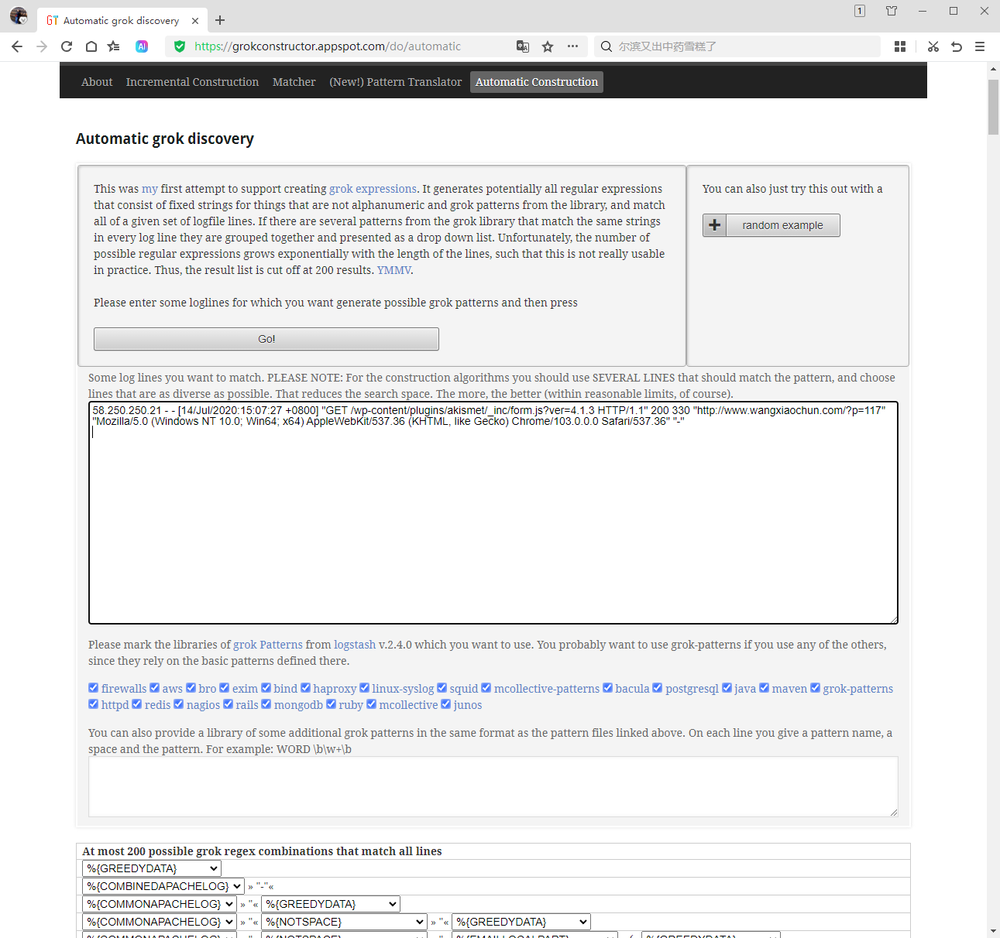

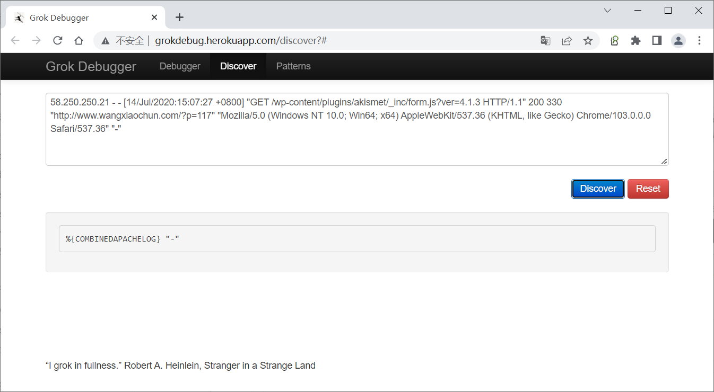

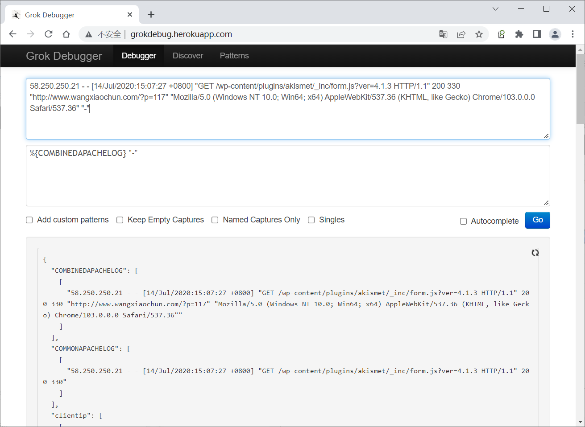

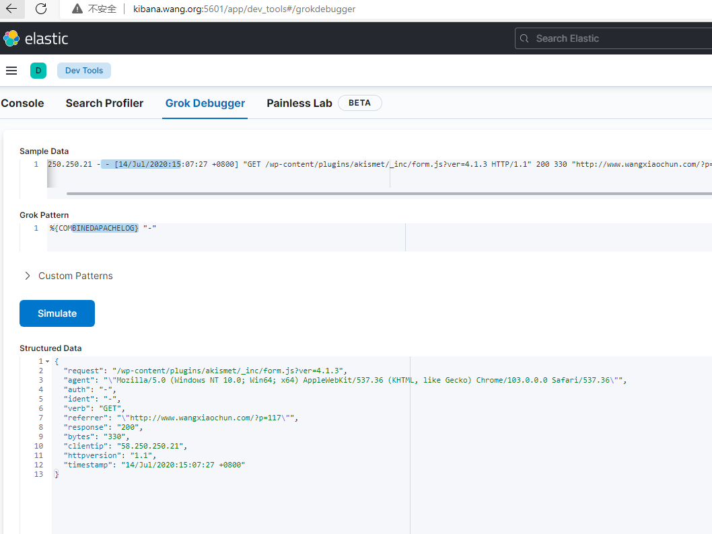

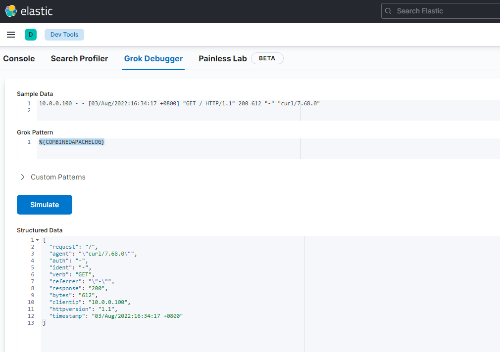

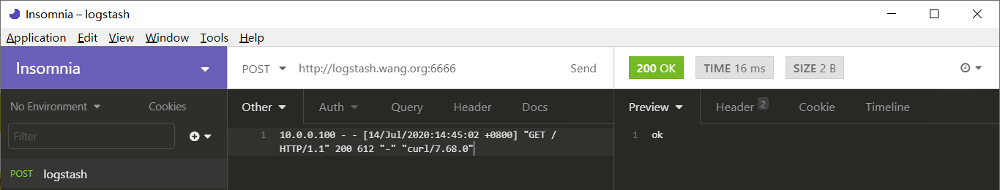

</details>


### mutate 与条件判断

`mutate` 的 `split` 把字符串切为数组，`add_field` 可引用数组元素，`convert` 才把字符串转成数字；不要在同一配置中误以为 `add_field` 自动推断类型。下例针对 `1000|提交订单|2020-01-08 09:10:21`：

```ruby
filter {
  mutate { split => { "message" => "|" } }
  if [message][2] {
    mutate {
      add_field => {
        "user_id" => "%{[message][0]}"
        "action" => "%{[message][1]}"
        "action_time" => "%{[message][2]}"
      }
    }
    mutate { convert => { "user_id" => "integer" } }
  }
}
```

输出路由应对整个标签数组判断，使用 `"nginx-access" in [tags]`，而不是原文的 `"access" in [tags][0]`：后者依赖标签顺序，也可能只匹配子字符串。用于下游索引名的路由字段可放在 `[@metadata][target_index]`，它不会作为普通文档字段发送：

```ruby
filter {
  if "nginx-access" in [tags] {
    mutate { add_field => { "[@metadata][target_index]" => "nginx-access-%{+YYYY.MM.dd}" } }
  } else if "nginx-error" in [tags] {
    mutate { add_field => { "[@metadata][target_index]" => "nginx-error-%{+YYYY.MM.dd}" } }
  }
}
```

## 5. 输出、验证与交付边界

`stdout` 适合调试，`file` 把事件写入本地文件；需要集中检索时使用 Elasticsearch 输出。按天命名索引仅是旧版日志管理方式，较新环境还应评估数据流和 ILM。索引名须为小写；Elasticsearch 开启安全功能时添加 HTTPS、CA 与具备写入权限的凭据。

```ruby
output {
  if [@metadata][target_index] {
    elasticsearch {
      hosts => ["https://ES_HOST:9200"]
      user => "${ES_USER}"
      password => "${ES_PASSWORD}"
      ssl_certificate_authorities => ["/etc/logstash/certs/http_ca.crt"]
      index => "%{[@metadata][target_index]}"
    }
  }
}
```

先检查管道配置，再验证目标中确实有新文档、索引或数据流。旧截图依次展示 Head/Cerebro 中看到索引；现代集群也可用 Elasticsearch API 和 Kibana Index Management 检查。不要因为 `Configuration OK` 就认定输出目标可连接，它只说明配置语法基本可解析。


<details>
<summary>Elasticsearch 写入后的索引验证（6 张）</summary>

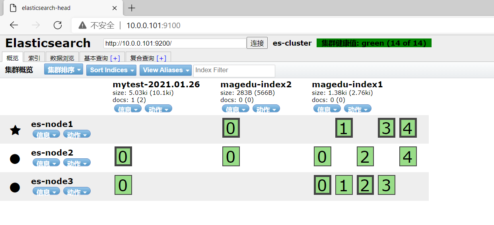

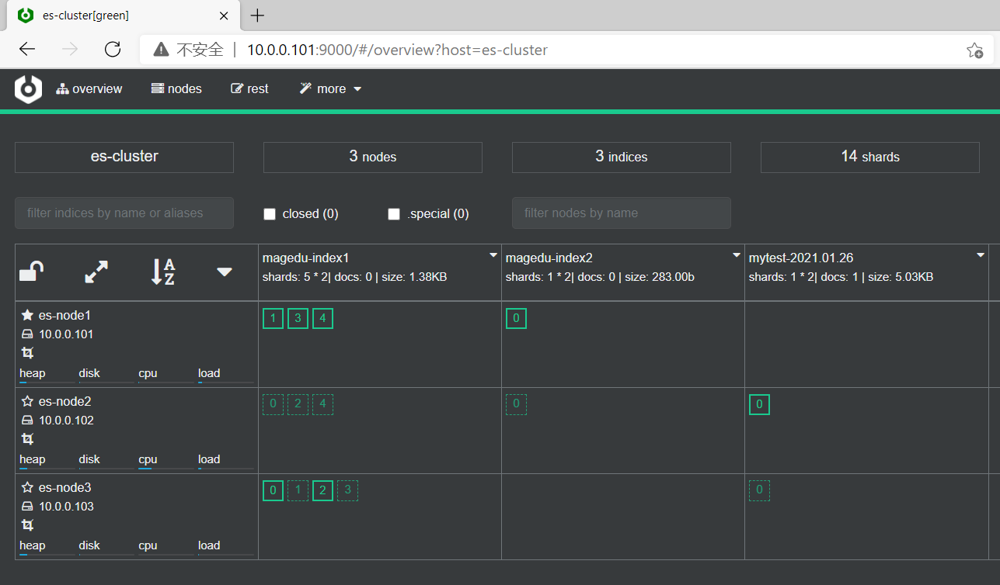

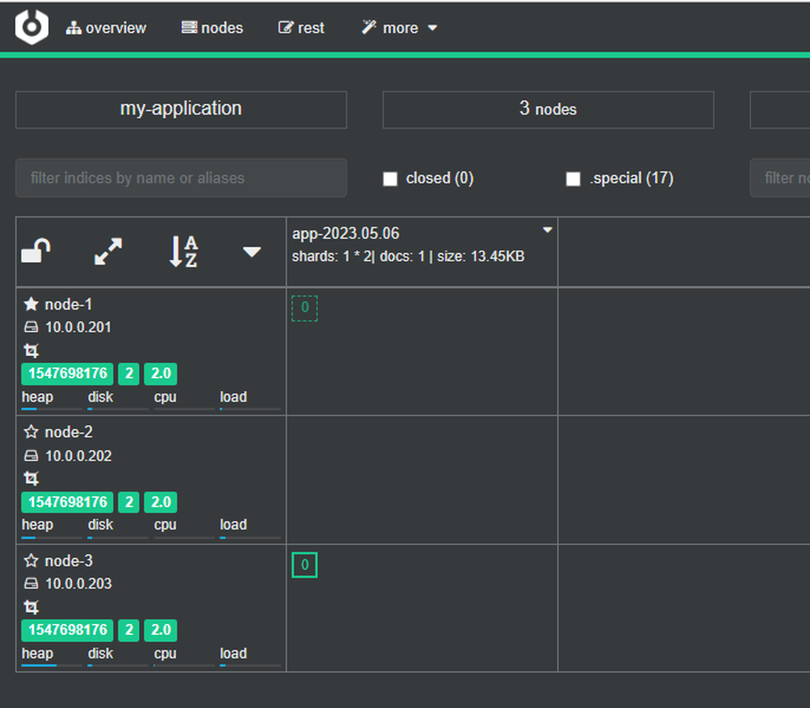

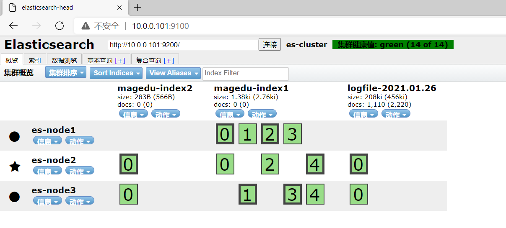

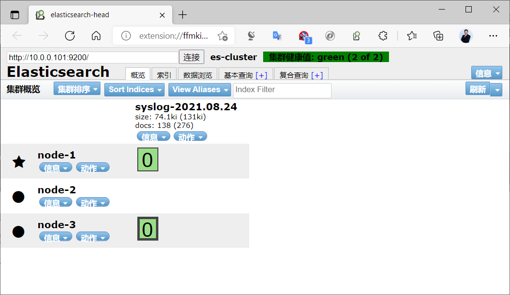

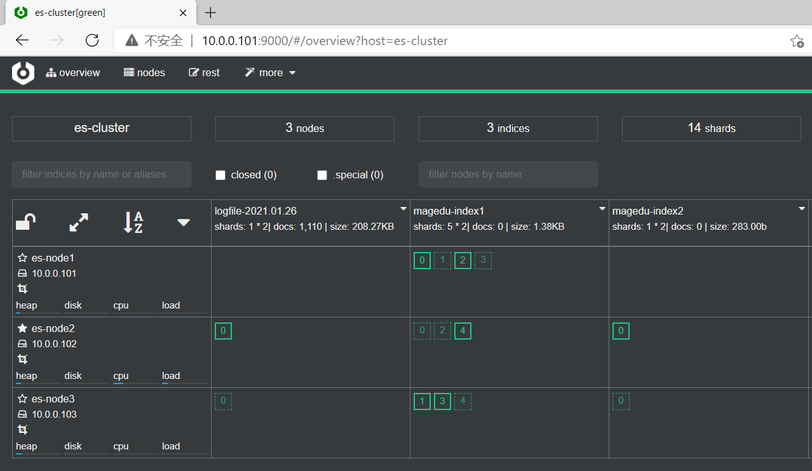

</details>


Logstash 也可以输出到 Redis List 或 Kafka Topic。Redis output 的 `data_type => "list"`、`key`、`db` 必须与下游 Redis input 对应；Kafka output 的 `topic_id` 必须与消费者订阅的 Topic 对应。示意配置如下，二者按实际架构选用，不要无意中同时发送：

```ruby
output {
  redis {
    host => "REDIS_HOST"
    port => 6379
    password => "${REDIS_PASSWORD}"
    db => 0
    data_type => "list"
    key => "nginx-access"
  }
}
```

```ruby
output {
  kafka {
    bootstrap_servers => "KAFKA_1:9092,KAFKA_2:9092"
    topic_id => "nginx-access"
    codec => json
  }
}
```

`codec => json` 在 Kafka 输出上让整个事件按 JSON 编码；若采用默认纯文本 codec，部分结构化字段不会进入消息体。任何输出都要结合队列、重试、下游容量与日志指标验证交付，不应只看 Logstash 进程处于运行状态。



<nav class="article-end" aria-label="章节导航">
  <a href="{{ '/subjects/ELK/17-installing-logstash.html' | relative_url }}">← 上一篇：安装 Logstash</a>
  <a href="{{ '/subjects/ELK/' | relative_url }}">返回 ELK 日志分析目录</a>
  <a href="{{ '/subjects/ELK/19-logstash-practical-examples.html' | relative_url }}">下一篇：Logstash 实战案例 →</a>
</nav>
