[← Back to ELK Log Analytics Index]({{ '/subjects/ELK/' | relative_url }})



# 18 Using Logstash
### 4.3 Logstash 使用

### Logstash 命令

官方文档

<https://www.elastic.co/guide/en/logstash/current/first-event.html#各种插件>

<https://www.elastic.co/guide/en/logstash/current/input-plugins.html>

<https://www.elastic.co/guide/en/logstash/current/filter-plugins.html>

<https://www.elastic.co/guide/en/logstash/current/output-plugins.html>

<https://www.elastic.co/guide/en/logstash/7.6/input-plugins.html>

<https://www.elastic.co/guide/en/logstash/7.6/filter-plugins.html>

<https://www.elastic.co/guide/en/logstash/7.6/output-plugins.html>

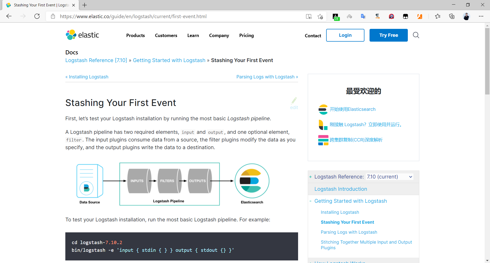

范例： 查看帮助

```bash
[root@logstash01 ~]#file /usr/share/logstash/bin/logstash
/usr/share/logstash/bin/logstash: Bourne-Again shell script, Unicode text, UTF-8
text executable
[root@logstash ~]#/usr/share/logstash/bin/logstash --help
OpenJDK 64-Bit Server VM warning: Option UseConcMarkSweepGC was deprecated in
version 9.0 and will likely be removed in a future release.
WARNING: An illegal reflective access operation has occurred
WARNING: Illegal reflective access by com.headius.backport9.modules.Modules
(file:/usr/share/logstash/logstash-core/lib/jars/jruby-complete-9.2.9.0.jar) to
method sun.nio.ch.NativeThread.signal(long)
WARNING: Please consider reporting this to the maintainers of
com.headius.backport9.modules.Modules
WARNING: Use --illegal-access=warn to enable warnings of further illegal
reflective access operations
WARNING: All illegal access operations will be denied in a future release
WARNING: Could not find logstash.yml which is typically located in
$LS_HOME/config or /etc/logstash. You can specify the path using --
path.settings. Continuing using the defaults
Usage:
bin/logstash [OPTIONS]
Options:
-n, --node.name NAME          Specify the name of this logstash instance, if
no value is given
it will default to the current hostname.
(default: "logstash.bowen.org")
-f, --path.config CONFIG_PATH Load the logstash config from a specific file
or directory.  If a directory is given, all
files in that directory will be concatenated
in lexicographical order and then parsed as a
single config file. You can also specify
wildcards (globs) and any matched files will
be loaded in the order described above.
-e, --config.string CONFIG_STRING Use the given string as the configuration
data. Same syntax as the config file. If no
input is specified, then the following is
used as the default input:
"input { stdin { type => stdin } }"
and if no output is specified, then the
following is used as the default output:
"output { stdout { codec => rubydebug } }"
If you wish to use both defaults, please use
the empty string for the '-e' flag.
(default: nil)
--field-reference-parser MODE (DEPRECATED) This option is no longer
configurable.
Use the given MODE when parsing field
references.
The field reference parser is used to expand
field references in your pipeline configs,
and has become more strict to better handle
ambiguous- and illegal-syntax inputs.
The only available MODE is:
- `STRICT`: parse in a strict manner; when
given ambiguous- or illegal-syntax input,
raises a runtime exception that should
be handled by the calling plugin.
(default: "STRICT")
--modules MODULES             Load Logstash modules.
Modules can be defined using multiple
instances
'--modules module1 --modules module2',
or comma-separated syntax
'--modules=module1,module2'
Cannot be used in conjunction with '-e' or '-
f'
Use of '--modules' will override modules
declared
in the 'logstash.yml' file.
-M, --modules.variable MODULES_VARIABLE Load variables for module template.
Multiple instances of '-M' or
'--modules.variable' are supported.
Ignored if '--modules' flag is not used.
Should be in the format of
'-M
"MODULE_NAME.var.PLUGIN_TYPE.PLUGIN_NAME.VARIABLE_NAME=VALUE"'
as in
'-M
"example.var.filter.mutate.fieldname=fieldvalue"'
--setup                       Load index template into Elasticsearch, and
saved searches,
index-pattern, visualizations, and dashboards
into Kibana when
running modules.
(default: false)
--cloud.id CLOUD_ID           Sets the elasticsearch and kibana host
settings for
module connections in Elastic Cloud.
Your Elastic Cloud User interface or the Cloud
support
team should provide this.
Add an optional label prefix '<label>:' to
help you
identify multiple cloud.ids.
e.g.
'staging:dXMtZWFzdC0xLmF3cy5mb3VuZC5pbyRub3RhcmVhbCRpZGVudGlmaWVy'
--cloud.auth CLOUD_AUTH       Sets the elasticsearch and kibana username and
password
for module connections in Elastic Cloud
e.g. 'username:<password>'
--pipeline.id ID              Sets the ID of the pipeline.
(default: "main")
-w, --pipeline.workers COUNT  Sets the number of pipeline workers to run.
(default: 2)
--java-execution              Use Java execution engine.
(default: true)
--plugin-classloaders         (Beta) Load Java plugins in independent
classloaders to isolate their dependencies.
(default: false)
-b, --pipeline.batch.size SIZE Size of batches the pipeline is to work in.
(default: 125)
-u, --pipeline.batch.delay DELAY_IN_MS When creating pipeline batches, how
long to wait while polling
for the next event.
(default: 50)
--pipeline.unsafe_shutdown    Force logstash to exit during shutdown even
if there are still inflight events in memory.
By default, logstash will refuse to quit until
all
received events have been pushed to the
outputs.
(default: false)
--path.data PATH              This should point to a writable directory.
Logstash
will use this directory whenever it needs to
store
data. Plugins will also have access to this
path.
(default: "/usr/share/logstash/data")
-p, --path.plugins PATH       A path of where to find plugins. This flag
can be given multiple times to include
multiple paths. Plugins are expected to be
in a specific directory hierarchy:
'PATH/logstash/TYPE/NAME.rb' where TYPE is
'inputs' 'filters', 'outputs' or 'codecs'
and NAME is the name of the plugin.
(default: [])
-l, --path.logs PATH          Write logstash internal logs to the given
file. Without this flag, logstash will emit
logs to standard output.
(default: "/usr/share/logstash/logs")
--log.level LEVEL             Set the log level for logstash. Possible
values are:
- fatal
- error
- warn
- info
- debug
- trace
(default: "info")
--config.debug                Print the compiled config ruby code out as a
debug log (you must also have --log.level=debug enabled).
WARNING: This will include any 'password'
options passed to plugin configs as plaintext, and may result
in plaintext passwords appearing in your logs!
(default: false)
-i, --interactive SHELL       Drop to shell instead of running as normal.
Valid shells are "irb" and "pry"
-V, --version                 Emit the version of logstash and its friends,
then exit.
-t, --config.test_and_exit    Check configuration for valid syntax and then
exit.
(default: false)
-r, --config.reload.automatic Monitor configuration changes and reload
whenever it is changed.
NOTE: use SIGHUP to manually reload the config
(default: false)
--config.reload.interval RELOAD_INTERVAL How frequently to poll the
configuration location
for changes, in seconds.
(default: 3000000000)
--http.host HTTP_HOST         Web API binding host (default: "127.0.0.1")
--http.port HTTP_PORT         Web API http port (default: 9600..9700)
--log.format FORMAT           Specify if Logstash should write its own logs
in JSON form (one
event per line) or in plain text (using Ruby's
Object#inspect)
(default: "plain")
--path.settings SETTINGS_DIR  Directory containing logstash.yml file. This
can also be
set through the LS_SETTINGS_DIR environment
variable.
(default: "/usr/share/logstash/config")
--verbose                     Set the log level to info.
DEPRECATED: use --log.level=info instead.
--debug                       Set the log level to debug.
DEPRECATED: use --log.level=debug instead.
--quiet                       Set the log level to info.
DEPRECATED: use --log.level=info instead.
-h, --help                    print help
#常用选项
-e 指定配置内容
-f 指定配置文件，支持绝对路径，如果用相对路径，是相对于/usr/share/logstash/的路径
-t 语法检查
-r 修改配置文件后自动加载生效,注意:有时候修改配置还需要重新启动生效
#服务方式启动,由于默认没有配置文件,所以7.X无法启动，8.X可以启动
[root@logstash ~]#systemctl start logstash
```

各种插件帮助

<https://www.elastic.co/guide/en/logstash/current/index.html>

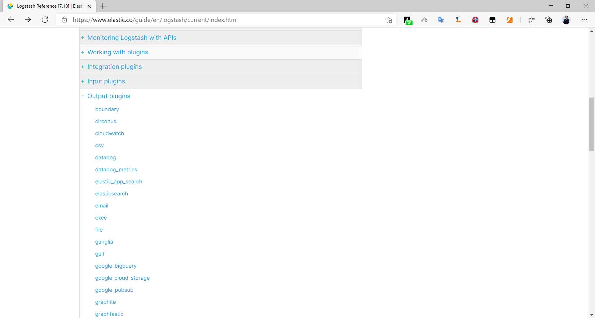

范例: 列出所有插件

```bash
[root@logstash ~]#/usr/share/logstash/bin/logstash-plugin list
```

Github logstash插件链接

<https://github.com/logstash-plugins>

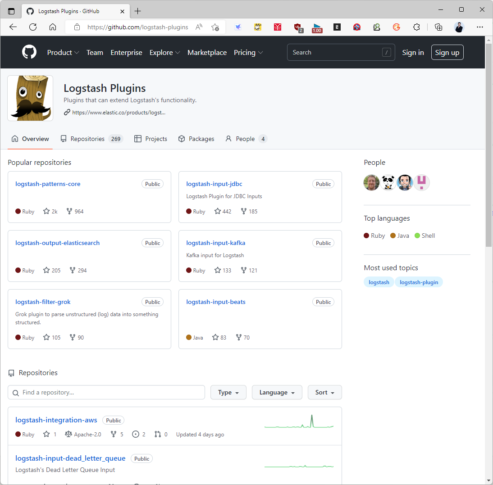

### Logstash 输入 Input 插件

官方链接

<https://www.elastic.co/guide/en/logstash/7.6/input-plugins.html>

### 标准输入

codec 用于输入数据的编解码器，默认值为plain表示单行字符串，若设置为json，表示按照json方式解析

范例：

```bash
#logstash-9.0.1不能以root启动，还要求对/usr/share/logstash/data有权限
[root@logstash01 ~]#chmod 777 /usr/share/logstash/data
[root@logstash01 ~]#su - bowen
bowen@logstash01:~$ /usr/share/logstash/bin/logstash  -e 'input { stdin{} }
output { stdout{}}'
```

范例：9.X 不支持root直接运行logstash, 交互式实现标准输入

```json
#如果首次以root身份启动，需要修改目录属性
[root@logstash01 ~]#chown -R logstash: /usr/share/logstash/data
[root@logstash01 ~]#su - logstash -s /bin/bash
#不支持json
logstash@logstash01:~$ logstash -e 'input { stdin{} } output { stdout{}}'
#支持json
logstash@logstash01:~$ logstash -e 'input { stdin{ codec => json } } output {
stdout{ }}'
{"name" : "bowenxiaochun", "age" : "18", "phone" : "0123456789"}
{
"name" => "bowenxiaochun",
"host" => {
"hostname" => "logstash01.bowen.org"
},
"age" => "18",
"@timestamp" => 2025-07-30T02:49:06.908488502Z,
"phone" => "0123456789",
"@version" => "1",
"event" => {
"original" => "{\"name\" : \"bowenxiaochun\", \"age\" : \"18\", \"phone\"
: \"0123456789\"}\n"
}
}
```

范例: 交互式实现标准输入

```bash
#标准输入和输出,codec => rubydebug指输出格式，是默认值，可以省略，也支持设为json，以json格
式输出
[root@logstash ~]#ln -s /usr/share/logstash/bin/logstash  /usr/local/bin/
#不支持Json格式输入
[root@logstash ~]#/usr/share/logstash/bin/logstash  -e 'input { stdin{} } output
{ stdout{}}'
[root@logstash ~]#/usr/share/logstash/bin/logstash  -e 'input { stdin{} } output
{ stdout{ codec => rubydebug }}'
#新版
Using bundled JDK: /usr/share/logstash/jdk
WARNING: Could not find logstash.yml which is typically located in
$LS_HOME/config or /etc/logstash. You can specify the path using --
path.settings. Continuing using the defaults
Could not find log4j2 configuration at path
/usr/share/logstash/config/log4j2.properties. Using default config which logs
errors to the console
[WARN ] 2023-05-04 16:21:29.990 [main] runner - NOTICE: Running Logstash as
superuser is not recommended and won't be allowed in the future. Set
'allow_superuser' to 'false' to avoid startup errors in future releases.
[INFO ] 2023-05-04 16:21:29.996 [main] runner - Starting Logstash
{"logstash.version"=>"8.7.0", "jruby.version"=>"jruby 9.3.10.0 (2.6.8) 2023-02-
01 107b2e6697 OpenJDK 64-Bit Server VM 17.0.6+10 on 17.0.6+10 +indy +jit [x86_64-
linux]"}
[INFO ] 2023-05-04 16:21:29.997 [main] runner - JVM bootstrap flags: [-Xms1g, -
Xmx1g, -Djava.awt.headless=true, -Dfile.encoding=UTF-8, -
Djruby.compile.invokedynamic=true, -XX:+HeapDumpOnOutOfMemoryError, -
Djava.security.egd=file:/dev/urandom, -
Dlog4j2.isThreadContextMapInheritable=true, -Djruby.regexp.interruptible=true, -
Djdk.io.File.enableADS=true, --add-
exports=jdk.compiler/com.sun.tools.javac.api=ALL-UNNAMED, --add-
exports=jdk.compiler/com.sun.tools.javac.file=ALL-UNNAMED, --add-
exports=jdk.compiler/com.sun.tools.javac.parser=ALL-UNNAMED, --add-
exports=jdk.compiler/com.sun.tools.javac.tree=ALL-UNNAMED, --add-
exports=jdk.compiler/com.sun.tools.javac.util=ALL-UNNAMED, --add-
opens=java.base/java.security=ALL-UNNAMED, --add-opens=java.base/java.io=ALL-
UNNAMED, --add-opens=java.base/java.nio.channels=ALL-UNNAMED, --add-
opens=java.base/sun.nio.ch=ALL-UNNAMED, --add-
opens=java.management/sun.management=ALL-UNNAMED]
[INFO ] 2023-05-04 16:21:30.004 [main] settings - Creating directory
{:setting=>"path.queue", :path=>"/usr/share/logstash/data/queue"}
[INFO ] 2023-05-04 16:21:30.005 [main] settings - Creating directory
{:setting=>"path.dead_letter_queue",
:path=>"/usr/share/logstash/data/dead_letter_queue"}
[WARN ] 2023-05-04 16:21:30.087 [LogStash::Runner] multilocal - Ignoring the
'pipelines.yml' file because modules or command line options are specified
[INFO ] 2023-05-04 16:21:30.094 [LogStash::Runner] agent - No persistent UUID
file found. Generating new UUID {:uuid=>"4ac9a435-cbf9-462b-b05e-10392d1356ec",
:path=>"/usr/share/logstash/data/uuid"}
[INFO ] 2023-05-04 16:21:30.425 [Api Webserver] agent - Successfully started
Logstash API endpoint {:port=>9600, :ssl_enabled=>false}
[INFO ] 2023-05-04 16:21:30.479 [Converge PipelineAction::Create<main>]
Reflections - Reflections took 56 ms to scan 1 urls, producing 132 keys and 462
values
[INFO ] 2023-05-04 16:21:30.635 [Converge PipelineAction::Create<main>]
javapipeline - Pipeline `main` is configured with `pipeline.ecs_compatibility:
v8` setting. All plugins in this pipeline will default to `ecs_compatibility =>
v8` unless explicitly configured otherwise.
[INFO ] 2023-05-04 16:21:30.649 [[main]-pipeline-manager] javapipeline -
Starting pipeline {:pipeline_id=>"main", "pipeline.workers"=>2,
"pipeline.batch.size"=>125, "pipeline.batch.delay"=>50,
"pipeline.max_inflight"=>250, "pipeline.sources"=>["config string"], :thread=>"#
<Thread:0x41e1cc04@/usr/share/logstash/logstash-
core/lib/logstash/java_pipeline.rb:134 run>"}
[INFO ] 2023-05-04 16:21:30.912 [[main]-pipeline-manager] javapipeline -
Pipeline Java execution initialization time {"seconds"=>0.26}
[INFO ] 2023-05-04 16:21:30.936 [[main]-pipeline-manager] javapipeline -
Pipeline started {"pipeline.id"=>"main"}
[INFO ] 2023-05-04 16:21:30.944 [Agent thread] agent - Pipelines running
{:count=>1, :running_pipelines=>[:main], :non_running_pipelines=>[]}
The stdin plugin is now waiting for input:
hello,world #输入信息
{
"host" => {
"hostname" => "logstash2.bowen.org"
},
"message" => "hello,world",
"event" => {
"original" => "hello,world"
},
"@timestamp" => 2023-05-04T08:22:13.154387251Z,
"@version" => "1"
}
{ "name":"bowen","age": "18"} #输入Json格式数据，不自动解析
{
"host" => {
"hostname" => "logstash2.bowen.org"
},
"message" => "{ \"name\":\"bowen\",\"age\": \"18\"}",
"event" => {
"original" => "{ \"name\":\"bowen\",\"age\": \"18\"}"
},
"@timestamp" => 2023-05-04T08:24:59.925134196Z,
"@version" => "1"
}
```

```text
#旧版
OpenJDK 64-Bit Server VM warning: Option UseConcMarkSweepGC was deprecated in
version 9.0 and will likely be removed in a future release.
WARNING: An illegal reflective access operation has occurred
WARNING: Illegal reflective access by com.headius.backport9.modules.Modules
(file:/usr/share/logstash/logstash-core/lib/jars/jruby-complete-9.2.9.0.jar) to
method sun.nio.ch.NativeThread.signal(long)
WARNING: Please consider reporting this to the maintainers of
com.headius.backport9.modules.Modules
WARNING: Use --illegal-access=warn to enable warnings of further illegal
reflective access operations
WARNING: All illegal access operations will be denied in a future release
WARNING: Could not find logstash.yml which is typically located in
$LS_HOME/config or /etc/logstash. You can specify the path using --
path.settings. Continuing using the defaults
Could not find log4j2 configuration at path
/usr/share/logstash/config/log4j2.properties. Using default config which logs
errors to the console
[WARN ] 2021-01-26 18:46:17.658 [LogStash::Runner] multilocal - Ignoring the
'pipelines.yml' file because modules or command line options are specified
[INFO ] 2021-01-26 18:46:17.670 [LogStash::Runner] runner - Starting Logstash
{"logstash.version"=>"7.6.2"}
[INFO ] 2021-01-26 18:46:19.248 [Converge PipelineAction::Create<main>]
Reflections - Reflections took 25 ms to scan 1 urls, producing 20 keys and 40
values
[WARN ] 2021-01-26 18:46:19.837 [[main]-pipeline-manager] LazyDelegatingGauge -
A gauge metric of an unknown type (org.jruby.RubyArray) has been created for
key: cluster_uuids. This may result in invalid serialization.  It is recommended
to log an issue to the responsible developer/development team.
[INFO ] 2021-01-26 18:46:19.844 [[main]-pipeline-manager] javapipeline -
Starting pipeline {:pipeline_id=>"main", "pipeline.workers"=>2,
"pipeline.batch.size"=>125, "pipeline.batch.delay"=>50,
"pipeline.max_inflight"=>250, "pipeline.sources"=>["config string"], :thread=>"#
<Thread:0x36c2d619 run>"}
[INFO ] 2021-01-26 18:46:20.724 [[main]-pipeline-manager] javapipeline -
Pipeline started {"pipeline.id"=>"main"}
The stdin plugin is now waiting for input:
[INFO ] 2021-01-26 18:46:20.799 [Agent thread] agent - Pipelines running
{:count=>1, :running_pipelines=>[:main], :non_running_pipelines=>[]}
[INFO ] 2021-01-26 18:46:21.010 [Api Webserver] agent - Successfully started
Logstash API endpoint {:port=>9600}
hello world  #标准输入此字符串
/usr/share/logstash/vendor/bundle/jruby/2.5.0/gems/awesome_print-
1.7.0/lib/awesome_print/formatters/base_formatter.rb:31: warning: constant
::Fixnum is deprecated
{
"@version" => "1",                       #事件版本号
"@timestamp" => 2021-01-26T10:47:49.594Z,  #当前事件发生的时间
"host" => "logstash.bowen.org",       #标记事件发生在哪个主机
"message" => "hello world"              #消息具体内容
}
#后续还可继续输入其它信息，按ctrl+c退出
```

```json
#指定输入信息为Json格式，支持Json格式输入
[root@logstash ~]#logstash -e 'input { stdin{ codec => json } } output { stdout{
}}'
.......
{ "name":"bowen","age": "18","gender":"male"}  #输入Json格式信息
#自动解析
{
"age" => "18",
"name" => "bowen",
"gender" => "male",
"host" => "logstash-node1.bowen.org",
"@version" => "1",
"@timestamp" => 2022-08-03T07:04:12.194Z
}
#输入非Json格式信息，告警提示无法自动解析，存放message字段
hello,world
[WARN ] 2022-08-03 15:08:06.911 [[main]<stdin] jsonlines - JSON parse error,
original data now in message field {:message=>"Unrecognized token 'hello': was
expecting ('true', 'false' or 'null')\n at [Source: (String)\"hello,world\";
line: 1, column: 6]", :exception=>LogStash::Json::ParserError,
:data=>"hello,world"}
{
"@version" => "1",
"message" => "hello,world",
"@timestamp" => 2022-08-03T07:08:06.915Z,
"host" => "logstash-node1.bowen.org",
"tags" => [
[0] "_jsonparsefailure"
]
}
```

```json
#添加tag和type
[root@ubuntu2204 ~]#/usr/share/logstash/bin/logstash  -e 'input { stdin{  tags
=> "stdin_tag"  type => "stdin_type" codec => json }  } output { stdout{  }}'
#输入
hello,world
[WARN ] 2024-03-01 09:45:49.597 [[main]<stdin] jsonlines - JSON parse error,
original data now in message field {:message=>"Unrecognized token 'hello': was
expecting (JSONString, Number, Array, Object or token 'null', 'true' or
'false')\n at [Source: (String)\"hello,world\"; line: 1, column: 6]",
:exception=>LogStash::Json::ParserError, :data=>"hello,world"}
{
"event" => {
"original" => "hello,world\n"
},
"tags" => [
[0] "_jsonparsefailure",
[1] "stdin_tag"
],
"message" => "hello,world",
"@version" => "1",
"@timestamp" => 2024-03-01T01:45:49.604017451Z,
"type" => "stdin_type",
"host" => {
"hostname" => "ubuntu2204.bowen.org"
}
}
```

范例: 以配置文件实现标准输入

```bash
#配置文件
[root@logstash ~]#cat /etc/logstash/conf.d/stdin_to_stdout.conf
input {
stdin {
type => "stdin_type"      #自定义事件类型，可用于后续判断
tags => "stdin_tag"       #自定义事件tag，可用于后续判断
codec => "json"           #指定Json 格式
}
}
output {
stdout {
codec => "rubydebug" #输出格式,此为默认值,可省略
}
}
```

```json
#语法检查,配置文件路径默认查找/usr/share/logstash/，文件放在此路径下时可省略
[root@logstash ~]#/usr/share/logstash/bin/logstash -f
/etc/logstash/conf.d/stdin_to_stdout.conf -t
.....
Configuration OK
[INFO ] 2021-07-12 18:16:23.225 [LogStash::Runner] runner - Using
config.test_and_exit mode. Config Validation Result: OK. Exiting Logstash
#执行logstash,选项-r表示动态加载配
[root@logstash ~]#/usr/share/logstash/bin/logstash -f
/etc/logstash/conf.d/stdin_to_stdout.conf -r
.....
[INFO ] 2021-07-12 18:19:11.069 [[main]-pipeline-manager] javapipeline -
Pipeline Java execution initialization time {"seconds"=>1.58}
[INFO ] 2021-07-12 18:19:11.317 [[main]-pipeline-manager] javapipeline -
Pipeline started {"pipeline.id"=>"main"}
The stdin plugin is now waiting for input:
[INFO ] 2021-07-12 18:19:11.547 [Agent thread] agent - Pipelines running
{:count=>1, :running_pipelines=>[:main], :non_running_pipelines=>[]}
hello,bowenxiaochun    #输入信息
{
"@version" => "1",
"@timestamp" => 2021-07-12T10:22:12.076Z,
"host" => "logstash",
"tags" => [
[0] "stdin_tag"    #增加了此行
],
"type" => "stdin_type",   #增加了此行
"message" => "hello,bowenxiaochun"
}
hello,logstash     #输入信息
{
"@version" => "1",
"@timestamp" => 2021-07-12T10:22:22.991Z,
"host" => "logstash",
"tags" => [
[0] "stdin_tag"  #增加了此行
],
"type" => "stdin_type",   #添加了此行
"message" => "hello,logstash"
}
{ "name":"bowen","age": "18"} #输入json格式数据，可以自动解析
{
"event" => {
"original" => " { \"name\":\"bowen\",\"age\": \"18\"} \n"
},
"@version" => "1",
"name" => "bowen",
"age" => "18",
"tags" => [
[0] "stdin_tag"
],
"host" => {
"hostname" => "logstash2.bowen.org"
},
"type" => "stdin_type",
"@timestamp" => 2023-05-04T08:36:20.274593571Z
}
```

### 从文件输入

Logstash 会记录每个文件的读取位置,下次自动从此位置继续向后读取

每个文件的读取位置记录在下面对应的文件中

```text
#新版：8.11.1
/usr/share/logstash/data/plugins/inputs/file/.sincedb_f5fdf6ea0ea92860c6a6b2b354
bfcbbc
#旧版
/var/lib/logstash/plugins/inputs/file/.sincedb_xxxx
```

此文件包括文件的 inode号, 大小等信息

范例：9.X版本，不能为root启动

```bash
#先以root创建文件
[root@logstash01 ~]#cat  /etc/logstash/conf.d/file_to_stdout.conf
input {
file {
path => "/tmp/bowen.*"
type => "bowenlog"             #添加自定义的type字段,可以用于条件判断,和
filebeat中tag功能相似
exclude => "*.txt"            #排除不采集数据的文件，使用通配符glob匹配语法
start_position => "beginning" #第一次从头开始读取文件,可以取值为:beginning和
end,默认为end,即只从最后尾部读取日志
stat_interval => "3"             #定时检查文件是否更新，默认1s
codec => json              #如果文件是Json格式,需要指定此项才能解析,如果不是Json
格式而添加此行也不会影响结果
}
}
output {
stdout {
codec => rubydebug
}
}
[root@logstash01 ~]#getent passwd logstash
logstash:x:999:989:LogStash Service User:/usr/share/logstash:/usr/sbin/nologin
```

```bash
#logstash运行时，需要切换为logstash的普通用户
[root@logstash01 ~]#su - logstash -s /bin/bash
logstash@logstash01:~$ logstash -f /etc/logstash/conf.d/file_to_stdout.conf -t
logstash@logstash01:~$ logstash -f /etc/logstash/conf.d/file_to_stdout.conf
[root@logstash01 ~]#cat
/usr/share/logstash/data/plugins/inputs/file/.sincedb_a641434a4c79546978286025f3
c788f9
4325390 0 64512 103 1753844569.206077 /tmp/bowen.log
```

范例: 8.X以前版本

```bash
[root@logstash ~]#cat /etc/logstash/conf.d/file_to_stdout.conf
input {
file {
path => "/tmp/bowen.*"
type => "bowenlog"             #添加自定义的type字段,可以用于条件判断,和
filebeat中tag功能相似
exclude => "*.txt"            #排除不采集数据的文件，使用通配符glob匹配语法
start_position => "beginning" #第一次从头开始读取文件,可以取值为:beginning和
end,默认为end,即只从最后尾部读取日志
stat_interval => "3"         #定时检查文件是否更新，默认1s
codec => json              #如果文件是Json格式,需要指定此项才能解析,如果不是Json
格式而添加此行也不会影响结果
}
file {
path => "/var/log/syslog"
type => "syslog"
#start_position => "beginning"
stat_interval => "3"
}
}
output {
stdout {
codec => rubydebug
}
}
#语法检查
[root@logstash ~]#/usr/share/logstash/bin/logstash -f
/etc/logstash/conf.d/file_to_stdout.conf -t
[root@logstash ~]#echo line1 >> /tmp/bowen.log
#执行
[root@logstash ~]#/usr/share/logstash/bin/logstash -f
/etc/logstash/conf.d/file_to_stdout.conf
{
"message" => "line1",
"@timestamp" => 2021-07-12T10:31:42.390Z,
"host" => "logstash",
"type" => "syslog",
"@version" => "1",
"path" => "/tmp/bowen.log"
}
#再追加内容到文件
[root@logstash ~]#echo line1 >> /tmp/bowen.log
#可以看到logstash会输出下面内容
{
"message" => "line2",
"@timestamp" => 2021-07-12T10:32:51.570Z,
"host" => "logstash",
"type" => "syslog",
"@version" => "1",
"path" => "/tmp/bowen.log"
}
#再追加Json格式数据
echo  '{ "name":"bowen","age": "18","gender":"male"}' >> /tmp/bowen.log
#可以看到logstash会输出自动解析出来的下面内容
{
"type" => "bowenlog",
"@timestamp" => 2023-05-04T08:49:40.949016329Z,
"age" => "18",
"name" => "bowen",
"log" => {
"file" => {
"path" => "/tmp/bowen.log"
}
},
"host" => {
"name" => "logstash2.bowen.org"
},
"gender" => "male",
"@version" => "1",
"event" => {
"original" => "{ \"name\":\"bowen\",\"age\": \"18\",\"gender\":\"male\"}"
}
}
```

logstash利用 sincedb 文件记录了logstash收集的记录文件的信息，比如位置，以方便下次接着从此位置继续收集日志

```bash
#新版路径
[root@logstash1 ~]#ls /usr/share/logstash/data/plugins/inputs/file/ -a
.  ..  .sincedb_a641434a4c79546978286025f3c788f9
.sincedb_f5fdf6ea0ea92860c6a6b2b354bfcbbc
[root@logstash1 ~]#ls
/usr/share/logstash/data/plugins/inputs/file/.sincedb_a641434a4c79546978286025f3
c788f9
/usr/share/logstash/data/plugins/inputs/file/.sincedb_a641434a4c79546978286025f3
c788f9
[root@logstash1 ~]#cat
/usr/share/logstash/data/plugins/inputs/file/.sincedb_a641434a4c79546978286025f3
c788f9
262157 0 64768 34 1702262327.176583 /tmp/bowen.log
[root@logstash1 ~]#ll /tmp/bowen.log
-rw-r--r-- 1 root root 34 12月 11 10:39 /tmp/bowen.log
[root@logstash1 ~]#ll /tmp/bowen.log -i
262157 -rw-r--r-- 1 root root 34 12月 11 10:39 /tmp/bowen.log
[root@logstash1 ~]#date +%s
1702262566
```

```bash
#旧版路径
[root@es-node1~]# cat
/var/lib/logstash/plugins/inputs/file/.sincedb_1ced15cfacdbb0380466be84d620085a
134219868 0 2064 29465 #记录了收集文件的inode和大小等信息
[root@es-node1 ~]# ll -li /elk/logs/ELK-Cluster.log
134219868 -rw-r--r-- 1 elasticsearch elasticsearch 29465 Apr 21 14:33
/elk/logs/ELK-Cluster.log
```

### 从 Http 请求输入数据

```json
[root@logstash ~]# cat /etc/logstash/conf.d/http_to_stdout.conf
input {
http {
port => 6666
codec => json
}
}
output {
stdout {
codec => rubydebug
}
}
[root@logstash ~]#/usr/share/logstash/bin/logstash -f
/etc/logstash/conf.d/http_to_stdout.conf -r
.....
{
"message" => "test log message",
"headers" => {
"content_length" => "0",
"http_user_agent" => "curl/7.68.0",
"http_host" => "logstash.bowen.org:6666",
"http_version" => "HTTP/1.1",
"request_method" => "GET",
"http_accept" => "*/*",
"request_path" => "/"
},
"@version" => "1",
"@timestamp" => 2022-07-14T06:38:20.626Z,
"host" => "10.0.0.100"
}
#执行下面访问可以看到上面信息
[root@ubuntu2004 ~]#curl http://logstash.bowen.org:6666
ok
[root@ubuntu2004 ~]#curl  -XPOST -d'test log message'
http://logstash.bowen.org:6666
#在logstash显示数据如下
{
"http" => {
"version" => "HTTP/1.1",
"method" => "POST",
"request" => {
"mime_type" => "application/x-www-form-urlencoded",
"body" => {
"bytes" => "16"
}
}
},
"@version" => "1",
"url" => {
"domain" => "10.0.0.207",
"port" => 6666,
"path" => "/"
},
"tags" => [
[0] "_jsonparsefailure"
],
"host" => {
"ip" => "10.0.0.200"
},
"message" => "test log message",
"@timestamp" => 2023-05-04T09:16:05.859331055Z,
"user_agent" => {
"original" => "curl/7.81.0"
}
}
#提交Json格式数据，可以自动解析
[root@ubuntu2004 ~]#curl  -XPOST -d'{ "name":"bowen","age":
"18","gender":"male"}' http://logstash.bowen.org:6666
#在logstash显示数据如下
{
"age" => "18",
"event" => {
"original" => "{ \"name\":\"bowen\",\"age\": \"18\",\"gender\":\"male\"}"
},
"http" => {
"version" => "HTTP/1.1",
"method" => "POST",
"request" => {
"mime_type" => "application/x-www-form-urlencoded",
"body" => {
"bytes" => "44"
}
}
},
"@version" => "1",
"url" => {
"domain" => "10.0.0.207",
"port" => 6666,
"path" => "/"
},
"name" => "bowen",
"host" => {
"ip" => "10.0.0.200"
},
"@timestamp" => 2023-05-04T09:18:00.224420651Z,
"gender" => "male",
"user_agent" => {
"original" => "curl/7.81.0"
}
}
```

还可以通过其它的API调试工具访问

```text
https://app.apifox.com/
#Postman
#insomnia 官方下载
https://insomnia.rest/download
```

范例：insomnia

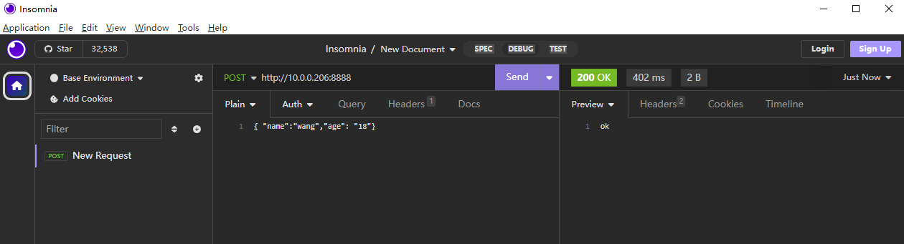

### 从 Filebeat 输入数据

```bash
#filebeat配置
[root@elk-web1 ~]#vim /etc/filebeat/filebeat.yml
filebeat.inputs:
- type: log
enabled: true                        #开启日志
paths:
- /var/log/nginx/access_json.log      #指定收集的日志文件
json.keys_under_root: true
tags: ["nginx-access"]
- type: log
enabled: true           #开启日志
paths:
- /var/log/syslog            #指定收集的日志文件
fields:
logtype: "syslog"     #添加自定义字段logtype
```

```bash
#output.console:
#  pretty: true
#  enable: true
output.logstash:
hosts: ["10.0.0.104:5044"]  #指定Logstash服务器的地址和端口
#Logstash配置
[root@logstash ~]#cat /etc/logstash/conf.d/filebeat_to_stdout.conf
input {
beats {
port => 5044
}
}
output {
stdout {
codec => rubydebug
}
}
#访问filebeat生成日志
#注意：nginx的访问日志时间会被filebeat的收集日志的时间覆盖
[root@logstash ~]#/usr/share/logstash/bin/logstash -f
/etc/logstash/conf.d/filebeat_to_stdout.conf -r
#在logstash可以看到如下数据
{
"@timestamp" => 2023-05-04T09:24:53.213Z, #filebeat收集日志的时间，而非
nginx访问日志本身的时间
"tags" => [
[0] "nginx-access",
[1] "beats_input_raw_event"
],
"host" => {
"name" => "app01.bowen.org"
},
"uri" => "/index.nginx-debian.html",
"http_host" => "10.0.0.204",
"domain" => "10.0.0.204",
"upstreamtime" => "-",
"clientip" => "10.0.0.1",
"upstreamhost" => "-",
"status" => "304",
"size" => 0,
"input" => {
"type" => "log"
},
"tcp_xff" => "-",
"http_user_agent" => "Mozilla/5.0 (Windows NT 10.0; Win64; x64)
AppleWebKit/537.36 (KHTML, like Gecko) Chrome/112.0.0.0 Safari/537.36
Edg/112.0.1722.68",
"referer" => "-",
"agent" => {
"version" => "8.7.0",
"id" => "52660032-fd95-4716-bcf1-3d291dc794fa",
"type" => "filebeat",
"name" => "app01.bowen.org",
"ephemeral_id" => "8d004745-c49b-418e-b97f-72a6c3224d81"
},
"@version" => "1",
"log" => {
"file" => {
"path" => "/var/log/nginx/access_json.log"
},
"offset" => 13440
},
"responsetime" => 0,
"ecs" => {
"version" => "8.0.0"
},
"xff" => "-"
}
```

### 从 Redis 输入数据

支持由多个 Logstash 从 Redis 读取日志,提高性能

Logstash 从 Redis 收集完数据后,将删除对应的列表Key

官方链接:

<https://www.elastic.co/guide/en/logstash/current/plugins-inputs-redis.html>

<https://www.elastic.co/guide/en/logstash/7.6/plugins-inputs-redis.html>

范例:

```bash
[root@logstash ~]#cat /etc/logstash/conf.d/redis_to_stdout.conf
input {
redis {
host => 'Redis_IP'
port => "6379"
password => "123456"
db => "0"
data_type => 'list'
key => "nginx-accesslog"
}
}
output {
stdout {
codec => rubydebug
}
}
[root@logstash ~]#/usr/share/logstash/bin/logstash -f
/etc/logstash/conf.d/redis_to_stdout.conf -r
```

### 从 Kafka 输入数据

官方链接:

<https://www.elastic.co/guide/en/logstash/current/plugins-inputs-kafka.html>

<https://www.elastic.co/guide/en/logstash/7.6/plugins-inputs-kafka.html>

范例:

```bash
#logstash会读取kafka最新生成的消息数据，原有的消息不会读取
[root@logstash ~]#cat /etc/logstash/conf.d/kakfa_to_stdout.conf
input {
kafka {
bootstrap_servers => "10.0.0.201:9092,10.0.0.202:9092,10.0.0.203:9092"
group_id => "logstash" #多个logstash的group_id如果不同，将实现消息共享（发布者/
订阅者模式），如果相同（建议使用），则消息独占（生产者/消费者模式）
#topics => ["nginx-accesslog","nginx-errorlog"]
topics => ["filebeat-log"]
codec => "json"
#auto_offset_reset="earliest"
consumer_threads => 8
}
}
output {
stdout {
codec => rubydebug
}
}
```

```bash
[root@logstash ~]#/usr/share/logstash/bin/logstash -f
/etc/logstash/conf.d/kakfa_to_stdout.conf -r
```

### 从 syslog 输入数据

```json
[root@logstash ~]#cat /etc/logstash/conf.d/syslog-to-stdout.conf
input {
syslog {
host => "0.0.0.0"
port => "514"       #指定监听的UDP/TCP端口，注意普通用户无法监听此端口
type => "syslog"
codec => "json"
}
}
output {
stdout {
codec => rubydebug
}
}
#测试访问，json无法解析
[root@web01 ~]#logger  -n <logstash地址> '{"name" : "bowenxiaochun", "age" : "18",
"phone" : "0123456789"}'
[root@web01 ~]#logger -p local6.info -n  <logstash地址>  "This is a test log"
#观察结果
[root@logstash ~]#logstash -f  /etc/logstash/conf.d/syslog-to-stdout.conf
{
"@version" => "1",
"message" => "This is a test log",
"type" => "syslog",
"process" => {
"name" => "root"
},
"log" => {
"syslog" => {
"facility" => {
"code" => 22,
"name" => "local6"
},
"severity" => {
"code" => 6,
"name" => "Informational"
},
"priority" => 182
}
},
"service" => {
"type" => "system"
},
"@timestamp" => 2024-10-29T03:34:18.000Z,
"tags" => [
[0] "_jsonparsefailure"
],
"host" => {
"ip" => "10.0.0.104",
"hostname" => "web01"
},
"event" => {
"original" => "<182>Oct 29 11:34:18 web01 root: This is a test log"
}
}
```

### 从TCP/UDP 输入数据

```bash
[root@logstash ~]#cat /etc/logstash/conf.d/tcp-to-stdout.conf
input {
tcp {
port => "9527"
host => "0.0.0.0"
type => "tcplog"      #可用于判断输出
codec => json         #如果是json格式,必须加此行,如果不是Json格式,却添加此行也不会影
响结果
mode => "server"      #默认值,可省略
}
}
output {
stdout {
codec => rubydebug
}
}
#TCP访问
[root@web01 ~]#nc 10.0.0.106 9527
this is a test log
{"name" : "bowenxiaochun", "age" : "18", "phone" : "0123456789"}
#观察结果
[root@logstash1 ~]#logstash  -f /etc/logstash/conf.d/tcp-to-stdout.conf
{
"@timestamp" => 2024-10-29T03:37:42.556704832Z,
"type" => "tcplog",
"tags" => [
[0] "_jsonparsefailure"
],
"message" => "this is a test log",
"@version" => "1"
}
{
"age" => "18",
"phone" => "0123456789",
"@timestamp" => 2024-10-29T03:37:53.312579979Z,
"name" => "bowenxiaochun",
"type" => "tcplog",
"@version" => "1"
}
```

### Logstash 过滤 Filter 插件

数据从源传输到存储库的过程中，Logstash 过滤器能够解析各个事件，识别已命名的字段以构建结构， 并将它们转换成通用格式，以便进行更强大的分析和实现商业价值。

Logstash 能够动态地转换和解析数据，不受格式或复杂度的影响

常见的 Filter 插件:

利用 Grok 从非结构化数据中转化为结构数据JSON格式利用 GEOIP 根据 IP 地址找出对应的地理位置坐标利用 Date 可以将日志中的指定的日期字符串对应的源字段生成新的目标字段。 利用 useragent 从请求中分析操作系统、设备类型利用 Mutate 从请求中整理字段


官方链接

<https://www.elastic.co/guide/en/logstash/current/filter-plugins.html>

<https://www.elastic.co/guide/en/logstash/7.6/filter-plugins.html>

### Grok 插件

4.3.3.1.1 Grok 介绍

<https://www.elastic.co/guide/en/logstash/current/plugins-filters-grok.html>

Grok  是一个过滤器插件，可帮助用户描述日志格式的结构。有超过120种 grok模式抽象概念，如IPv6 地址，UNIX路径和月份名称。

<https://github.com/logstash-plugins/logstash-patterns-core/tree/main/patterns>

为了将日志行与格式匹配, 生产环境常需要将非结构化的数据解析成 json 结构化数据格式

Grok 可以解析任意文本并把它结构化。因此 Grok 是将非结构化的日志数据解析为可查询的结构化数据的好方法。

Grok 非常适合将syslog 日志、apache 和其他 web 服务器日志、MySQL 日志等日志格式转换为JSON格式。 比如下面行:

```text
2016-09-19T18:19:00 [8.8.8.8:prd] DEBUG this is an example log message
```

使用  Grok 插件可以基于正则表达式技术利用其内置的正则表达式的别名来表示和匹配上面的日志,如下效果

```text
%{TIMESTAMP_ISO8601:timestamp} \[%{IPV4:ip};%{WORD:environment}\] %
{LOGLEVEL:log_level} %{GREEDYDATA:message}
```

最终转换为以下格式

```json
{
"timestamp": "2016-09-19T18:19:00",
"ip": "8.8.8.8",
"environment": "prd",
"log_level": "DEBUG",
"message": "this is an example log message"
}
```

参考网站

<https://www.elastic.co/cn/blog/do-you-grok-grok>

<https://www.alibabacloud.com/help/zh/sls/user-guide/grok-patterns>

<https://github.com/elastic/logstash/blob/v1.4.2/patterns/grok-patterns>

<http://grokdebug.herokuapp.com/>

<http://grokdebug.herokuapp.com/discover?#>

<https://grokconstructor.appspot.com/do/automatic>

<https://tongyi.aliyun.com/>

<https://yiyan.baidu.com/>

<https://www.doubao.com/chat/>

范例： 利用grokconstructo网站将nginx日志自动生成grok的内置格式代码

```text
58.250.250.21 - - [14/Jul/2020:15:07:27 +0800] "GET /wp-
content/plugins/akismet/_inc/form.js?ver=4.1.3 HTTP/1.1" 200 330
"http://www.bowenxiaochun.com/?p=117" "Mozilla/5.0 (Windows NT 10.0; Win64; x64)
AppleWebKit/537.36 (KHTML, like Gecko) Chrome/103.0.0.0 Safari/537.36" "-"
```

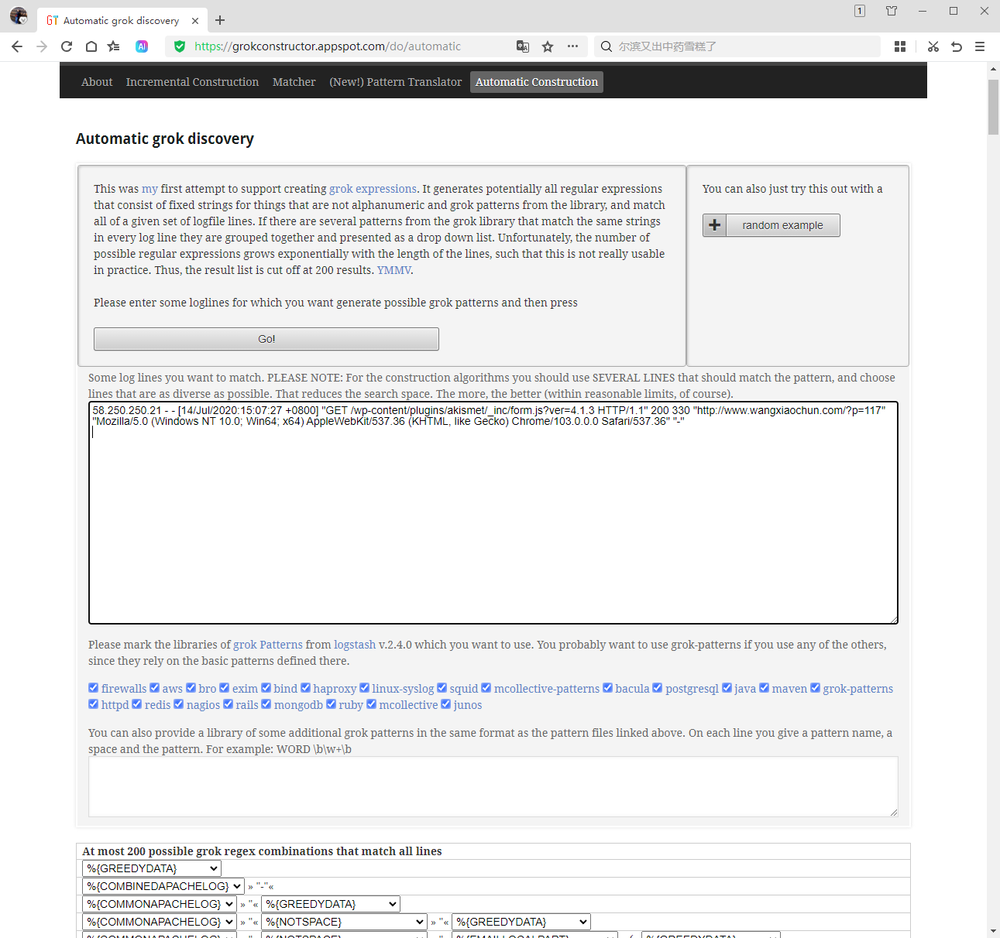

范例: 基于Docker 部署 grokdebugger

```bash
[root@ubuntu2204 ~]#docker run  --name grokdebugger -p 80:80 epurs/grokdebugger
```

范例: Nginx 访问日志

```text
#cat /var/log/nginx/access.log
10.0.0.100 - - [03/Aug/2022:16:34:17 +0800] "GET / HTTP/1.1" 200 612 "-"
"curl/7.68.0"
%{COMBINEDAPACHELOG}
```

范例: 利用grokedebug 网站将nginx日志自动生成grok的内置格式代码

```text
58.250.250.21 - - [14/Jul/2020:15:07:27 +0800] "GET /wp-
content/plugins/akismet/_inc/form.js?ver=4.1.3 HTTP/1.1" 200 330
"http://www.bowenxiaochun.com/?p=117" "Mozilla/5.0 (Windows NT 10.0; Win64; x64)
AppleWebKit/537.36 (KHTML, like Gecko) Chrome/103.0.0.0 Safari/537.36" "-"
```

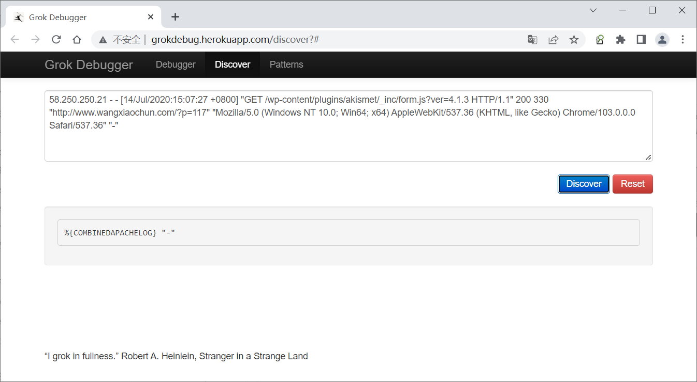

基于上面生成的代码转化为 Json 格式

```text
%{COMBINEDAPACHELOG}
```

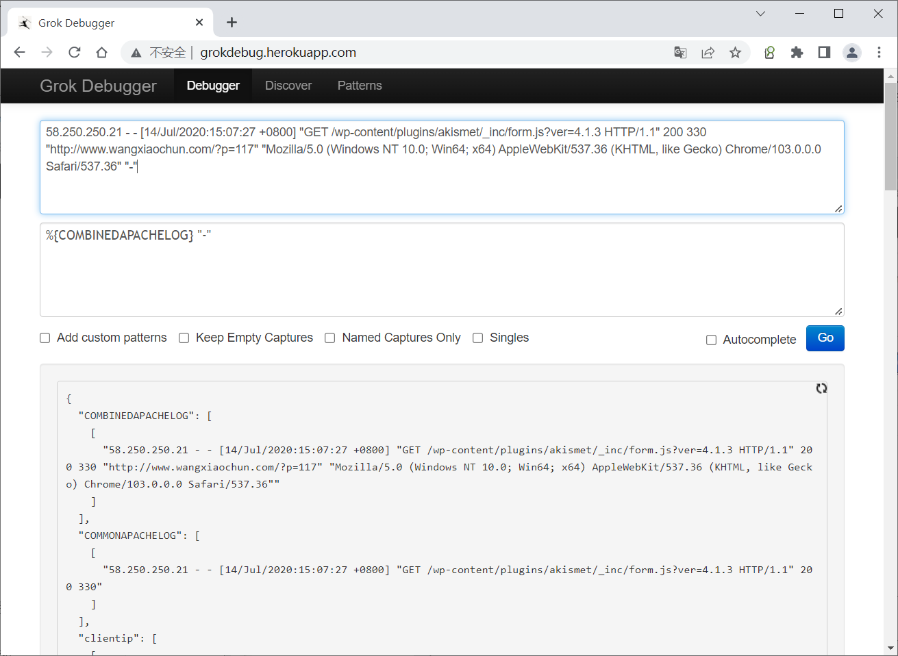

或者使作Kibana 实现上面功能

Management -- 开发工具 -- Grok Debugger

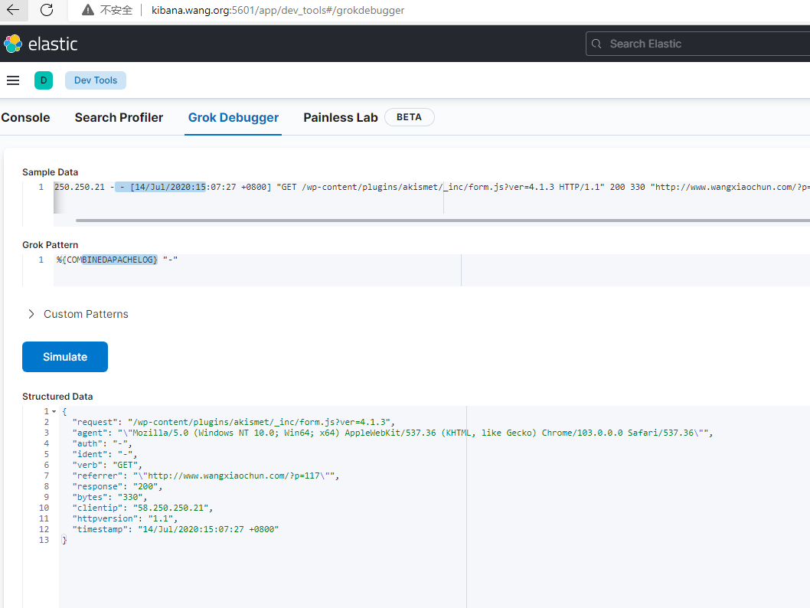

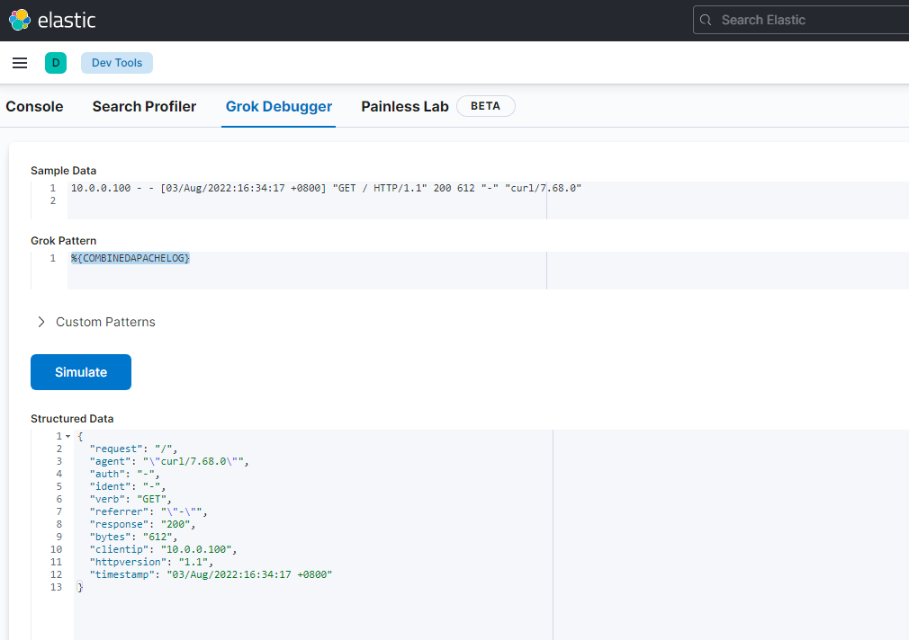

4.3.3.1.2 范例：使用 grok pattern 将 Nginx 日志格式化为 json 格式

```bash
[root@logstash ~]#vim /etc/logstash/conf.d/http_grok_stdout.conf
input {
http {
port =>6666
}
}
filter {
#将nginx日志格式化为json格式
grok {
match => {
"message" => "%{COMBINEDAPACHELOG}"  #将message字段转化为指定的Json格式
}
}
}
output {
stdout {
codec => rubydebug
}
}
[root@logstash ~]#/usr/share/logstash/bin/logstash -f
/etc/logstash/conf.d/http_grok_stdout.conf -r
#使用curl 或 insomnia 等工具将nginx日志发送http请求至logstash,可以看到下面的输出信息
[root@ubuntu2004 ~]#curl -XPOST -d '58.250.250.21 - - [14/Jul/2020:15:07:27
+0800] "GET /wp-content/plugins/akismet/_inc/form.js?ver=4.1.3 HTTP/1.1" 200 330
"http://www.bowenxiaochun.com/?p=117" "Mozilla/5.0 (Windows NT 10.0; Win64; x64)
AppleWebKit/537.36 (KHTML, like Gecko) Chrome/103.0.0.0 Safari/537.36" "-"'
http://logstash.bowen.org:6666/
ok
# insomnia 官方下载
https://insomnia.rest/download
```

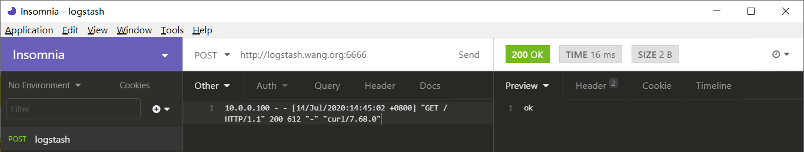

```json
#8.X版可以看到下面信息
[root@logstash ~]#/usr/share/logstash/bin/logstash -f
/etc/logstash/conf.d/http_grok_stdout.conf -r
.....
{
"user_agent" => {
"original" => [
[0] "curl/7.81.0",
[1] "Mozilla/5.0 (Windows NT 10.0; Win64; x64) AppleWebKit/537.36
(KHTML, like Gecko) Chrome/103.0.0.0 Safari/537.36"
]
},
"event" => {
"original" => "58.250.250.21 - - [14/Jul/2020:15:07:27 +0800] \"GET /wp-
content/plugins/akismet/_inc/form.js?ver=4.1.3 HTTP/1.1\" 200 330
\"http://www.bowenxiaochun.com/?p=117\" \"Mozilla/5.0 (Windows NT 10.0; Win64;
x64) AppleWebKit/537.36 (KHTML, like Gecko) Chrome/103.0.0.0 Safari/537.36\""
},
"@version" => "1",
"timestamp" => "14/Jul/2020:15:07:27 +0800",
"url" => {
"original" => "/wp-content/plugins/akismet/_inc/form.js?ver=4.1.3",
"domain" => "10.0.0.207",
"port" => 6666,
"path" => "/"
},
"http" => {
"version" => [
[0] "HTTP/1.1",
[1] "1.1"
],
"method" => "POST",
"response" => {
"body" => {
"bytes" => 330
},
"status_code" => 200
},
"request" => {
"body" => {
"bytes" => "271"
},
"referrer" => "http://www.bowenxiaochun.com/?p=117",
"method" => "GET",
"mime_type" => "application/x-www-form-urlencoded"
}
},
"source" => {
"address" => "58.250.250.21"    #客户端IP,和7.X版不同有嵌套关系
},
"@timestamp" => 2023-05-05T01:22:02.989829299Z,
"message" => "58.250.250.21 - - [14/Jul/2020:15:07:27 +0800] \"GET /wp-
content/plugins/akismet/_inc/form.js?ver=4.1.3 HTTP/1.1\" 200 330
\"http://www.bowenxiaochun.com/?p=117\" \"Mozilla/5.0 (Windows NT 10.0; Win64;
x64) AppleWebKit/537.36 (KHTML, like Gecko) Chrome/103.0.0.0 Safari/537.36\"",
"host" => {
"ip" => "10.0.0.200"
}
}
#7.X访问后可以看到下面JSON信息
[root@logstash ~]#/usr/share/logstash/bin/logstash -f
/etc/logstash/conf.d/http_grok_stdout.conf -r
.....
{
"ident" => "-",
"verb" => "GET",
"@version" => "1",
"httpversion" => "1.1",
"message" => "10.0.0.100 - - [14/Jul/2020:14:45:02 +0800] \"GET /
HTTP/1.1\" 200 612 \"-\" \"curl/7.68.0\"",
"host" => "10.0.0.1",
"request" => "/",
"auth" => "-",
"timestamp" => "14/Jul/2020:14:45:02 +0800",  #注意:两个timestamp字段,此处的字
段是日志生成的时间
"response" => "200",
"referrer" => "\"-\"",
"@timestamp" => 2022-07-14T07:38:52.606Z,      #注意:两个timestamp字段,此处的字
段是logstash处理的时间
"headers" => {
"http_accept" => "*/*",
"request_path" => "/",
"http_version" => "HTTP/1.1",
"http_host" => "logstash.bowen.org:6666",
"content_length" => "86",
"request_method" => "POST",
"http_user_agent" => "insomnia/6.3.2"
},
"agent" => "\"curl/7.68.0\"",
"clientip" => "10.0.0.100",                 #客户端IP
"bytes" => "612"
}
```

范例： 直接将nginx的访问日志转化为Json格式

```bash
[root@ubuntu2004 ~]#cat /etc/logstash/conf.d/nginx_grok_stdout.conf
input {
file {
path => "/var/log/nginx/access.log"
type => "nginx-accesslog"
start_position => "beginning"
stat_interval => "3"
}
}
filter {
#将nginx日志格式化为json格式
grok {
match => {
"message" => "%{COMBINEDAPACHELOG}"  #将message字段转化为指定的Json格式
}
}
}
output {
stdout {
codec => rubydebug
}
}
#添加日志信息
[root@logstash ~]#head -n1 nginx-access.log
23.101.180.204 - - [28/Jun/2021:03:09:01 +0800] "POST //xmlrpc.php HTTP/1.1" 200
412 "-" "Mozilla/5.0 (Windows NT 6.1; Win64; x64) AppleWebKit/537.36 (KHTML,
like Gecko) Chrome/85.0.4183.102 Safari/537.36"
[root@logstash ~]#head -n1 nginx-access.log  >> /tmp/nginx-access.log
#8.X访问后可以看到下面JSON信息
[root@logstash ~]#/usr/share/logstash/bin/logstash -f
/etc/logstash/conf.d/nginx_grok_stdout.conf -r
{
"timestamp" => "28/Jun/2021:03:09:01 +0800",
"url" => {
"original" => "//xmlrpc.php"
},
"source" => {
"address" => "23.101.180.204"
},
"host" => {
"name" => "logstash2.bowen.org"
},
"message" => "23.101.180.204 - - [28/Jun/2021:03:09:01 +0800] \"POST
//xmlrpc.php HTTP/1.1\" 200 412 \"-\" \"Mozilla/5.0 (Windows NT 6.1; Win64; x64)
AppleWebKit/537.36 (KHTML, like Gecko) Chrome/85.0.4183.102 Safari/537.36\" \"-\"
",
"@version" => "1",
"user_agent" => {
"original" => "Mozilla/5.0 (Windows NT 6.1; Win64; x64)
AppleWebKit/537.36 (KHTML, like Gecko) Chrome/85.0.4183.102 Safari/537.36"
},
"log" => {
"file" => {
"path" => "/tmp/nginx-access.log"
}
},
"type" => "nginx-accesslog",
"@timestamp" => 2023-05-05T01:24:27.096714914Z,
"http" => {
"request" => {
"method" => "POST"
},
"version" => "1.1",
"response" => {
"status_code" => 200,
"body" => {
"bytes" => 412
}
}
},
"event" => {
"original" => "23.101.180.204 - - [28/Jun/2021:03:09:01 +0800] \"POST
//xmlrpc.php HTTP/1.1\" 200 412 \"-\" \"Mozilla/5.0 (Windows NT 6.1; Win64; x64)
AppleWebKit/537.36 (KHTML, like Gecko) Chrome/85.0.4183.102 Safari/537.36\" \"-\"
"
}
}
```

### GeoIP 插件

geoip 根据 ip 地址提供的对应地域信息，比如:经纬度,国家,城市名等,以方便进行地理数据分析

```text
#logstash-9.0.1
/usr/share/logstash/vendor/bundle/jruby/3.1.0/gems/logstash-filter-geoip-7.3.1-
java/vendor/GeoLite2-City.mmdb
#logstash-8版本
/usr/share/logstash/vendor/bundle/jruby/3.1.0/gems/logstash-filter-geoip-7.2.13-
java/vendor/GeoLite2-City.mmdb
```

范例:

```bash
[root@logstash ~]#vim /etc/logstash/conf.d/http_geoip_stdout.conf
input {
#beats {
#   port => 5044
#}
http {
port => 6666
codec => "json"
}
}
filter {
#将nginx日志格式化为json格式
grok {
match => {
"message" => "%{COMBINEDAPACHELOG}"
}
}
#以上面提取clientip字段为源,获取地域信息
geoip {
#database =>
"/usr/share/logstash/vendor/bundle/jruby/3.1.0/gems/logstash-filter-geoip-7.3.0-
java/vendor/GeoLite2-City.mmdb"      #8.15.X版本必须指定数据库文件路径，7.X可以不指定
#database =>
"/usr/share/logstash/vendor/bundle/jruby/3.1.0/gems/logstash-filter-geoip-7.3.1-
java/vendor/GeoLite2-City.mmdb"
#source => "clientip"          #7.X版本指定源IP的所在字段
source => "[source][address]"  #8.X版本变化,结合grok插件
target => "geoip"
}
}
output {
stdout {
codec => rubydebug
}
}
#启动
[root@logstash ~]#/usr/share/logstash/bin/logstash -f
/etc/logstash/conf.d/http_geoip_stdout.conf -r
#使用curl命令或insomnia等发送nginx日志给logstash可以看到下面信息
[root@ubuntu2004 ~]#curl -XPOST -d '23.101.180.204 - - [28/Jun/2021:03:09:01
+0800] "POST //xmlrpc.php HTTP/1.1" 200 412 "-" "Mozilla/5.0 (Windows NT 6.1;
Win64; x64) AppleWebKit/537.36 (KHTML, like Gecko) Chrome/85.0.4183.102
Safari/537.36" "-" ' http://logstash.bowen.org:6666/
```

```json
[root@ubuntu2004 ~]#curl -XPOST -d '58.250.250.21 - - [14/Jul/2020:15:07:27
+0800] "GET /wp-content/plugins/akismet/_inc/form.js?ver=4.1.3 HTTP/1.1" 200 330
"http://www.bowenxiaochun.com/?p=117" "Mozilla/5.0 (Windows NT 10.0; Win64; x64)
AppleWebKit/537.36 (KHTML, like Gecko) Chrome/103.0.0.0 Safari/537.36" "-"'
http://logstash.bowen.org:6666/
ok
#8.X版可以看到下面信息
[root@logstash ~]#/usr/share/logstash/bin/logstash -f
/etc/logstash/conf.d/http_geoip_stdout.conf -r
.....
[INFO ] 2023-05-06 09:23:08.342 [http-input-processor[T#2]] json - ECS
compatibility is enabled but `target` option was not specified. This may cause
fields to be set at the top-level of the event where they are likely to clash
with the Elastic Common Schema. It is recommended to set the `target` option to
avoid potential schema conflicts (if your data is ECS compliant or non-
conflicting, feel free to ignore this message)
{
"url" => {
"domain" => "10.0.0.206",
"port" => 6666,
"path" => "/",
"original" => "//xmlrpc.php"
},
"source" => {
"address" => "23.101.180.204"
},
"@version" => "1",
"host" => {
"ip" => "10.0.0.200"
},
"message" => "23.101.180.204 - - [28/Jun/2021:03:09:01 +0800] \"POST
//xmlrpc.php HTTP/1.1\" 200 412 \"-\" \"Mozilla/5.0 (Windows NT 6.1; Win64; x64)
AppleWebKit/537.36 (KHTML, like Gecko) Chrome/85.0.4183.102 Safari/537.36\" \"-\"
",
"event" => {
"original" => "23.101.180.204 - - [28/Jun/2021:03:09:01 +0800] \"POST
//xmlrpc.php HTTP/1.1\" 200 412 \"-\" \"Mozilla/5.0 (Windows NT 6.1; Win64; x64)
AppleWebKit/537.36 (KHTML, like Gecko) Chrome/85.0.4183.102 Safari/537.36\" \"-\"
"
},
"geoip" => {
"geo" => {
"country_iso_code" => "US",
"city_name" => "San Antonio",
"region_name" => "Texas",
"timezone" => "America/Chicago",
"continent_code" => "NA",
"region_iso_code" => "US-TX",
"country_name" => "United States",
"postal_code" => "78288",
"location" => {
"lon" => -98.4927,
"lat" => 29.4227
}
},
"mmdb" => {
"dma_code" => 641
},
"ip" => "23.101.180.204"
},
"user_agent" => {
"original" => [
[0] "curl/7.81.0",
[1] "Mozilla/5.0 (Windows NT 6.1; Win64; x64) AppleWebKit/537.36
(KHTML, like Gecko) Chrome/85.0.4183.102 Safari/537.36"
]
},
"http" => {
"version" => [
[0] "HTTP/1.1",
[1] "1.1"
],
"request" => {
"method" => "POST",
"mime_type" => "application/x-www-form-urlencoded",
"body" => {
"bytes" => "210"
}
},
"response" => {
"status_code" => 200,
"body" => {
"bytes" => 412
}
},
"method" => "POST"
},
"timestamp" => "28/Jun/2021:03:09:01 +0800",
"@timestamp" => 2023-05-06T01:23:08.343758615Z
}
```

```json
#7.X版可以看到下面信息
[root@logstash ~]#/usr/share/logstash/bin/logstash -f
/etc/logstash/conf.d/http_geoip_stdout.conf -r
......
{
"response" => "200",
"clientip" => "58.250.250.21",
"host" => "10.0.0.100",
"@version" => "1",
"auth" => "-",
"request" => "/wp-content/plugins/akismet/_inc/form.js?ver=4.1.3",
"@timestamp" => 2020-07-14T07:51:38.653Z,
"agent" => "\"Mozilla/5.0 (Windows NT 10.0; Win64; x64)
AppleWebKit/537.36 (KHTML, like Gecko) Chrome/103.0.0.0 Safari/537.36\"",
"headers" => {
"http_user_agent" => "curl/7.68.0",
"http_host" => "logstash.bowen.org:6666",
"content_type" => "application/x-www-form-urlencoded",
"request_path" => "/",
"request_method" => "POST",
"content_length" => "275",
"http_version" => "HTTP/1.1",
"http_accept" => "*/*"
},
"bytes" => "330",
"message" => "58.250.250.21 - - [14/Jul/2020:15:07:27 +0800] \"GET /wp-
content/plugins/akismet/_inc/form.js?ver=4.1.3 HTTP/1.1\" 200 330
\"http://www.bowenxiaochun.com/?p=117\" \"Mozilla/5.0 (Windows NT 10.0; Win64;
x64) AppleWebKit/537.36 (KHTML, like Gecko) Chrome/103.0.0.0 Safari/537.36\" \"-
\"",
"referrer" => "\"http://www.bowenxiaochun.com/?p=117\"",
"timestamp" => "14/Jul/2020:15:07:27 +0800",
"verb" => "GET",
"geoip" => {                 #显示以下地理位置信息
"country_name" => "China",
"continent_code" => "AS",
"latitude" => 34.7732,
"ip" => "58.250.250.21",
"country_code2" => "CN",
"timezone" => "Asia/Shanghai",
"longitude" => 113.722,
"country_code3" => "CN",
"location" => {
"lat" => 34.7732,
"lon" => 113.722
}
},
"ident" => "-",
"httpversion" => "1.1"
}
```

范例: 只显示指定的geoip的字段信息

```bash
[root@logstash ~]#cat  /etc/logstash/conf.d/http_geoip_field_stdout.conf
input {
http {
port =>6666
}
}
filter {
#将nginx日志格式化为json格式
grok {
match => {
"message" => "%{COMBINEDAPACHELOG}"
}
}
#以上面提取clientip字段为源,获取地域信息,并指定只保留显示的字段
geoip {
database =>
"/usr/share/logstash/vendor/bundle/jruby/3.1.0/gems/logstash-filter-geoip-7.3.0-
java/vendor/GeoLite2-City.mmdb"
#source => "clientip"            #7.X版本
source => "[source][address]"   #8.X版本变化
target => "geoip"
fields => ["continent_code","country_name","city_name","timezone",
"longitude","latitude"]
}
}
output {
stdout {
codec => rubydebug
}
}
[root@logstash ~]#/usr/share/logstash/bin/logstash -f
/etc/logstash/conf.d/http_geoip_field_stdout.conf -r
.....
8.X
......
"geoip" => {
"geo" => {
"city_name" => "San Antonio",
"country_name" => "United States",
"timezone" => "America/Chicago",
"location" => {
"lon" => -98.4927,
"lat" => 29.4227
},
"continent_code" => "NA"
}
},
7.X
{
"httpversion" => "1.1",
"clientip" => "58.250.250.21",
"agent" => "\"Mozilla/5.0 (Windows NT 10.0; Win64; x64)
AppleWebKit/537.36 (KHTML, like Gecko) Chrome/103.0.0.0 Safari/537.36\"",
"verb" => "GET",
"timestamp" => "14/Jul/2020:15:07:27 +0800",
"@version" => "1",
"geoip" => {                     #显示指定字段信息
"latitude" => 34.7732,
"country_name" => "China",
"continent_code" => "AS",
"country_code2" => "CN",
"longitude" => 113.722,
"timezone" => "Asia/Shanghai"
},
"bytes" => "330",
"ident" => "-",
"auth" => "-",
"referrer" => "\"http://www.bowenxiaochun.com/?p=117\"",
"@timestamp" => 2020-07-14T08:02:49.744Z,
"host" => "10.0.0.100",
"response" => "200",
"message" => "58.250.250.21 - - [14/Jul/2020:15:07:27 +0800] \"GET /wp-
content/plugins/akismet/_inc/form.js?ver=4.1.3 HTTP/1.1\" 200 330
\"http://www.bowenxiaochun.com/?p=117\" \"Mozilla/5.0 (Windows NT 10.0; Win64;
x64) AppleWebKit/537.36 (KHTML, like Gecko) Chrome/103.0.0.0 Safari/537.36\" \"-
\"",
"headers" => {
"request_method" => "POST",
"content_type" => "application/x-www-form-urlencoded",
"http_host" => "logstash.bowen.org:6666",
"http_accept" => "*/*",
"content_length" => "275",
"http_user_agent" => "curl/7.68.0",
"request_path" => "/",
"http_version" => "HTTP/1.1"
},
"request" => "/wp-content/plugins/akismet/_inc/form.js?ver=4.1.3"
}
......
#使用curl命令或insomnia等发送nginx日志给logstash可以看到上面信息
[root@ubuntu2004 ~]#curl -XPOST -d '58.250.250.21 - - [14/Jul/2020:15:07:27
+0800] "GET /wp-content/plugins/akismet/_inc/form.js?ver=4.1.3 HTTP/1.1" 200 330
"http://www.bowenxiaochun.com/?p=117" "Mozilla/5.0 (Windows NT 10.0; Win64; x64)
AppleWebKit/537.36 (KHTML, like Gecko) Chrome/103.0.0.0 Safari/537.36" "-"'
http://logstash.bowen.org:6666/
ok
```

### Date 插件

Date插件可以将日志中的指定的日期字符串对应的源字段生成新的目标字段。

然后替换@timestamp 字段(此字段默认为当前写入logstash的时间而非日志本身的时间)或指定的其他字段

```text
match    #类型为数组，用于指定需要使用的源字段名和对应的时间格式
target   #类型为字符串，用于指定生成的目标字段名，默认是 @timestamp
timezone #类型为字符串，用于指定时区域
```

官方说明

<https://www.elastic.co/guide/en/logstash/current/plugins-filters-date.html>

时区格式参考

<http://joda-time.sourceforge.net/timezones.html>

范例: 利用源字段timestamp生成新的字段名access_time

```bash
[root@logstash ~]#cat /etc/logstash/conf.d/http_grok_date_stdout.conf
input {
http {
port =>6666
}
}
filter {
#将nginx日志格式化为json格式
grok {
match => {
"message" => "%{COMBINEDAPACHELOG}"
}
}
#解析源字段timestamp的date日期格式: 14/Jul/2020:15:07:27 +0800
date {
match => ["timestamp", "dd/MMM/yyyy:HH:mm:ss Z" ]
target => "access_time"        #将时间写入新生成的access_time字段，源字段仍保留
#target => "@timestamp"        #将时间覆盖原有的@timestamp字段
timezone => "Asia/Shanghai"
}
}
output {
stdout {
codec => rubydebug
}
}
[root@logstash ~]#/usr/share/logstash/bin/logstash -f
/etc/logstash/conf.d/http_grok_date_stdout.conf -r
......
#用curl提交日志,可以看到上面输出信息
[root@kibana ~]#curl -XPOST -d '23.101.180.204 - - [28/Jun/2021:03:09:01 +0800]
"POST //xmlrpc.php HTTP/1.1" 200 412 "-" "Mozilla/5.0 (Windows NT 6.1; Win64;
x64) AppleWebKit/537.36 (KHTML, like Gecko) Chrome/85.0.4183.102 Safari/537.36"
"-" ' http://10.0.0.206:6666
[root@ubuntu2004 ~]#curl -XPOST -d '58.250.250.21 - - [14/Jul/2020:15:07:27
+0800] "GET /wp-content/plugins/akismet/_inc/form.js?ver=4.1.3 HTTP/1.1" 200 330
"http://www.bowenxiaochun.com/?p=117" "Mozilla/5.0 (Windows NT 10.0; Win64; x64)
AppleWebKit/537.36 (KHTML, like Gecko) Chrome/103.0.0.0 Safari/537.36" "-"'
http://logstash.bowen.org:6666/
ok
[root@logstash ~]#/usr/share/logstash/bin/logstash -f
/etc/logstash/conf.d/http_grok_date_stdout.conf -r
......
{
"@version" => "1",
"headers" => {
"http_host" => "logstash.bowen.org:6666",
"request_method" => "POST",
"content_length" => "275",
"request_path" => "/",
"http_accept" => "*/*",
"http_user_agent" => "curl/7.68.0",
"content_type" => "application/x-www-form-urlencoded",
"http_version" => "HTTP/1.1"
},
"@timestamp" => 2020-07-14T08:14:23.063Z,
"verb" => "GET",
"ident" => "-",
"clientip" => "58.250.250.21",
"auth" => "-",
"timestamp" => "14/Jul/2020:15:07:27 +0800",
"referrer" => "\"http://www.bowenxiaochun.com/?p=117\"",
"bytes" => "330",
"request" => "/wp-content/plugins/akismet/_inc/form.js?ver=4.1.3",
"httpversion" => "1.1",
"response" => "200",
"message" => "58.250.250.21 - - [14/Jul/2020:15:07:27 +0800] \"GET /wp-
content/plugins/akismet/_inc/form.js?ver=4.1.3 HTTP/1.1\" 200 330
\"http://www.bowenxiaochun.com/?p=117\" \"Mozilla/5.0 (Windows NT 10.0; Win64;
x64) AppleWebKit/537.36 (KHTML, like Gecko) Chrome/103.0.0.0 Safari/537.36\" \"-
\"",
"access_time" => 2020-07-14T07:07:27.000Z,     ###########生成新的字段
##########
"agent" => "\"Mozilla/5.0 (Windows NT 10.0; Win64; x64)
AppleWebKit/537.36 (KHTML, like Gecko) Chrome/103.0.0.0 Safari/537.36\"",
"host" => "10.0.0.100"
}
......
```

范例: 将UNIX时间转换指定格式

```text
date {
match => ["timestamp","UNIX","YYYY-MM-dd HH:mm:ss"]
target =>"@timestamp"
timezone => "Asia/shanghai"
}
```

### Useragent 插件

useragent 插件可以根据请求中的 user-agent 字段，解析出浏览器设备、操作系统等信息, 以方便后续的分析使用

```text
112.13.112.30 - - [05/Jul/2023:19:48:03 +0000] "GET /wp-
content/themes/dux/js/libs/ias.min.js?ver=THEME_VERSION HTTP/1.1" 200 1949
"https://www.bowenxiaochun.com/" "Mozilla/5.0 (Linux; U; Android 11; zh-CN; Redmi
K30 Pro Build/RKQ1.200826.002) AppleWebKit/537.36 (KHTML, like Gecko) Version/4.0
Chrome/78.0.3904.108 Quark/5.4.9.201 Mobile Safari/537.36"
223.104.42.101 - - [29/Oct/2024:14:33:09 +0800] "GET /wp-
content/themes/dux/js/libs/ias.min.js?ver=THEME_VERSION HTTP/1.1" 200 1949
"http://www.bowenxiaochun.com:8888/?paged=2" "Mozilla/5.0 (Linux; U; Android 10;
zh-CN; LYA-AL00 Build/HUAWEILYA-AL00L) AppleWebKit/537.36 (KHTML, like Gecko)
Version/4.0 Chrome/100.0.4896.58 UCBrowser/17.1.2.1343 Mobile Safari/537.36" "-"
36.112.186.61 - - [29/Oct/2024:14:35:46 +0800] "GET /wp-
content/themes/dux/img/share.png HTTP/1.1" 200 6932
"http://www.bowenxiaochun.com:8888/wp-content/themes/dux/css/share.css"
"Mozilla/5.0 (Linux; U; Android 14; zh-cn; M2011K2C Build/UKQ1.231207.002)
AppleWebKit/537.36 (KHTML, like Gecko) Version/4.0 Chrome/109.0.5414.86
MQQBrowser/15.6 Mobile Safari/537.36 COVC/047113" "-"
```

范例:

```bash
[root@logstash ~]#cat /etc/logstash/conf.d/http_grok_useragent_stdout.conf
input {
http {
port =>6666
}
}
filter {
#将nginx日志格式化为json格式
grok {
match => {
"message" => "%{COMBINEDAPACHELOG}"
}
}
#解析date日期如: 10/Dec/2020:10:40:10 +0800
date {
match => ["timestamp", "dd/MMM/yyyy:HH:mm:ss Z" ]
target => "@timestamp"
#target => "access_time"
timezone => "Asia/Shanghai"
}
#提取agent字段，进行解析
useragent {
#source => "agent"        #7,X指定从哪个字段获取数据
source => "message"        #8.X指定从哪个字段获取数据
#source => "[user_agent][original]" #8.X指定从哪个字段获取数据,直接分析日志文
件，curl或insomnia此方式不成功
#source => "[user_agent][original][1]" #8.X指定从哪个字段获取数据，如果利用
insomnia此方式不成功工具发送http请求，需要加[1]
target => "useragent" #指定生成新的字典类型的字段的名称，包括os，device等内容
}
}
output {
stdout {
codec => rubydebug
}
}
#启动
[root@logstash ~]#/usr/share/logstash/bin/logstash -f
/etc/logstash/conf.d/http_grok_useragent_stdout.conf -r
......
#用curl提交日志,可以看到上面输出信息
[root@ubuntu2004 ~]#curl -POST -d'112.13.112.30 - - [05/Jul/2023:19:48:03 +0000]
"GET /wp-content/themes/dux/js/libs/ias.min.js?ver=THEME_VERSION HTTP/1.1" 200
1949 "https://www.bowenxiaochun.com/" "Mozilla/5.0 (Linux; U; Android 11; zh-CN;
Redmi K30 Pro Build/RKQ1.200826.002) AppleWebKit/537.36 (KHTML, like Gecko)
Version/4.0 Chrome/78.0.3904.108 Quark/5.4.9.201 Mobile Safari/537.36"'
http://logstash.bowen.org:6666
{
"log" => {
"file" => {
"path" => "/tmp/access.log"
}
},
"url" => {
"original" => "/wp-content/themes/dux/js/libs/ias.min.js?
ver=THEME_VERSION"
},
"source" => {
"address" => "112.13.112.30"
},
"http" => {
"request" => {
"method" => "GET",
"referrer" => "https://www.bowenxiaochun.com/"
},
"version" => "1.1",
"response" => {
"body" => {
"bytes" => 1949
},
"status_code" => 200
}
},
"event" => {
"original" => "112.13.112.30 - - [05/Jul/2023:19:48:03 +0000] \"GET /wp-
content/themes/dux/js/libs/ias.min.js?ver=THEME_VERSION HTTP/1.1\" 200 1949
\"https://www.bowenxiaochun.com/\" \"Mozilla/5.0 (Linux; U; Android 11; zh-CN;
Redmi K30 Pro Build/RKQ1.200826.002) AppleWebKit/537.36 (KHTML, like Gecko)
Version/4.0 Chrome/78.0.3904.108 Quark/5.4.9.201 Mobile Safari/537.36\" \"-\""
},
"@version" => "1",
"message" => "112.13.112.30 - - [05/Jul/2023:19:48:03 +0000] \"GET /wp-
content/themes/dux/js/libs/ias.min.js?ver=THEME_VERSION HTTP/1.1\" 200 1949
\"https://www.bowenxiaochun.com/\" \"Mozilla/5.0 (Linux; U; Android 11; zh-CN;
Redmi K30 Pro Build/RKQ1.200826.002) AppleWebKit/537.36 (KHTML, like Gecko)
Version/4.0 Chrome/78.0.3904.108 Quark/5.4.9.201 Mobile Safari/537.36\" \"-\"",
"type" => "nginx-accesslog",
"user_agent" => {
"original" => "Mozilla/5.0 (Linux; U; Android 11; zh-CN; Redmi K30 Pro
Build/RKQ1.200826.002) AppleWebKit/537.36 (KHTML, like Gecko) Version/4.0
Chrome/78.0.3904.108 Quark/5.4.9.201 Mobile Safari/537.36"
},
"timestamp" => "05/Jul/2023:19:48:03 +0000",
"host" => {
"name" => "logstash.bowen.org"
},
"useragent" => {
"name" => "Chrome Mobile WebView",
"version" => "78.0.3904.108",
"device" => {
"name" => "XiaoMi Redmi K30 Pro"
},
"os" => {
"name" => "Android",
"version" => "11",
"full" => "Android 11"
}
},
"@timestamp" => 2023-07-05T19:48:03.000Z
}
[root@ubuntu2004 ~]#curl -XPOST -d '58.250.250.21 - - [14/Jul/2020:15:07:27
+0800] "GET /wp-content/plugins/akismet/_inc/form.js?ver=4.1.3 HTTP/1.1" 200 330
"http://www.bowenxiaochun.com/?p=117" "Mozilla/5.0 (Windows NT 10.0; Win64; x64)
AppleWebKit/537.36 (KHTML, like Gecko) Chrome/103.0.0.0 Safari/537.36" "-"'
http://logstash.bowen.org:6666/
ok
[root@logstash ~]#/usr/share/logstash/bin/logstash -f
/etc/logstash/conf.d/http_grok_useragent_stdout.conf -r
......
{
"bytes" => "330",
"ident" => "-",
"host" => "10.0.0.100",
"@version" => "1",
"auth" => "-",
"httpversion" => "1.1",
"message" => "58.250.250.21 - - [14/Jul/2020:15:07:27 +0800] \"GET /wp-
content/plugins/akismet/_inc/form.js?ver=4.1.3 HTTP/1.1\" 200 330
\"http://www.bowenxiaochun.com/?p=117\" \"Mozilla/5.0 (Windows NT 10.0; Win64;
x64) AppleWebKit/537.36 (KHTML, like Gecko) Chrome/103.0.0.0 Safari/537.36\" \"-
\"",
"referrer" => "\"http://www.bowenxiaochun.com/?p=117\"",
"request" => "/wp-content/plugins/akismet/_inc/form.js?ver=4.1.3",
"headers" => {
"content_type" => "application/x-www-form-urlencoded",
"request_path" => "/",
"http_user_agent" => "curl/7.68.0",
"http_accept" => "*/*",
"http_host" => "logstash.bowen.org:6666",
"http_version" => "HTTP/1.1",
"request_method" => "POST",
"content_length" => "275"
},
"agent" => "\"Mozilla/5.0 (Windows NT 10.0; Win64; x64)
AppleWebKit/537.36 (KHTML, like Gecko) Chrome/103.0.0.0 Safari/537.36\"",
"@timestamp" => 2020-07-14T07:07:27.000Z,
"timestamp" => "14/Jul/2020:15:07:27 +0800",
"verb" => "GET",
"useragent" => {            ########################生成的新字段
######################
"name" => "Chrome",
"major" => "103",
"os_version" => "10",
"patch" => "0",
"os_major" => "10",
"os_full" => "Windows 10",
"os" => "Windows",
"minor" => "0",
"version" => "103.0.0.0",
"os_name" => "Windows",
"device" => "Other"
},
"clientip" => "58.250.250.21",
"response" => "200"
}
,,,,,,
```

### Mutate 插件

官方链接:

<https://www.elastic.co/guide/en/logstash/master/plugins-filters-mutate.html>

<https://www.elastic.co/guide/en/logstash/7.6/plugins-filters-mutate.html>

Mutate 插件主要是对字段进行、类型转换、删除、替换、更新等操作,可以使用以下函数

```text
remove_field    #删除字段
split           #字符串切割,相当于awk取列
add_field       #添加字段
convert         #类型转换，支持的数据类型：integer，integer_eu，float，float_eu，
string，boolean
gsub            #字符串替换
rename          #字符串改名
lowercase       #转换字符串为小写
```

4.3.3.5.1 remove_field 删除字段

范例:

```bash
[root@logstash ~]#cat
/etc/logstash/conf.d/http_grok_mutate_remove_field_stdout.conf
input {
http {
port =>6666
}
}
filter {
#将nginx日志格式化为json格式
grok {
match => {
"message" => "%{COMBINEDAPACHELOG}"
}
}
#解析date日期如: 10/Dec/2020:10:40:10 +0800
date {
match => ["timestamp", "dd/MMM/yyyy:HH:mm:ss Z" ]
target => "@timestamp"
#target => "access_time"
timezone => "Asia/Shanghai"
}
#mutate 删除指定字段的操作
mutate {
#remove_field => ["headers","message", "agent"]  #7.X
remove_field => ["timestamp","message", "http"] #8.X
}
}
output {
stdout {
codec => rubydebug
}
}
```

```json
[root@logstash ~]#/usr/share/logstash/bin/logstash -f
/etc/logstash/conf.d/http_grok_mutate_remove_field_stdout.conf -r
......
{
"@version" => "1",
"request" => "/wp-content/plugins/akismet/_inc/form.js?ver=4.1.3",
"referrer" => "\"http://www.bowenxiaochun.com/?p=117\"",
"response" => "200",
"timestamp" => "14/Jul/2020:15:07:27 +0800",
"ident" => "-",
"host" => "10.0.0.100",
"httpversion" => "1.1",
"verb" => "GET",
"bytes" => "330",
"@timestamp" => 2020-07-14T07:07:27.000Z,
"clientip" => "58.250.250.21",
"auth" => "-"
}
,,,,,,
#用curl提交日志,可以看到上面输出信息
[root@ubuntu2004 ~]#curl -XPOST -d '58.250.250.21 - - [14/Jul/2020:15:07:27
+0800] "GET /wp-content/plugins/akismet/_inc/form.js?ver=4.1.3 HTTP/1.1" 200 330
"http://www.bowenxiaochun.com/?p=117" "Mozilla/5.0 (Windows NT 10.0; Win64; x64)
AppleWebKit/537.36 (KHTML, like Gecko) Chrome/103.0.0.0 Safari/537.36" "-"'
http://logstash.bowen.org:6666/
ok
```

4.3.3.5.2 Split 切割

mutate 中的 split 字符串切割，指定字符做为分隔符，切割的结果用于生成新的列表元素

示例: 1000|提交订单|2020-01-08 09:10:21

范例: split 切割字符串取列

```bash
[root@logstash ~]#cat /etc/logstash/conf.d/http_grok_mutate_split_stdout.conf
input {
http {
port =>6666
}
}
filter {
#mutate 切割操作
mutate {
#字段分隔符
split => { "message" => "|" } #将message字段按 | 分割成名称message列表中多个列
表元素
}
}
output {
stdout {
codec => rubydebug
}
}
#启动
[root@logstash ~]#/usr/share/logstash/bin/logstash -f
/etc/logstash/conf.d/http_grok_mutate_split_stdout.conf
#用curl提交日志,可以看到上面输出信息
[root@ubuntu2004 ~]#curl -XPOST -d '1000|提交订单|2020-01-08 09:10:21'
http://logstash.bowen.org:6666/
ok
#观察结果
[root@logstash ~]#/usr/share/logstash/bin/logstash -f
/etc/logstash/conf.d/http_grok_mutate_split_stdout.conf
......
{
"message" => [
[0] "1000",
[1] "提交订单",
[2] "2020-01-08 09:10:21"
],
"@timestamp" => 2021-07-14T09:23:40.392Z,
"host" => "10.0.0.100",
"@version" => "1",
"headers" => {
"http_accept" => "*/*",
"request_path" => "/",
"content_length" => "37",
"request_method" => "POST",
"content_type" => "application/x-www-form-urlencoded",
"http_version" => "HTTP/1.1",
"http_user_agent" => "curl/7.68.0",
"http_host" => "logstash.bowen.org:6666"
}
}
,,,,,,
```

4.3.3.5.3 add_field 添加字段

用指定源字段添加新的字段，添加完成后源字段还存在

范例:

```bash
[root@logstash ~]#cat
/etc/logstash/conf.d/http_grok_mutate_add_field_stdout.conf
input {
http {
port =>6666
}
}
filter {
#mutate 切割操作
mutate {
#字段分隔符
split => { "message" => "|" }
#添加字段,将message的列表的第0个元素添加字段名user_id
add_field => {
"user_id" => "%{[message][0]}"
"action" => "%{[message][1]}"
"time" => "%{[message][2]}"
}
#添加字段做索引名
#add_field => {"[@metadata][target_index]" => "app-%{+YYY.MM.dd}"}
#删除无用字段
remove_field => ["headers","message"]
}
}
output {
stdout {
codec => rubydebug
}
}
```

```json
#启动
[root@logstash ~]#/usr/share/logstash/bin/logstash -f
/etc/logstash/conf.d/http_grok_mutate_add_field_stdout.conf
#用curl提交日志,可以看到上面输出信息
[root@ubuntu2004 ~]#curl -XPOST -d '1000|提交订单|2020-01-08 09:10:21'
http://logstash.bowen.org:6666/
ok
#观察结果
8.X
{
"event" => {
"original" => "1000|提交订单|2020-01-08 09:10:21"
},
"http" => {
"request" => {
"mime_type" => "application/x-www-form-urlencoded",
"body" => {
"bytes" => "37"
}
},
"version" => "HTTP/1.1",
"method" => "POST"
},
"action" => "提交订单",
"url" => {
"domain" => "logstash.bowen.org",
"port" => 6666,
"path" => "/"
},
"time" => "2020-01-08 09:10:21",
"host" => {
"ip" => "10.0.0.200"
},
"user_id" => "1000",
"@timestamp" => 2023-05-06T02:17:18.723754561Z,
"@version" => "1",
"user_agent" => {
"original" => "curl/7.81.0"
}
}
7.X
[root@logstash ~]#/usr/share/logstash/bin/logstash -f
/etc/logstash/conf.d/http_grok_mutate_add_field_stdout.conf
......
{
"user_id" => "1000",                    #生成字段名
"@timestamp" => 2021-07-14T09:34:11.144Z,
"time" => "2020-01-08 09:10:21",     #生成字段名
"action" => "提交订单",                  #生成字段名
"@version" => "1",
"host" => "10.0.0.100"
}
,,,,,,
```

5.5.3.5.4 convert 转换

mutate 中的 convert 可以实现数据类型的转换。 支持转换integer、float、string等类型

范例:

```bash
[root@logstash ~]#cat /etc/logstash/conf.d/http_grok_mutate_convert_stdout.conf
input {
http {
port =>6666
}
}
filter {
#mutate 切割操作
mutate {
#字段分隔符
split => { "message" => "|" }
#添加字段
add_field => {
"user_id" => "%{[message][0]}"
"action" => "%{[message][1]}"
"time" => "%{[message][2]}"
}
#删除无用字段
remove_field => ["headers","message"]
#对新添加字段进行格式转换
convert => {
"user_id" => "integer"
"action" => "string"
"time" => "string"
}
#convert => ["excute_time","float] #此格式也可以支持
#convert => ["time","string" ]
}
}
output {
stdout {
codec => rubydebug
}
}
```

```json
[root@logstash ~]#/usr/share/logstash/bin/logstash -f
/etc/logstash/conf.d/http_grok_mutate_convert_stdout.conf -r
......
8.X
{
"action" => "提交订单",
"url" => {
"domain" => "logstash.bowen.org",
"port" => 6666,
"path" => "/"
},
"time" => "2020-01-08 09:10:21",
"@version" => "1",
"host" => {
"ip" => "10.0.0.200"
},
"@timestamp" => 2023-05-06T02:20:41.573025409Z,
"user_id" => "1000",
"http" => {
"request" => {
"body" => {
"bytes" => "37"
},
"mime_type" => "application/x-www-form-urlencoded"
},
"version" => "HTTP/1.1",
"method" => "POST"
},
"user_agent" => {
"original" => "curl/7.81.0"
},
"event" => {
"original" => "1000|提交订单|2020-01-08 09:10:21"
}
}
7.X
{
"user_id" => "1000",
"@timestamp" => 2021-07-14T09:39:41.401Z,
"time" => "2020-01-08 09:10:21",
"action" => "提交订单",
"@version" => "1",
"host" => "10.0.0.100"
}
......
#用curl提交日志,可以看到上面输出信息
[root@ubuntu2004 ~]#curl -XPOST -d '1000|提交订单|2020-01-08 09:10:21'
http://logstash.bowen.org:6666/
ok
```

5.5.3.5.5 gsub 替换

gsub 实现字符串的替换

```text
filter {
mutate {
gsub=>["message","\n", " "] #将message字段中的换行替换为空格
}
}
```

### 条件判断

Filter 语句块中支持 if 条件判断功能

范例:

```text
#vim /etc/filebeat/filebeat.yml
filebeat.inputs:
- type: log
enabled: true
paths:
- /var/log/nginx/access.log
tags: ["access"]
- type: log
enabled: true
paths:
- /var/log/nginx/error.log
tags: ["error"]
- type: log
enabled: true
paths:
- /var/log/syslog
tags: ["system"]
```

```text
output.logstash:
hosts: ["10.0.0.104:5044","10.0.0.105:5044"]
#loadbalance: true        #负载均衡
#worker: 2 #number of hosts * workers #开启多进程
#vim /etc/logstash/conf.d/filebeat_logstash_es.conf
input {
beats {
port => 5044
}
}
filter {
if "access" in [tags][0] {
mutate {
add_field => { "target_index" => "access-%{+YYYY.MM.dd}"}
}
}
else if "error" in [tags][0] {
mutate {
add_field => { "target_index" => "error-%{+YYYY.MM.dd}"}
}
}
else if "system" in [tags][0] {
mutate {
add_field => { "target_index" => "system-%{+YYYY.MM.dd}"}
}
}
}
output {
elasticsearch {
hosts =>["10.0.0.101:9200","10.0.0.102:9200","10.0.0.103:9200"]  #一般写
data地址
index => "%{[target_index]}"   #使用字段target_index值做为索引名
template_overwrite => true      #覆盖索引模板
}
}
```

范例:

```text
#vim /etc/filebeat/filebeat.yml
filebeat.inputs:
- type: log
enabled: true
paths:
- /var/log/nginx/access.log
fields:
project: test-access
env: test
output.logstash:
hosts: ["10.0.0.104:5044","10.0.0.105:5044",]
```

```text
#vim /etc/logstash/conf.d/filebeat_logstash_es.conf
input {
beats {
port => 5044
}
file {
path => "/tmp/bowen.log"
type => bowenlog     #自定义的类型,可以用于条件判断
start_position => "beginning"
stat_interval => "3"
}
}
output {
if [fields][env] == "test" {
elasticsearch {
hosts =>["10.0.0.101:9200","10.0.0.102:9200","10.0.0.103:9200"]
index => "test-nginx-%{+YYYY.MM.dd}"
}
}
if [type] == "bowenlog" {
stdout {
codec => rubydebug
}
}
}
```

### Logstash 输出 Output 插件

官方链接

<https://www.elastic.co/guide/en/logstash/current/output-plugins.html>

<https://www.elastic.co/guide/en/logstash/8.17/output-plugins.html>

<https://www.elastic.co/guide/en/logstash/7.6/output-plugins.html>

### Stdout 插件

stdout 插件将数据输出到屏幕终端，主要用于调试

```text
output {
stdout {
codec => rubydebug
}
}
```

### File 插件

输出到文件，可以将分散在多个文件的数据统一存放到一个文件

示例: 将所有 web 机器的日志收集到一个文件中，从而方便统一管理

```bash
[root@ubuntu2204 ~]#cat /etc/logstash/conf.d/stdin_file.conf
input {
stdin {}
}
output {
stdout {
codec => rubydebug
}
file {
#path => "/var/log/test.log"
path => "/tmp/test.log"
}
}
```

范例:

```bash
[root@logstash ~]#/usr/share/logstash/bin/logstash  -e 'input { stdin{  codec =>
json  }} output { file{ path => "/tmp/logstash.log" }}'
OpenJDK 64-Bit Server VM warning: Option UseConcMarkSweepGC was deprecated in
version 9.0 and will likely be removed in a future release.
WARNING: An illegal reflective access operation has occurred
WARNING: Illegal reflective access by com.headius.backport9.modules.Modules
(file:/usr/share/logstash/logstash-core/lib/jars/jruby-complete-9.2.9.0.jar) to
method sun.nio.ch.NativeThread.signal(long)
WARNING: Please consider reporting this to the maintainers of
com.headius.backport9.modules.Modules
WARNING: Use --illegal-access=warn to enable warnings of further illegal
reflective access operations
WARNING: All illegal access operations will be denied in a future release
WARNING: Could not find logstash.yml which is typically located in
$LS_HOME/config or /etc/logstash. You can specify the path using --
path.settings. Continuing using the defaults
Could not find log4j2 configuration at path
/usr/share/logstash/config/log4j2.properties. Using default config which logs
errors to the console
[WARN ] 2021-01-26 18:58:24.105 [LogStash::Runner] multilocal - Ignoring the
'pipelines.yml' file because modules or command line options are specified
[INFO ] 2021-01-26 18:58:24.116 [LogStash::Runner] runner - Starting Logstash
{"logstash.version"=>"7.6.2"}
[INFO ] 2021-01-26 18:58:26.179 [Converge PipelineAction::Create<main>]
Reflections - Reflections took 35 ms to scan 1 urls, producing 20 keys and 40
values
[WARN ] 2021-01-26 18:58:26.619 [[main]-pipeline-manager] LazyDelegatingGauge -
A gauge metric of an unknown type (org.jruby.RubyArray) has been created for
key: cluster_uuids. This may result in invalid serialization.  It is recommended
to log an issue to the responsible developer/development team.
[INFO ] 2021-01-26 18:58:26.622 [[main]-pipeline-manager] javapipeline -
Starting pipeline {:pipeline_id=>"main", "pipeline.workers"=>2,
"pipeline.batch.size"=>125, "pipeline.batch.delay"=>50,
"pipeline.max_inflight"=>250, "pipeline.sources"=>["config string"], :thread=>"#
<Thread:0x4187ef25 run>"}
[INFO ] 2021-01-26 18:58:27.294 [[main]-pipeline-manager] javapipeline -
Pipeline started {"pipeline.id"=>"main"}
The stdin plugin is now waiting for input:
[INFO ] 2021-01-26 18:58:27.414 [Agent thread] agent - Pipelines running
{:count=>1, :running_pipelines=>[:main], :non_running_pipelines=>[]}
[INFO ] 2021-01-26 18:58:27.600 [Api Webserver] agent - Successfully started
Logstash API endpoint {:port=>9600}
test  #输入内容
[INFO ] 2021-01-26 18:59:30.242 [[main]>worker0] file - Opening file
{:path=>"/tmp/logstash.log"}
[INFO ] 2021-01-26 18:59:46.667 [[main]>worker0] file - Closing file
/tmp/logstash.log
[root@logstash ~]#cat /tmp/logstash.log
{"@version":"1","@timestamp":"2021-01-
26T10:59:29.943Z","host":"logstash.bowen.org","message":"test"}
```

### Elasticsearch 插件

官方说明

<https://www.elastic.co/guide/en/logstash/7.6/plugins-outputs-elasticsearch.html>

索引的时间格式说明

<https://www.joda.org/joda-time/apidocs/org/joda/time/format/DateTimeFormat.html>

当日志量较小时，可以按月或周生成索引，当日志量比较大时，会按天生成索引，以方便后续按天删除

```text
output {
elasticsearch {
hosts =>["10.0.0.101:9200","10.0.0.102:9200","10.0.0.103:9200"]   #一般写ES
中data节点地址
index => "app-%{+YYYY.MM.dd}"               #指定索引名称,建议加时间,按天建立索
引
#index => "%{[@metadata][target_index]}"    #使用字段[@metadata]
[target_index]值做为索引名
template_overwrite => true                  #覆盖索引模板,此项可选,默认值为
false
}
}
```

注意: 索引名必须为小写范例: 将标准输入输出到 elasticsearch

```bash
#将配置写入配置文件中
[root@ubuntu1804 ~]#cat /etc/logstash/conf.d/logstash-to-es.conf
input {
stdin{
codec => json
}
}
output {
elasticsearch {
hosts => ["10.0.0.101:9200"]
index => "syslog-%{+YYYY.MM.dd}"
}
}
#检查语法
[root@ubuntu1804 ~]#/usr/share/logstash/bin/logstash  -f
/etc/logstash/conf.d/logstash-to-es.conf -t
#前台执行
[root@ubuntu1804 ~]#/usr/share/logstash/bin/logstash  -f
/etc/logstash/conf.d/logstash-to-es.conf
```

范例: 将标准输入输出到 Elasticsearch

```bash
[root@logstash ~]#/usr/share/logstash/bin/logstash  -e 'input { stdin{ codec =>
json } } output { elasticsearch {hosts => ["10.0.0.101:9200"] index => "mytest-%
{+YYYY.MM.dd}" }}'
OpenJDK 64-Bit Server VM warning: Option UseConcMarkSweepGC was deprecated in
version 9.0 and will likely be removed in a future release.
WARNING: An illegal reflective access operation has occurred
WARNING: Illegal reflective access by com.headius.backport9.modules.Modules
(file:/usr/share/logstash/logstash-core/lib/jars/jruby-complete-9.2.9.0.jar) to
method sun.nio.ch.NativeThread.signal(long)
WARNING: Please consider reporting this to the maintainers of
com.headius.backport9.modules.Modules
WARNING: Use --illegal-access=warn to enable warnings of further illegal
reflective access operations
WARNING: All illegal access operations will be denied in a future release
WARNING: Could not find logstash.yml which is typically located in
$LS_HOME/config or /etc/logstash. You can specify the path using --path.settings.
Continuing using the defaults
Could not find log4j2 configuration at path
/usr/share/logstash/config/log4j2.properties. Using default config which logs
errors to the console
[WARN ] 2021-01-26 19:05:02.417 [LogStash::Runner] multilocal - Ignoring the
'pipelines.yml' file because modules or command line options are specified
[INFO ] 2021-01-26 19:05:02.431 [LogStash::Runner] runner - Starting Logstash
{"logstash.version"=>"7.6.2"}
[INFO ] 2021-01-26 19:05:04.002 [Converge PipelineAction::Create<main>]
Reflections - Reflections took 37 ms to scan 1 urls, producing 20 keys and 40
values
[INFO ] 2021-01-26 19:05:04.763 [[main]-pipeline-manager] elasticsearch -
Elasticsearch pool URLs updated {:changes=>{:removed=>[], :added=>
[http://10.0.0.101:9200/]}}
[WARN ] 2021-01-26 19:05:04.935 [[main]-pipeline-manager] elasticsearch -
Restored connection to ES instance {:url=>"http://10.0.0.101:9200/"}
[INFO ] 2021-01-26 19:05:05.126 [[main]-pipeline-manager] elasticsearch - ES
Output version determined {:es_version=>7}
[WARN ] 2021-01-26 19:05:05.129 [[main]-pipeline-manager] elasticsearch -
Detected a 6.x and above cluster: the `type` event field won't be used to
determine the document _type {:es_version=>7}
[INFO ] 2021-01-26 19:05:05.196 [[main]-pipeline-manager] elasticsearch - New
Elasticsearch output {:class=>"LogStash::Outputs::ElasticSearch", :hosts=>
["//10.0.0.101:9200"]}
[INFO ] 2021-01-26 19:05:05.275 [Ruby-0-Thread-6: :1] elasticsearch - Using
default mapping template
[WARN ] 2021-01-26 19:05:05.329 [[main]-pipeline-manager] LazyDelegatingGauge - A
gauge metric of an unknown type (org.jruby.specialized.RubyArrayOneObject) has
been created for key: cluster_uuids. This may result in invalid serialization.
It is recommended to log an issue to the responsible developer/development team.
[INFO ] 2021-01-26 19:05:05.334 [[main]-pipeline-manager] javapipeline - Starting
pipeline {:pipeline_id=>"main", "pipeline.workers"=>2,
"pipeline.batch.size"=>125, "pipeline.batch.delay"=>50,
"pipeline.max_inflight"=>250, "pipeline.sources"=>["config string"], :thread=>"#
<Thread:0x26fa8247 run>"}
[INFO ] 2021-01-26 19:05:05.381 [Ruby-0-Thread-6: :1] elasticsearch - Attempting
to install template {:manage_template=>{"index_patterns"=>"logstash-*",
"version"=>60001, "settings"=>{"index.refresh_interval"=>"5s",
"number_of_shards"=>1}, "mappings"=>{"dynamic_templates"=>[{"message_field"=>
{"path_match"=>"message", "match_mapping_type"=>"string", "mapping"=>
{"type"=>"text", "norms"=>false}}}, {"string_fields"=>{"match"=>"*",
"match_mapping_type"=>"string", "mapping"=>{"type"=>"text", "norms"=>false,
"fields"=>{"keyword"=>{"type"=>"keyword", "ignore_above"=>256}}}}}],
"properties"=>{"@timestamp"=>{"type"=>"date"}, "@version"=>{"type"=>"keyword"},
"geoip"=>{"dynamic"=>true, "properties"=>{"ip"=>{"type"=>"ip"}, "location"=>
{"type"=>"geo_point"}, "latitude"=>{"type"=>"half_float"}, "longitude"=>
{"type"=>"half_float"}}}}}}}
[INFO ] 2021-01-26 19:05:05.463 [Ruby-0-Thread-6: :1] elasticsearch - Installing
elasticsearch template to _template/logstash
[INFO ] 2021-01-26 19:05:06.262 [[main]-pipeline-manager] javapipeline - Pipeline
started {"pipeline.id"=>"main"}
The stdin plugin is now waiting for input:
[INFO ] 2021-01-26 19:05:06.322 [Agent thread] agent - Pipelines running
{:count=>1, :running_pipelines=>[:main], :non_running_pipelines=>[]}
[INFO ] 2021-01-26 19:05:06.519 [Api Webserver] agent - Successfully started
Logstash API endpoint {:port=>9600}
Elasticsearch test #输入信息
```

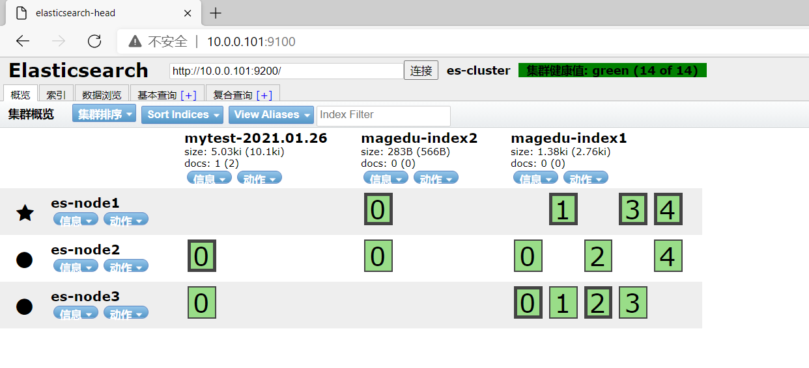

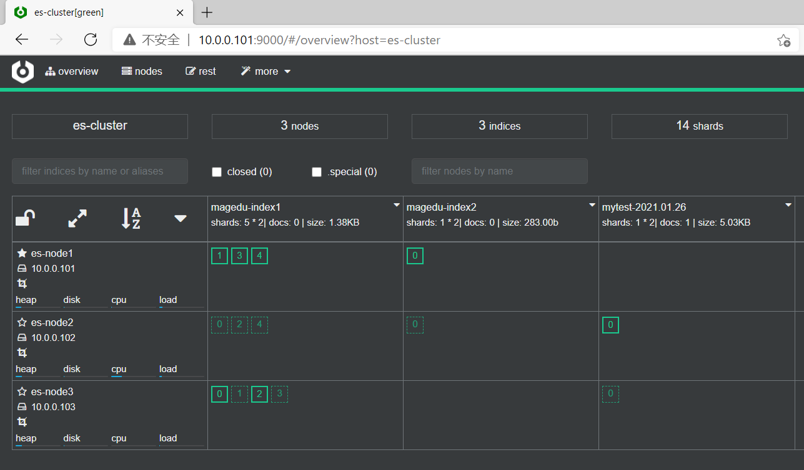

范例：将文件输出至 Elasticsearch

```bash
[root@logstash ~]#/usr/share/logstash/bin/logstash -e  'input { file { path =>
"/var/log/bootstrap.log" start_position => "beginning" stat_interval => "3" } }
output { elasticsearch {hosts => ["10.0.0.101:9200"] index => "logfile-%
{+YYYY.MM.dd}" }}'
OpenJDK 64-Bit Server VM warning: Option UseConcMarkSweepGC was deprecated in
version 9.0 and will likely be removed in a future release.
WARNING: An illegal reflective access operation has occurred
WARNING: Illegal reflective access by com.headius.backport9.modules.Modules
(file:/usr/share/logstash/logstash-core/lib/jars/jruby-complete-9.2.9.0.jar) to
method sun.nio.ch.NativeThread.signal(long)
WARNING: Please consider reporting this to the maintainers of
com.headius.backport9.modules.Modules
WARNING: Use --illegal-access=warn to enable warnings of further illegal
reflective access operations
WARNING: All illegal access operations will be denied in a future release
WARNING: Could not find logstash.yml which is typically located in
$LS_HOME/config or /etc/logstash. You can specify the path using --
path.settings. Continuing using the defaults
Could not find log4j2 configuration at path
/usr/share/logstash/config/log4j2.properties. Using default config which logs
errors to the console
[WARN ] 2021-01-26 23:49:26.545 [LogStash::Runner] multilocal - Ignoring the
'pipelines.yml' file because modules or command line options are specified
[INFO ] 2021-01-26 23:49:26.555 [LogStash::Runner] runner - Starting Logstash
{"logstash.version"=>"7.6.2"}
[INFO ] 2021-01-26 23:49:28.556 [Converge PipelineAction::Create<main>]
Reflections - Reflections took 67 ms to scan 1 urls, producing 20 keys and 40
values
[INFO ] 2021-01-26 23:49:29.685 [[main]-pipeline-manager] elasticsearch -
Elasticsearch pool URLs updated {:changes=>{:removed=>[], :added=>
[http://10.0.0.101:9200/]}}
[WARN ] 2021-01-26 23:49:29.959 [[main]-pipeline-manager] elasticsearch -
Restored connection to ES instance {:url=>"http://10.0.0.101:9200/"}
[INFO ] 2021-01-26 23:49:30.239 [[main]-pipeline-manager] elasticsearch - ES
Output version determined {:es_version=>7}
[WARN ] 2021-01-26 23:49:30.246 [[main]-pipeline-manager] elasticsearch -
Detected a 6.x and above cluster: the `type` event field won't be used to
determine the document _type {:es_version=>7}
[INFO ] 2021-01-26 23:49:30.330 [[main]-pipeline-manager] elasticsearch - New
Elasticsearch output {:class=>"LogStash::Outputs::ElasticSearch", :hosts=>
["//10.0.0.101:9200"]}
[INFO ] 2021-01-26 23:49:30.448 [Ruby-0-Thread-6: :1] elasticsearch - Using
default mapping template
[WARN ] 2021-01-26 23:49:30.469 [[main]-pipeline-manager] LazyDelegatingGauge -
A gauge metric of an unknown type (org.jruby.specialized.RubyArrayOneObject) has
been created for key: cluster_uuids. This may result in invalid serialization.
It is recommended to log an issue to the responsible developer/development team.
[INFO ] 2021-01-26 23:49:30.489 [[main]-pipeline-manager] javapipeline -
Starting pipeline {:pipeline_id=>"main", "pipeline.workers"=>2,
"pipeline.batch.size"=>125, "pipeline.batch.delay"=>50,
"pipeline.max_inflight"=>250, "pipeline.sources"=>["config string"], :thread=>"#
<Thread:0x30ea9ca1 run>"}
[INFO ] 2021-01-26 23:49:30.577 [Ruby-0-Thread-6: :1] elasticsearch - Attempting
to install template {:manage_template=>{"index_patterns"=>"logstash-*",
"version"=>60001, "settings"=>{"index.refresh_interval"=>"5s",
"number_of_shards"=>1}, "mappings"=>{"dynamic_templates"=>[{"message_field"=>
{"path_match"=>"message", "match_mapping_type"=>"string", "mapping"=>
{"type"=>"text", "norms"=>false}}}, {"string_fields"=>{"match"=>"*",
"match_mapping_type"=>"string", "mapping"=>{"type"=>"text", "norms"=>false,
"fields"=>{"keyword"=>{"type"=>"keyword", "ignore_above"=>256}}}}}],
"properties"=>{"@timestamp"=>{"type"=>"date"}, "@version"=>{"type"=>"keyword"},
"geoip"=>{"dynamic"=>true, "properties"=>{"ip"=>{"type"=>"ip"}, "location"=>
{"type"=>"geo_point"}, "latitude"=>{"type"=>"half_float"}, "longitude"=>
{"type"=>"half_float"}}}}}}}
[INFO ] 2021-01-26 23:49:31.773 [[main]-pipeline-manager] file - No sincedb_path
set, generating one based on the "path" setting
{:sincedb_path=>"/usr/share/logstash/data/plugins/inputs/file/.sincedb_d775630e2
3677feb080794eae41c5417", :path=>["/var/log/bootstrap.log"]}
[INFO ] 2021-01-26 23:49:31.803 [[main]-pipeline-manager] javapipeline -
Pipeline started {"pipeline.id"=>"main"}
[INFO ] 2021-01-26 23:49:31.913 [Agent thread] agent - Pipelines running
{:count=>1, :running_pipelines=>[:main], :non_running_pipelines=>[]}
[INFO ] 2021-01-26 23:49:31.948 [[main]<file] observingtail - START, creating
Discoverer, Watch with file and sincedb collections
[INFO ] 2021-01-26 23:49:32.417 [Api Webserver] agent - Successfully started
Logstash API endpoint {:port=>9600}
```

范例: 配置文件实现

```bash
#将配置写入配置文件中
[root@ubuntu1804 ~]#cat /etc/logstash/conf.d/logstash-test.conf
input {
file {
path => "/var/log/syslog"
start_position => "beginning"
stat_interval => 3
}
}
output {
elasticsearch {
hosts => ["10.0.0.101:9200"]
index => "syslog-%{+YYYY.MM.dd}"
}
}
#检查语法
[root@ubuntu1804 ~]#/usr/share/logstash/bin/logstash  -f
/etc/logstash/conf.d/logstash-test.conf -t
#前台执行
[root@ubuntu1804 ~]#/usr/share/logstash/bin/logstash  -f
/etc/logstash/conf.d/logstash-test.conf
```

Elasticsearch服务器验证收到数据

通过head插件观察到下面信息


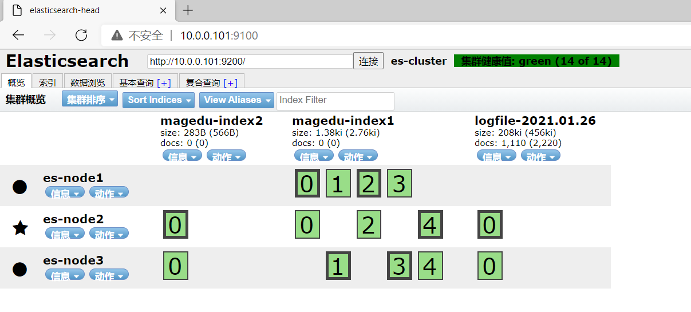

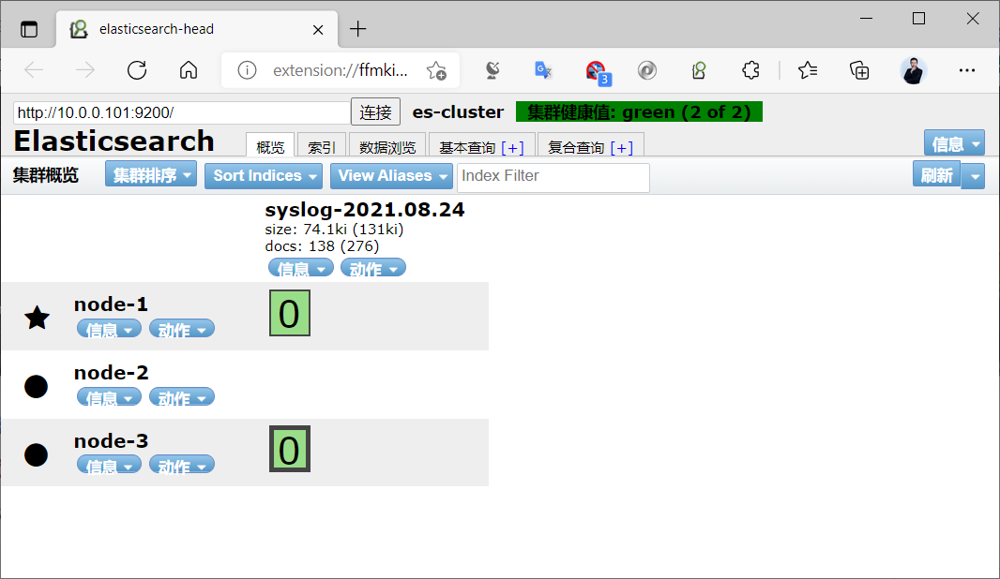

通过cerebro插件可以看到下面信息

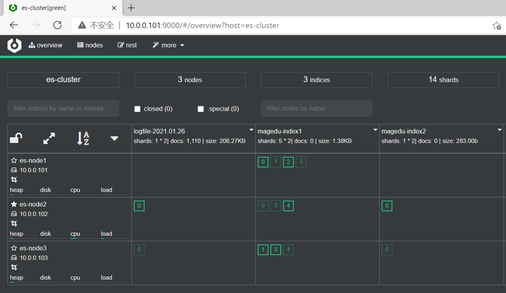

### Redis 插件

Logstash 支持将日志转发至 Redis

官方链接:

<https://www.elastic.co/guide/en/logstash/7.6/plugins-outputs-redis.html>

范例

```bash
[root@logstash ~]#cat /etc/logstash/conf.d/file_to_redis.conf
input {
file {
path => "/var/log/nginx/access.log"
type => 'nginx-accesslog'
start_position => "beginning"
stat_interval => "3"
codec => json
}
stdin { }
}
output {
if [type] == 'nginx-accesslog' {
redis {
host => 'Redis_IP'
port => "6379"
password => "123456"
db => "0"
data_type => 'list'
key => "nginx-accesslog"
}
}
stdout {
codec => rubydebug
}
}
```

### Kafka 插件

Logstash 支持将日志转发至 Kafka

官方链接:

<https://www.elastic.co/guide/en/logstash/7.6/plugins-outputs-kafka.html>

范例:

```bash
[root@logstash ~]#cat /etc/logstash/conf.d/file_to_kafka.conf
input {
file {
path => "/var/log/nginx/access.log"
type => 'nginx-accesslog'
start_position => "beginning"
stat_interval => "3"
codec => json
}
file {
path => "/var/log/nginx/error.log"
type => 'nginx-errorlog'
start_position => "beginning"
stat_interval => "3"
}
}
output {
#stdout {}
if [type] == 'nginx-accesslog' {
kafka {
bootstrap_servers =>
'10.0.0.211:9092,10.0.0.212:9092,10.0.0.213:9092'
topic_id => 'nginx-accesslog'
codec => 'json'    #如果是Json格式,需要标识的字段
}
}
if [type] == 'nginx-errorlog' {
kafka {
bootstrap_servers =>
'10.0.0.211:9092,10.0.0.212:9092,10.0.0.213:9092'
topic_id => 'nginx-errorlog'
codec => 'json'  #为了保留logstash添加的字段,比如:type字段,也需要指定json格
式,否则会丢失logstash添加的字段
}
}
}
```



<nav class="article-end" aria-label="章节导航">
  <a href="{{ '/subjects/ELK/17-installing-logstash.html' | relative_url }}">← Previous: Installing Logstash</a>
  <a href="{{ '/subjects/ELK/' | relative_url }}">Back to ELK Log Analytics Index</a>
  <a href="{{ '/subjects/ELK/19-logstash-practical-examples.html' | relative_url }}">Next: Logstash Practical Examples →</a>
</nav>
