[← Back to ELK Log Analytics Index]({{ '/subjects/ELK/' | relative_url }})



# 19 Logstash Practical Examples
### 4.4 Logstash 实战案例

### 收集单个系统日志并输出至 Elasticsearch

前提需要logstash用户对被收集的日志文件有读的权限并对写入的文件有写权限

### Logstash配置文件

```bash
[root@logstash ~]#vim /etc/logstash/conf.d/dpkg-to-es.conf
input {
file {
path => "/var/log/dpkg.log"
start_position => "beginning"
stat_interval => "3"
}
}
output {
elasticsearch {
hosts => ["10.0.0.101:9200"]
index => "linux-%{+YYYY.MM.dd}"
}
}
```

### 检测配置文件语法是否正确

```bash
[root@logstash ~]#/usr/share/logstash/bin/logstash -f /etc/logstash/conf.d/dpkg-
to-es.conf  -t
OpenJDK 64-Bit Server VM warning: Option UseConcMarkSweepGC was deprecated in
version 9.0 and will likely be removed in a future release.
WARNING: An illegal reflective access operation has occurred
WARNING: Illegal reflective access by com.headius.backport9.modules.Modules
(file:/usr/share/logstash/logstash-core/lib/jars/jruby-complete-9.2.9.0.jar) to
method sun.nio.ch.NativeThread.signal(long)
WARNING: Please consider reporting this to the maintainers of
com.headius.backport9.modules.Modules
WARNING: Use --illegal-access=warn to enable warnings of further illegal
reflective access operations
WARNING: All illegal access operations will be denied in a future release
WARNING: Could not find logstash.yml which is typically located in
$LS_HOME/config or /etc/logstash. You can specify the path using --
path.settings. Continuing using the defaults
Could not find log4j2 configuration at path
/usr/share/logstash/config/log4j2.properties. Using default config which logs
errors to the console
[WARN ] 2021-01-31 15:58:00.880 [LogStash::Runner] multilocal - Ignoring the
'pipelines.yml' file because modules or command line options are specified
[INFO ] 2021-01-31 15:58:02.007 [LogStash::Runner] Reflections - Reflections
took 37 ms to scan 1 urls, producing 20 keys and 40 values
Configuration OK
[INFO ] 2021-01-31 15:58:02.447 [LogStash::Runner] runner - Using
config.test_and_exit mode. Config Validation Result: OK. Exiting Logstash
```

### 启动 Logstash 服务

```bash
[root@logstash ~]#systemctl enable --now logstash.service
Created symlink /etc/systemd/system/multi-user.target.wants/logstash.service â••
/etc/systemd/system/logstash.service.
[root@logstash ~]#systemctl status  logstash.service
â•• logstash.service - logstash
Loaded: loaded (/etc/systemd/system/logstash.service; enabled; vendor preset:
enabled)
Active: active (running) since Sun 2021-01-31 15:55:49 CST; 6s ago
Main PID: 3053 (java)
Tasks: 14 (limit: 2290)
CGroup: /system.slice/logstash.service
â••â••3053 /usr/bin/java -Xms1g -Xmx1g -XX:+UseConcMarkSweepGC -
XX:CMSInitiatingOccupancyFraction=75 -XX:+UseCMSInitiatingOccupancyOnly -
Djava.awt.hea
Jan 31 15:55:49 logstash.bowen.org systemd[1]: Started logstash.
Jan 31 15:55:49 logstash.bowen.org logstash[3053]: OpenJDK 64-Bit Server VM
warning: Option UseConcMarkSweepGC was deprecated in version 9.0 and will likely
Jan 31 15:55:55 logstash.bowen.org logstash[3053]: WARNING: An illegal reflective
access operation has occurred
Jan 31 15:55:55 logstash.bowen.org logstash[3053]: WARNING: Illegal reflective
access by com.headius.backport9.modules.Modules (file:/usr/share/logstash/log
Jan 31 15:55:55 logstash.bowen.org logstash[3053]: WARNING: Please consider
reporting this to the maintainers of com.headius.backport9.modules.Modules
Jan 31 15:55:55 logstash.bowen.org logstash[3053]: WARNING: Use --illegal-
access=warn to enable warnings of further illegal reflective access operations
Jan 31 15:55:55 logstash.bowen.org logstash[3053]: WARNING: All illegal access
operations will be denied in a future release
```

### 生成数据并验证

```bash
[root@logstash ~]#apt purge  apache2 -y
```

### 在 Kibana 中验证结果

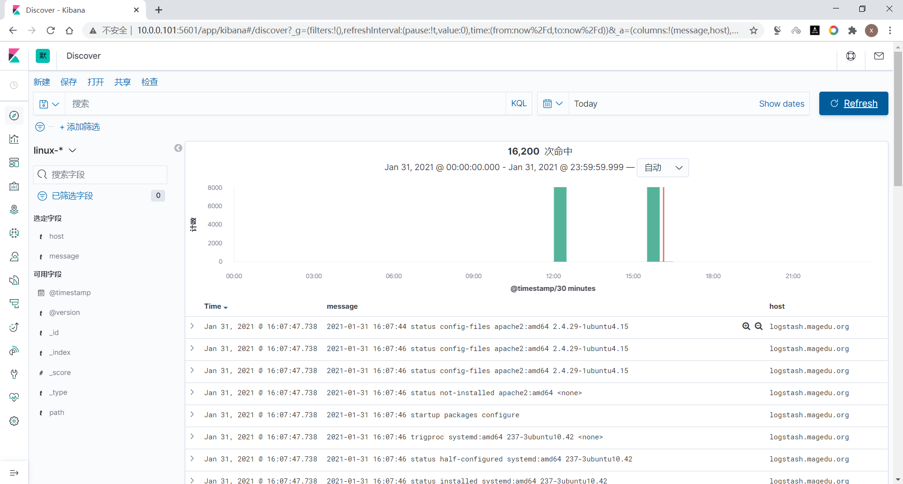

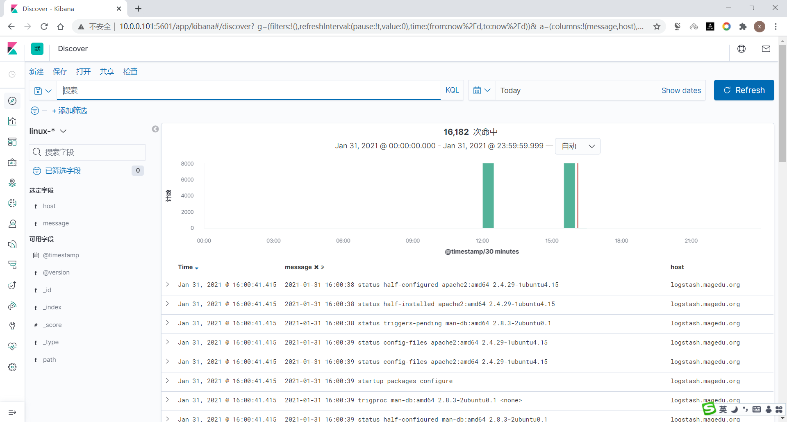

### 通过 Logstash 收集多个日志文件并输出至 Elasticsearch

### 服务器部署 Tomcat 服务

安装 Java 环境并且通过一个 Web 界面进行访问测试。 4.4.2.1.1 配置 Java 环境并部署 Tomcat

```bash
#方法1:包安装tomcat
[root@logstash ~]#apt update && apt -y install tomcat9
#方法2:二进制安装tomcat
#先安装JDK,因为logstash已经安装JDK,此步不用执行
[root@logstash ~]#mkdir /apps
[root@logstash ~]#ll apache-tomcat-8.5.61.tar.gz
-rw-r--r-- 1 root root 10492067 Jan  3 17:47 apache-tomcat-8.5.61.tar.gz
[root@logstash ~]#tar xf apache-tomcat-8.5.61.tar.gz  -C /apps/
[root@logstash ~]#cd /apps
[root@logstash apps]#ln -s apache-tomcat-8.5.61/ tomcat
[root@logstash ~]#/apps/tomcat/bin/startup.sh
```

4.4.2.1.2 确认 Web 可以访问

用浏览器访问tomcat

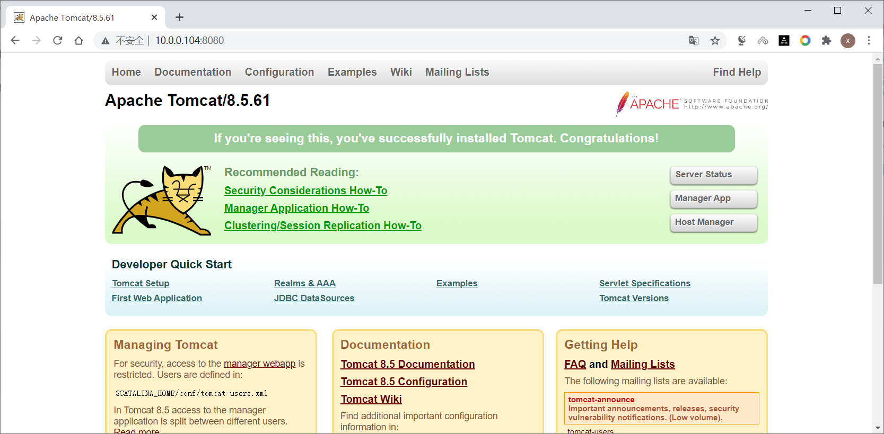

生成访问日志

```bash
[root@logstash ~]#ll /apps/tomcat/logs/
total 32
drwxr-x--- 2 root root 4096 Jan 31 16:25 ./
drwxr-xr-x 9 root root 4096 Jan 31 16:25 ../
-rw-r----- 1 root root 6615 Jan 31 16:25 catalina.2021-01-31.log
-rw-r----- 1 root root 6787 Jan 31 16:25 catalina.out
-rw-r----- 1 root root    0 Jan 31 16:25 host-manager.2021-01-31.log
-rw-r----- 1 root root  459 Jan 31 16:25 localhost.2021-01-31.log
-rw-r----- 1 root root  711 Jan 31 16:30 localhost_access_log.2021-01-31.txt
-rw-r----- 1 root root    0 Jan 31 16:25 manager.2021-01-31.log
```

### Logstash配置

范例：采集tomcat访问日志和系统日志

```bash
[root@logstash ~]#cat /etc/logstash/conf.d/syslog-tomcat-to-es.conf
input {
file {
path => "/var/log/syslog"           #日志路径
start_position => "beginning"       #第一次收集日志的位置
stat_interval => "3"                #日志收集的间隔时间
type => "syslog"                    #事件的唯一类型，可用于区分不同日志，分别存于不同
index
}
file {
#path => "/apps/tomcat/logs/localhost_access_log.*.txt"   #二进安装日志路径
path => "/var/log/tomcat9/localhost_access_log.*.txt"     #包日志路径
start_position => "beginning"       #第一次收集日志的位置
stat_interval => "3"                #日志收集的间隔时间
type => "tomcat-access"             #事件的唯一类型
}
}
output {
if [type] == "syslog" {
elasticsearch {
hosts => ["10.0.0.101:9200"]
index => "syslog-%{+YYYY.MM.dd}"
}
}
if [type] == "tomcat-access" {
elasticsearch {
hosts => ["10.0.0.101:9200"]
index => "example-tomcat-%{+YYYY.MM.dd}"   #tomcat开头的索引名在8.10.X，生成
的索引名为.ds-tomcat,不要以tomcat开头，ES无法获取数据
}
}
}
```

范例：采集系统日志

```bash
[root@logstash1 conf.d]#cat /etc/logstash/conf.d/syslog-dpkg-to-es.conf
input {
file {
path => "/var/log/syslog"
start_position => "beginning"
stat_interval => "3"
type => "syslog"
}
file {
path => "/var/log/dpkg.log"
start_position => "beginning"
stat_interval => "3"
type => "dpkg"
}
}
output {
if [type] == "syslog" {                 #指定类型不同,写入不同索引
elasticsearch {
hosts => ["10.0.0.201:9200"]
index => "syslog-%{+YYYY.MM.dd}"
}
}
if [type] == "dpkg" {
elasticsearch {
hosts => ["10.0.0.201:9200"]
index => "dpkg-%{+YYYY.MM.dd}"
}
}
}
```

### 设置权限并重启logstash并查看日志是否有报错

```bash
#默认logstash用户无法直接读取日志文件，会提示下面错误
[root@logstash1 ~]#cat /var/log/logstash/logstash-plain.log
[2023-09-22T15:12:53,265][WARN ][filewatch.tailmode.handlers.createinitial][main]
[d4ca56ff958416c24e6be2420e26abc11c56ff42afc0b5579851c7abca6e7592] failed to open
file {:path=>"/var/log/syslog", :exception=>Errno::EACCES, :message=>"Permission
denied - /var/log/syslog"}
#方法1
[root@logstash1 ~]#vim /lib/systemd/system/logstash.service
[Service]
Type=simple
#注释下面两行
#User=logstash
#Group=logstash
[root@logstash1 ~]#systemctl daemon-reload
[root@logstash1 ~]#systemctl restart logstash.service
#方法2
#修改权限让logstash可以访问日志
#包安装tomcat
[root@logstash ~]#setfacl  -m u:logstash:r /var/log/syslog /var/log/tomcat9/
[root@logstash ~]#setfacl  -Rm u:logstash:rx   /var/log/tomcat9/
#二进制安装tomcat
[root@logstash ~]#setfacl  -m u:logstash:r /var/log/syslog  /apps/tomcat/logs/*
[root@logstash ~]#setfacl  -Rm u:logstash:rx   /apps/tomcat/logs/
#或者修改Logstash启用用户为root
[root@logstash ~]#vim /etc/systemd/system/logstash.service
User=logstash
Group=logstash
[root@logstash ~]#systemctl restart logstash
#确认没有错误提示
[root@logstash ~]#cat /var/log/logstash/*
[2021-01-31T17:14:25,950][INFO ][logstash.javapipeline    ][main] Starting
pipeline {:pipeline_id=>"main", "pipeline.workers"=>2,
"pipeline.batch.size"=>125, "pipeline.batch.delay"=>50,
"pipeline.max_inflight"=>250, "pipeline.sources"=>["/etc/logstash/conf.d/dpkg-
to-es.conf", "/etc/logstash/conf.d/syslog-tomcat-to-es.conf"], :thread=>"#
<Thread:0x100e8e59 run>"}
[2021-01-31T17:14:26,977][INFO ][logstash.inputs.file     ][main] No sincedb_path
set, generating one based on the "path" setting
{:sincedb_path=>"/var/lib/logstash/plugins/inputs/file/.sincedb_32f0f350939e5021
672b2ae32dbe8707", :path=>["/apps/tomcat/logs/localhost_access_log.*.txt"]}
[2021-01-31T17:14:27,011][INFO ][logstash.inputs.file     ][main] No sincedb_path
set, generating one based on the "path" setting
{:sincedb_path=>"/var/lib/logstash/plugins/inputs/file/.sincedb_97162ef95ddfd5ec
14e860c916f9ca74", :path=>["/var/log/syslog.log"]}
[2021-01-31T17:14:27,022][INFO ][logstash.inputs.file     ][main] No sincedb_path
set, generating one based on the "path" setting
{:sincedb_path=>"/var/lib/logstash/plugins/inputs/file/.sincedb_53ee1dc7b0052cf4
3da0cab60435e2c0", :path=>["/var/log/dpkg.log"]}
[2021-01-31T17:14:27,071][INFO ][logstash.javapipeline    ][main] Pipeline
started {"pipeline.id"=>"main"}
[2021-01-31T17:14:27,111][INFO ][filewatch.observingtail  ][main] START, creating
Discoverer, Watch with file and sincedb collections
[2021-01-31T17:14:27,146][INFO ][filewatch.observingtail  ][main] START, creating
Discoverer, Watch with file and sincedb collections
[2021-01-31T17:14:27,138][INFO ][filewatch.observingtail  ][main] START, creating
Discoverer, Watch with file and sincedb collections
[2021-01-31T17:14:27,217][INFO ][logstash.agent           ] Pipelines running
{:count=>1, :running_pipelines=>[:main], :non_running_pipelines=>[]}
[2021-01-31T17:14:27,599][INFO ][logstash.agent           ] Successfully started
Logstash API endpoint {:port=>9600}
```

### 向被收集的文件生成新日志信息

```bash
[root@centos8 ~]#while true;do curl 10.0.0.104:8080;sleep 1;done
[root@logstash ~]#logger  "test log"
```

### 查看索引是否生成

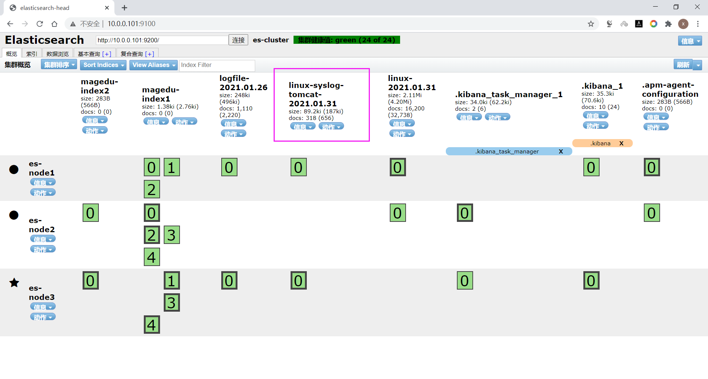

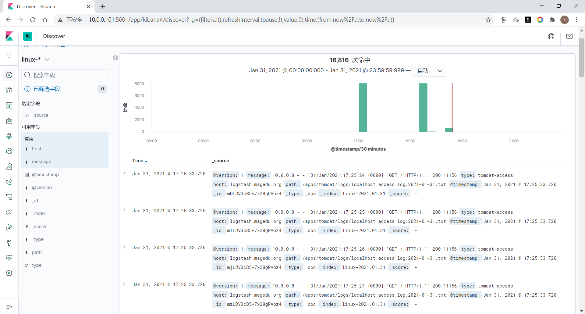

### 配置将不同类型日志写入不同索引

```bash
[root@logstash ~]#cat /etc/logstash/conf.d/syslog-tomcat-to-es.conf
input {
file {
path => "/var/log/syslog"
start_position => "beginning"
stat_interval => "3"
type => "syslog"
}
file {
path => "/apps/tomcat/logs/localhost_access_log.*.txt"
start_position => "beginning"
stat_interval => "3"
type => "tomcat-access"
}
}
output {
if [type] == "syslog" {                 #指定类型不同,写入不同索引
elasticsearch {
hosts => ["10.0.0.101:9200"]
index => "syslog-0.104-%{+YYYY.MM.dd}"
}
file {                                #可以同时写入文件
path => "/tmp/syslog-0.104.log"
}
}
if [type] == "tomcat-access" {
elasticsearch {
hosts => ["10.0.0.101:9200"]
index => "tomcat-accesslog-0.104-%{+YYYY.MM.dd}"
}
file {
path => "/tmp/tomcat-accesslog-0.104.log"
}
}
}
[root@logstash ~]#systemctl restart logstash.service
```

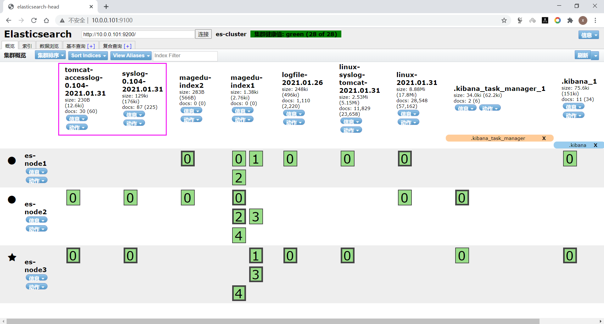

### Kibana 界面添加索引

4.4.2.7.1 添加syslog索引

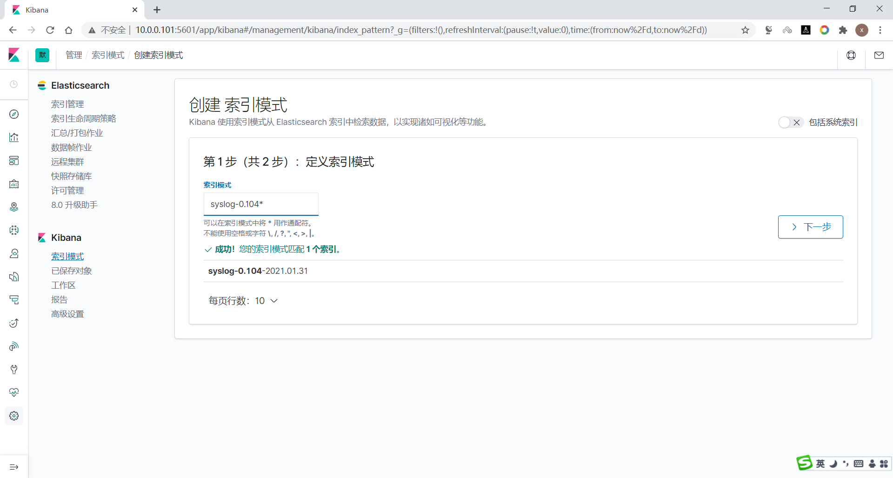


4.4.2.7.2 添加tomcat索引

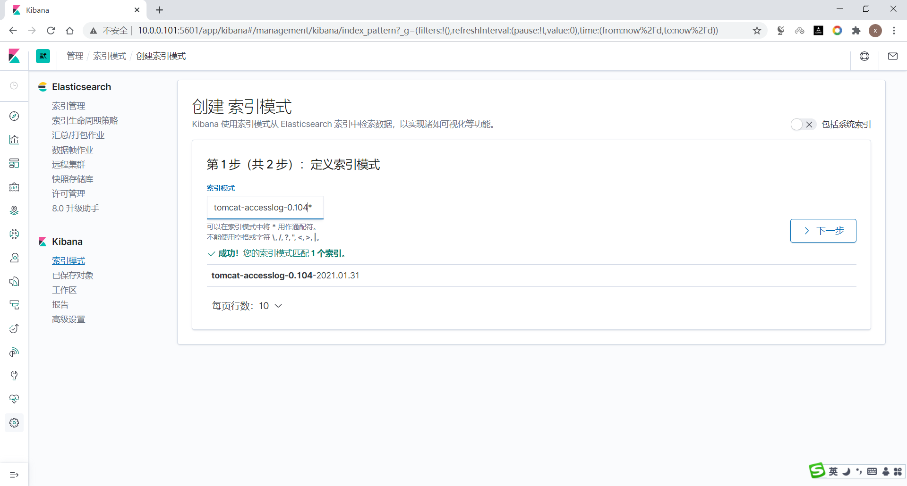

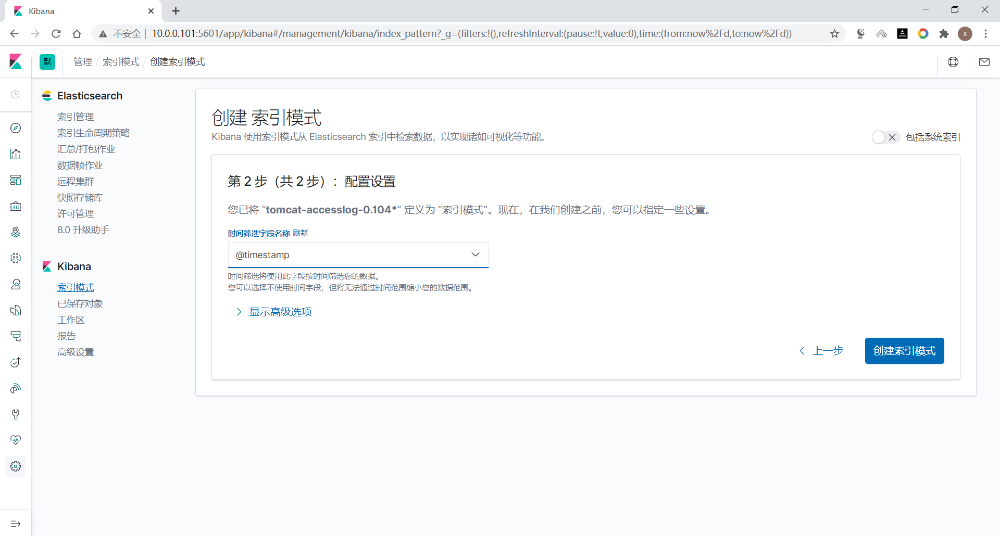

### Kibana 展示索引

4.4.2.8.1 Kibana 展示 syslog 索引

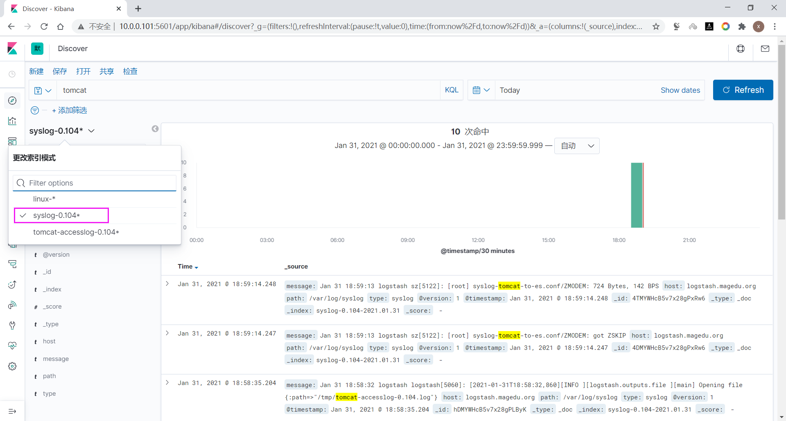

4.4.2.8.2 Kibana 展示 tomcat 日志索引

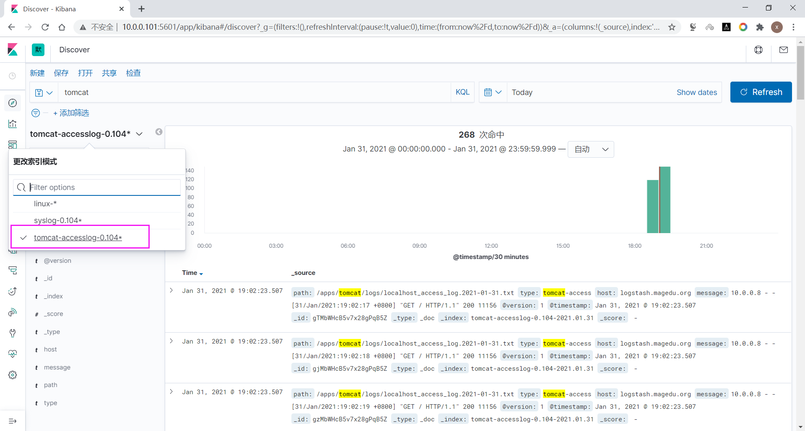

### 输出索引文件

```bash
[root@logstash ~]#ll /tmp/*.log
-rw-r--r-- 1 logstash logstash  57005 Jan 31 19:02 /tmp/syslog-0.104.log
-rw-r--r-- 1 logstash logstash 141780 Jan 31 19:02 /tmp/tomcat-accesslog-
0.104.log
[root@logstash ~]#tail  /tmp/syslog-0.104.log
{"@timestamp":"2021-01-
31T10:46:35.318Z","path":"/var/log/syslog","type":"syslog","message":"Jan 31
18:46:32 logstash logstash[4863]: [2021-01-31T18:46:32,488][INFO ]
[logstash.outputs.file    ][main] Closing file
/tmp/syslog.log","@version":"1","host":"logstash.bowen.org"}
{"@timestamp":"2021-01-
31T10:46:38.321Z","path":"/var/log/syslog","type":"syslog","message":"Jan 31
18:46:35 logstash logstash[4863]: [2021-01-31T18:46:35,451][INFO ]
[logstash.outputs.file    ][main] Opening file
{:path=>\"/tmp/syslog.log\"}","@version":"1","host":"logstash.bowen.org"}
{"@timestamp":"2021-01-
31T10:46:53.331Z","path":"/var/log/syslog","type":"syslog","message":"Jan 31
18:46:52 logstash logstash[4863]: [2021-01-31T18:46:52,511][INFO ]
[logstash.outputs.file    ][main] Closing file
/tmp/syslog.log","@version":"1","host":"logstash.bowen.org"}
{"@timestamp":"2021-01-
31T10:46:56.335Z","path":"/var/log/syslog","type":"syslog","message":"Jan 31
18:46:53 logstash logstash[4863]: [2021-01-31T18:46:53,472][INFO ]
[logstash.outputs.file    ][main] Opening file
{:path=>\"/tmp/syslog.log\"}","@version":"1","host":"logstash.bowen.org"}
{"@timestamp":"2021-01-
31T10:47:14.348Z","path":"/var/log/syslog","type":"syslog","message":"Jan 31
18:47:12 logstash logstash[4863]: [2021-01-31T18:47:12,537][INFO ]
[logstash.outputs.file    ][main] Closing file
/tmp/syslog.log","@version":"1","host":"logstash.bowen.org"}
{"@timestamp":"2021-01-
31T10:47:17.352Z","path":"/var/log/syslog","type":"syslog","message":"Jan 31
18:47:14 logstash logstash[4863]: [2021-01-31T18:47:14,481][INFO ]
[logstash.outputs.file    ][main] Opening file
{:path=>\"/tmp/syslog.log\"}","@version":"1","host":"logstash.bowen.org"}
{"@timestamp":"2021-01-
31T10:47:35.363Z","path":"/var/log/syslog","type":"syslog","message":"Jan 31
18:47:32 logstash logstash[4863]: [2021-01-31T18:47:32,575][INFO ]
[logstash.outputs.file    ][main] Closing file
/tmp/syslog.log","@version":"1","host":"logstash.bowen.org"}
{"@timestamp":"2021-01-
31T10:47:38.366Z","path":"/var/log/syslog","type":"syslog","message":"Jan 31
18:47:35 logstash logstash[4863]: [2021-01-31T18:47:35,493][INFO ]
[logstash.outputs.file    ][main] Opening file
{:path=>\"/tmp/syslog.log\"}","@version":"1","host":"logstash.bowen.org"}
{"@timestamp":"2021-01-
31T10:47:53.376Z","path":"/var/log/syslog","type":"syslog","message":"Jan 31
18:47:52 logstash logstash[4863]: [2021-01-31T18:47:52,623][INFO ]
[logstash.outputs.file    ][main] Closing file
/tmp/syslog.log","@version":"1","host":"logstash.bowen.org"}
{"@timestamp":"2021-01-
31T10:47:56.378Z","path":"/var/log/syslog","type":"syslog","message":"Jan 31
18:47:53 logstash logstash[4863]: [2021-01-31T18:47:53,510][INFO ]
[logstash.outputs.file    ][main] Opening file
{:path=>\"/tmp/syslog.log\"}","@version":"1","host":"logstash.bowen.org"}
[root@logstash ~]#tail /tmp/tomcat-accesslog-0.104.log
{"@timestamp":"2021-01-
31T10:38:55.090Z","path":"/apps/tomcat/logs/localhost_access_log.2021-01-
31.txt","type":"tomcat-access","message":"10.0.0.8 - - [31/Jan/2021:18:38:46
+0800] \"GET / HTTP/1.1\" 200 11156","@version":"1","host":"logstash.bowen.org"}
{"@timestamp":"2021-01-
31T10:39:04.106Z","path":"/apps/tomcat/logs/localhost_access_log.2021-01-
31.txt","type":"tomcat-access","message":"10.0.0.8 - - [31/Jan/2021:18:38:52
+0800] \"GET / HTTP/1.1\" 200 11156","@version":"1","host":"logstash.bowen.org"}
{"@timestamp":"2021-01-
31T10:39:04.106Z","path":"/apps/tomcat/logs/localhost_access_log.2021-01-
31.txt","type":"tomcat-access","message":"10.0.0.8 - - [31/Jan/2021:18:38:53
+0800] \"GET / HTTP/1.1\" 200 11156","@version":"1","host":"logstash.bowen.org"}
{"@timestamp":"2021-01-
31T10:39:04.107Z","path":"/apps/tomcat/logs/localhost_access_log.2021-01-
31.txt","type":"tomcat-access","message":"10.0.0.8 - - [31/Jan/2021:18:38:54
+0800] \"GET / HTTP/1.1\" 200 11156","@version":"1","host":"logstash.bowen.org"}
{"@timestamp":"2021-01-
31T10:39:04.107Z","path":"/apps/tomcat/logs/localhost_access_log.2021-01-
31.txt","type":"tomcat-access","message":"10.0.0.8 - - [31/Jan/2021:18:38:55
+0800] \"GET / HTTP/1.1\" 200 11156","@version":"1","host":"logstash.bowen.org"}
{"@timestamp":"2021-01-
31T10:39:04.108Z","path":"/apps/tomcat/logs/localhost_access_log.2021-01-
31.txt","type":"tomcat-access","message":"10.0.0.8 - - [31/Jan/2021:18:38:57
+0800] \"GET / HTTP/1.1\" 200 11156","@version":"1","host":"logstash.bowen.org"}
{"@timestamp":"2021-01-
31T10:39:04.108Z","path":"/apps/tomcat/logs/localhost_access_log.2021-01-
31.txt","type":"tomcat-access","message":"10.0.0.8 - - [31/Jan/2021:18:38:58
+0800] \"GET / HTTP/1.1\" 200 11156","@version":"1","host":"logstash.bowen.org"}
{"@timestamp":"2021-01-
31T10:39:04.108Z","path":"/apps/tomcat/logs/localhost_access_log.2021-01-
31.txt","type":"tomcat-access","message":"10.0.0.8 - - [31/Jan/2021:18:38:59
+0800] \"GET / HTTP/1.1\" 200 11156","@version":"1","host":"logstash.bowen.org"}
{"@timestamp":"2021-01-
31T10:39:04.108Z","path":"/apps/tomcat/logs/localhost_access_log.2021-01-
31.txt","type":"tomcat-access","message":"10.0.0.8 - - [31/Jan/2021:18:39:00
+0800] \"GET / HTTP/1.1\" 200 11156","@version":"1","host":"logstash.bowen.org"}
{"@timestamp":"2021-01-
31T10:39:04.109Z","path":"/apps/tomcat/logs/localhost_access_log.2021-01-
31.txt","type":"tomcat-access","message":"10.0.0.8 - - [31/Jan/2021:18:39:01
+0800] \"GET / HTTP/1.1\" 200 11156","@version":"1","host":"logstash.bowen.org"}
```

### 通过 Logstash 收集 Tomcat 和 Java 日志并输出至 Elasticsearch

每台Tomcat服务器要安装logstash负责收集Tomcat服务器的访问日志和错误日志进行实时统计,然后将日志转发给Elasticsearch进行分析，最终利用 Kibana 在前端展现

### 服务器部署 Tomcat 服务

需要安装 Java 环境，并自定义一个 Web 界面进行测试。

4.4.3.1.1 配置 Java 环境并部署 Tomcat

```bash
#包安装
[root@logstash1 ~]#apt update && apt -y install tomcat9
#二进制安装
#先安装JDK,因为logstash已经安装JDK,此步不用执行
[root@elk-web1 ~]#apt -y  install openjdk-8-jdk
[root@logstash ~]#mkdir /apps
[root@logstash ~]#ll apache-tomcat-8.5.61.tar.gz
-rw-r--r-- 1 root root 10492067 Jan  3 17:47 apache-tomcat-8.5.61.tar.gz
[root@logstash ~]#tar xf apache-tomcat-8.5.61.tar.gz  -C /apps/
[root@logstash ~]#cd /apps
[root@logstash apps]#ln -s apache-tomcat-8.5.61/ tomcat
[root@logstash ~]#/apps/tomcat/bin/startup.sh
```

4.4.3.1.2 确认 Web 可以访问

用浏览器访问 tomcat

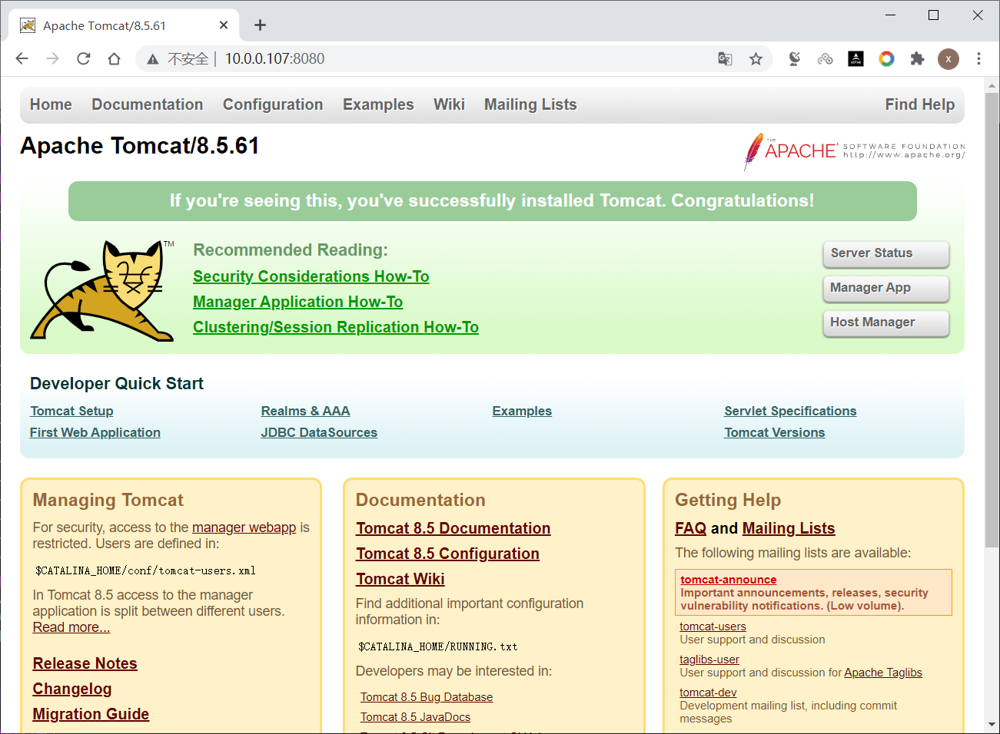

生成访问日志

```bash
[root@elk-web1 ~]#ll /apps/tomcat/logs/
total 32
drwxr-x--- 2 root root 4096 Feb  2 10:27 ./
drwxr-xr-x 9 root root 4096 Feb  2 10:25 ../
-rw-r----- 1 root root 6158 Feb  2 10:27 catalina.2021-02-02.log
-rw-r----- 1 root root 6158 Feb  2 10:27 catalina.out
-rw-r----- 1 root root    0 Feb  2 10:27 host-manager.2021-02-02.log
-rw-r----- 1 root root  458 Feb  2 10:27 localhost.2021-02-02.log
-rw-r----- 1 root root 1605 Feb  2 10:27 localhost_access_log.2021-02-02.txt
-rw-r----- 1 root root    0 Feb  2 10:27 manager.2021-02-02.log
```

4.4.3.1.3 Tomcat 日志转为 Json 格式

参考文档：

<http://tomcat.apache.org/tomcat-9.0-doc/config/valve.html#Access_Logging>

调整日志格式为 json，方便后期 Elasticsearch 分析使用

```xml
#包安装
[root@elk-web1 ~]#vim /etc/tomcat9/server.xml
#二进制
[root@elk-web1 ~]# vim /apps/tomcat/conf/server.xml
<Valve className="org.apache.catalina.valves.AccessLogValve"
directory="logs"
prefix="localhost_access_log" suffix=".txt"
#pattern="%h %l %u %t &quot;%r&quot; %s %b" /> 删除此行,加下面内容实现自定义的json日志
格式
pattern="
{&quot;clientip&quot;:&quot;%h&quot;,&quot;ClientUser&quot;:&quot;%l&quot;,&quot
;authenticated&quot;:&quot;%u&quot;,&quot;AccessTime&quot;:&quot;%t&quot;,&quot;
method&quot;:&quot;%r&quot;,&quot;status&quot;:&quot;%s&quot;,&quot;SendBytes&qu
ot;:&quot;%b&quot;,&quot;Query?
string&quot;:&quot;%q&quot;,&quot;partner&quot;:&quot;%
{Referer}i&quot;,&quot;AgentVersion&quot;:&quot;%{User-Agent}i&quot;}"/>
[root@elk-web1 ~]#/apps/tomcat/bin/shutdown.sh
[root@elk-web1 ~]#/apps/tomcat/bin/startup.sh
#查看日志格式发生变化
[root@elk-web1 ~]#tail -f /apps/tomcat/logs/localhost_access_log.2021-02-02.txt
10.0.0.1 - - [02/Feb/2021:10:36:13 +0800] "GET / HTTP/1.1" 200 11156
10.0.0.1 - - [02/Feb/2021:10:36:13 +0800] "GET /favicon.ico HTTP/1.1" 200 21630
10.0.0.1 - - [02/Feb/2021:10:36:13 +0800] "GET / HTTP/1.1" 200 11156
10.0.0.1 - - [02/Feb/2021:10:36:13 +0800] "GET /favicon.ico HTTP/1.1" 200 21630
10.0.0.1 - - [02/Feb/2021:10:36:13 +0800] "GET / HTTP/1.1" 200 11156
10.0.0.1 - - [02/Feb/2021:10:36:13 +0800] "GET /favicon.ico HTTP/1.1" 200 21630
10.0.0.1 - - [02/Feb/2021:10:36:13 +0800] "GET / HTTP/1.1" 200 11156
10.0.0.1 - - [02/Feb/2021:10:36:13 +0800] "GET /favicon.ico HTTP/1.1" 200 21630
10.0.0.1 - - [02/Feb/2021:10:36:13 +0800] "GET / HTTP/1.1" 200 11156
10.0.0.1 - - [02/Feb/2021:10:36:13 +0800] "GET /favicon.ico HTTP/1.1" 200 21630
{"clientip":"10.0.0.1","ClientUser":"-","authenticated":"-","AccessTime":"
[02/Feb/2021:10:37:10 +0800]","method":"GET /
HTTP/1.1","status":"200","SendBytes":"11156","Query?string":"","partner":"-
","AgentVersion":"Mozilla/5.0 (Windows NT 10.0; Win64; x64) AppleWebKit/537.36
(KHTML, like Gecko) Chrome/88.0.4324.104 Safari/537.36 FS"}
{"clientip":"10.0.0.1","ClientUser":"-","authenticated":"-","AccessTime":"
[02/Feb/2021:10:37:10 +0800]","method":"GET /favicon.ico
HTTP/1.1","status":"200","SendBytes":"21630","Query?
string":"","partner":"http://10.0.0.107:8080/","AgentVersion":"Mozilla/5.0
(Windows NT 10.0; Win64; x64) AppleWebKit/537.36 (KHTML, like Gecko)
Chrome/88.0.4324.104 Safari/537.36 FS"}
{"clientip":"10.0.0.1","ClientUser":"-","authenticated":"-","AccessTime":"
[02/Feb/2021:10:37:11 +0800]","method":"GET /
HTTP/1.1","status":"200","SendBytes":"11156","Query?string":"","partner":"-
","AgentVersion":"Mozilla/5.0 (Windows NT 10.0; Win64; x64) AppleWebKit/537.36
(KHTML, like Gecko) Chrome/88.0.4324.104 Safari/537.36 FS"}
{"clientip":"10.0.0.1","ClientUser":"-","authenticated":"-","AccessTime":"
[02/Feb/2021:10:37:11 +0800]","method":"GET /favicon.ico
HTTP/1.1","status":"200","SendBytes":"21630","Query?
string":"","partner":"http://10.0.0.107:8080/","AgentVersion":"Mozilla/5.0
(Windows NT 10.0; Win64; x64) AppleWebKit/537.36 (KHTML, like Gecko)
Chrome/88.0.4324.104 Safari/537.36 FS"}
{"clientip":"10.0.0.1","ClientUser":"-","authenticated":"-","AccessTime":"
[02/Feb/2021:10:37:11 +0800]","method":"GET /
HTTP/1.1","status":"200","SendBytes":"11156","Query?string":"","partner":"-
","AgentVersion":"Mozilla/5.0 (Windows NT 10.0; Win64; x64) AppleWebKit/537.36
(KHTML, like Gecko) Chrome/88.0.4324.104 Safari/537.36 FS"}
{"clientip":"10.0.0.1","ClientUser":"-","authenticated":"-","AccessTime":"
[02/Feb/2021:10:37:11 +0800]","method":"GET /favicon.ico
HTTP/1.1","status":"200","SendBytes":"21630","Query?
string":"","partner":"http://10.0.0.107:8080/","AgentVersion":"Mozilla/5.0
(Windows NT 10.0; Win64; x64) AppleWebKit/537.36 (KHTML, like Gecko)
Chrome/88.0.4324.104 Safari/537.36 FS"}
```

4.4.3.1.4 验证日志是否 Json 格式

利用json网站工具验证 json 格式

<https://www.sojson.com/>

<http://www.kjson.com/>

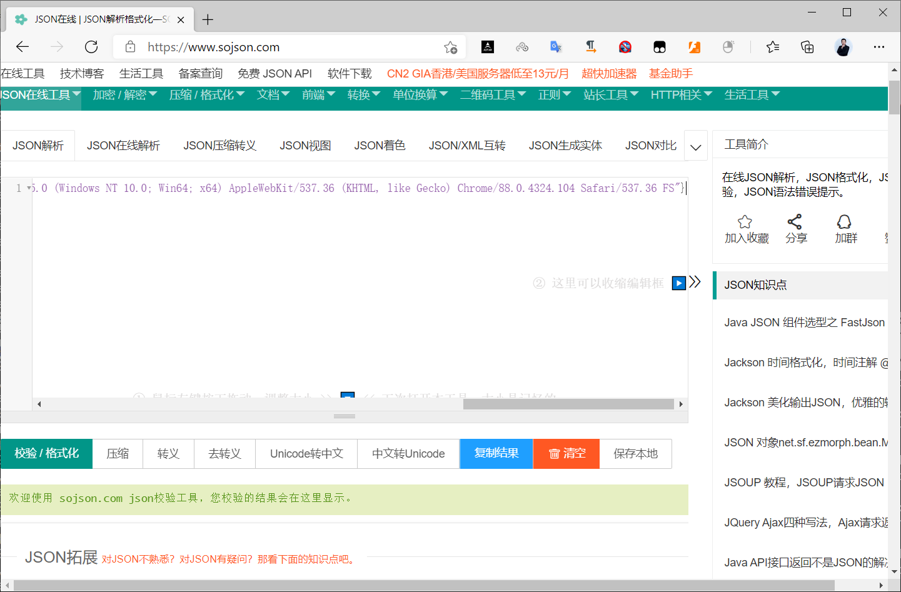

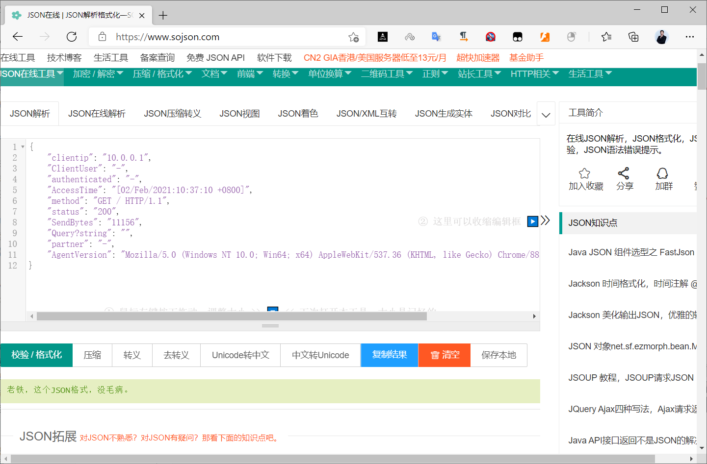

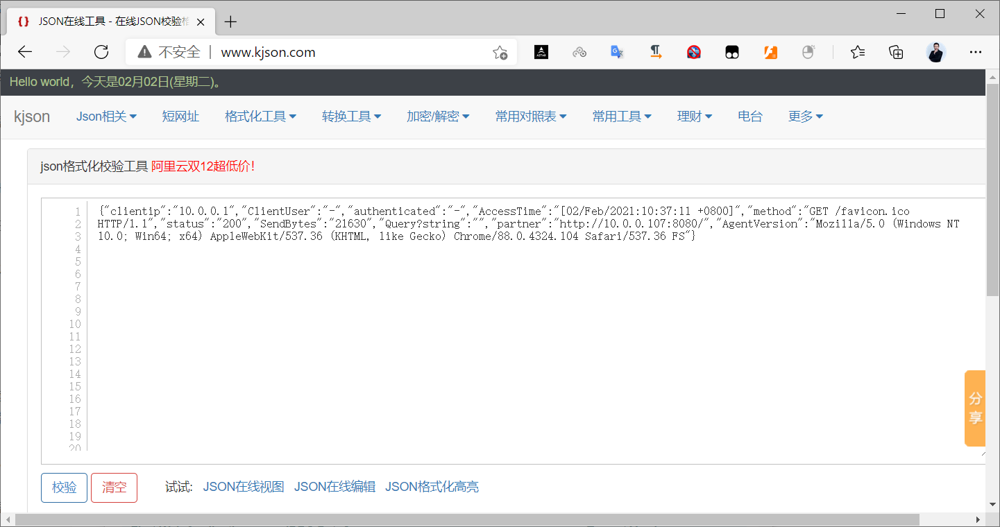

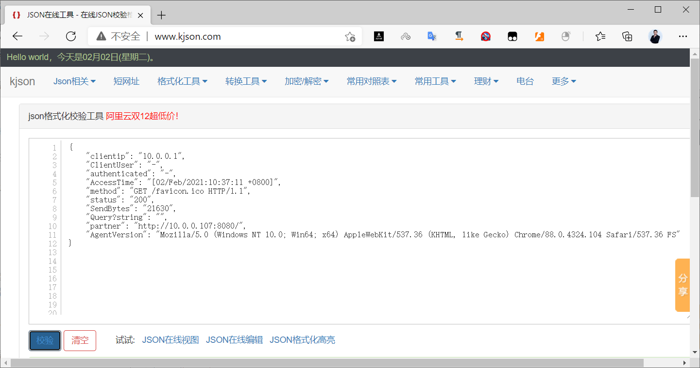

4.4.3.1.5 利用 Python 脚本获取日志行中的 IP

```bash
[root@elk-web1 ~]#cat get_status.py
#!/usr/bin/python3
#coding:utf-8
status_200= []
status_404= []
with open("access_json.log") as f:
for line in f.readlines():
line = eval(line)
print(line.get("clientip"))
if line.get("status") == "200":
status_200.append(line.get)
elif line.get("status") == "404":
status_404.append(line.get)
else:
print("状态码 ERROR")
f.close()
print("状态码200的有--:",len(status_200))
print("状态码404的有--:",len(status_404))
[root@elk-web1 ~]#
[root@elk-web1 ~]#./get_status.py
10.0.0.1
10.0.0.1
10.0.0.1
10.0.0.1
10.0.0.1
状态码200的有--: 5
状态码404的有--: 0
```

### 在 Tomcat 服务器安装 Logstash 收集 Tomcat和系统日志

需要部署tomcat并安装配置 logstash 4.4.3.2.1 安装配置 Logstash

```bash
[root@elk-web1 ~]#dpkg -i logstash-7.6.2.deb
[root@elk-web1 ~]#vim /etc/systemd/system/logstash.service
[Service]
Type=simple
User=root   #修改用户和组为root,让logstash访问日志文件
Group=root
[root@elk-web1 ~]#cat /etc/logstash/conf.d/tomcat-to-es.conf
input {
file {
path => "/var/log/syslog"
start_position => "beginning"
stat_interval => "3"
type => "syslog"
}
file {
#path => "/apps/tomcat/logs/localhost_access_log.*.txt"  #二进制安装
path => "/var/log/tomcat9/localhost_access_log.*.txt"    #包安装
start_position => "end"
stat_interval => "3"
type => "tomcat-accesslog"
codec => json
}
file {
path => "/var/log/tomcat9/catalina.*.log"
start_position => "end"  #新生成的日志才会采集
stat_interval => "3"
type => "tomcat-errorlog"
#codec => json
}
}
output {
if [type] == "syslog" {
elasticsearch {
hosts => ["10.0.0.101:9200"]
index => "syslog-0.107-%{+YYYY.MM.dd}"
}
}
if [type] == "tomcat-accesslog" {
elasticsearch {
hosts => ["10.0.0.101:9200"]
index => "mytomcat-accesslog-0.107-%{+YYYY.MM.dd}"      #logstash-v8.11.1
版本不能使用tomcat-accesslog索引名
#index => "tomcat-accesslog-0.107-%{+YYYY.MM.dd}"
}
file {
path => "/tmp/tomcat-accesslog-0.107.log"
}
}
if [type] == "tomcat-errorlog" {
elasticsearch {
hosts => ["10.0.0.101:9200"]
index => "mytomcat-errorlog-0.206-%{+YYYY.MM.dd}"      #logstash-v8.11.1 版
本不能使用tomcat-accesslog索引名
#index => "tomcat-accesslog-0.1-%{+YYYY.MM.dd}"
}
}
}
```

4.4.3.2.2 重启 Logstash 并确认

```bash
[root@elk-web1 ~]#systemctl restart logstash  #更改完配置文件重启logstash
[root@elk-web1 ~]#tail -f /var/log/logstash/logstash-plain.log #确保日志无错误
```

4.4.3.2.3 访问 Tomcat 并生成日志

```bash
[root@elk-web1 ~]#tail -1 /apps/tomcat/logs/localhost_access_log.2021-02-02.txt
{"clientip":"10.0.0.1","ClientUser":"-","authenticated":"-","AccessTime":"
[02/Feb/2021:12:34:46 +0800]","method":"GET /favicon.ico
HTTP/1.1","status":"200","SendBytes":"21630","Query?
string":"","partner":"http://10.0.0.107:8080/","AgentVersion":"Mozilla/5.0
(Windows NT 10.0; Win64; x64) AppleWebKit/537.36 (KHTML, like Gecko)
Chrome/88.0.4324.104 Safari/537.36 FS"}
[root@elk-web1 ~]#tail -n 1 /tmp/tomcat-accesslog-0.107.log
{"status":"200","host":"elk-
web1.bowen.org","SendBytes":"11156","authenticated":"-
","@version":"1","@timestamp":"2021-02-
02T04:34:56.067Z","path":"/apps/tomcat/logs/localhost_access_log.2021-02-
02.txt","type":"tomcat-accesslog","ClientUser":"-","Query?
string":"","clientip":"10.0.0.1","AccessTime":"[02/Feb/2021:12:34:45
+0800]","AgentVersion":"Mozilla/5.0 (Windows NT 10.0; Win64; x64)
AppleWebKit/537.36 (KHTML, like Gecko) Chrome/88.0.4324.104 Safari/537.36
FS","partner":"-","method":"GET / HTTP/1.1"}
```

4.4.3.2.4 访问 Head 插件验证索引

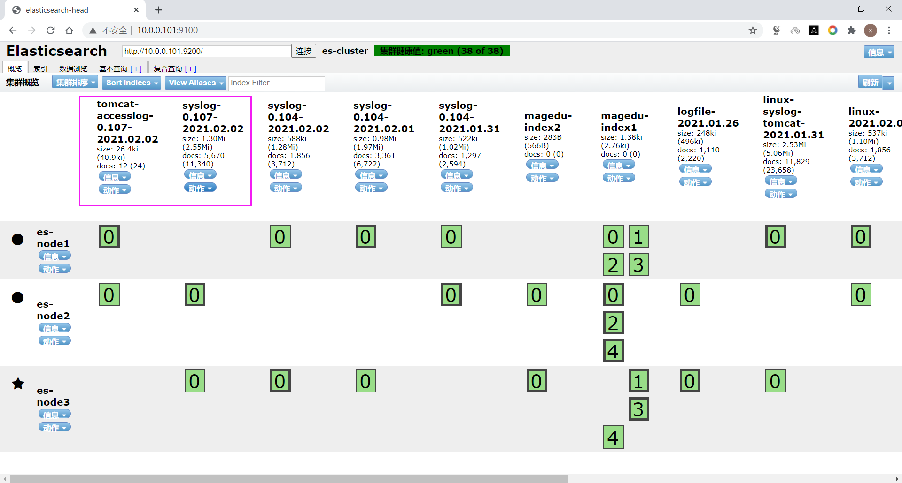

4.4.3.2.5 在 Kibana 添加索引

4.4.3.2.5.1 在kibana添加 Tomcat 索引

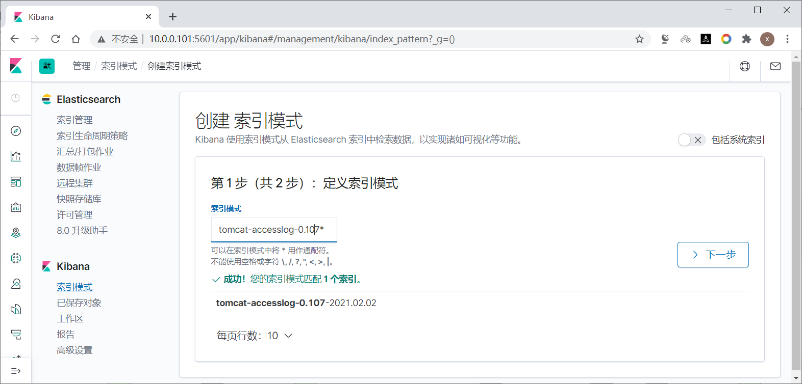

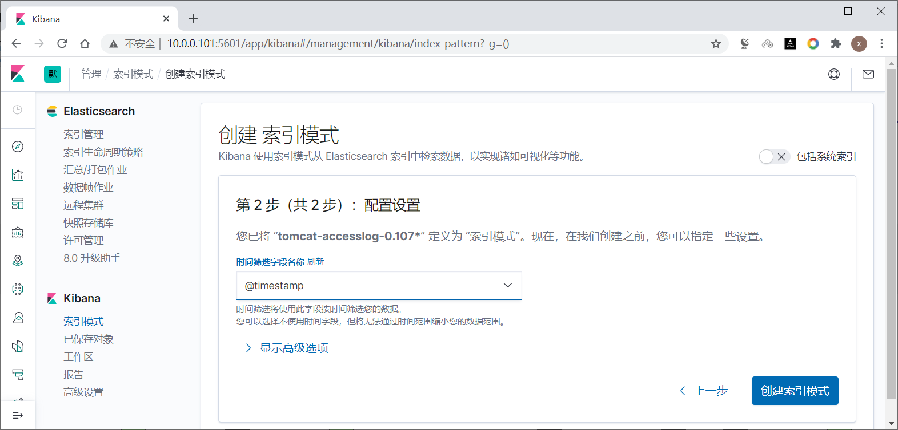

4.4.3.2.5.2 在Kibana 添加 syslog 索引

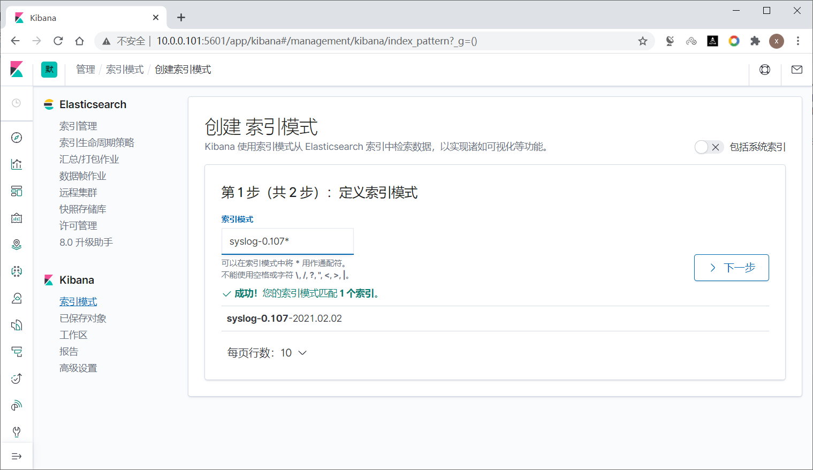

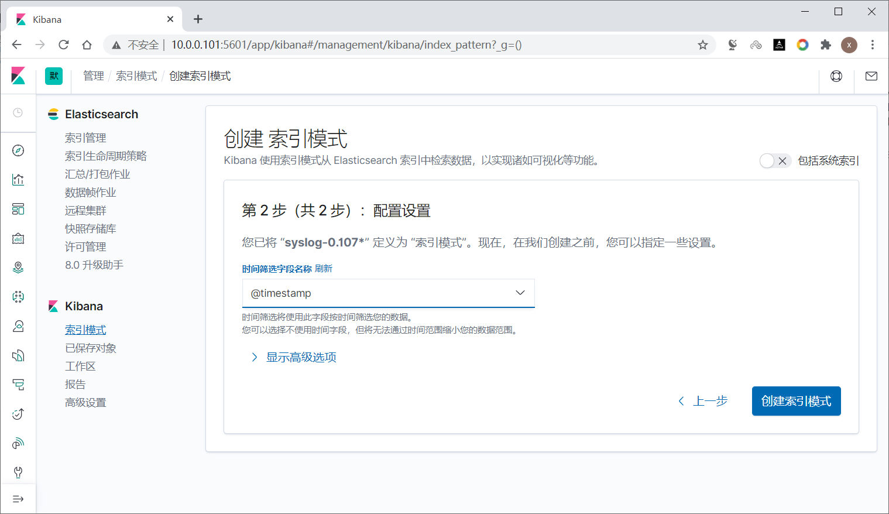

4.4.3.2.7 验证数据

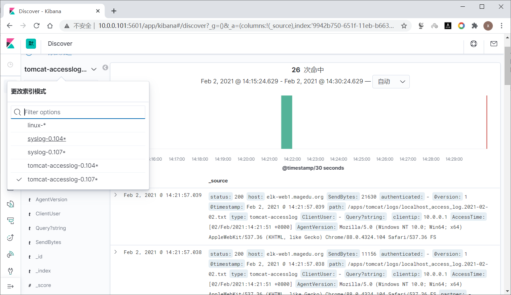

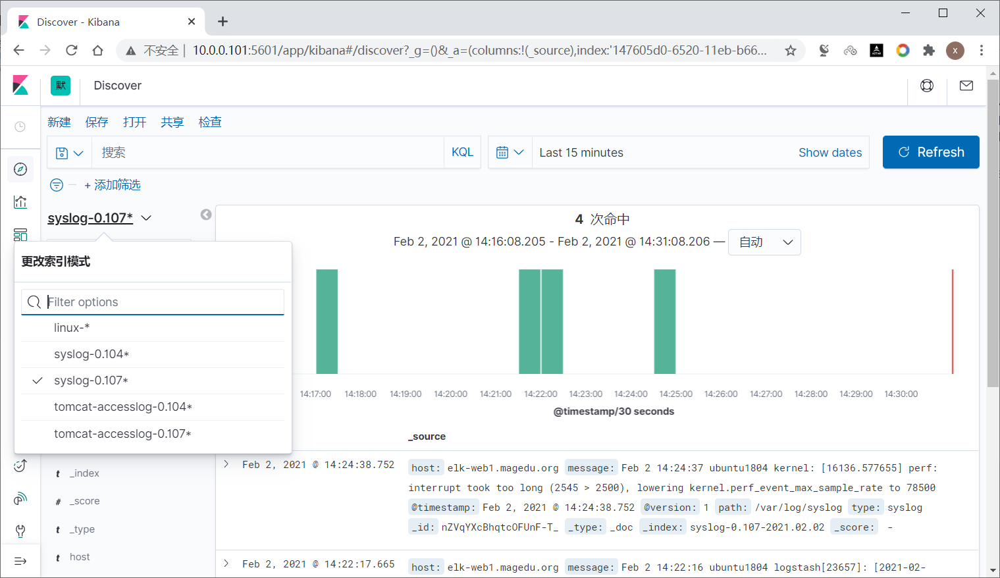

### 利用 multiline 插件收集 Java 错误日志

Java应用日志有时因为某一个错误会出现很多行错误的日志信息,但这些行都属于同一个日志的信息

为了Elasticsearch 分析方便,需要将多行日志合并成一行日志

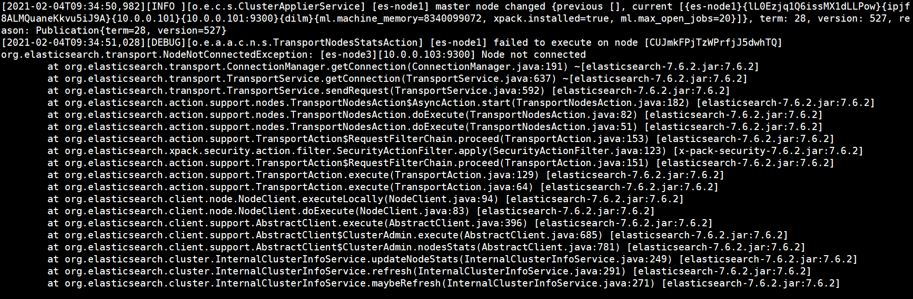

使用codec的multiline插件实现多行匹配，而且支持使用what指令灵活的将匹配到的行与前面的行合并或者和后面的行合并

插件链接:

<https://www.elastic.co/guide/en/logstash/current/plugins-codecs-multiline.html>

多行匹配规则

<https://www.elastic.co/guide/en/beats/filebeat/8.3/multiline-examples.html>

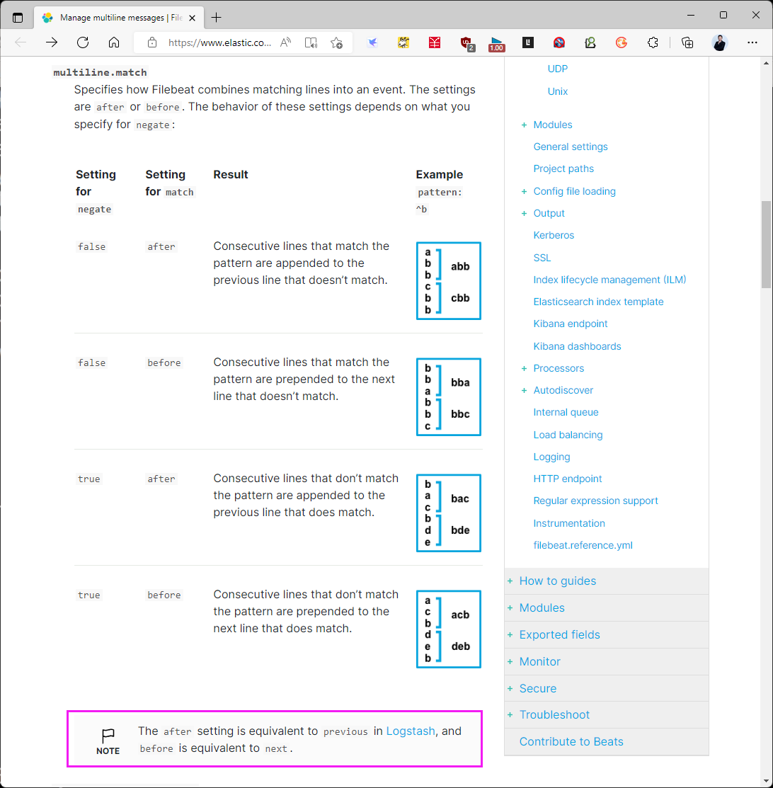

4.4.3.3.1 实现测试 multiline 插件的配置文件

```bash
#测试multiline插件
[root@elk-web1 ~]#cat  /etc/logstash/conf.d/java-log-to-es.conf
input {
stdin {
codec => multiline {
pattern => "^[0-3][0-9]-"  #以包安装tomcat9，用正则表达式表示以两个数字开头的行
#pattern => "^\["          #二进制安装tomcat9, 用正则表达式表示以[开头的行
negate => "true"  #匹配正则表达式的行才进行合并,true为匹配不成功进行操作,false为成功
进行操作
what => "previous" #将正则表达式前面的行进行合并,previous表示与以前的行合并，如果是
下面的行合并就是next
}
}
}
output {
stdout {
codec => "rubydebug"
}
}
```

4.4.3.3.2 测试语法是否正确

```bash
#语法检查
[root@elk-web1 ~]#/usr/share/logstash/bin/logstash -f /etc/logstash/conf.d/java-
log-to-es.conf -t
WARNING: Could not find logstash.yml which is typically located in
$LS_HOME/config or /etc/logstash. You can specify the path using --
path.settings. Continuing using the defaults
Could not find log4j2 configuration at path
/usr/share/logstash/config/log4j2.properties. Using default config which logs
errors to the console
[INFO ] 2021-02-04 09:52:36.951 [main] writabledirectory - Creating directory
{:setting=>"path.queue", :path=>"/usr/share/logstash/data/queue"}
[INFO ] 2021-02-04 09:52:36.974 [main] writabledirectory - Creating directory
{:setting=>"path.dead_letter_queue",
:path=>"/usr/share/logstash/data/dead_letter_queue"}
[WARN ] 2021-02-04 09:52:37.345 [LogStash::Runner] multilocal - Ignoring the
'pipelines.yml' file because modules or command line options are specified
[INFO ] 2021-02-04 09:52:38.684 [LogStash::Runner] Reflections - Reflections
took 78 ms to scan 1 urls, producing 20 keys and 40 values
Configuration OK
[INFO ] 2021-02-04 09:52:40.235 [LogStash::Runner] runner - Using
config.test_and_exit mode. Config Validation Result: OK. Exiting Logstash
```

4.4.3.3.3 交互式测试插件的标准输入和标准输出

```bash
[root@elk-web1 ~]#systemctl stop logstash.service
[root@elk-web1 ~]#/usr/share/logstash/bin/logstash -f /etc/logstash/conf.d/java-
log-to-es.conf
WARNING: Could not find logstash.yml which is typically located in
$LS_HOME/config or /etc/logstash. You can specify the path using --
path.settings. Continuing using the defaults
Could not find log4j2 configuration at path
/usr/share/logstash/config/log4j2.properties. Using default config which logs
errors to the console
[WARN ] 2021-02-04 09:55:32.095 [LogStash::Runner] multilocal - Ignoring the
'pipelines.yml' file because modules or command line options are specified
[INFO ] 2021-02-04 09:55:32.109 [LogStash::Runner] runner - Starting Logstash
{"logstash.version"=>"7.6.2"}
[INFO ] 2021-02-04 09:55:32.141 [LogStash::Runner] agent - No persistent UUID
file found. Generating new UUID {:uuid=>"61a9bd43-18df-454c-aef6-3df4b98b4530",
:path=>"/usr/share/logstash/data/uuid"}
[INFO ] 2021-02-04 09:55:34.094 [Converge PipelineAction::Create<main>]
Reflections - Reflections took 45 ms to scan 1 urls, producing 20 keys and 40
values
[WARN ] 2021-02-04 09:55:35.467 [[main]-pipeline-manager] LazyDelegatingGauge -
A gauge metric of an unknown type (org.jruby.RubyArray) has been created for
key: cluster_uuids. This may result in invalid serialization.  It is recommended
to log an issue to the responsible developer/development team.
[INFO ] 2021-02-04 09:55:35.472 [[main]-pipeline-manager] javapipeline -
Starting pipeline {:pipeline_id=>"main", "pipeline.workers"=>2,
"pipeline.batch.size"=>125, "pipeline.batch.delay"=>50,
"pipeline.max_inflight"=>250, "pipeline.sources"=>["/etc/logstash/conf.d/java-
log-to-es.conf"], :thread=>"#<Thread:0x3143f68e run>"}
[INFO ] 2021-02-04 09:55:36.560 [[main]-pipeline-manager] javapipeline -
Pipeline started {"pipeline.id"=>"main"}
The stdin plugin is now waiting for input:
[INFO ] 2021-02-04 09:55:36.671 [Agent thread] agent - Pipelines running
{:count=>1, :running_pipelines=>[:main], :non_running_pipelines=>[]}
[INFO ] 2021-02-04 09:55:36.929 [Api Webserver] agent - Successfully started
Logstash API endpoint {:port=>9600}
line1       #输入测试数据
line2       #输入测试数据
line3       #输入测试数据
[2021-02-04T09:23:20,512][INFO ] test java log #输入测试数据
{
"tags" => [
[0] "multiline"
],
"message" => "[\nline1\nline2\nline3",
"host" => "elk-web1.bowen.org",
"@timestamp" => 2021-02-04T01:58:01.365Z,
"@version" => "1"
}
line4       #输入测试数据
line5       #输入测试数据
line6       #输入测试数据
[2021-02-04T09:23:20,512][INFO ] test java log2 #输入测试数据
{
"tags" => [
[0] "multiline"
],
"message" => "[2021-02-04T09:23:20,512][INFO ] test java
log\nline4\nline5\nline6",
"host" => "elk-web1.bowen.org",
"@timestamp" => 2021-02-04T01:59:35.338Z,
"@version" => "1"
}
```

4.4.3.3.4 配置读取日志文件至标准输出

```bash
[root@elk-web1 ~]#cat  /etc/logstash/conf.d/java-log-to-es.conf
input {
file {
path => "/data/java-log/es-cluster.log"
type => "java-error-log"
start_position => "beginning"
stat_interval => "3"
codec => multiline {
pattern => "^\["
negate => "true"
what => "previous"
}
}
}
output {
stdout {
codec => "rubydebug"
}
}
```

4.4.3.3.5 语法验证

```bash
#语法检查
[root@elk-web1 ~]#/usr/share/logstash/bin/logstash -f /etc/logstash/conf.d/java-
log-to-es.conf  -t
.....
Configuration OK
[INFO ] 2021-02-04 11:10:59.275 [LogStash::Runner] runner - Using
config.test_and_exit mode. Config Validation Result: OK. Exiting Logstash
#查看日志输出是否合并日志
[root@elk-web1 ~]#/usr/share/logstash/bin/logstash -f /etc/logstash/conf.d/java-
log-to-es.conf
```

4.4.3.3.6 将输出改为 Elasticsearch

```bash
[root@elk-web1 ~]#cat /etc/logstash/conf.d/java-log-to-es.conf
input {
file {
path => "/data/java-log/es-cluster.log"
#path => "/var/log/tomcat9/catalina.*.log"
type => "java-error-log"
start_position => "beginning"
stat_interval => "3"
codec => multiline {
pattern => "^\["
negate => "true"
what => "previous"
}
}
}
output {
if [type] == "java-error-log" {
elasticsearch {
hosts => ["10.0.0.101:9200"]
index => "java-error-log-0.107-%{+YYYY.ww}"  #时间格式：年.周
}
}
}
[root@elk-web1 ~]#systemctl restart logstash.service
```

4.4.3.3.7 Head 插件查看索引

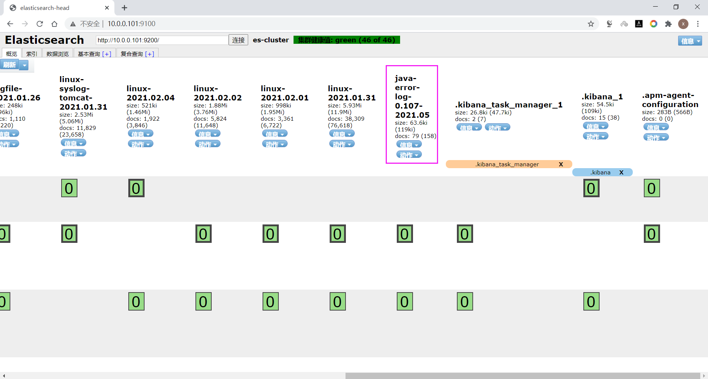

4.4.3.3.8 Kibana 界面添加索引


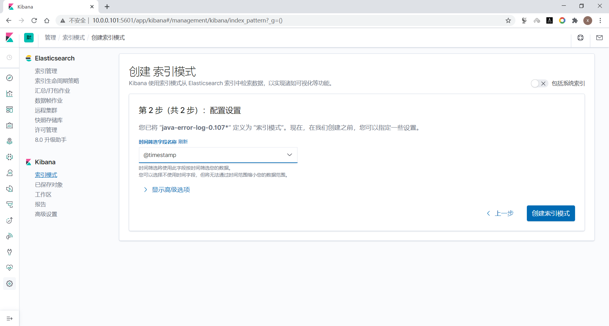

4.4.3.3.9 Kibana 界面查看数据

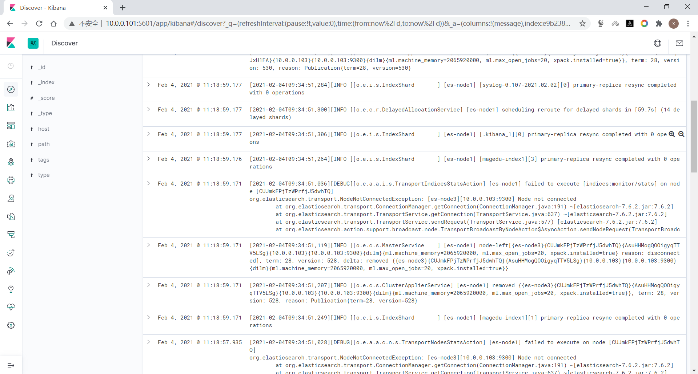

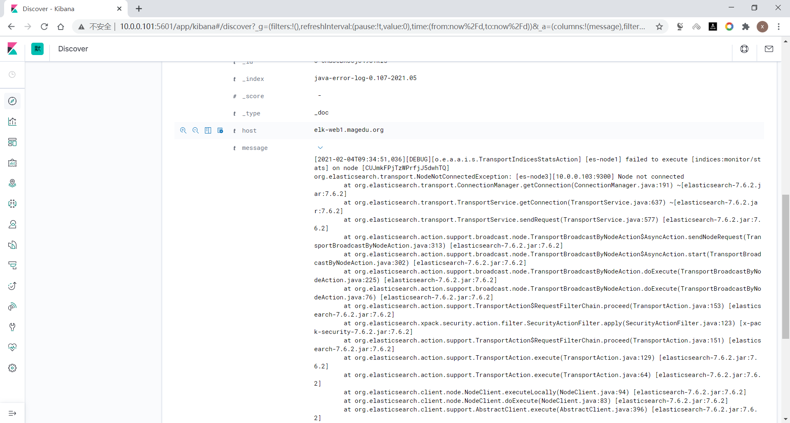

### 收集 Nginx Json 格式的日志并输出至 Elasticsearch

可以收集json格式的数据发送至logstash，再转发给ES

官方说明

<https://www.elastic.co/guide/en/beats/filebeat/7.x/filebeat-input-log.html>

范例:

```bash
[root@centos8 ~]#vim /etc/filebeat/filebeat.yml
- type: log
paths:
-  /var/log/nginx/access_json.log
json.keys_under_root: true
json.overwrite_keys: true
```

### 部署 Nginx 服务

```bash
#包安装
[root@elk-web1 ~]#apt update && apt -y install nginx
#编译安装
[root@elk-web1 ~]#wget http://nginx.org/download/nginx-1.18.0.tar.gz
[root@elk-web1 ~]#tar xvf nginx-1.18.0.tar.gz
[root@elk-web1 ~]#cd nginx-1.18.0/
[root@elk-web1 nginx-1.18.0]#./configure  --prefix=/apps/nginx
[root@elk-web1 nginx-1.18.0]#make && make install
```

### 将 Nginx 日志转换为 Json 格式

```bash
#包安装
[root@elk-web1 ~]#vim /etc/nginx/nginx.conf
#编译安装
[root@elk-web1 ~]#vim /apps/nginx/conf/nginx.conf
user nginx
http {
......
#log_format  main  '$remote_addr - $remote_user [$time_local] "$request" '
#                  '$status $body_bytes_sent "$http_referer" '
#                  '"$http_user_agent" "$http_x_forwarded_for"';
#access_log  logs/access.log  main;
log_format access_json '{"@timestamp":"$time_iso8601",'
'"host":"$server_addr",'
'"clientip":"$remote_addr",'
'"size":$body_bytes_sent,'
'"responsetime":$request_time,'
'"upstreamtime":"$upstream_response_time",'
'"upstreamhost":"$upstream_addr",'
'"http_host":"$host",'
'"uri":"$uri",'
'"domain":"$host",'
'"xff":"$http_x_forwarded_for",'
'"referer":"$http_referer",'
'"tcp_xff":"$proxy_protocol_addr",'
'"http_user_agent":"$http_user_agent",'
'"status":"$status"}';
......
server {
access_log   /apps/nginx/logs/nginx.access_json.log access_json;
#access_log  logs/host.access.log  main;
.....
[root@elk-web1 ~]#useradd -r -s /sbin/nologin nginx
[root@elk-web1 ~]#/apps/nginx/sbin/nginx  -t
[root@elk-web1 ~]#/apps/nginx/sbin/nginx
#验证日志格式
#包安装
[root@elk-web1 ~]#tail -n  1/var/log/nginx/access_json.log
#编译安装
[root@elk-web1 ~]#tail -n  1 /apps/nginx/logs/nginx.access_json.log
{"@timestamp":"2021-02-
04T12:18:12+08:00","host":"172.17.180.135","clientip":"61.148.74.134","size":676
46,"responsetime":0.000,"upstreamtime":"-","upstreamhost":"-
","http_host":"www.bowenxiaochun.com","uri":"/wp-content/uploads/2020/01/favicon-
1.ico","domain":"www.bowenxiaochun.com","xff":"-
","referer":"http://www.bowenxiaochun.com/","tcp_xff":"","http_user_agent":"Mozil
la/5.0 (Windows NT 10.0; Win64; x64; rv:85.0) Gecko/20100101
Firefox/85.0","status":"200"}
```

### 配置 Logstash 收集 Nginx 访问日志

```bash
[root@elk-web1 ~]#cat /etc/logstash/conf.d/nginx-log-to-es.conf
input {
file {
path => "/apps/nginx/logs/nginx.access_json.log"
#path => "/var/log/nginx/access_json.log"
start_position => "beginning"
stat_interval => "3"
type => "nginx-accesslog"
codec => json
}
file {
path => "/apps/nginx/logs/error.log"
#path => "/var/log/nginx/error.log"
start_position => "beginning"
stat_interval => "3"
type => "nginx-errorlog"
}
}
output {
if [type] == "nginx-accesslog" {
elasticsearch {
hosts => ["10.0.0.101:9200"]
#index => "nginx-accesslog-0.107-%{+YYYY.MM.dd}"  #8.10.X 索引名不能为包含
nginx
index => "myapp-accesslog-0.107-%{+YYYY.MM.dd}"  #8.10.X 索引名不能为包含
nginx开头
}
}
if [type] == "nginx-errorlog" {
elasticsearch {
hosts => ["10.0.0.101:9200"]
#index => "nginx-errorlog-0.107-%{+YYYY.MM.dd}"   #8.10.X 索引名不能为包含
nginx
index => "myapp-errorlog-0.107-%{+YYYY.MM.dd}"   #8.10.X 索引名不能为包含
nginx
}
}
}
#语法检查
[root@elk-web1 ~]#/usr/share/logstash/bin/logstash -f
/etc/logstash/conf.d/nginx-log-to-es.conf  -t
#重新启动
[root@elk-web1 ~]#systemctl restart logstash.service
```

### 利用 Head 插件查看索引

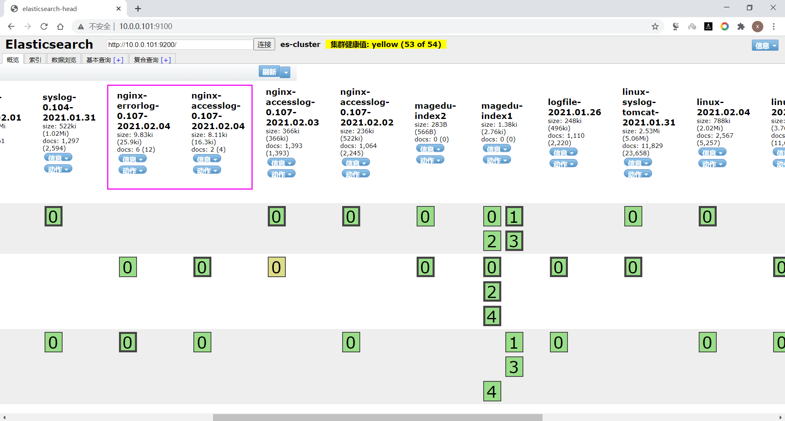

### Kibana 界面添加索引

4.4.4.5.1 添加 Nginx 访问日志索引

新版: 创建数据视图

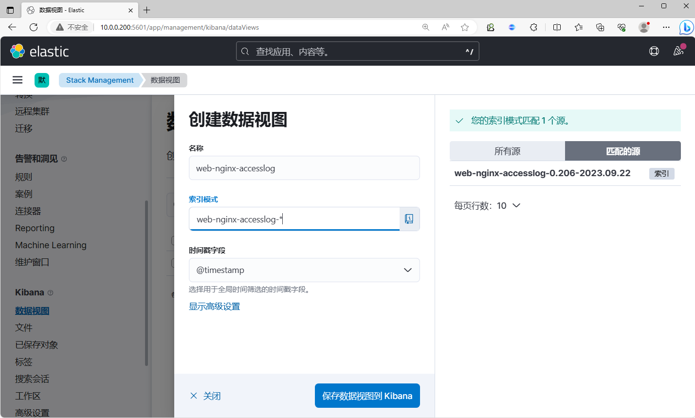

旧版: 创建索引模式

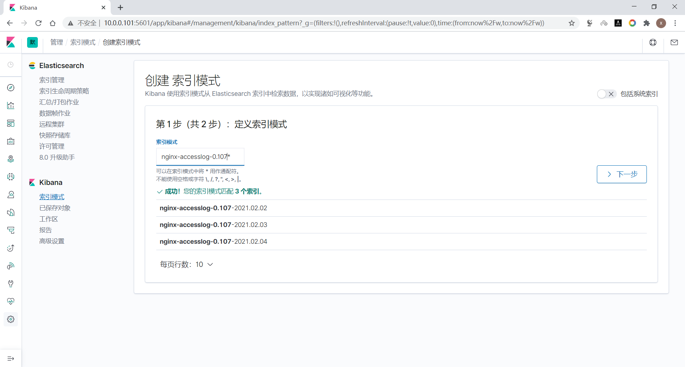


4.4.4.5.2 添加 Nginx 错误日志索引

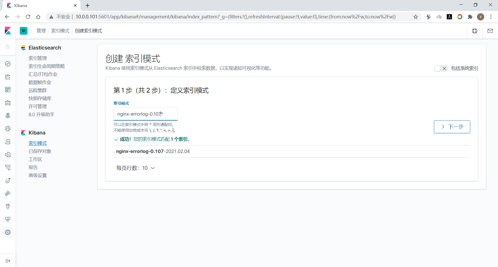


### Kibana界面验证数据

4.4.4.6.1 Kibana界面验证 Nginx 访问日志索引

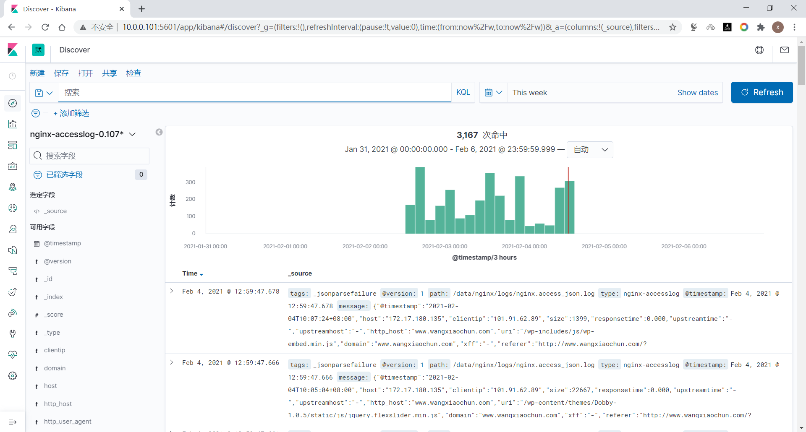

### Kibana界面验证 Nginx 错误日志索引

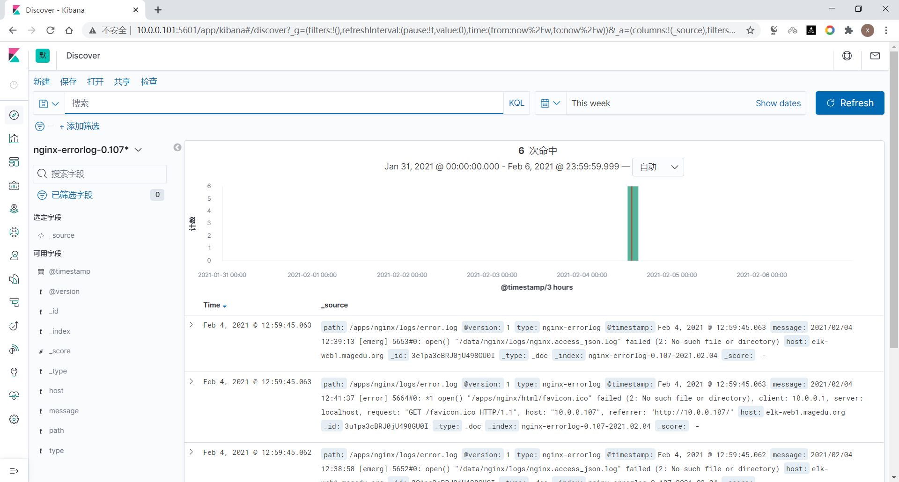

### 基于 TCP/UDP 收集日志并输出至 Elasticsearch

利用logstash的 tcp/udp 插件也可以通过网络接收和收集日志

官方链接:

<https://www.elastic.co/guide/en/logstash/current/plugins-inputs-tcp.html>

### 准备 Logstash 配置文件先进行收集测试

```bash
[root@logstash ~]#cat /etc/logstash/conf.d/tcp-to-es.conf
input {
tcp {
port => "9527"
host => "0.0.0.0"
type => "tcplog"      #可用于判断输出
codec => json         #如果是json格式,必须加此行,如果不是Json格式,却添加此行也不会影
响结果
mode => "server"      #默认值,可省略
}
}
output {
if [type] == 'tcplog' {
elasticsearch {
hosts => ["10.0.0.201:9200"]
index => "tcplog-%{+YYYY.MM.dd}"
}
stdout {
codec => "rubydebug"
}
}
}
[root@logstash ~]#systemctl stop logstash.service
[root@logstash ~]#/usr/share/logstash/bin/logstash -f /etc/logstash/conf.d/tcp-
to-es.conf -t
```

### 验证端口启动成功

```bash
[root@logstash ~]#/usr/share/logstash/bin/logstash -f /etc/logstash/conf.d/tcp-
to-es.conf
[root@logstash ~]#ss -ntl|grep 9527
LISTEN  0        128         [::ffff:10.0.0.107]:9527                  *:*
```

### 通过 nc 命令测试

NetCat简称nc, 因其功能强大，被称为网络界的“瑞士军刀”，利用nc 可以实现基于TCP或UDP协议传输数据.

```bash
#向logstash服务器发送信息
#输入非Json格式数据
[root@ubuntu1804 ~]#echo "test tcp log" | nc 10.0.0.107 9527
#输入Json格式数据
[root@ubuntu1804 ~]#echo '{"name" : "bowen", "age" : "28", "phone" :
"0123456789"}' | nc 10.0.0.107 9527
```

### 验证 Logstash 是否接收到数据

```json
root@logstash ~]#/usr/share/logstash/bin/logstash -f /etc/logstash/conf.d/tcp-to-
es.conf
......
[INFO ] 2021-02-04 15:40:45.734 [Api Webserver] agent - Successfully started
Logstash API endpoint {:port=>9600}
/usr/share/logstash/vendor/bundle/jruby/2.5.0/gems/awesome_print-
1.7.0/lib/awesome_print/formatters/base_formatter.rb:31: warning: constant
::Fixnum is deprecated
{
"message" => "test tcp log",
"@timestamp" => 2021-02-04T07:41:56.115Z,
"port" => 37472,
"type" => "tcplog",
"@version" => "1",
"host" => "10.0.0.108"
}
{
"tags" => [
[0] "_jsonparsefailure"
],
"message" => "hello,world",
"type" => "tcplog",
"@version" => "1",
"@timestamp" => 2023-05-06T02:57:45.865640754Z
}
#如果是Json数据，可以自动解析
输入：
{
"name" => "bowen",
"phone" => "0123456789",
"age" => "28",
"@version" => "1",
"@timestamp" => 2023-05-06T02:58:09.311423142Z,
"type" => "tcplog"
}
```

### 通过 nc 命令发送一个文件

```bash
[root@logstash ~]#nc 10.0.0.107 9527 < /etc/os-release
```

### Logstash验证数据

```json
[root@elk-web1 ~]#/usr/share/logstash/bin/logstash -f /etc/logstash/conf.d/tcp-
to-es.conf
......
{
"message" => "VERSION=\"18.04.5 LTS (Bionic Beaver)\"",
"@timestamp" => 2021-02-04T07:44:18.472Z,
"port" => 37474,
"type" => "tcplog",
"@version" => "1",
"host" => "10.0.0.108"
}
{
"message" => "ID_LIKE=debian",
"@timestamp" => 2021-02-04T07:44:18.473Z,
"port" => 37474,
"type" => "tcplog",
"@version" => "1",
"host" => "10.0.0.108"
}
{
"message" => "VERSION_ID=\"18.04\"",
"@timestamp" => 2021-02-04T07:44:18.473Z,
"port" => 37474,
"type" => "tcplog",
"@version" => "1",
"host" => "10.0.0.108"
}
{
"message" => "SUPPORT_URL=\"https://help.ubuntu.com/\"",
"@timestamp" => 2021-02-04T07:44:18.473Z,
"port" => 37474,
"type" => "tcplog",
"@version" => "1",
"host" => "10.0.0.108"
}
{
"message" => "PRIVACY_POLICY_URL=\"https://www.ubuntu.com/legal/terms-
and-policies/privacy-policy\"",
"@timestamp" => 2021-02-04T07:44:18.473Z,
"port" => 37474,
"type" => "tcplog",
"@version" => "1",
"host" => "10.0.0.108"
}
{
"message" => "UBUNTU_CODENAME=bionic",
"@timestamp" => 2021-02-04T07:44:18.474Z,
"port" => 37474,
"type" => "tcplog",
"@version" => "1",
"host" => "10.0.0.108"
}
{
"message" => "NAME=\"Ubuntu\"",
"@timestamp" => 2021-02-04T07:44:18.468Z,
"port" => 37474,
"type" => "tcplog",
"@version" => "1",
"host" => "10.0.0.108"
}
{
"message" => "ID=ubuntu",
"@timestamp" => 2021-02-04T07:44:18.473Z,
"port" => 37474,
"type" => "tcplog",
"@version" => "1",
"host" => "10.0.0.108"
}
{
"message" => "PRETTY_NAME=\"Ubuntu 18.04.5 LTS\"",
"@timestamp" => 2021-02-04T07:44:18.473Z,
"port" => 37474,
"type" => "tcplog",
"@version" => "1",
"host" => "10.0.0.108"
}
{
"message" => "HOME_URL=\"https://www.ubuntu.com/\"",
"@timestamp" => 2021-02-04T07:44:18.473Z,
"port" => 37474,
"type" => "tcplog",
"@version" => "1",
"host" => "10.0.0.108"
}
{
"message" => "BUG_REPORT_URL=\"https://bugs.launchpad.net/ubuntu/\"",
"@timestamp" => 2021-02-04T07:44:18.473Z,
"port" => 37474,
"type" => "tcplog",
"@version" => "1",
"host" => "10.0.0.108"
}
{
"message" => "VERSION_CODENAME=bionic",
"@timestamp" => 2021-02-04T07:44:18.473Z,
"port" => 37474,
"type" => "tcplog",
"@version" => "1",
"host" => "10.0.0.108"
}
```

### 通过伪设备的方式发送消息

Linux系统中,设备分为块设备和字符设备,而块设备中有硬盘、内存的等对应实体的硬件，但是也有一些设备并不一定要对应物理设备，比如: /dev/null，/dev/zero，/dev/random，/dev/tcp，/dev/udp等， 这种没有对应关系的设备称为伪设备

```bash
[root@elk-web2 ~]#echo "伪设备测试" > /dev/tcp/10.0.0.107/9527
```

### Logstash 验证数据

```json
[root@elk-web1 ~]#/usr/share/logstash/bin/logstash -f /etc/logstash/conf.d/tcp-
to-es.conf
......
{
"message" => "伪设备测试",
"@timestamp" => 2021-02-04T08:07:14.484Z,
"port" => 37476,
"type" => "tcplog",
"@version" => "1",
"host" => "10.0.0.108"
}
```

### 将输出改为 Elasticsearch

```bash
[root@elk-web1 ~]#cat /etc/logstash/conf.d/tcp-to-es.conf
input {
tcp {
port => "9527"
host => "10.0.0.107"
type => "tcplog"
codec => json
mode => "server"
}
}
output {
if [type] == "tcplog" {
elasticsearch {
hosts => ["10.0.0.101:9200"]
index => "tcplog-0.107-%{+YYYY.MM.dd}"
}
}
}
[root@elk-web1 ~]#systemctl restart logstash.service
```

### 通过 nc 命令或伪设备输入日志

```bash
#在任意主机都可以执行下面指令
[root@elk-web2 ~]#echo "伪设备测试1" > /dev/tcp/10.0.0.107/9527
[root@elk-web2 ~]#echo "伪设备测试2" > /dev/tcp/10.0.0.107/9527
[root@elk-web2 ~]#echo "伪设备测试3" > /dev/tcp/10.0.0.107/9527
[root@elk-web2 ~]#echo '{ "name":"bowen","age": "18","gender":"male"}' >
/dev/tcp/10.0.0.107/9527
[root@elk-web2 ~]#nc 10.0.0.107 9527 < /var/log/syslog
```

### 利用 Head 插件查看

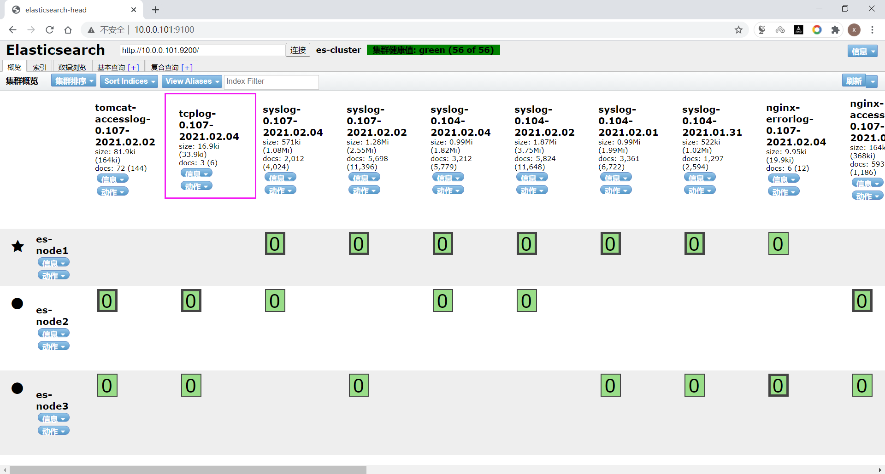

### 在 Kibana 界面添加索引


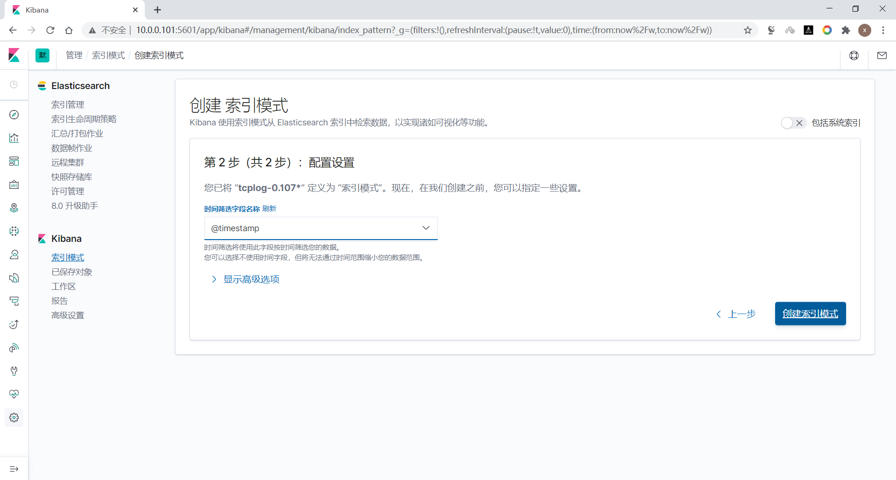

### 验证数据

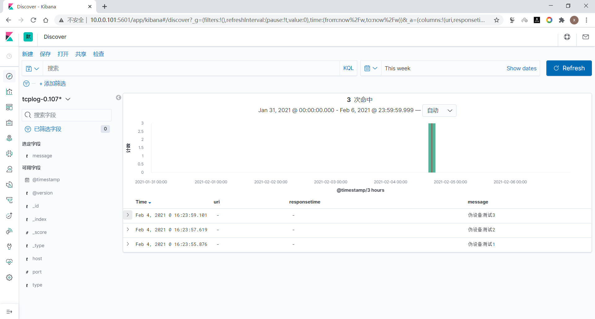

### 通过 Rsyslog 收集 Haproxy 日志并输出至 Elasticsearch

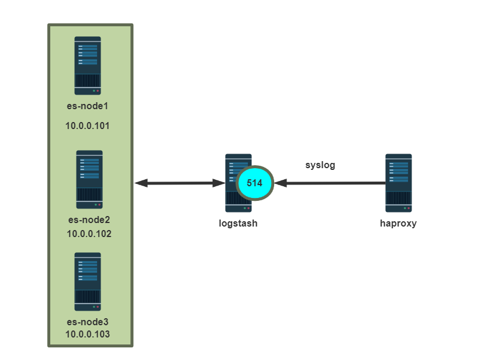

### rsyslog 日志服务和 syslog 插件介绍

Linux系统中的 rsyslog 提供强大的日志管理功能, 不仅可以收集本机的日志,还可以接受来自各种来源的输入，转换再发送至不同的目标

此外rsyslog的性能也很强，根据官方的介绍，rsyslog(2013年版本)可以达到每秒转发百万条日志的级别


官方网址：http://www.rsyslog.com/

确认系统安装的版本命令如下：

```bash
[root@es-node1 ~]#dpkg -l rsyslog
Desired=Unknown/Install/Remove/Purge/Hold
| Status=Not/Inst/Conf-files/Unpacked/halF-conf/Half-inst/trig-aWait/Trig-pend
|/ Err?=(none)/Reinst-required (Status,Err: uppercase=bad)
||/ Name                              Version               Architecture
Description
+++-=================================-=====================-
=====================-
=======================================================================
ii  rsyslog                           8.32.0-1ubuntu4       amd64
reliable system and kernel logging daemon
```

利用 logstash的syslog插件可以收集日志,经常用于收集网络设备的日志,比如:路由器,交换机等

官方链接:

<https://www.elastic.co/guide/en/logstash/current/plugins-inputs-syslog.html>

<https://www.elastic.co/guide/en/logstash/7.x/plugins-inputs-syslog.html>

### 安装并配置 Haproxy 的日志(如果不生效，reboot)

```bash
#如果无法生成日志，reboot
[root@elk-web1 ~]#apt -y install haproxy
[root@elk-web1 ~]#vim /etc/haproxy/haproxy.cfg
global
#log /dev/log   local0         #默认会记录日志到/var/log/haproxy.log中，将此行加注
释
#log /dev/log   local1 notice  #将此行加注释
log 127.0.0.1 local6  #添加下面一行,发送至本机的514/udp的local6日志级别中
#在文件最后加下面段
listen stats
mode http
bind 0.0.0.0:9999
stats enable
log global
stats uri   /haproxy-status
stats auth  admin:123456
[root@elk-web1 ~]#systemctl restart haproxy.service
#通过浏览器访问haproxy的状态页,生成访问日志
```

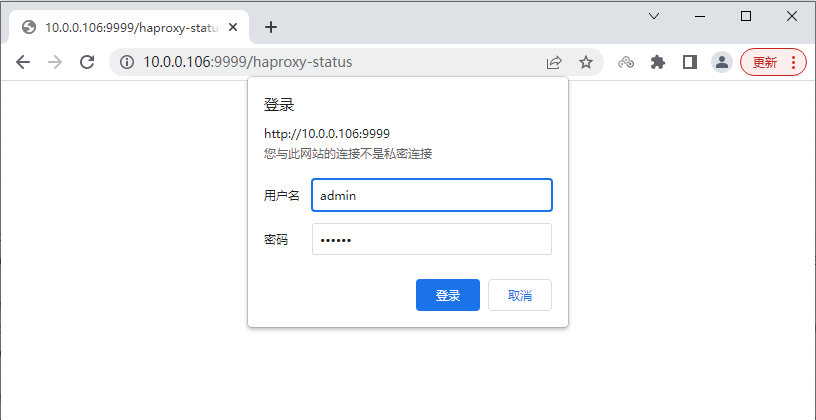

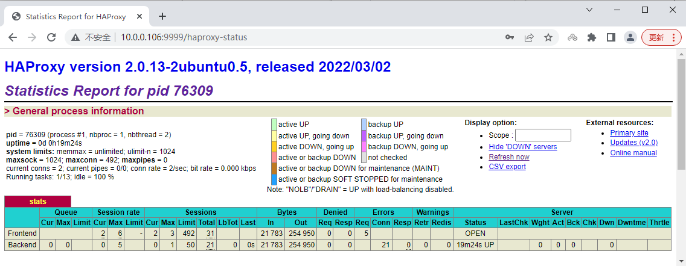

### 编辑 Rsyslog 服务配置文件(如果不生效，reboot)

```bash
#在haproxy主机上配置rsyslog服务
[root@elk-web1 ~]#vim /etc/rsyslog.conf
#取消下面两行的注释,实现接收haproxy的日志
module(load="imudp")
input(type="imudp" port="514")
......
#备份原有haproxy的配置文件
[root@ubuntu2004 rsyslog.d]#mv 49-haproxy.conf  49-haproxy.conf.bak
#加下面行,将haproxy日志再利用UDP或TCP转发到logstash服务器
[root@elk-web1 ~]#cat /etc/rsyslog.d/haproxy.conf
local6.*  @10.0.0.104:514
[root@elk-web1 ~]#systemctl restart haproxy.service  rsyslog
```

### 编辑 Logstash 配置文件

配置logstash监听一个本地端口作为日志输入源，用于接收从rsyslog服务转发过来的haproxy服务器日志

logstash的服务器监听的IP:端口和rsyslog输出IP和端口必须相同

```bash
[root@elk-web1 ~]#cat /etc/logstash/conf.d/haproxy-syslog-to-es.conf
input {
syslog {
host => "0.0.0.0"
port => "514"       #指定监听的UDP/TCP端口，注意普通用户无法监听此端口
type => "haproxy"
}
}
output {
if [type] == 'haproxy' {
stdout {
codec => "rubydebug" #默认值，可以省略
}
}
}
```

```bash
#修改用户
[root@elk-web1 ~]#vim /etc/systemd/system/logstash.service
User=root
Group=root
```

### 语法检查

```bash
[root@elk-web1 ~]#/usr/share/logstash/bin/logstash -f
/etc/logstash/conf.d/haproxy-syslog-to-es.conf -t
```

### 启动并验证端口

```bash
[root@elk-web1 ~]#/usr/share/logstash/bin/logstash -f
/etc/logstash/conf.d/syslog-to-es.conf
[root@elk-web1 ~]#ss -ntlup|grep 514
udp   UNCONN  0  0 0.0.0.0:514  0.0.0.0:*      users:(("java",pid=6975,fd=68))
tcp   LISTEN  0  50      *:514        *:*      users:(("java",pid=6975,fd=69))
```

### Web 访问 haproxy 并验证数据

刷新页面,生成日志信息

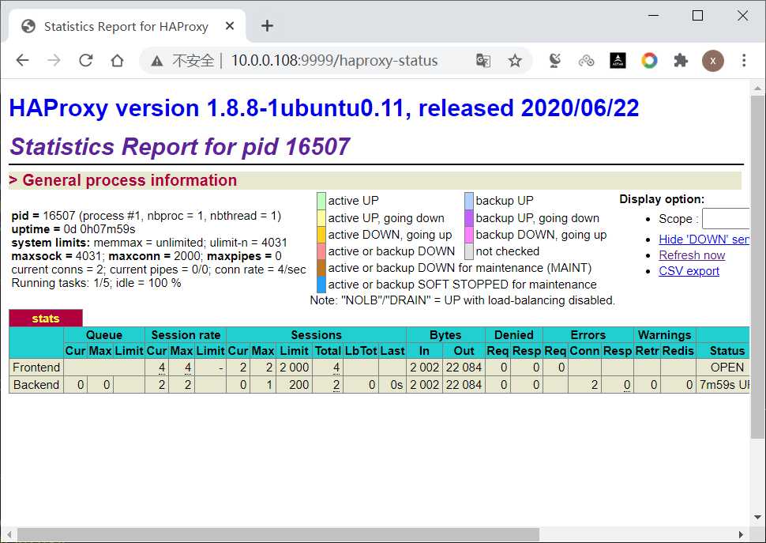

```bash
#测试方法1
[root@elk-web02 ~]#logger  -n logstash服务器地址  "This is a test log"
#测试法2：也可以使用logger命令测试生成日志
[root@elk-web2 ~]#logger -p "local6.info" "This is a test log"
#测试法3：
[root@ubuntu2204 ~]#logger -n 10.0.0.210 -P514 -T  "This is a test log"
[root@web01 ~]#logger -d -n <logstash-server> "This is test remote haproxy log"
```

```json
#启动logstash
[root@elk-web1 ~]#/usr/share/logstash/bin/logstash -f
/etc/logstash/conf.d/haproxy-syslog-to-es.conf
.....
[INFO ] 2021-02-04 18:38:55.133 [Api Webserver] agent - Successfully started
Logstash API endpoint {:port=>9600}
/usr/share/logstash/vendor/bundle/jruby/2.5.0/gems/awesome_print-
1.7.0/lib/awesome_print/formatters/base_formatter.rb:31: warning: constant
::Fixnum is deprecated
{
"pid" => "16506",
"facility" => 22,
"message" => "Proxy stats started.",
"severity" => 5,
"type" => "syslog",
"facility_label" => "local6",
"severity_label" => "Notice",
"@timestamp" => 2021-02-04T10:33:32.000Z,
"program" => "haproxy",
"priority" => 181,
"@version" => "1",
"timestamp" => "Feb  4 18:33:32",
"logsource" => "localhost",
"host" => "10.0.0.108"
}
{
"pid" => "16507",
"facility" => 22,
"message" => "10.0.0.1:11742 [04/Feb/2021:18:41:31.143] stats
stats/<STATS> 0/0/0/0/0 200 10743 - - LR-- 2/2/0/0/0 0/0 \"GET /haproxy-status
HTTP/1.1\"",
"severity" => 6,
"type" => "syslog",
"facility_label" => "local6",
"severity_label" => "Informational",
"@timestamp" => 2021-02-04T10:41:31.000Z,
"program" => "haproxy",
"priority" => 182,
"@version" => "1",
"timestamp" => "Feb  4 18:41:31",
"logsource" => "localhost",
"host" => "10.0.0.108"
}
```

### 将输出改为 Elasticsearch

```bash
[root@logstash1 ~]#echo net.ipv4.ip_unprivileged_port_start = 500 >>
/etc/sysctl.conf
[root@logstash1 ~]#sysctl -p
[root@elk-web1 ~]#cat /etc/logstash/conf.d/haproxy-syslog-to-es.conf
input {
syslog {
port => "514"             #普通用户无法监听
host => "0.0.0.0"
type => "haproxy"
}
}
output {
if [type] == "haproxy" {
stdout {
codec => "rubydebug"
}
elasticsearch {
hosts => ["10.0.0.101:9200","10.0.0.102:9200","10.0.0.103:9200"]
index => "syslog-haproxy-%{+YYYY.MM.dd}"
}
}
}
[root@elk-web1 ~]#/usr/share/logstash/bin/logstash -f
/etc/logstash/conf.d/haproxy-syslog-to-es.conf -t
[root@elk-web1 ~]#systemctl restart logstash.service
```

### 利用 Head 插件查看

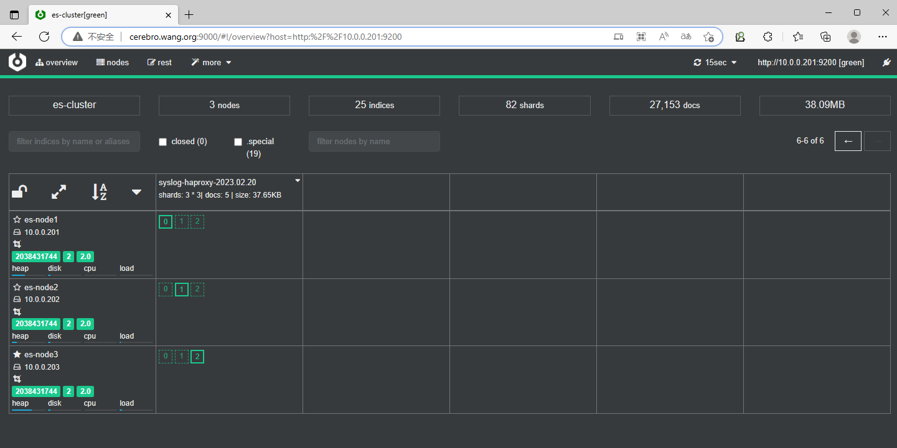

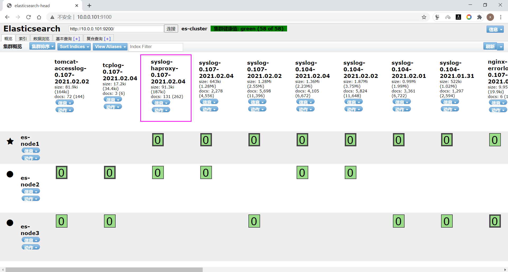

### Kibana界面添加索引

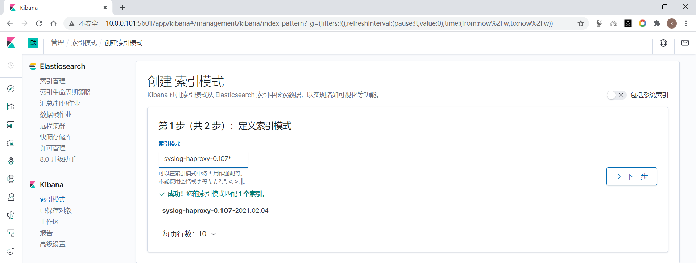

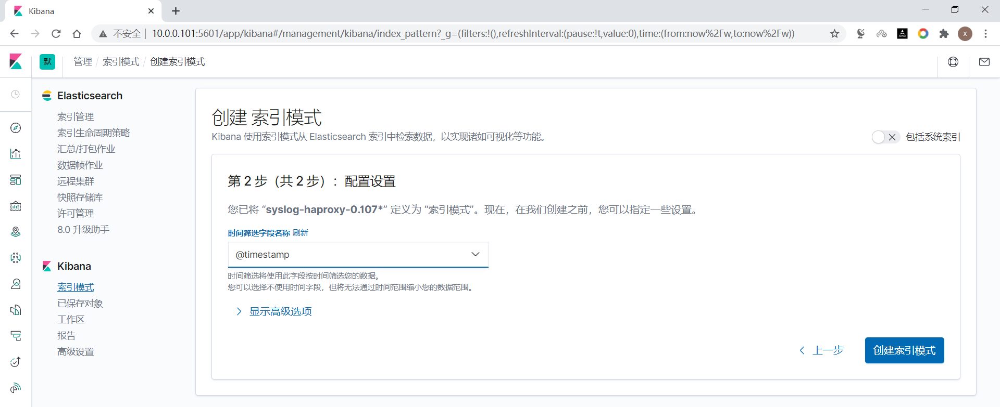

### Kibana验证数据

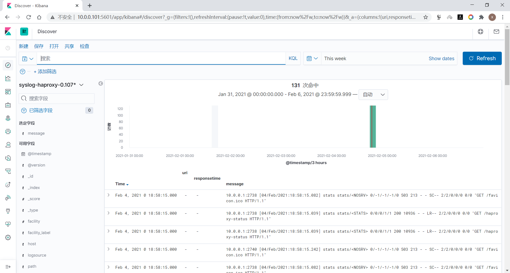

### 收集应用特定格式的日志输出至 Elasticsearch 并利用 Kibana 展示(练习)

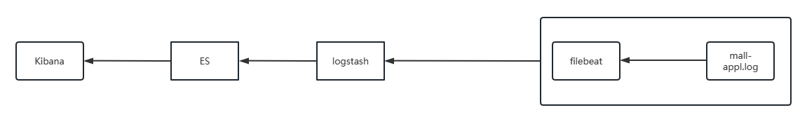

### 应用日志收集项目说明

应用的日志格式如下

```bash
[root@web01 ~]#head /var/log/mall_app.log
[INFO] 2018-06-28 08:08:12 [www.mall.com] - DAU|9136|加入收藏|2018-06-28 01:05:02
[INFO] 2018-06-28 08:08:14 [www.mall.com] - DAU|5035|搜索|2018-06-28 01:07:01
[INFO] 2018-06-28 08:08:15 [www.mall.com] - DAU|669|使用优惠券|2018-06-28 08:05:13
[INFO] 2018-06-28 08:08:19 [www.mall.com] - DAU|2564|搜索|2018-06-28 08:07:08
```

将日志收集利用 Logstash 进行格式转换后发给 Elasticsearch,并利用Kibana展示

### 实现过程

4.4.7.2.1 配置 Filebeat

```bash
[root@web01 ~]#cat /etc/filebeat/filebeat.yml
filebeat.inputs:
- type: log
enabled: true
paths:
- /var/log/mall_app.log
output.logstash:
hosts: ["logstash.bowen.org:6666"]
[root@web01 ~]#systemctl restart filebeat.service
```

4.4.7.2.2 配置 Logstash

```bash
[root@logstash ~]#cat /etc/logstash/conf.d/app_filebeat_filter_es.conf
input {
beats {
port =>6666
}
}
filter {
#mutate 切割操作
mutate {
#字段分隔符
split => { "message" => "|" }
#添加字段
add_field => {
"user_id" => "%{[message][1]}"
"action" => "%{[message][2]}"
"time" => "%{[message][3]}"
#"[@metadata][target_index]" => "mall-app-%{+YYYY.MM.dd}"
}
#删除无用字段
remove_field => ["message"]
#对新添加字段进行格式转换
convert => {
"user_id" => "integer"
"action" => "string"
"time" => "string"
}
}
date {
#覆盖原来的@timestamp时间字段
match => ["time", "yyyy-MM-dd HH:mm:ss"]
target => "@timestamp"
timezone => "Asia/Shanghai"
}
}
output {
stdout {
codec => rubydebug
}
elasticsearch {
hosts => ["10.0.0.101:9200","10.0.0.102:9200","10.0.0.103:9200"]
index => "mall-app-%{+YYYY.MM.dd}"
#index => "[@metadata][target_index]"
template_overwrite => true
}
}
#启动，观察结果
[root@logstash ~]#/usr/share/logstash/bin/logstash -f
/etc/logstash/conf.d/app_filebeat_filter_es.conf -r
.....
{
"@version" => "1",
"log" => {
"file" => {
"path" => "/var/log/mall_app.log"
},
"offset" => 86
},
"time" => "2018-06-28 01:05:02",
"user_id" => "9136",
"tags" => [
[0] "beats_input_codec_plain_applied"
],
"@timestamp" => 2018-06-27T17:05:02.000Z,
"agent" => {
"version" => "7.17.5",
"ephemeral_id" => "19431877-35c9-4429-ab78-8c8de178b05e",
"id" => "665bed82-0adb-4eb7-ba68-3810c753cb09",
"hostname" => "web01.bowen.org",
"type" => "filebeat",
"name" => "web01.bowen.org"
},
"input" => {
"type" => "log"
},
"action" => "加入收藏",
"ecs" => {
"version" => "1.12.0"
},
"host" => {
"name" => "web01.bowen.org"
}
}
```

4.4.7.2.3 插件查看索引

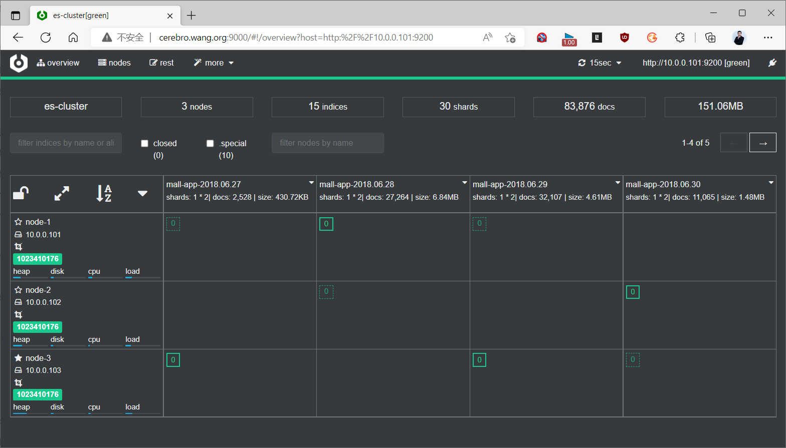

4.4.7.2.4 Kibana 创建索引模式

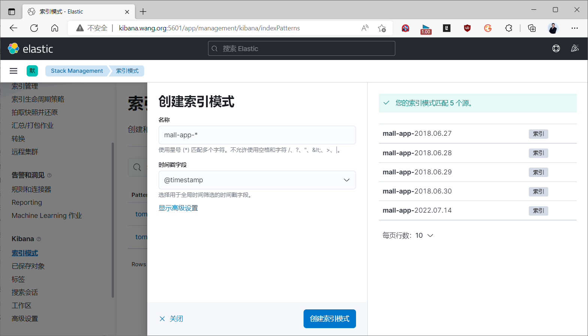

注意：因为是历史数据，所以需要选择正确的时间段


4.4.7.2.5 Kibana 展示

8.X


选择饼图


数据--Buckets--添加 --- 拆分切片 -- 聚合  -- 词Terms -- 字段：action.keyword  --  大小10


数据--Buckets--添加 --- 拆分切片 -- 聚合  -- 词Terms -- 字段：action.keyword  --  大小10


数据--Buckets--添加 --- 拆分行 -- 聚合  -- 词Terms -- 字段：action.keyword   --  大小10


生成仪表板

Dashborad --- 添加前面创建的三个图  -- 保存


最终效果如下




<nav class="article-end" aria-label="章节导航">
  <a href="{{ '/subjects/ELK/18-using-logstash.html' | relative_url }}">← Previous: Using Logstash</a>
  <a href="{{ '/subjects/ELK/' | relative_url }}">Back to ELK Log Analytics Index</a>
  <a href="{{ '/subjects/ELK/20-introduction-to-kibana.html' | relative_url }}">Next: Introduction to Kibana →</a>
</nav>
