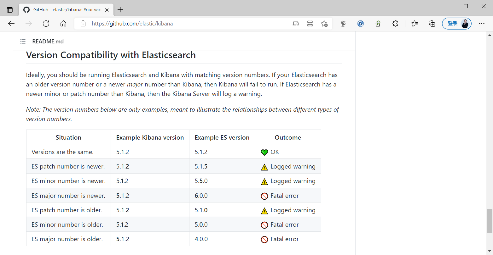
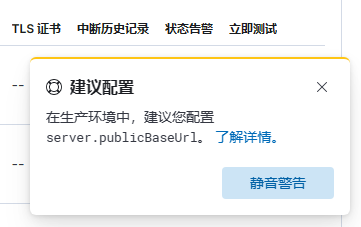

[← 返回ELK 日志分析目录]({{ '/subjects/ELK/' | relative_url }})



# 21 安装并配置 Kibana
### 5.2 安装并配置 Kibana

可以通过包或者二进制的方式进行安装,可以安装在独立服务器,或者也可以和elasticsearch的主机安装在一起

注意: Kibana的版本要和 Elasticsearch 相同的版本，否则可能会出错

官方说明：

<https://github.com/elastic/kibana>



### 包安装

基于性能原因，建议将Kibana安装到独立节点上，而非和ES节点复用

下载链接

<https://www.elastic.co/cn/downloads/kibana>

<https://mirrors.tuna.tsinghua.edu.cn/elasticstack/>

### Ubuntu 安装

```bash
[root@ubuntu2204 ~]#https://artifacts.elastic.co/downloads/kibana/kibana-8.6.1-
amd64.deb
[root@ubuntu2204 ~]#wget
https://mirrors.tuna.tsinghua.edu.cn/elasticstack/8.x/apt/pool/main/k/kibana/kib
ana-8.6.1-amd64.deb
[root@es-node1 ~]#wget
https://mirrors.tuna.tsinghua.edu.cn/elasticstack/7.x/apt/pool/main/k/kibana/kib
ana-7.6.2-amd64.deb
[root@es-node1 ~]#dpkg -i kibana-7.6.2-amd64.deb
```

### CentOS 安装

```bash
[root@es-node1 ~]#wget
https://mirrors.tuna.tsinghua.edu.cn/elasticstack/7.x/yum/7.6.2/kibana-7.6.2-
x86_64.rpm
[root@es-node1 ~]#yum localinstall kibana-7.6.2-x86_64.rpm
```

### 修改配置

```bash
[root@es-node1 ~]#vim  /etc/kibana/kibana.yml
[root@es-node1 ~]#grep  "^[a-Z]" /etc/kibana/kibana.yml
server.port: 5601  #监听端口,此为默认值,可不做修改
server.host: "0.0.0.0" #修改此行的监听地址,默认为localhost，即：127.0.0.1:5601
#修改此行,指向ES任意服务器地址或多个节点地址实现容错,默认为localhost
elasticsearch.hosts:
["http://10.0.0.101:9200","http://10.0.0.102:9200","http://10.0.0.103:9200"]
i18n.locale: "zh-CN"   #修改此行,使用"zh-CN"显示中文界面,默认英文
#8.X版本新添加配置,默认被注释,会显示下面提示
server.publicBaseUrl: "http://kibana.bowen.org"
```



### 启动 Kibana 服务并验证

```bash
#默认没有开机自动启动，需要自行设置
[root@es-node1 ~]#systemctl enable --now kibana
[root@es-node1 ~]#systemctl status kibana
```

● kibana.service - Kibana

```text
Loaded: loaded (/etc/systemd/system/kibana.service; enabled; vendor preset:
enabled)
Active: active (running) since Sun 2021-01-31 11:29:31 CST; 1min 40s ago
Main PID: 2013 (node)
Tasks: 11 (limit: 9470)
CGroup: /system.slice/kibana.service
└─2013 /usr/share/kibana/bin/../node/bin/node
/usr/share/kibana/bin/../src/cli -c /etc/kibana/kibana.yml
Jan 31 11:30:00 es-node1.bowen.org kibana[2013]:
{"type":"log","@timestamp":"2021-01-31T03:30:00Z","tags":
["status","plugin:ui_metric@7.6.2","info"],"pid":2
Jan 31 11:30:00 es-node1.bowen.org kibana[2013]:
{"type":"log","@timestamp":"2021-01-31T03:30:00Z","tags":
["status","plugin:markdown_vis@7.6.2","info"],"pid
Jan 31 11:30:00 es-node1.bowen.org kibana[2013]:
{"type":"log","@timestamp":"2021-01-31T03:30:00Z","tags":
["status","plugin:metric_vis@7.6.2","info"],"pid":
Jan 31 11:30:00 es-node1.bowen.org kibana[2013]:
{"type":"log","@timestamp":"2021-01-31T03:30:00Z","tags":
["status","plugin:table_vis@7.6.2","info"],"pid":2
Jan 31 11:30:00 es-node1.bowen.org kibana[2013]:
{"type":"log","@timestamp":"2021-01-31T03:30:00Z","tags":
["status","plugin:tagcloud@7.6.2","info"],"pid":20
Jan 31 11:30:00 es-node1.bowen.org kibana[2013]:
{"type":"log","@timestamp":"2021-01-31T03:30:00Z","tags":
["status","plugin:vega@7.6.2","info"],"pid":2013,"
Jan 31 11:30:04 es-node1.bowen.org kibana[2013]:
{"type":"log","@timestamp":"2021-01-31T03:30:04Z","tags":
["reporting","warning"],"pid":2013,"message":"正在
Jan 31 11:30:04 es-node1.bowen.org kibana[2013]:
{"type":"log","@timestamp":"2021-01-31T03:30:04Z","tags":
["status","plugin:reporting@7.6.2","info"],"pid":2
Jan 31 11:30:04 es-node1.bowen.org kibana[2013]:
{"type":"log","@timestamp":"2021-01-31T03:30:04Z","tags":
["listening","info"],"pid":2013,"message":"Server
Jan 31 11:30:04 es-node1.bowen.org kibana[2013]:
{"type":"log","@timestamp":"2021-01-31T03:30:04Z","tags":
["info","http","server","Kibana"],"pid":2013,"mess
[root@es-node1 ~]#ss -ntlp |grep node
LISTEN   0         128                 0.0.0.0:5601             0.0.0.0:*
users:(("node",pid=2013,fd=18))
```

```bash
[root@es-node1 ~]#pstree  -p | grep node
|-node(2013)-+-{node}(2021)
|            |-{node}(2028)
|            |-{node}(2029)
|            |-{node}(2030)
|            |-{node}(2031)
|            |-{node}(2033)
|            |-{node}(2037)
|            |-{node}(2038)
|            |-{node}(2039)
|            `-{node}(2040)
#默认以kibana用户启动服务
[root@es-node1 ~]#id kibana
用户id=113(kibana) 组id=118(kibana) 组=118(kibana)
[root@es-node1 ~]#ps aux |grep node
kibana     2013 17.9  4.6 1735212 375236 ?      Ssl  11:29   0:40
/usr/share/kibana/bin/../node/bin/node /usr/share/kibana/bin/../src/cli -c
/etc/kibana/kibana.yml
root       2125  0.0  0.0  14436  1040 pts/0    S+   11:33   0:00 grep --
color=auto node
[root@es-node1 ~]#id kibana
uid=113(kibana) gid=116(kibana) groups=116(kibana)
```

### 基于 docker 安装

<https://www.elastic.co/guide/en/kibana/current/docker.html>

Docker images for Kibana are available from the Elastic Docker registry. The base image is ubuntu:20.04.

A list of all published Docker images and tags is available at www.docker.elastic.co. The source code is in GitHub.

These images contain both free and subscription features. Start a 30-day trial to try out all of the features.

Run Kibana on Docker for development

To start an Elasticsearch container for development or testing, run:

```text
docker network create elastic
docker pull docker.elastic.co/elasticsearch/elasticsearch:7.17.12
docker run --name es01-test --net elastic -p 127.0.0.1:9200:9200 -p
127.0.0.1:9300:9300 -e "discovery.type=single-node"
docker.elastic.co/elasticsearch/elasticsearch:7.17.12
```

To start Kibana and connect it to your Elasticsearch container, run the following commands in a new terminal session:

```text
docker pull docker.elastic.co/kibana/kibana:7.17.12
docker run --name kib01-test --net elastic -p 127.0.0.1:5601:5601 -e
"ELASTICSEARCH_HOSTS=http://es01-test:9200"
docker.elastic.co/kibana/kibana:7.17.12
```

To access Kibana, go to http://localhost:5601.

Stop Docker containers To stop your containers, run:

```text
docker stop es01-test
docker stop kib01-test
```

To remove the containers and their network, run:

```text
docker network rm elastic
docker rm es01-test
docker rm kib01-test
```

Configure Kibana on Docker

The Docker images provide several methods for configuring Kibana. The conventional approach is to provide a kibana.yml file as described in Configuring Kibana, but it’s also possible to use environment variables to define settings.

Bind-mounted configuration

One way to configure Kibana on Docker is to provide kibana.yml via bind-mounting. With docker-compose , the bind-mount can be specified like this:

```yaml
version: '2'
services:
kibana:
image: docker.elastic.co/kibana/kibana:7.17.12
volumes:
- ./kibana.yml:/usr/share/kibana/config/kibana.yml
```

Persist the Kibana keystore

By default, Kibana auto-generates a keystore file for secure settings at startup. To persist your secure settings, use the kibana-keystore utility to bind-mount the parent directory of the keystore to the container. For example:

```text
docker run -it --rm -v full_path_to/config:/usr/share/kibana/config -v
full_path_to/data:/usr/share/kibana/data docker.elastic.co/kibana/kibana:7.17.12
bin/kibana-keystore create
docker run -it --rm -v full_path_to/config:/usr/share/kibana/config -v
full_path_to/data:/usr/share/kibana/data docker.elastic.co/kibana/kibana:7.17.12
bin/kibana-keystore add test_keystore_setting
```

Environment variable configuration

Under Docker, Kibana can be configured via environment variables. When the container starts, a helper process checks the environment for variables that can be mapped to Kibana commandline arguments.

For compatibility with container orchestration systems, these environment variables are written in all capitals, with underscores as word separators. The helper translates these names to valid Kibana setting names.

All information that you include in environment variables is visible through the ps command, including sensitive information.

Some example translations are shown here: Table 1. Example Docker Environment Variables

Environment Variable Kibana Setting

```text
SERVER_NAME
server.name
SERVER_BASEPATH
server.basePath
ELASTICSEARCH_HOSTS
elasticsearch.hosts
```

In general, any setting listed in Configure Kibana can be configured with this technique.

Supplying array options can be tricky. The following example shows the syntax for providing an array to ELASTICSEARCH_HOSTS .

These variables can be set with docker-compose like this:

```yaml
version: '2'
services:
kibana:
image: docker.elastic.co/kibana/kibana:7.17.12
environment:
SERVER_NAME: kibana.example.org
ELASTICSEARCH_HOSTS:
'["http://es01:9200","http://es02:9200","http://es03:9200"]'
```

Since environment variables are translated to CLI arguments, they take precedence over settings configured in kibana.yml .

Docker defaults

The following settings have different default values when using the Docker images:

server.host "0.0.0.0"

```text
server.shutdownTimeout
"5s"
elasticsearch.hosts
http://elasticsearch:9200
monitoring.ui.container.elasticsearch.enabled
true
```



<nav class="article-end" aria-label="章节导航">
  <a href="{{ '/subjects/ELK/20-introduction-to-kibana.html' | relative_url }}">← Previous: Introduction to Kibana</a>
  <a href="{{ '/subjects/ELK/' | relative_url }}">Back to ELK Log Analytics Index</a>
  <a href="{{ '/subjects/ELK/22-using-kibana.html' | relative_url }}">Next: Using Kibana →</a>
</nav>
