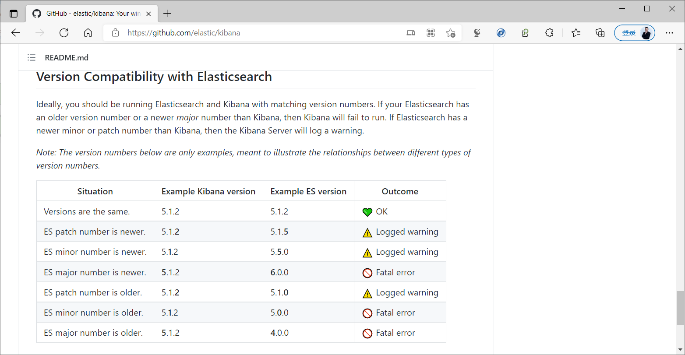
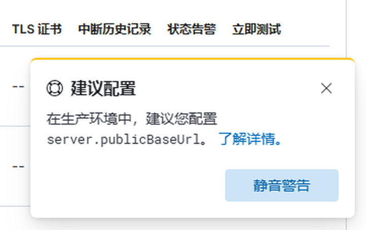

[← 返回ELK 日志分析目录]({{ '/subjects/ELK/' | relative_url }})



# 21 安装并配置 Kibana
### 5.2 安装并配置 Kibana

Kibana 可以安装在独立主机、与 Elasticsearch 同机，或运行在容器中。是否独立部署取决于查询负载、资源与运维边界；并不存在所有场景都必须独占一台主机的规则。首先核对 Kibana 与 Elasticsearch 的版本兼容关系，然后确认访问方式和安全配置。

参考：[Kibana 官方下载页](https://www.elastic.co/downloads/kibana)、[Docker 部署文档](https://www.elastic.co/guide/en/kibana/current/docker.html)。



### 5.2.1 软件包安装

从官方渠道下载与系统架构和集群版本对应的 DEB/RPM 包。以 Debian/Ubuntu 为例，在已下载的包所在目录执行：

```bash
sudo apt install ./kibana-8.17.0-amd64.deb
sudo systemctl enable --now kibana
sudo systemctl status kibana --no-pager
sudo journalctl -u kibana -n 50 --no-pager
```

文件名中的版本只是示例，不要把旧版 7.x 的安装包与 8.x/9.x 集群混用。若使用 RPM，应按发行版文档通过相应包管理器安装。服务启动后仍须完成与 Elasticsearch 的连接和认证，不能只凭进程存在判断 Kibana 已可用。

### 5.2.2 最小配置与连接

包安装的主要配置文件通常是 `/etc/kibana/kibana.yml`。以下只展示展示层参数：

```yaml
server.port: 5601
server.host: "127.0.0.1"
i18n.locale: "zh-CN"
```

默认仅本机访问时，可通过反向代理或安全隧道提供入口。若确需远程访问，修改监听地址的同时配置 TLS、认证与网络访问控制，不要只把 `server.host` 改为 `0.0.0.0` 后直接开放公网。

Kibana 连接 Elasticsearch 的方式随版本和安全设置变化。启用安全功能的新版集群可使用 enrollment 流程（下一篇介绍）；手动配置时需提供 HTTPS 地址、受限服务凭据与 CA 证书，不能把仅有 `elasticsearch.hosts: ["http://..."]` 的旧示例套用于已启用 TLS 的集群。`server.publicBaseUrl` 只有在反向代理等需要公开访问地址的场景中按实际 HTTPS URL 设置。



### 5.2.3 容器部署注意事项

容器镜像与 Elasticsearch 版本应匹配，并把配置、证书和需要持久化的 keystore 挂载到容器可读取的位置。下面的 Compose 片段仅说明结构；`es01` 必须是同一 Docker 网络中可解析的 Elasticsearch 服务名，而且示例 HTTP 连接只适用于隔离的无认证测试环境：

```yaml
services:
  kibana:
    image: docker.elastic.co/kibana/kibana:8.17.0
    environment:
      ELASTICSEARCH_HOSTS: '["http://es01:9200"]'
    ports:
      - "127.0.0.1:5601:5601"
```

实际 8.x/9.x 部署通常开启 Elasticsearch 安全功能，应使用对应的 TLS/认证或 enrollment 步骤，而不是关闭安全功能来套用片段。完成部署后先查看 Kibana 日志与状态，再按下一篇创建数据视图和验证查询。



<nav class="article-end" aria-label="章节导航">
  <a href="{{ '/subjects/ELK/20-introduction-to-kibana.html' | relative_url }}">← 上一篇：Kibana 介绍</a>
  <a href="{{ '/subjects/ELK/' | relative_url }}">返回 ELK 日志分析目录</a>
  <a href="{{ '/subjects/ELK/22-using-kibana.html' | relative_url }}">下一篇：使用 Kibana →</a>
</nav>
