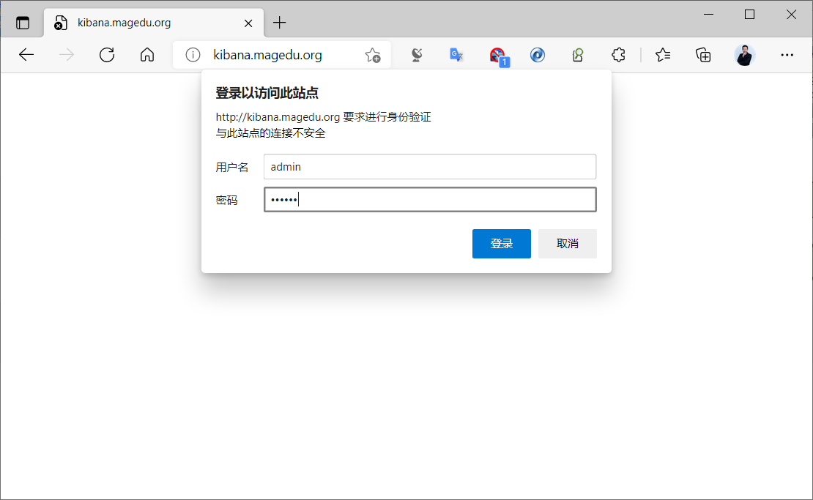
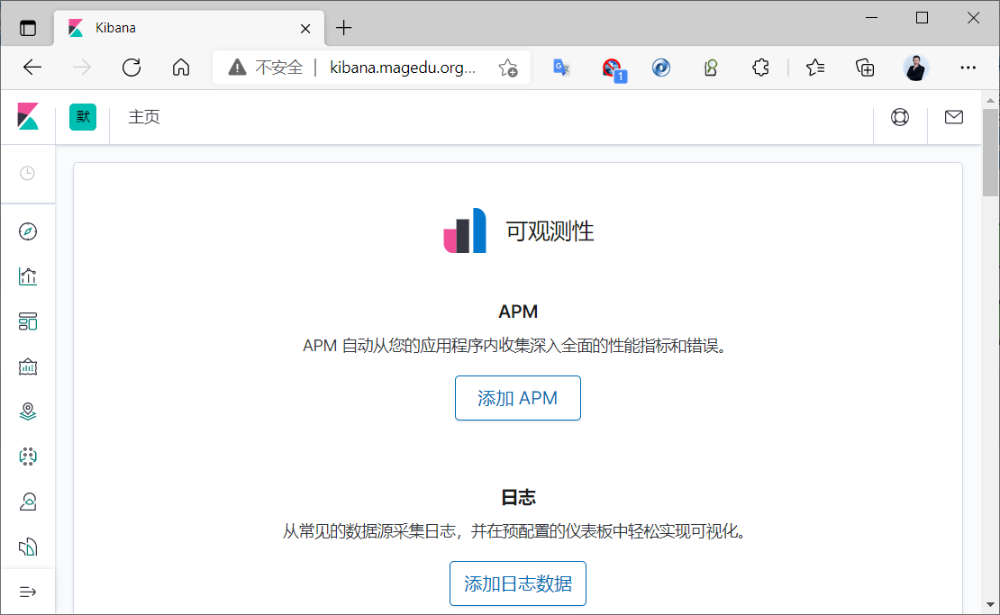

[← 返回ELK 日志分析目录]({{ '/subjects/ELK/' | relative_url }})



# 23 通过 Nginx 实现 Kibana 登录安全认证
### 5.4 通过 Nginx 实现 Kibana 登录安全认证

将 Nginx 作为反向代理服务器，并增加登录用户认证的目的，可以有效避免其他人员随意访问kibana页面。

```bash
[root@node1 ~]#vim /etc/kibana/kibana.yml
server.port: 5601
server.host: "127.0.0.1"   #修改此行为127.0.0.1
elasticsearch.hosts: ["http://10.0.0.101:9200"]
i18n.locale: "zh-CN"
[root@node1 ~]#systemctl restart kibana
[root@node1 ~]#ss -ntl |grep 5601
LISTEN  0        128                   127.0.0.1:5601            0.0.0.0:*
#生成用户和密码
[root@node1 ~]#apt -y install nginx apache2-utils
[root@node1 ~]#htpasswd -bc /etc/nginx/conf.d/kibana.users admin 123456
[root@node1 ~]#chown www-data: /etc/nginx/conf.d/kibana.users
[root@node1 ~]#chmod 600 /etc/nginx/conf.d/kibana.users
#配置反向代理和basic验证
[root@node1 ~]#cat /etc/nginx/conf.d/kibana.users
admin:$apr1$kbJ8qki4$aFObR3QixrOCSeYOSpQ0Z1
[root@node1 ~]#cat /etc/nginx/nginx.conf
http {
......
include /etc/nginx/conf.d/*.conf;
......
#方法1：无负载均衡功能
[root@ubuntu2204 ~]#cat /etc/nginx/conf.d/kibana.conf
server {
listen 80;
server_name kibana.bowen.org;
auth_basic  "kibana website";
auth_basic_user_file conf.d//kibana.users;
location / {
proxy_pass http://127.0.0.1:5601;
}
}
#方法2：负载均衡功能
[root@node1 ~]#vim  /etc/nginx/conf.d/kibana.conf
[root@node1 ~]#cat /etc/nginx/conf.d/kibana.conf
upstream kibana {
server 127.0.0.1:5601 max_fails=3 fail_timeout=60;
}
server {
listen 80;
server_name kibana.bowen.org;
auth_basic "Kibana Website";
auth_basic_user_file /etc/nginx/conf.d/kibana.users;
location / {
proxy_pass http://kibana;
proxy_http_version 1.1;
proxy_set_header Upgrade $http_upgrade;
proxy_set_header Connection 'upgrade';
proxy_set_header Host $host;
proxy_cache_bypass $http_upgrade;
}
}
[root@node1 ~]#nginx -t
[root@node1 ~]#systemctl reload nginx
#名称解析kibana.bowen.org后
#浏览器访问:http://kibana.bowen.org/
#使用前面创建的用户admin和密码123456登录
```







<nav class="article-end" aria-label="章节导航">
  <a href="{{ '/subjects/ELK/22-using-kibana.html' | relative_url }}">← Previous: Using Kibana</a>
  <a href="{{ '/subjects/ELK/' | relative_url }}">Back to ELK Log Analytics Index</a>
  <a href="{{ '/subjects/ELK/24-kibana-visualizations.html' | relative_url }}">Next: Kibana Visualizations →</a>
</nav>
