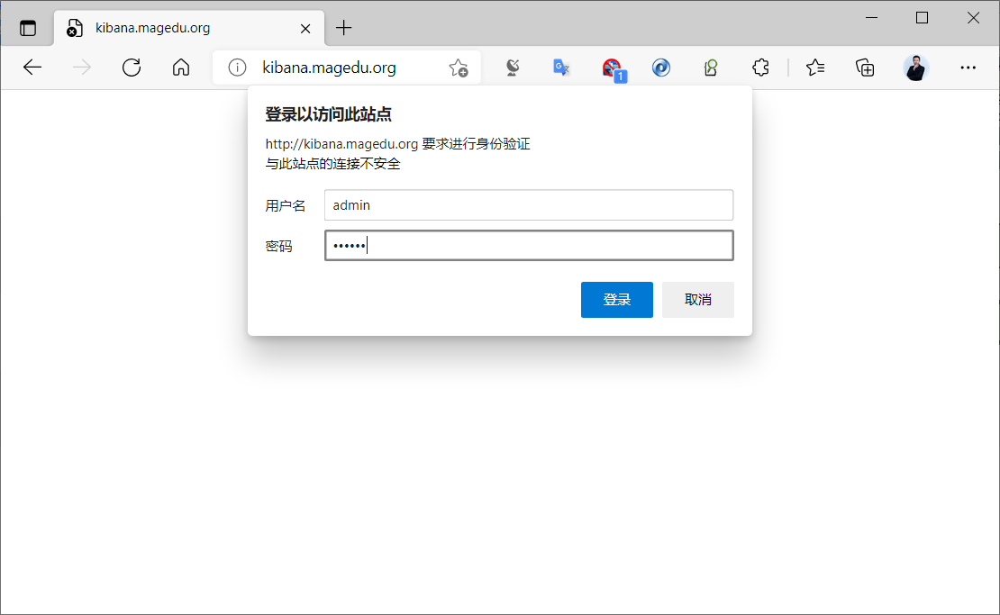
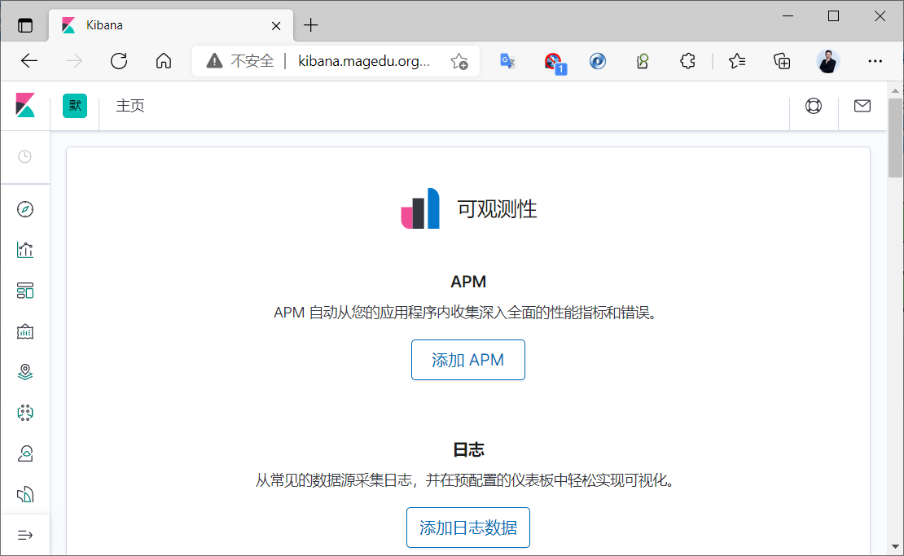

[← 返回ELK 日志分析目录]({{ '/subjects/ELK/' | relative_url }})



# 23 通过 Nginx 实现 Kibana 登录安全认证
### 5.4 通过 Nginx 实现 Kibana 登录安全认证

让 Kibana 只监听本机地址，再通过 Nginx 提供入口，可以在访问 Kibana 前增加一层 HTTP Basic 认证。**Basic 认证必须配合 HTTPS**，否则凭据会随请求传输而暴露。若已启用 Kibana 自身的用户认证与权限控制，代理认证是补充，不应取代原有权限设置。

### 1. 限制 Kibana 监听地址

在 `/etc/kibana/kibana.yml` 中确认：

```yaml
server.port: 5601
server.host: "127.0.0.1"
i18n.locale: "zh-CN"
```

保留现有 Elasticsearch 连接和认证配置，勿因复制示例覆盖它们。重启后用 `ss -lnt | grep 5601` 确认仅监听回环地址。

### 2. 创建代理认证文件

以下命令以 Debian/Ubuntu 为例。`htpasswd` 会交互式要求输入密码，避免把明文密码写进 shell 历史；`-c` 仅在首次创建文件时使用，新增用户时不要加 `-c`，否则会覆盖旧用户。

```bash
sudo apt install -y nginx apache2-utils
sudo htpasswd -c /etc/nginx/kibana.users admin
sudo chown root:www-data /etc/nginx/kibana.users
sudo chmod 640 /etc/nginx/kibana.users
```

### 3. 配置 HTTPS 反向代理

先为 `kibana.example.org` 准备有效证书与 DNS 解析，再保存以下站点配置。证书路径、域名和 Nginx 运行用户需按实际环境调整：

```nginx
server {
    listen 443 ssl;
    server_name kibana.example.org;

    ssl_certificate /etc/nginx/tls/kibana.crt;
    ssl_certificate_key /etc/nginx/tls/kibana.key;

    auth_basic "Kibana";
    auth_basic_user_file /etc/nginx/kibana.users;

    location / {
        proxy_pass http://127.0.0.1:5601;
        proxy_http_version 1.1;
        proxy_set_header Host $host;
        proxy_set_header X-Forwarded-Proto https;
        proxy_set_header X-Forwarded-For $proxy_add_x_forwarded_for;
        proxy_set_header Upgrade $http_upgrade;
        proxy_set_header Connection "upgrade";
    }
}
```

用 `sudo nginx -t` 检查语法后，执行 `sudo systemctl reload nginx`。在浏览器访问 `https://kibana.example.org/`，验证浏览器先提示代理认证，再进入 Kibana。若无法访问，分别检查 Kibana 本机端口、证书路径、Nginx 错误日志和 Kibana 原有的 Elasticsearch 连接配置。







<nav class="article-end" aria-label="章节导航">
  <a href="{{ '/subjects/ELK/22-using-kibana.html' | relative_url }}">← 上一篇：使用 Kibana</a>
  <a href="{{ '/subjects/ELK/' | relative_url }}">返回 ELK 日志分析目录</a>
  <a href="{{ '/subjects/ELK/24-kibana-visualizations.html' | relative_url }}">下一篇：Kibana 可视化画图功能 →</a>
</nav>
