[← 返回ELK 日志分析目录]({{ '/subjects/ELK/' | relative_url }})



# 25 Kibana 实现 Dashboard 仪表盘
### 5.6 Kibana 实现 Dashboard 仪表盘

仪表板把多个已保存的可视化放在同一个页面，适合同时观察日志量、错误类型、来源与时间趋势。开始前先确认已创建 Kibana 数据视图，并且字段类型和时间字段正确；否则图表可能显示为空。

### 1. 创建可视化

在 Kibana 的可视化工具中选择数据视图，分别创建符合分析目标的图表，例如按分钟统计日志数、按状态码统计错误、按来源 IP 展示排行。先检查每张图表的时间范围和过滤条件，再保存并命名，避免在仪表板中出现多张含义不明的“未命名图表”。具体菜单名称会随 Kibana 版本变化。

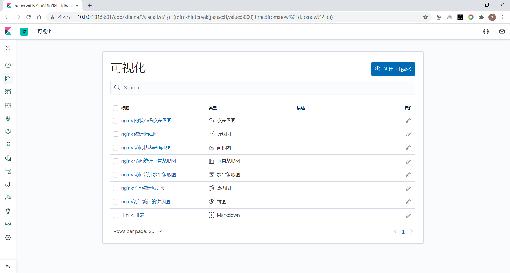

### 2. 组合仪表板

创建 Dashboard 后，从已保存的图表中添加面板。将概览指标放在上方、趋势图放在中间、明细表放在下方；通过拖动和缩放让标题、单位与图例可读。保存前再次确认全局时间范围及筛选器，必要时在仪表板说明中注明数据延迟和刷新频率。

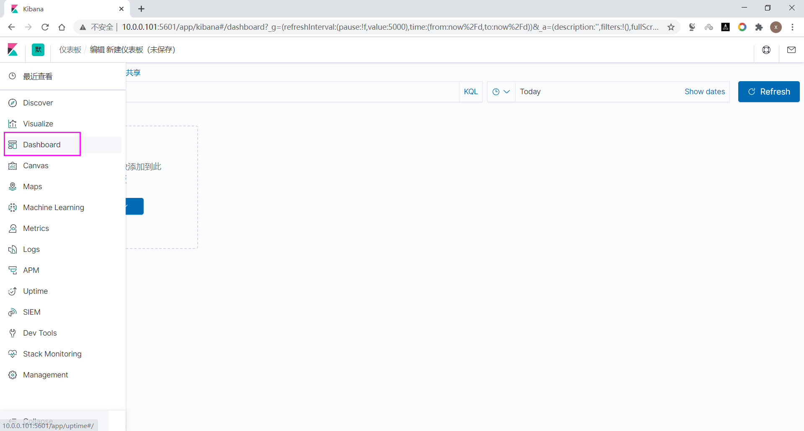

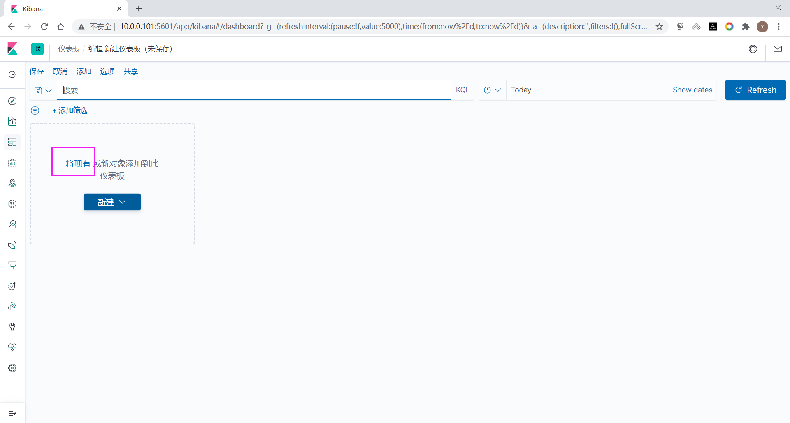

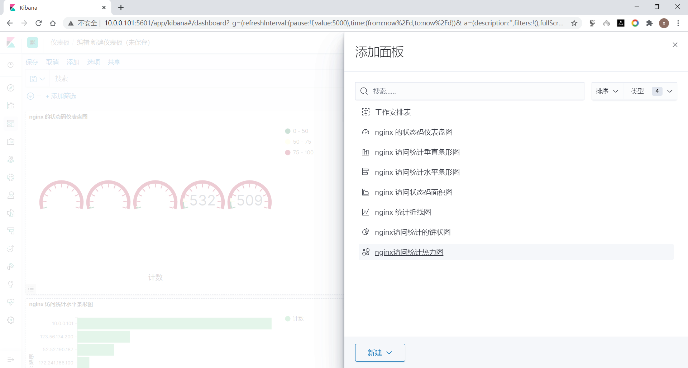

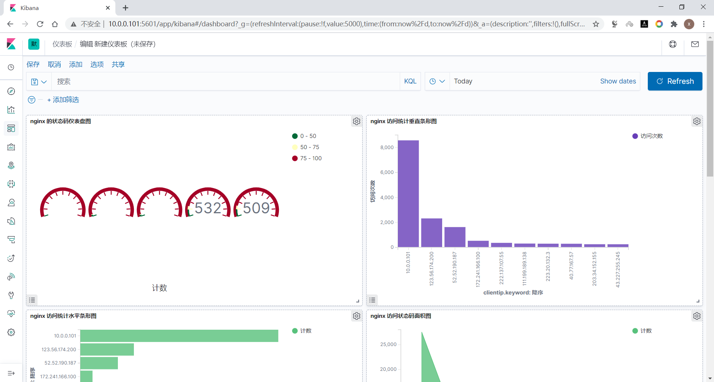

面板大小与位置都可以调整。优先让读者一眼看到异常，再进入明细追查；不要只为了填满画布而加入重复图表。

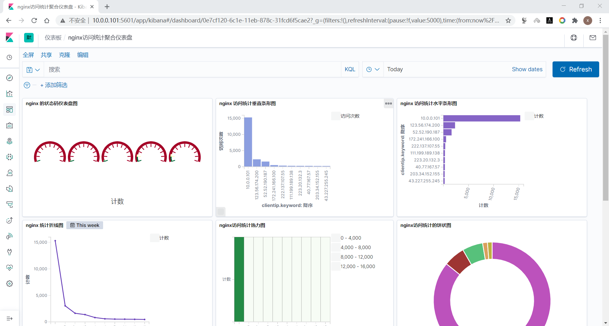

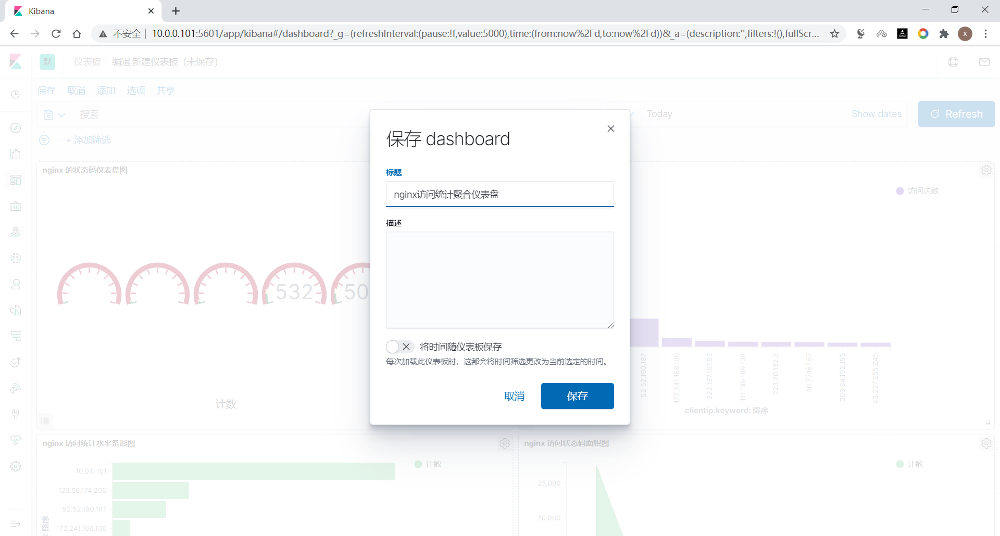

### 3. 分享与嵌入

**链接分享**：在 Dashboard 中使用“分享”功能复制链接，并区分当前状态链接与固定快照链接。接收者是否能打开，取决于 Kibana 地址可达性和其访问权限；复制链接不会自动授予权限。

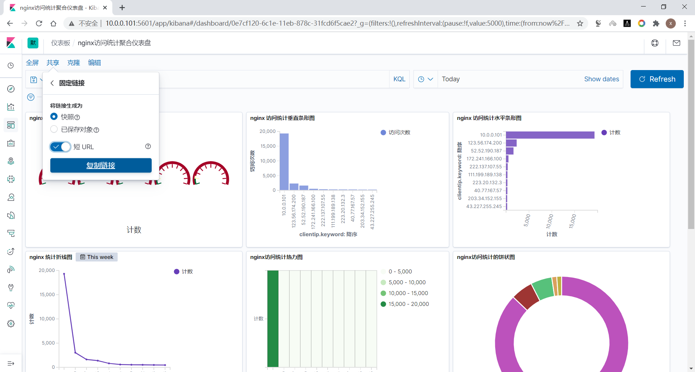

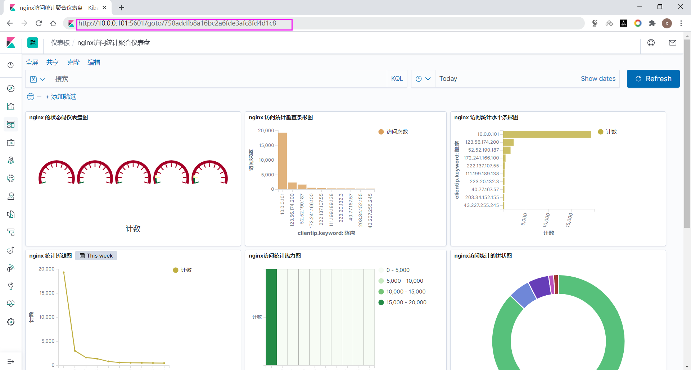

**网页嵌入**：从 Kibana 复制当前版本生成的嵌入 URL，再放入网页的 `iframe`。以下只展示结构，`src` 要替换为 Kibana 实际提供的地址，不能使用截图里的旧地址：

```html
<!doctype html>
<html lang="zh-CN">
<head>
  <meta charset="utf-8">
  <title>日志分析仪表板</title>
</head>
<body>
  <h1>日志分析仪表板</h1>
  <iframe
    title="Kibana 日志仪表板"
    src="https://kibana.example.org/app/dashboards#/view/DASHBOARD_ID?embed=true"
    width="100%" height="800" loading="lazy"></iframe>
</body>
</html>
```

嵌入可能受到身份认证、浏览器第三方 Cookie 和页面的内容安全策略限制。若页面空白，先直接打开嵌入 URL，再检查浏览器控制台与 Kibana 安全配置，而不是默认取消认证。

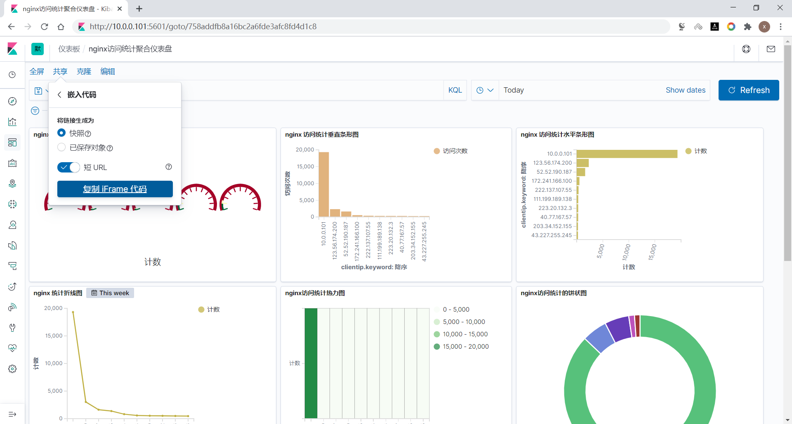

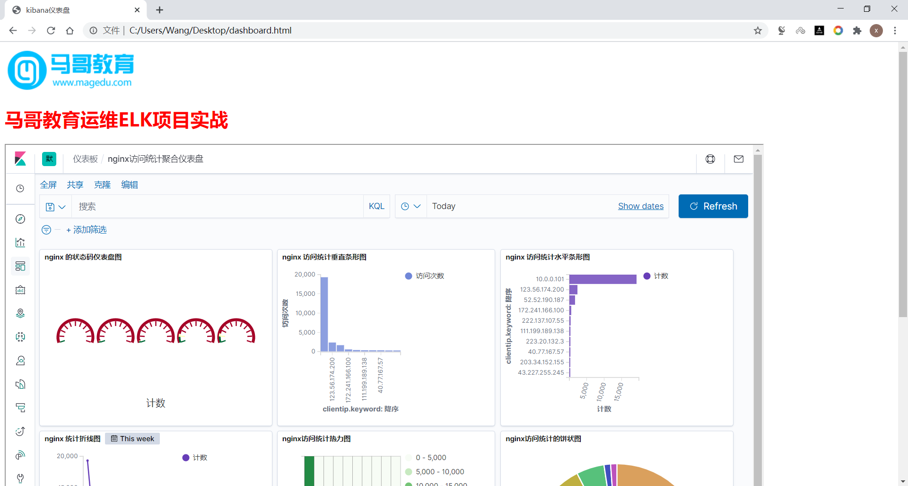



<nav class="article-end" aria-label="章节导航">
  <a href="{{ '/subjects/ELK/24-kibana-visualizations.html' | relative_url }}">← 上一篇：Kibana 可视化画图功能</a>
  <a href="{{ '/subjects/ELK/' | relative_url }}">返回 ELK 日志分析目录</a>
  <a href="{{ '/subjects/ELK/26-collecting-nginx-logs-with-filebeat-and-redis-buffering.html' | relative_url }}">下一篇：Filebeat 经 Redis 缓冲采集 Nginx 日志 →</a>
</nav>
