[← Back to ELK Log Analytics Index]({{ '/subjects/ELK/' | relative_url }})



# 25 Building Kibana Dashboards
### 5.6 Kibana 实现 Dashboard 仪表盘

### 先利用可视化功能实现多个图形

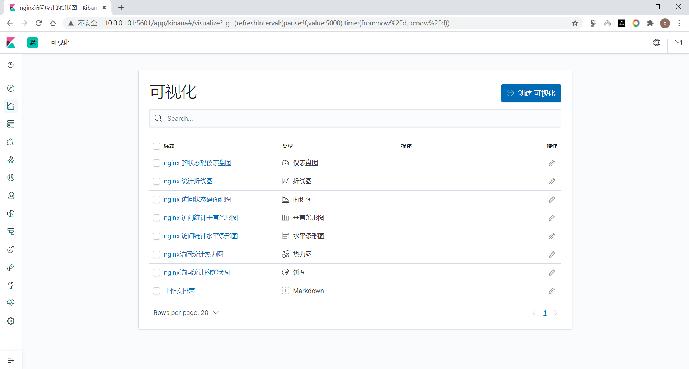

### 创建仪表盘

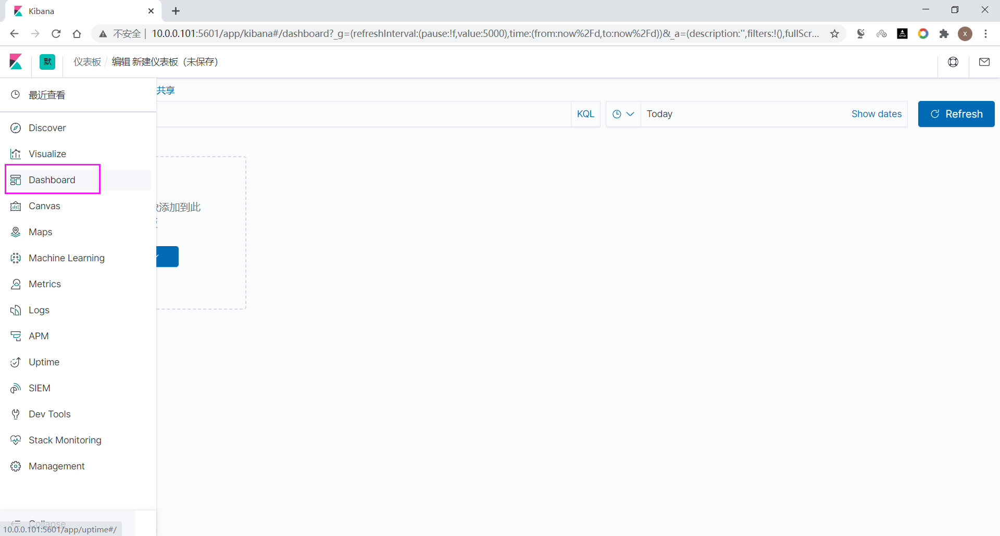

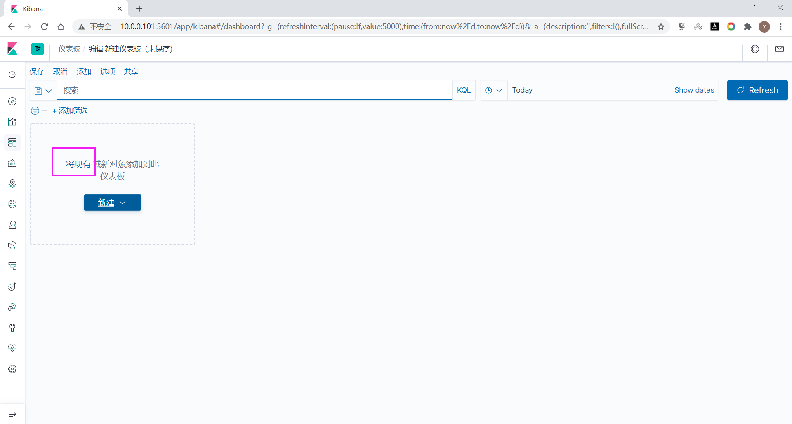

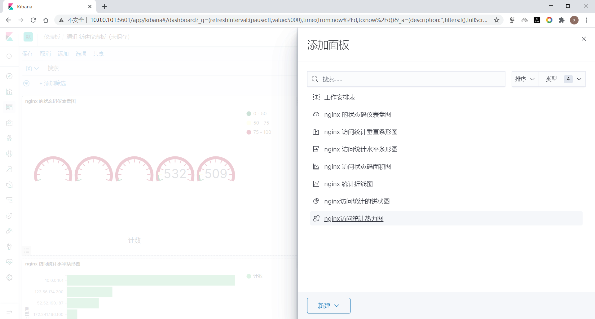

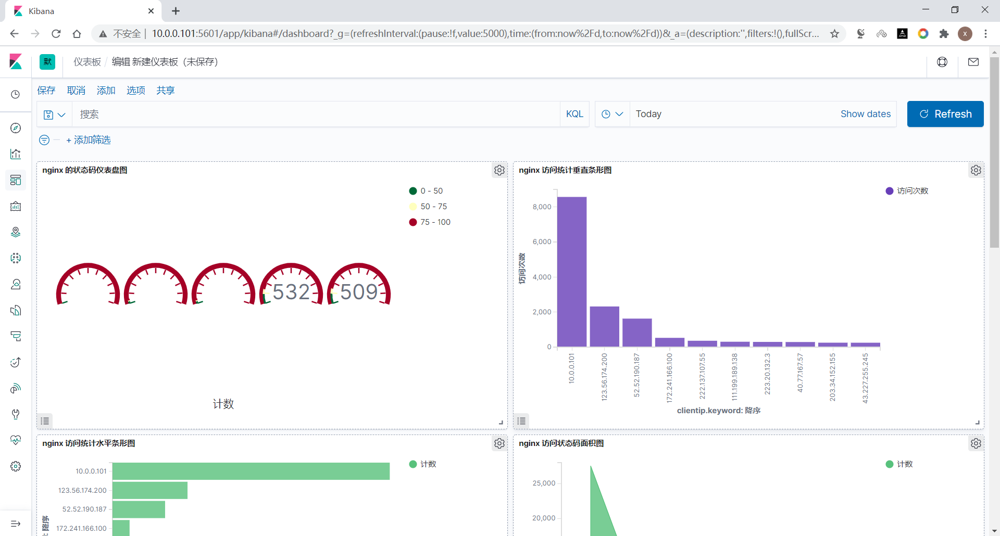

大小和位置都可以调整

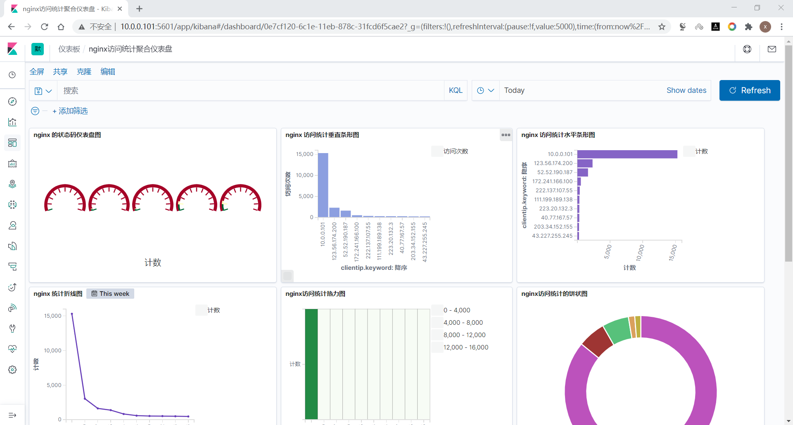

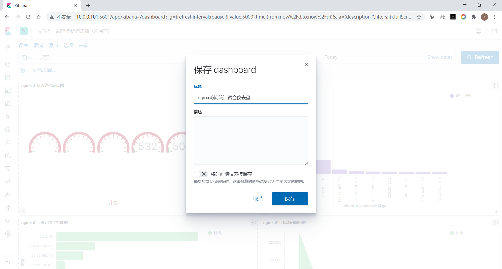

### 共享仪表盘图形

### 方式1: 固定链接

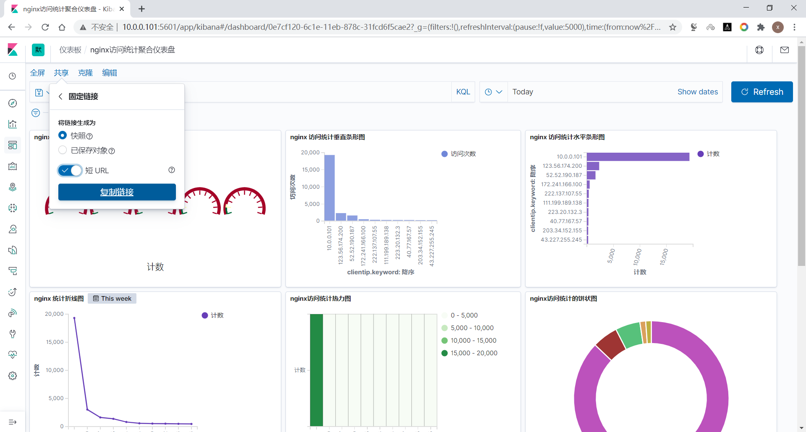

将复制下来的链接地址粘贴至浏览器地址栏,可以访问上面的图形

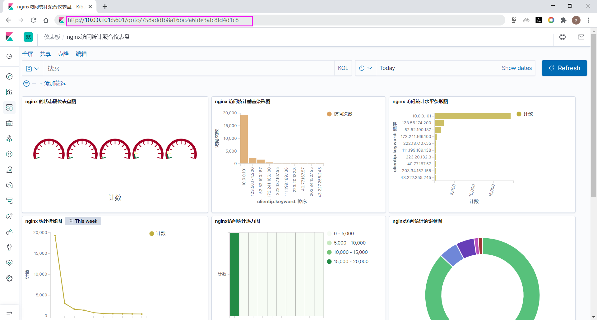

### 方式2: 嵌入代码

嵌入代码的共享

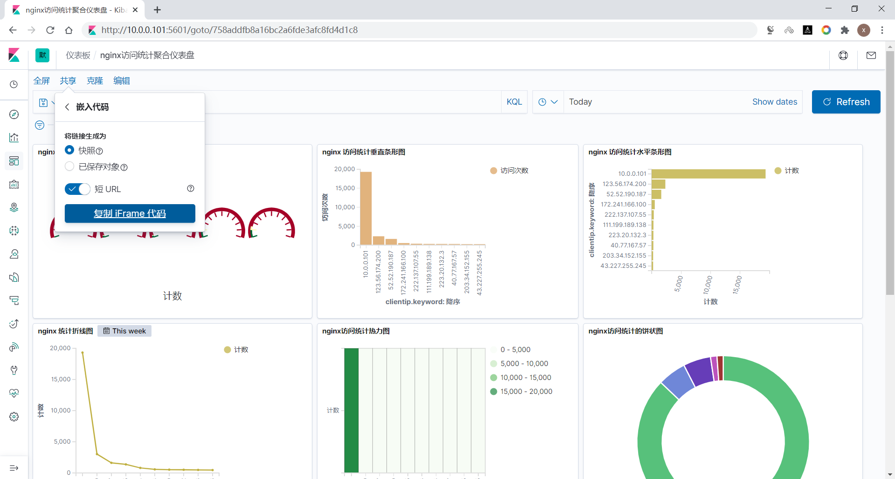

创建一个html文件,内容如下

```xml
[root@elk-web1 ~]#cat dashboard.html
<html>
<head>
<meta http-equiv=Content-Type content="text/html;charset=utf-8">
<title>kibana仪表盘</title>
</head>
<body>

<h1 style="color:red">马哥教育运维ELK项目实战</h1>
<iframe src="http://10.0.0.101:5601/goto/a61616c93be1f64df580ee3f16828173?
embed=true" height="1024" width="1280"></iframe>
</body>
</html>
```

用浏览器打开此文件,可以看到下面显示

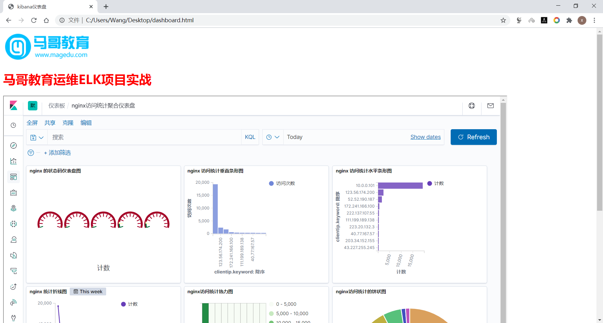



<nav class="article-end" aria-label="章节导航">
  <a href="{{ '/subjects/ELK/24-kibana-visualizations.html' | relative_url }}">← Previous: Kibana Visualizations</a>
  <a href="{{ '/subjects/ELK/' | relative_url }}">Back to ELK Log Analytics Index</a>
  <a href="{{ '/subjects/ELK/26-collecting-nginx-logs-with-filebeat-and-redis-buffering.html' | relative_url }}">Next: Collecting Nginx Logs with Filebeat and Redis Buffering →</a>
</nav>
