[← 返回 ELK 日志分析目录]({{ '/subjects/ELK/' | relative_url }})



# 26 Filebeat 经 Redis 缓冲采集 Nginx 日志

本例的数据流是 **Nginx → Filebeat → Redis List → Logstash → Elasticsearch → Kibana**。Filebeat 负责发送，Redis 缓冲突发写入，Logstash 消费并加工，Elasticsearch 存储供 Kibana 检索。Redis List 不是无限容量、具备完整确认机制的消息队列；理解这一局限后，从链路起点逐步验证。

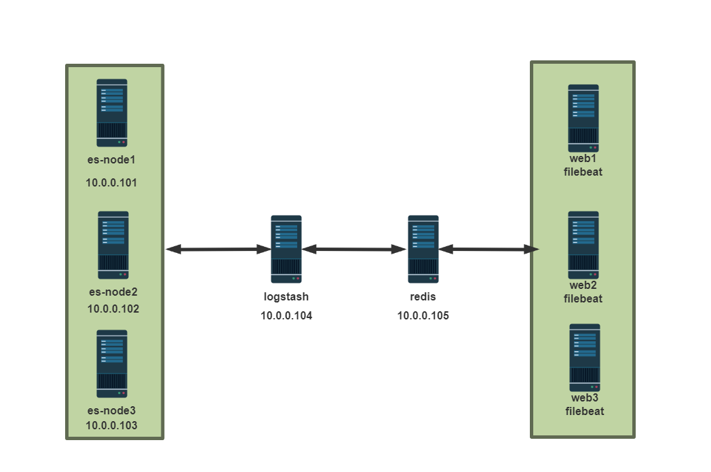

## 1. Nginx 生成 JSON 日志

`log_format` 放在 Nginx 的 `http` 块内，`access_log` 可以放在 `http` 或目标 `server` 块。数值字段不加引号，可能为 `-` 的上游字段保留字符串。`escape=json` 避免请求内容破坏 JSON 结构。

```nginx
http {
    log_format access_json escape=json
        '{"@timestamp":"$time_iso8601",'
        '"clientip":"$remote_addr",'
        '"host":"$host",'
        '"uri":"$request_uri",'
        '"status":$status,'
        '"size":$body_bytes_sent,'
        '"responsetime":$request_time,'
        '"upstreamtime":"$upstream_response_time",'
        '"http_user_agent":"$http_user_agent"}';
    access_log /var/log/nginx/access_json.log access_json;
    error_log /var/log/nginx/error.log;
}
```

```bash
sudo nginx -t && sudo systemctl reload nginx
curl -sS -o /dev/null http://127.0.0.1/
tail -n 1 /var/log/nginx/access_json.log | python3 -m json.tool
```

最后一条命令应能解析 JSON。源码安装时按实际目录调整路径。旧示例为生成错误日志而注释 `try_files`，会改变站点路由；错误日志应独立配置和排查。

## 2. Filebeat 写入 Redis

以下配置面向支持 `type: log` 的 Filebeat 7.x。8.x 新部署可使用 `filestream` 与 `ndjson` parser，不能直接混用两类输入参数。若系统没有 `/var/log/syslog`，删除对应输入或换为实际路径。

```yaml
filebeat.inputs:
  - type: log
    enabled: true
    paths: [/var/log/nginx/access_json.log]
    json.keys_under_root: true
    json.add_error_key: true
    tags: ["nginx-access"]
  - type: log
    enabled: true
    paths: [/var/log/nginx/error.log]
    tags: ["nginx-error"]
  - type: log
    enabled: true
    paths: [/var/log/syslog]
    tags: ["syslog"]

output.redis:
  hosts: ["REDIS_HOST:6379"]
  password: "${REDIS_PASSWORD}"
  db: 0
  key: "filebeat"
  datatype: list
```

`json.keys_under_root` 将访问日志字段提升到事件顶层；不要随意启用 `json.overwrite_keys` 覆盖 Filebeat 元数据。将配置保存到 `/etc/filebeat/filebeat.yml`，先验证再启动：

```bash
sudo filebeat test config -c /etc/filebeat/filebeat.yml
sudo filebeat test output -c /etc/filebeat/filebeat.yml
sudo systemctl enable --now filebeat
sudo journalctl -u filebeat -n 50 --no-pager
```

`test output` 仅检查连接与认证，不能代替真正的端到端验证。

## 3. Redis 的访问与容量

Redis 只需被 Filebeat 和 Logstash 访问。绑定内网地址、限制来源，并依据日志可容忍的丢失窗口配置持久化。不要照搬旧示例中 `bind 0.0.0.0`、弱密码与禁用持久化的组合。

```conf
bind 127.0.0.1 REDIS_PRIVATE_IP
protected-mode yes
appendonly yes
appendfsync everysec
maxmemory 4gb
maxmemory-policy noeviction
```

`noeviction` 避免旧日志被悄悄淘汰，但队列满时会出现写入错误，因此还要监控和扩容。需要更强的交付保证时，可比较下一篇的 Kafka 方案。

## 4. Logstash 消费并索引

Redis 的 `host`、`db`、`key` 必须与 Filebeat 对应。Filebeat 输出的事件已有 JSON 字段，不必再次解析整个消息。下例将三个标签分别写入不同索引；Elasticsearch 的认证和 TLS 设置按实际版本配置，不能混用旧版插件选项。

```ruby
input {
  redis {
    host => "REDIS_HOST"
    port => 6379
    password => "${REDIS_PASSWORD}"
    db => 0
    key => "filebeat"
    data_type => "list"
  }
}
filter {
  if "nginx-access" in [tags] {
    geoip { source => "clientip" target => "geoip" }
    if [upstreamtime] and [upstreamtime] != "-" {
      mutate { convert => { "upstreamtime" => "float" } }
    }
  }
}
output {
  if "nginx-access" in [tags] {
    elasticsearch { hosts => ["ES_HOST:9200"] index => "nginx-access-%{+YYYY.MM.dd}" }
  } else if "nginx-error" in [tags] {
    elasticsearch { hosts => ["ES_HOST:9200"] index => "nginx-error-%{+YYYY.MM.dd}" }
  } else if "syslog" in [tags] {
    elasticsearch { hosts => ["ES_HOST:9200"] index => "syslog-%{+YYYY.MM.dd}" }
  }
}
```

7.x、8.x、9.x 的 JDK、插件路径与 GeoIP 数据字段不能直接拼接成一份配置。`geoip.location` 通常已可用于地图，不必人工另拼经纬度数组；若位置为空，先确认 `clientip` 是公网 IP，再看 GeoIP 插件日志。

```bash
sudo /usr/share/logstash/bin/logstash --path.settings /etc/logstash -f /etc/logstash/conf.d/redis-to-es.conf --config.test_and_exit
sudo systemctl restart logstash
sudo journalctl -u logstash -n 80 --no-pager
```

## 5. 验证与 Kibana 阅读

访问 Nginx 产生一条新日志，再检查 Redis 的目标列表。使用 `REDISCLI_AUTH` 环境变量传密码，避免写进命令历史；不必用 `KEYS *` 全库扫描。

```bash
curl -sS -o /dev/null http://NGINX_HOST/
redis-cli -h REDIS_HOST -n 0 TYPE filebeat
redis-cli -h REDIS_HOST -n 0 LLEN filebeat
```

正常消费时 `LLEN` 可以立即回到 0；还须结合 Filebeat、Logstash 日志和 Elasticsearch 文档数判断。旧版 Head 插件截图用于定位索引；现在可优先使用 Elasticsearch API 或 Kibana 索引管理。

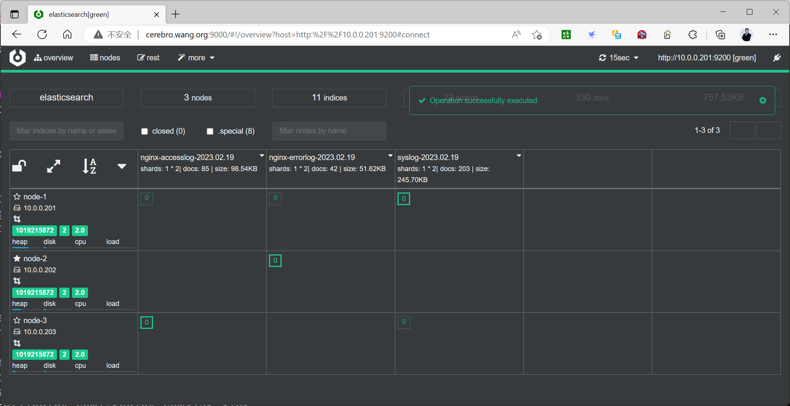

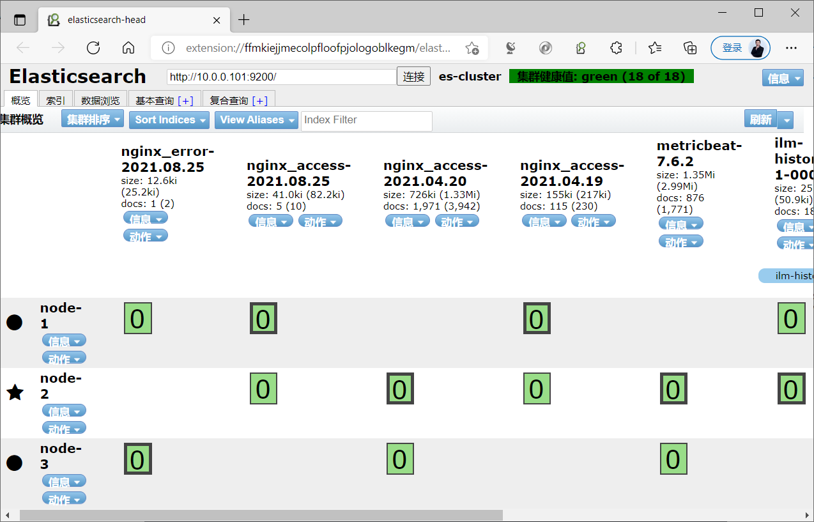

在 Kibana 创建匹配 `nginx-access-*` 的数据视图（旧版称索引模式），时间字段选 `@timestamp`。进入 Discover 检查 `status`、`uri`、`clientip` 与 `geoip.location`。下面是 7.x 和 8.x 的界面示例；排查顺序都是**索引存在 → 数据视图匹配 → 时间范围正确**。

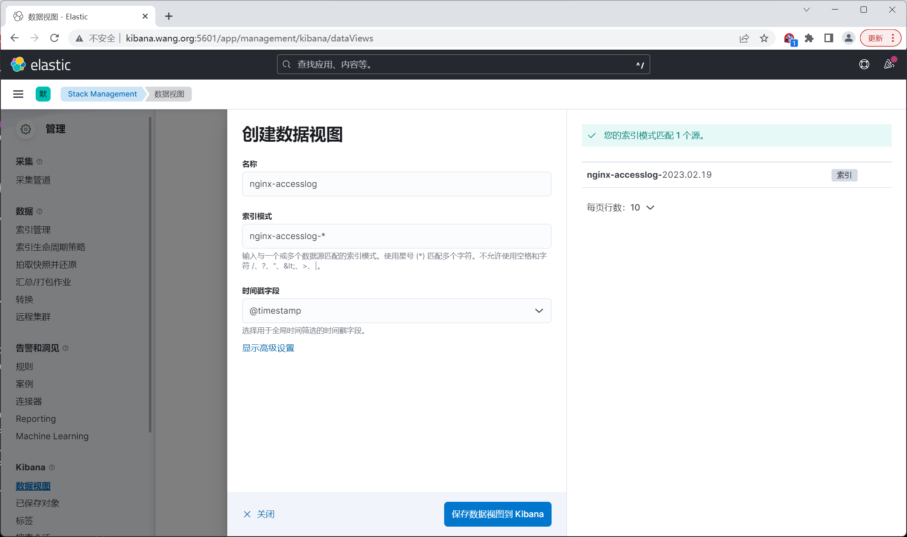

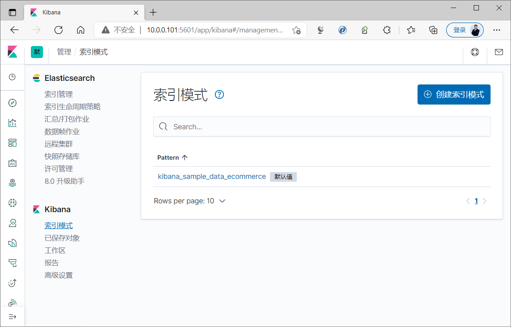

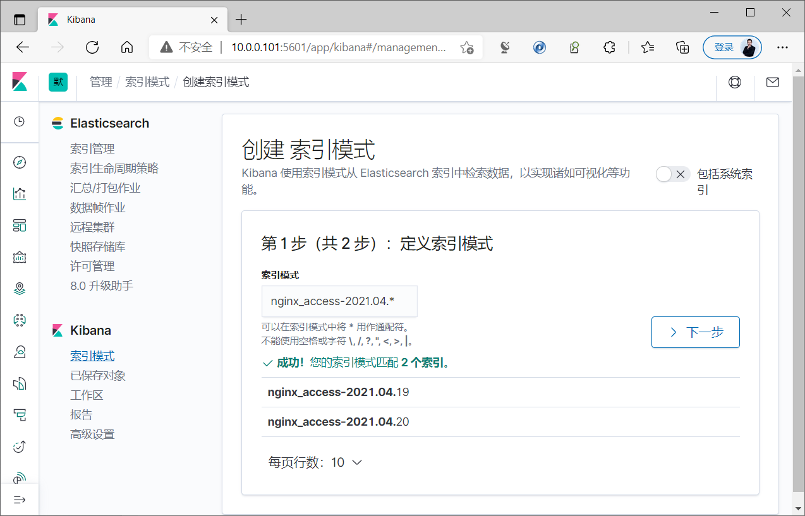

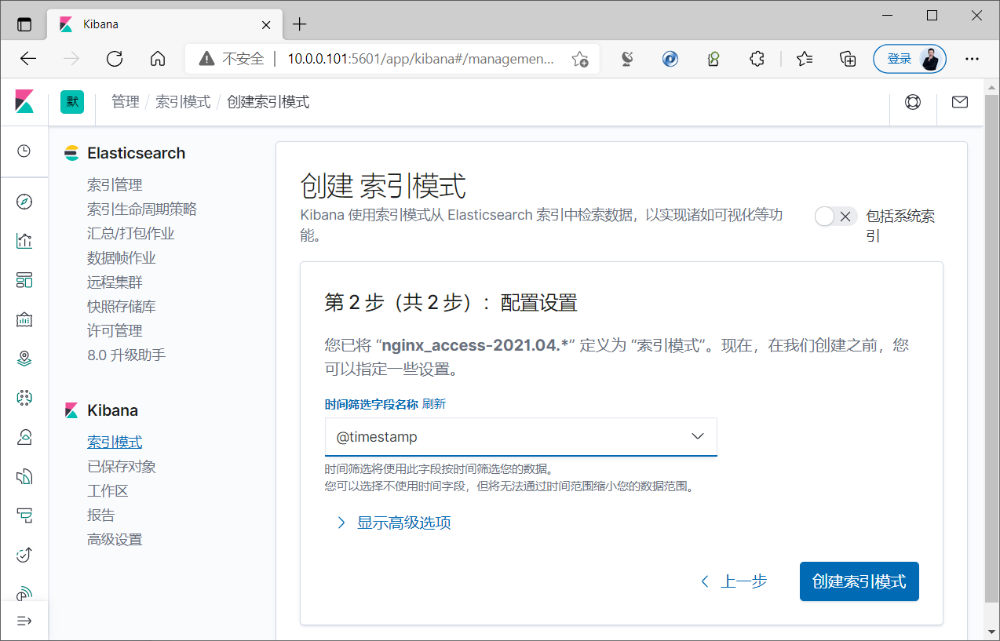

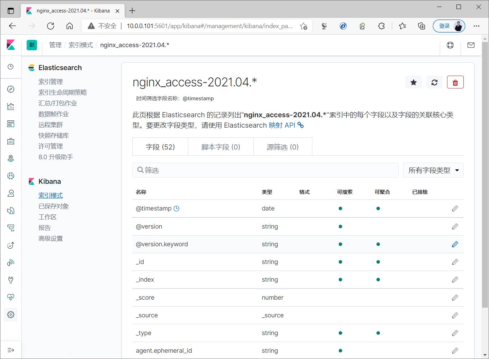

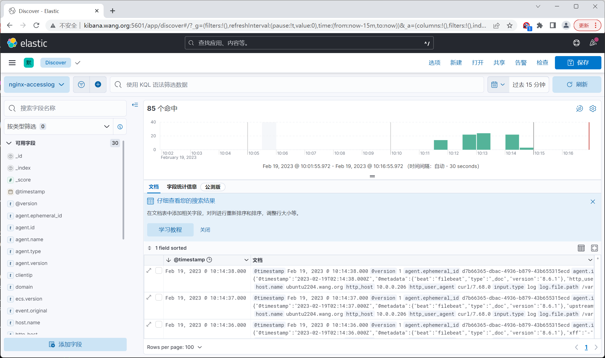

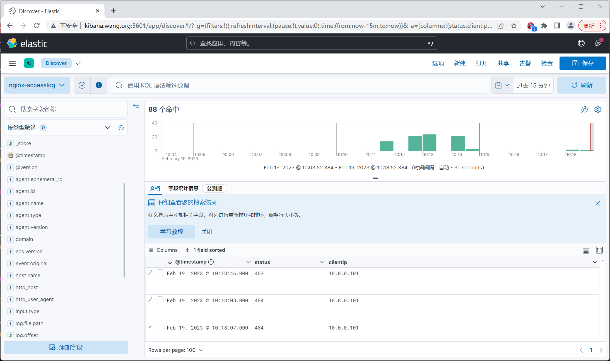

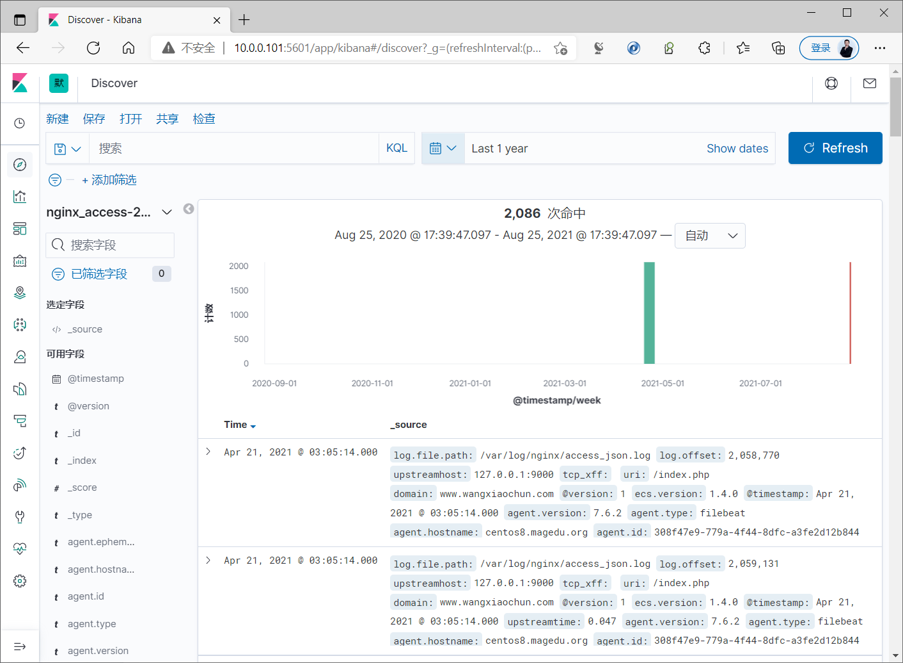

## 6. 监控队列积压

监控 `LLEN filebeat`、Redis 内存、Filebeat 发布失败数及 Logstash 消费速率。列表持续增长可能是 Elasticsearch 写入变慢，阈值应由平均事件大小、可用内存和恢复时间决定，不宜照搬旧脚本的“10 条”。

```bash
#!/usr/bin/env bash
set -euo pipefail
threshold="${QUEUE_WARNING_LENGTH:-100000}"
length="$(redis-cli -h "${REDIS_HOST:-127.0.0.1}" -n 0 --raw LLEN filebeat)"
if (( length > threshold )); then
  printf 'Redis 队列积压：filebeat=%s，阈值=%s\n' "$length" "$threshold" >&2
  exit 1
fi
printf 'Redis 队列正常：filebeat=%s\n' "$length"
```

旧脚本用 `KEYS *` 遍历全部键，又在同一命令中重复指定认证和两个数据库，可能检查错库。直接检查本管道列表，并确认 `TYPE filebeat` 是 `list` 即可。



<nav class="article-end" aria-label="章节导航">
  <a href="{{ '/subjects/ELK/25-building-kibana-dashboards.html' | relative_url }}">← 上一篇：构建 Kibana 仪表盘</a>
  <a href="{{ '/subjects/ELK/' | relative_url }}">返回 ELK 日志分析目录</a>
  <a href="{{ '/subjects/ELK/27-collecting-nginx-logs-with-filebeat-and-kafka-buffering.html' | relative_url }}">下一篇：Filebeat 经 Kafka 缓冲采集 Nginx 日志 →</a>
</nav>
