[← 返回ELK 日志分析目录]({{ '/subjects/ELK/' | relative_url }})



# 26 Filebeat 收集Nginx日志利用 Redis 缓存发送至 Elasticsearch
## 6 ELK 综合实战案例

### 6.1 Filebeat 收集Nginx日志利用 Redis 缓存发送至 Elasticsearch

利用 Redis 缓存日志数据,主要解决应用解耦，异步消息，流量削锋等问题

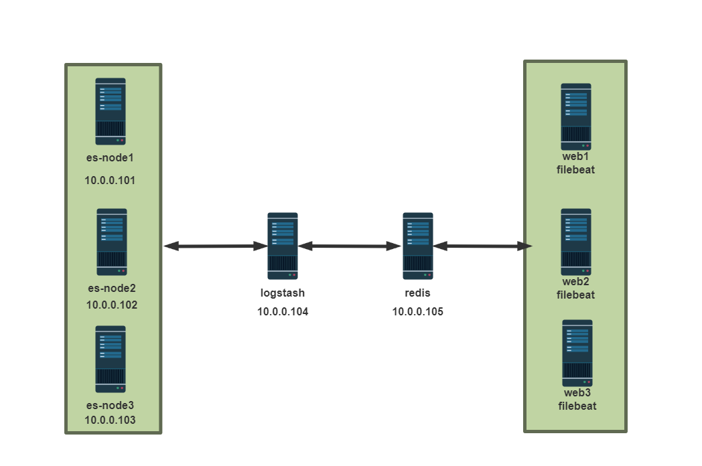

将nginx 服务器的logstash收集之后的访问日志写入到redis服务器，然后通过另外的logstash将redis服务器的数据取出在写入到elasticsearch服务器。

官方文档：

<https://www.elastic.co/guide/en/logstash/current/plugins-inputs-redis.html>

<https://www.elastic.co/guide/en/logstash/current/plugins-outputs-redis.html>

局限性

不支持Redis 集群，存在单点问题，但是可以多节点负载均衡 Redis 基于内存，因此存放数据量有限

### 部署 Nginx 服务配置 Json 格式的访问日志

范例：包安装 Nginx

```bash
#包安装
[root@elk-web1 ~]#apt update && apt -y install nginx
#修改nginx访问日志为Json格式
[root@elk-web1 ~]#vim /etc/nginx/nginx.conf
.....
log_format access_json '{"@timestamp":"$time_iso8601",'
'"host":"$server_addr",'
'"clientip":"$remote_addr",'
'"size":$body_bytes_sent,'
'"responsetime":$request_time,'
'"upstreamtime":"$upstream_response_time",'
'"upstreamhost":"$upstream_addr",'
'"http_host":"$host",'
'"uri":"$uri",'
'"domain":"$host",'
'"xff":"$http_x_forwarded_for",'
'"referer":"$http_referer",'
'"tcp_xff":"$proxy_protocol_addr",'
'"http_user_agent":"$http_user_agent",'
'"status":"$status"}';
access_log  /var/log/nginx/access_json.log access_json ;
#access_log /var/log/nginx/access.log;
error_log /var/log/nginx/error.log;
......
#默认开启nginx的错误日志,但如果是ubuntu,还需要修改下面行才能记录错误日志
[root@elk-web1 ~]#vim /etc/nginx/sites-available/default
location / {
# First attempt to serve request as file, then
# as directory, then fall back to displaying a 404.
#try_files $uri $uri/ =404; #将此行注释
[root@elk-web1 ~]#systemctl restart nginx
```

范例：编译安装 Nginx

```bash
#编译安装
[root@elk-web1 ~]#apt -y install gcc make
[root@elk-web1 ~]#wget http://nginx.org/download/nginx-1.18.0.tar.gz
[root@elk-web1 ~]#tar xvf nginx-1.18.0.tar.gz
[root@elk-web1 ~]#cd nginx-1.18.0/
[root@elk-web1 nginx-1.18.0]#./configure  --prefix=/apps/nginx
[root@elk-web1 nginx-1.18.0]#make && make install
#将nginx访问日志转换为json格式
[root@elk-web1 ~]#vim /apps/nginx/conf/nginx.conf
user nginx
http {
......
#log_format  main  '$remote_addr - $remote_user [$time_local] "$request" '
#                  '$status $body_bytes_sent "$http_referer" '
#                  '"$http_user_agent" "$http_x_forwarded_for"';
#access_log  logs/access.log  main;
log_format access_json '{"@timestamp":"$time_iso8601",'
'"host":"$server_addr",'
'"clientip":"$remote_addr",'
'"size":$body_bytes_sent,'
'"responsetime":$request_time,'
'"upstreamtime":"$upstream_response_time",'
'"upstreamhost":"$upstream_addr",'
'"http_host":"$host",'
'"uri":"$uri",'
'"domain":"$host",'
'"xff":"$http_x_forwarded_for",'
'"referer":"$http_referer",'
'"tcp_xff":"$proxy_protocol_addr",'
'"http_user_agent":"$http_user_agent",'
'"status":"$status"}';
......
server {
access_log   /data/nginx/logs/access_json.log access_json;
#access_log  logs/nginx.access.log  main;
.....
[root@elk-web1 ~]#useradd -r -s /sbin/nologin nginx
[root@elk-web1 ~]#mkdir /data/nginx/logs/ -pv
[root@elk-web1 ~]#chown -R nginx.nginx /data/nginx
[root@elk-web1 ~]#/apps/nginx/sbin/nginx  -t
[root@elk-web1 ~]#/apps/nginx/sbin/nginx
#验证访问日志的json格式
[root@elk-web1 ~]#tail -n  1 /data/nginx/logs/access_json.log
{"@timestamp":"2021-02-
04T12:18:12+08:00","host":"172.17.180.135","clientip":"61.148.74.134","size":676
46,"responsetime":0.000,"upstreamtime":"-","upstreamhost":"-
","http_host":"www.bowenxiaochun.com","uri":"/wp-content/uploads/2020/01/favicon-
1.ico","domain":"www.bowenxiaochun.com","xff":"-
","referer":"http://www.bowenxiaochun.com/","tcp_xff":"","http_user_agent":"Mozil
la/5.0 (Windows NT 10.0; Win64; x64; rv:85.0) Gecko/20100101
Firefox/85.0","status":"200"}
```

### 利用 Filebeat 收集日志到 Redis

### Filebeat 安装

```bash
[root@elk-web1 ~]#dpkg -i filebeat-7.6.2-amd64.deb
```

### 修改 Filebeat 配置

```bash
[root@elk-web1 ~]#cp /etcfilebeat/filebeat.yml{,.bak}
[root@elk-web1 ~]#vim /etc/filebeat/filebeat.yml
filebeat.inputs:
- type: log
enabled: true
paths:
- /var/log/nginx/access_json.log
json.keys_under_root: true #默认False会将json数据存储至message，改为true则会独立
message外存储
json.overwrite_keys: true  #设为true,覆盖默认的message字段，使用自定义json格式中的key
tags: ["nginx-access"]
- type: log
enabled: true
paths:
- /var/log/nginx/error.log
tags: ["nginx-error"]
- type: log
enabled: true
paths:
- /var/log/syslog
tags: ["syslog"]
```

```text
output.redis:
hosts: ["10.0.0.105:6379"]
password: "123456"
db: "0"
key: "filebeat" #所有日志都存放在key名称为filebeat的列表中，llen filebeat可查看长度，
即日志记录数
#也可以用下面的列表方式实现不同日志存放在不同的key
#keys:
#  - key: "nginx_access"
#    when.contains:
#    tags: "access"
#  - key: "nginx_error"
#    when.contains:
#    tags: "error"
```

### 启动 filebeat 服务

```bash
[root@elk-web1 ~]#systemctl status filebeat.service
○ filebeat.service - Filebeat sends log files to Logstash or directly to
Elasticsearch.
Loaded: loaded (/lib/systemd/system/filebeat.service; disabled; vendor
preset: enabled)
Active: inactive (dead)
Docs: https://www.elastic.co/beats/filebeat
[root@elk-web1 ~]#systemctl enable --now filebeat.service
```

### 安装配置 Redis

```bash
[root@redis ~]#apt update && apt -y install redis
[root@redis ~]#vim /etc/redis/redis.conf
bind 0.0.0.0
save ""           #禁用rdb持久保存
#save 900 1
#save 300 10
#save 60 10000
requirepass 123456
[root@redis ~]#systemctl restart redis
```

### 安装并配置logstash收集Redis数据发送至Elasticsearch

范例：将日志中的客户端IP添加地理位置信息

```bash
#8.X 要求JDK11或17
[root@logstash ~]#apt update && apt -y install openjdk-17-jdk
[root@logstash ~]#apt -y install openjdk-8-jdk
[root@logstash ~]#wget
https://mirrors.tuna.tsinghua.edu.cn/elasticstack/7.x/apt/pool/main/l/logstash/l
ogstash-7.6.2.deb
[root@logstash ~]#dpkg -i logstash-7.6.2.deb
#注意：必须删除下面的文件中注释
[root@logstash ~]#vim /etc/logstash/conf.d/redis-to-es.conf
input {
redis {
host => "10.0.0.208"
port => "6379"
password => "123456"
db => "0"
key => "filebeat"
data_type => "list"
}
}
filter {
if "nginx-access" in [tags] {
geoip {
source => "clientip"      #日志必须是json格式,且有一个clientip的key
target => "geoip"
database => "/usr/share/logstash/vendor/bundle/jruby/3.1.0/gems/logstash-
filter-geoip-7.3.0-java/vendor/GeoLite2-City.mmdb"      #8.15.X版本必须指定数据库文
件路径，7.X可以不指定
#database => "/etc/logstash/conf.d/GeoLite2-City.mmdb"    #指定数据库文件,可选
add_field => ["[geoip][coordinates]","%{[geoip][geo][location][lon]}"]
#8.X添加经纬度字段包括经度,使用时删除注释
add_field => ["[geoip][coordinates]","%{[geoip][geo][location][lat]}"]
#8.X添加经纬度字段包括纬度
#add_field => ["[geoip][coordinates]", "%{[geoip][longitude]}"]
#7,X添加经纬度字段包括经度
#add_field => ["[geoip][coordinates]", "%{[geoip][latitude]}"]
#7,X添加经纬度字段包括纬度
}
#转换经纬度为浮点数，注意：8X必须做，7.X 可不做此步
mutate {
convert => [ "[geoip][coordinates]", "float"]
}
}
mutate {
convert => ["upstreamtime","float"]
}
}
output {
if "syslog" in [tags] {
elasticsearch {
hosts => ["10.0.0.201:9200","10.0.0.202:9200","10.0.0.203:9200"]
index => "syslog-%{+YYYY.MM.dd}"
}
}
if "nginx-access" in [tags] {
elasticsearch {
hosts => ["10.0.0.201:9200","10.0.0.202:9200","10.0.0.203:9200"]
index => "nginxaccess-%{+YYYY.MM.dd}"
template_overwrite => true
}
stdout {
codec => "rubydebug"
}
}
if "nginx-error" in [tags] {
elasticsearch {
hosts => ["10.0.0.201:9200","10.0.0.202:9200","10.0.0.203:9200"]
index => "nginxerrorlog-%{+YYYY.MM.dd}"
template_overwrite => true
}
}
}
#删除注释才能成功
[root@logstash ~]#cat /etc/logstash/conf.d/redis-to-es.conf
input {
redis {
host => "10.0.0.210"
port => "6379"
password => "123456"
db => "0"
key => "filebeat"
data_type => "list"
}
}
filter {
if "nginx-access" in [tags] {
geoip {
source => "clientip"
target => "geoip"
database => "/usr/share/logstash/vendor/bundle/jruby/3.1.0/gems/logstash-
filter-geoip-7.3.1-java/vendor/GeoLite2-City.mmdb"
add_field => ["[geoip][coordinates]","%{[geoip][geo][location][lon]}"]
add_field => ["[geoip][coordinates]","%{[geoip][geo][location][lat]}"]
}
mutate {
convert => [ "[geoip][coordinates]", "float"]
}
}
mutate {
convert => ["upstreamtime","float"]
}
}
output {
if "syslog" in [tags] {
elasticsearch {
hosts => ["10.0.0.201:9200","10.0.0.202:9200","10.0.0.203:9200"]
index => "syslog-%{+YYYY.MM.dd}"
}
}
if "nginx-access" in [tags] {
elasticsearch {
hosts => ["10.0.0.201:9200","10.0.0.202:9200","10.0.0.203:9200"]
index => "nginxaccess-%{+YYYY.MM.dd}"
template_overwrite => true
}
stdout {
codec => "rubydebug"
}
}
if "nginx-error" in [tags] {
elasticsearch {
hosts => ["10.0.0.201:9200","10.0.0.202:9200","10.0.0.203:9200"]
index => "nginxerrorlog-%{+YYYY.MM.dd}"
template_overwrite => true
}
}
}
```

```bash
[root@logstash ~]#/usr/share/logstash/bin/logstash -f
/etc/logstash/conf.d/redis-to-es.conf -t
[root@logstash ~]#systemctl restart logstash
```

范例：logstash-9.0.1 示例

```bash
[root@logstash01 ~]#cat /etc/logstash/conf.d/redis-to-es.conf
input {
redis {
host => "10.0.0.200"
port => "6379"
password => "123456"
db => "0"
key => "nginx"
data_type => "list"
}
}
filter {
if "nginx-access" in [tags] {
geoip {
source => "clientip"
target => "geoip"
#database => "/usr/share/logstash/vendor/bundle/jruby/3.1.0/gems/logstash-
filter-geoip-7.3.1-java/vendor/GeoLite2-City.mmdb"
add_field => ["[geoip][coordinates]","%{[geoip][geo][location][lon]}"]
add_field => ["[geoip][coordinates]","%{[geoip][geo][location][lat]}"]
}
mutate {
convert => [ "[geoip][coordinates]", "float"]
}
}
mutate {
convert => ["upstreamtime","float"]
}
}
output {
if "nginx-access" in [tags] {
elasticsearch {
hosts => ["10.0.0.201:9200","10.0.0.202:9200","10.0.0.203:9200"]
index => "nginxaccess-%{+YYYY.MM.dd}"
template_overwrite => true
}
stdout {
codec => "rubydebug"
}
}
if "nginx-error" in [tags] {
elasticsearch {
hosts => ["10.0.0.201:9200","10.0.0.202:9200","10.0.0.203:9200"]
index => "nginxerrorlog-%{+YYYY.MM.dd}"
template_overwrite => true
}
}
}
#9.0.0需要用普通用户执行
[root@logstash01 conf.d]#su - bowen
bowen@logstash01:~$ logstash -f /etc/logstash/conf.d/redis-to-es.conf
```

范例：

```bash
#示例2
[root@logstash ~]#vim /etc/logstash/conf.d/redis-to-es.conf
input {
redis {
host => "10.0.0.105"
port => "6379"
password => "123456"
db => "0"
key => "filebeat"
data_type => "list"
}
#如果有多个key，用下面形式,从而实现将每个不同的key由不同的logstash消费，实现负载均衡
#redis {
#  host => ["10.0.0.105"]
#  port => "6379"
#  password => "123456"
#  data_type => "list"
#  key => "nginx_access"
#  db => "0"
#}
#redis {
#  host => ["10.0.0.105"]
#  port => "6379"
#  password => "123456"
#  data_type => "list"
#  key => "nginx_error"
#  db => "0"
#}
}
#filter {
#  mutate {
#    convert => ["upstreamtime","float"]
#  }
#}
output {
if "syslog" in [tags] {
elasticsearch {
hosts => ["10.0.0.101:9200","10.0.0.102:9200","10.0.0.103:9200"]
index => "syslog-%{+YYYY.MM.dd}"
}
}
if "nginx-access" in [tags] {
elasticsearch {
hosts => ["10.0.0.101:9200","10.0.0.102:9200","10.0.0.103:9200"]
index => "nginx-accesslog-%{+YYYY.MM.dd}"
template_overwrite => true
}
}
if "nginx-error" in [tags] {
elasticsearch {
hosts => ["10.0.0.101:9200","10.0.0.102:9200","10.0.0.103:9200"]
index => "nginx-errorlog-%{+YYYY.MM.dd}"
template_overwrite => true
}
}
}
```

### 通过 Head 插件查看索引

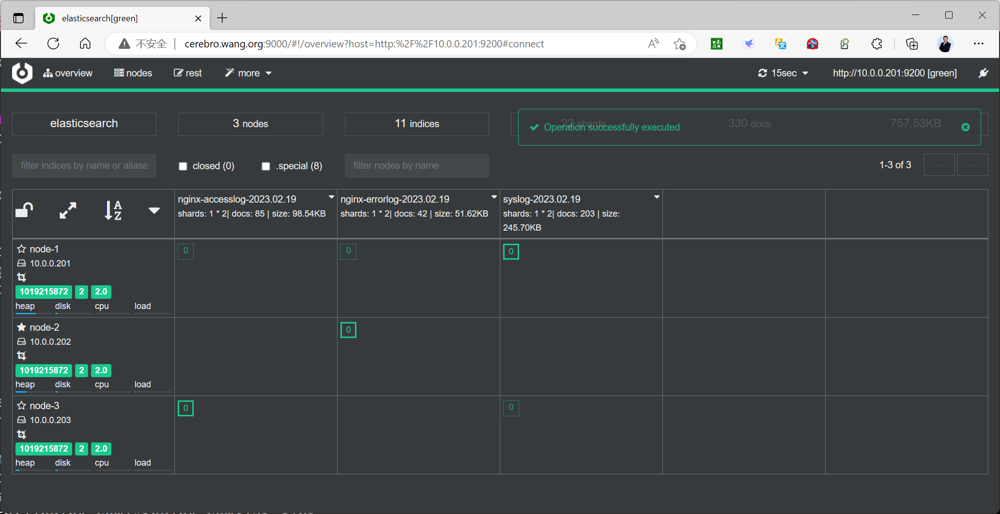

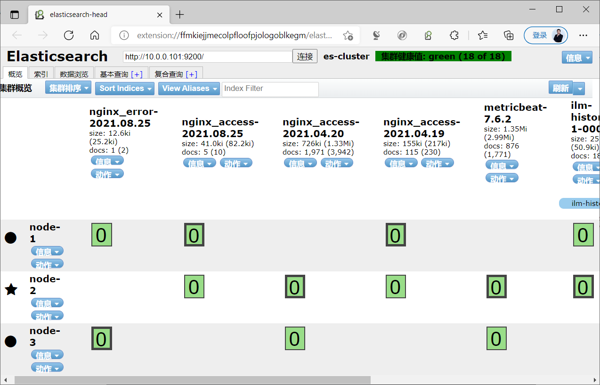

### 通过 Kibana 创建索引模式查看

### 创建索引模式

8.X

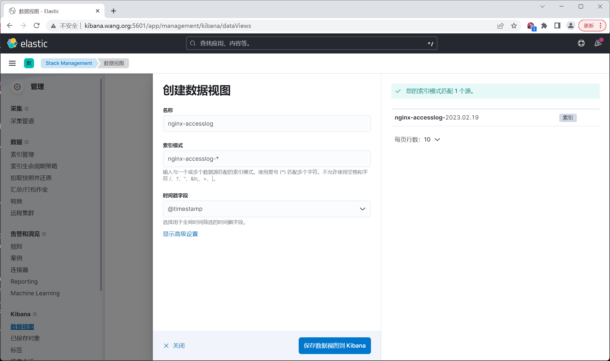

7.X

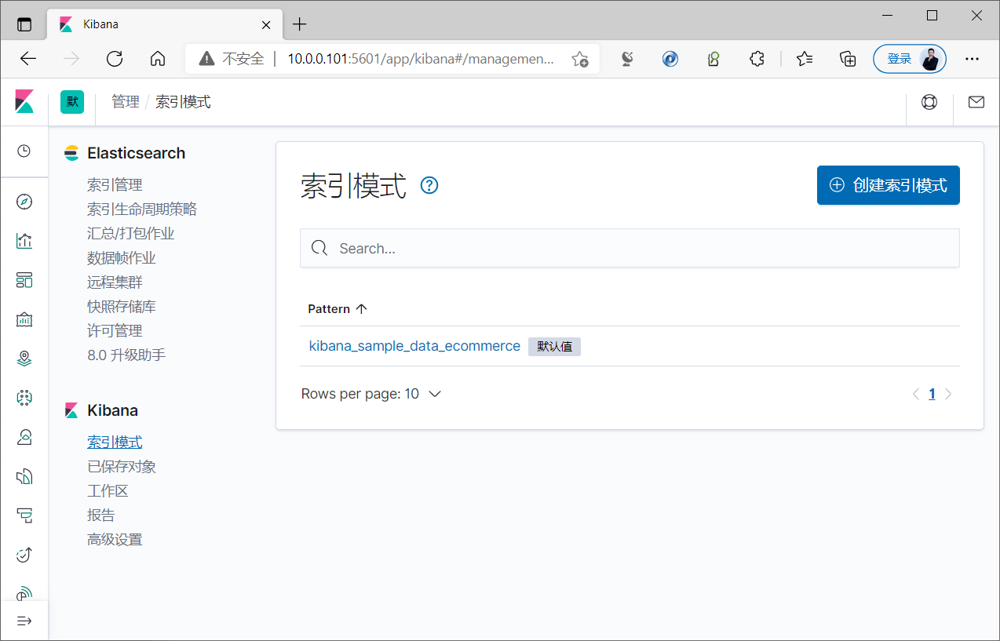

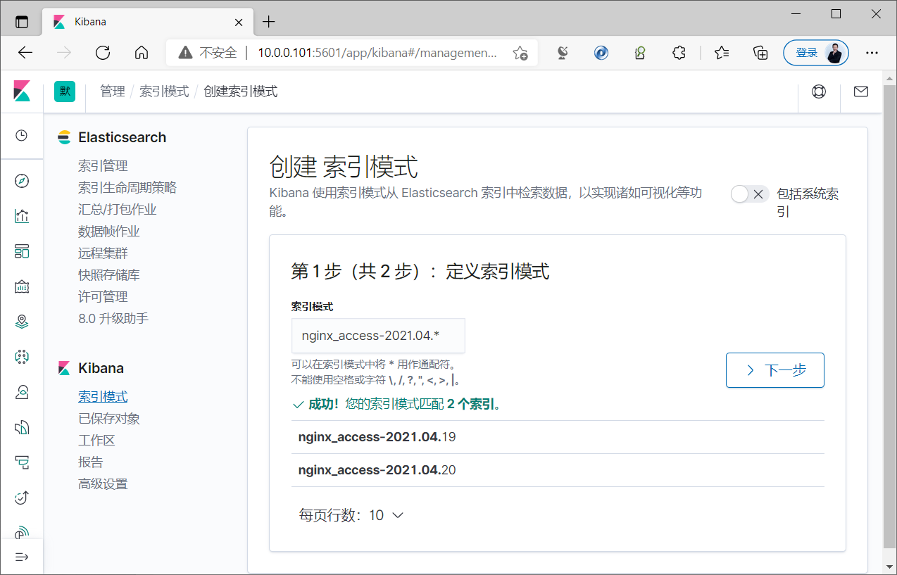

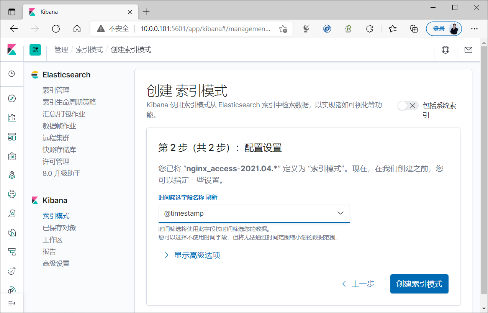

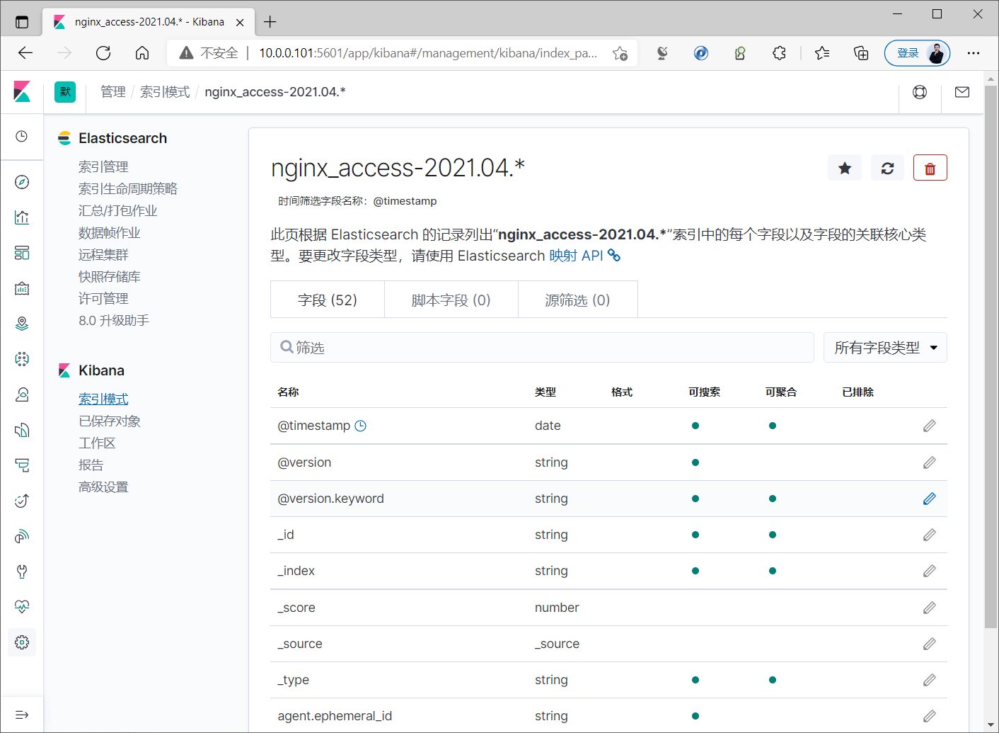

### 查看索引

8,X

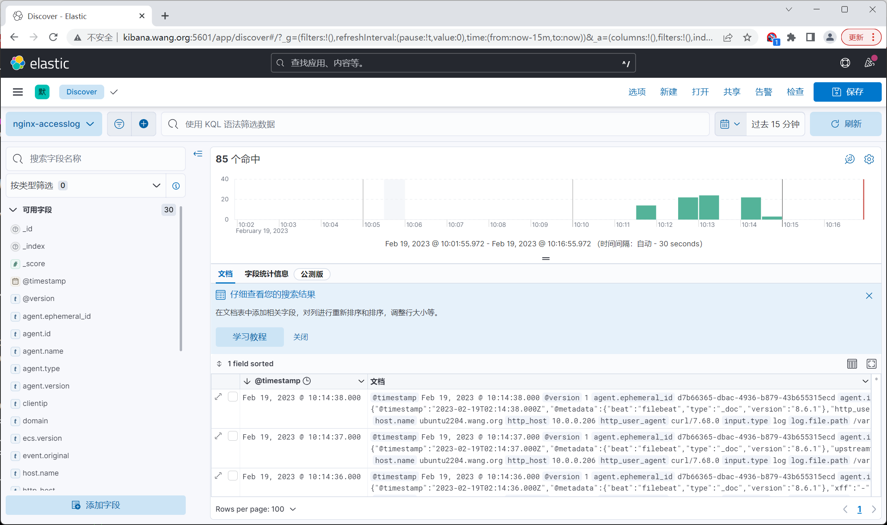

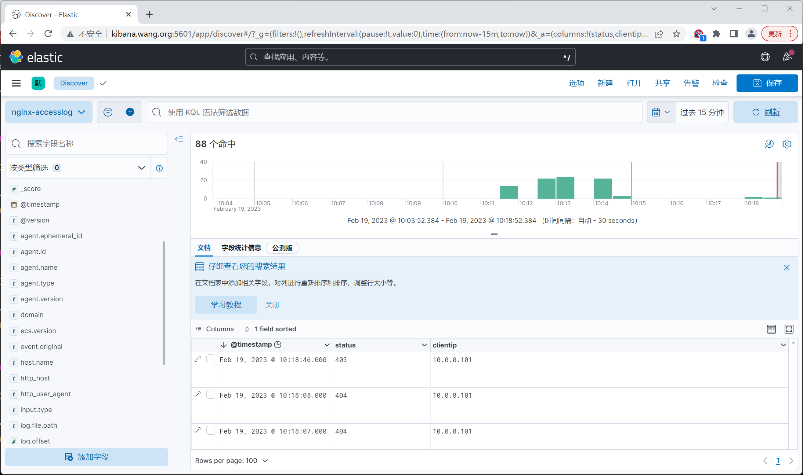

7.X

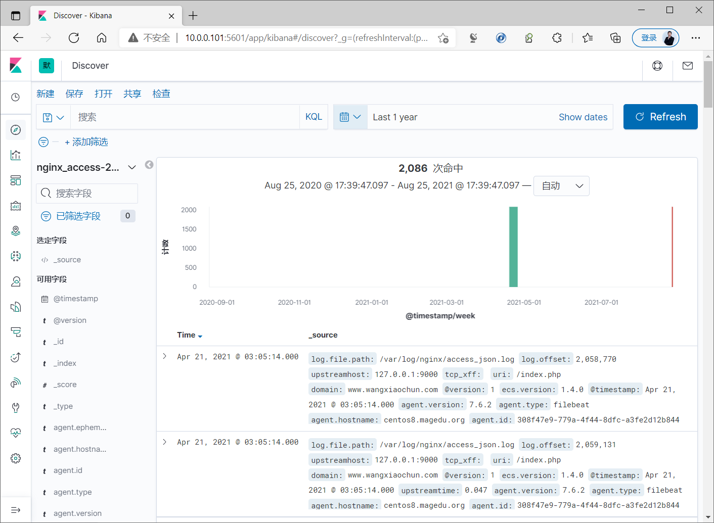

### 监控 Redis 数据长度

实际生产环境当中，利用Redis 缓存日志,logstash由于性能等原因未能及时提取日志，可能会出现 Redis 当中堆积了大量的数据, 导致redis服务器的内存被大量使用，甚至出现内存即将被使用完毕的情景, 可以通过脚本程序监控redis 中key的长度,达到阈值进行及时报警

范例：生成日志立即查看Redis

```bash
[root@elk-web1 ~]#cat access_json.log-20220304 >> /var/log/nginx/access_json.log
[root@redis ~]#redis-cli -a 123456 --no-auth-warning  keys '*'
1) "filebeat"
[root@redis ~]#redis-cli -a 123456 --no-auth-warning  type filebeat
list
[root@redis ~]#redis-cli -a 123456 --no-auth-warning  lrange  filebeat 0 1
1) "{\"@timestamp\":\"2022-03-03T12:24:37.000Z\",\"@metadata\":
{\"beat\":\"filebeat\",\"type\":\"_doc\",\"version\":\"8.6.1\"},\"input\":
{\"type\":\"log\"},\"host\":
{\"name\":\"ubuntu2204.bowen.org\"},\"upstreamhost\":\"127.0.0.1:9000\",\"http_us
er_agent\":\"python-requests/2.25.1\",\"xff\":\"-
\",\"clientip\":\"106.53.97.63\",\"referer\":\"http://www.bowenxiaochun.com/xmlrp
c.php\",\"domain\":\"www.bowenxiaochun.com\",\"status\":\"200\",\"size\":235,\"ta
gs\":[\"nginx-access\"],\"agent\":
{\"name\":\"ubuntu2204.bowen.org\",\"type\":\"filebeat\",\"version\":\"8.6.1\",\"
ephemeral_id\":\"d7b66365-dbac-4936-b879-43b655315ecd\",\"id\":\"97fad422-0bd1-
4091-8318-b8c612741625\"},\"ecs\":
{\"version\":\"8.0.0\"},\"upstreamtime\":\"0.035\",\"log\":
{\"offset\":128034807,\"file\":
{\"path\":\"/var/log/nginx/access_json.log\"}},\"uri\":\"/xmlrpc.php\",\"respons
etime\":0.035,\"tcp_xff\":\"\",\"http_host\":\"www.bowenxiaochun.com\"}"
2) "{\"@timestamp\":\"2022-03-03T12:24:38.000Z\",\"@metadata\":
{\"beat\":\"filebeat\",\"type\":\"_doc\",\"version\":\"8.6.1\"},\"log\":
{\"file\":
{\"path\":\"/var/log/nginx/access_json.log\"},\"offset\":128035206},\"http_host\
":\"www.bowenxiaochun.com\",\"status\":\"200\",\"upstreamtime\":\"0.037\",\"agent
\":{\"type\":\"filebeat\",\"version\":\"8.6.1\",\"ephemeral_id\":\"d7b66365-dbac-
4936-b879-43b655315ecd\",\"id\":\"97fad422-0bd1-4091-8318-
b8c612741625\",\"name\":\"ubuntu2204.bowen.org\"},\"ecs\":
{\"version\":\"8.0.0\"},\"xff\":\"-\",\"host\":
{\"name\":\"ubuntu2204.bowen.org\"},\"uri\":\"/xmlrpc.php\",\"size\":235,\"http_u
ser_agent\":\"python-
requests/2.25.1\",\"referer\":\"http://www.bowenxiaochun.com/xmlrpc.php\",\"tcp_x
ff\":\"\",\"upstreamhost\":\"127.0.0.1:9000\",\"input\":
{\"type\":\"log\"},\"responsetime\":0.038,\"clientip\":\"106.53.97.63\",\"domain
\":\"www.bowenxiaochun.com\",\"tags\":[\"nginx-access\"]}"
```

### Python 脚本内容

```bash
[root@redis ~]#apt -y install python3-pip
[root@redis ~]#pip3 install -i https://pypi.tuna.tsinghua.edu.cn/simple redis
[root@redis ~]#cat check_key_length.py
#!/usr/bin/python3
#coding:utf-8
import redis
def redis_key_len():
pool=redis.ConnectionPool(host="127.0.0.1",port=6379,db=0,password="123456")
conn = redis.Redis(connection_pool=pool)
data = conn.llen('filebeat')
print(data)
redis_key_len()
[root@redis ~]#python3 check_key_length.py
```

### Shell 脚本内容

```bash
[root@redis ~]#cat check_key_length.sh
#!/bin/bash
#
#FileName：          check_key_length.sh
#Description：       The test script
WARNING=10
REDIS=127.0.0.1
PASSWORD=123456
DB=0
for key in `redis-cli -h $REDIS -a $PASSWORD -n $DB keys '*' `;do
length=`redis-cli -h $REDIS -a $PASSWORD -n $DB -a 123456 -n 1 llen $key`
#echo $length
if [ $length -gt $WARNING ];then
echo "$key is too big,length:$length"
fi
done
```



<nav class="article-end" aria-label="章节导航">
  <a href="{{ '/subjects/ELK/25-building-kibana-dashboards.html' | relative_url }}">← Previous: Building Kibana Dashboards</a>
  <a href="{{ '/subjects/ELK/' | relative_url }}">Back to ELK Log Analytics Index</a>
  <a href="{{ '/subjects/ELK/27-collecting-nginx-logs-with-filebeat-and-kafka-buffering.html' | relative_url }}">Next: Collecting Nginx Logs with Filebeat and Kafka Buffering →</a>
</nav>
