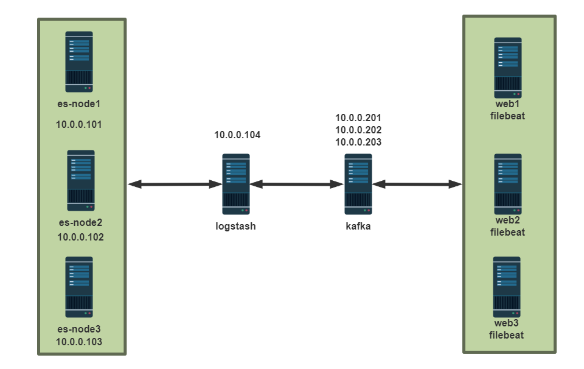
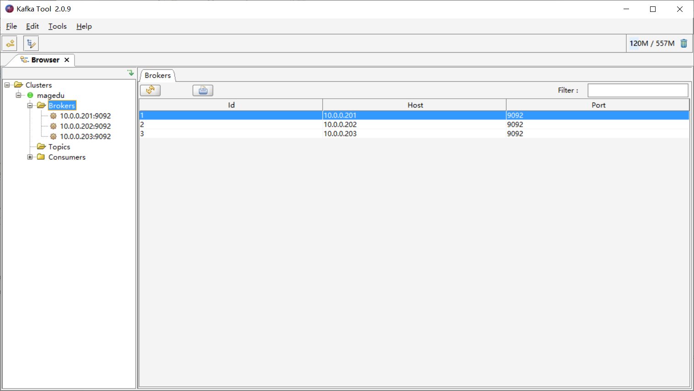
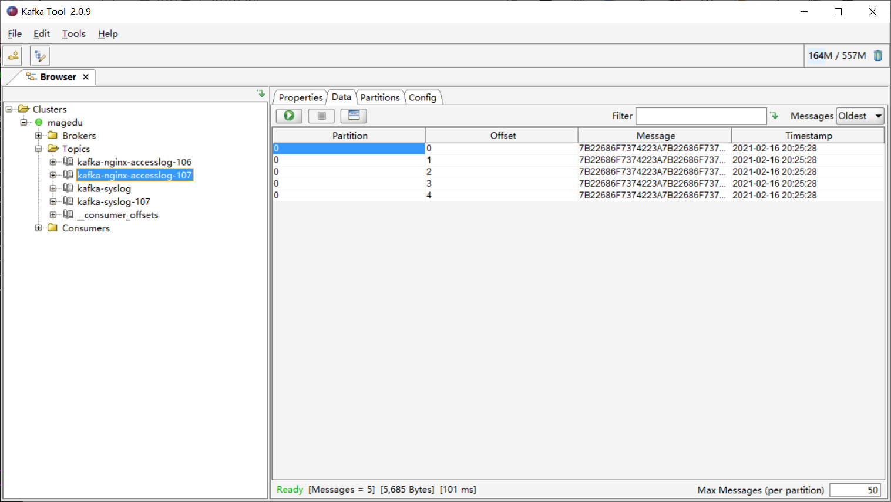
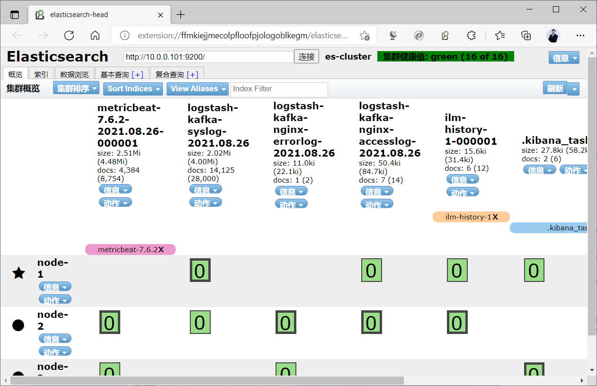
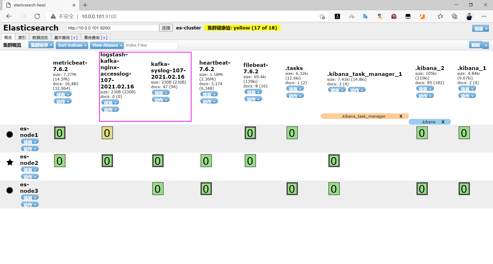
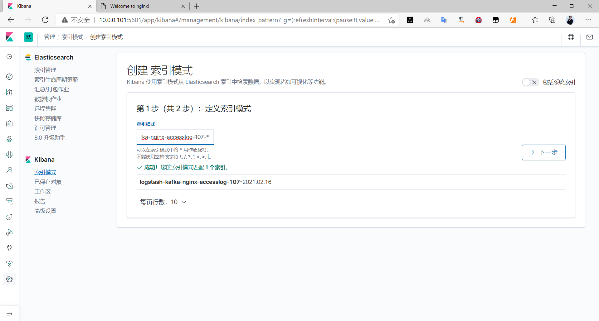
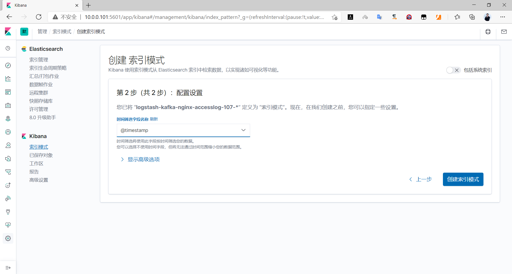
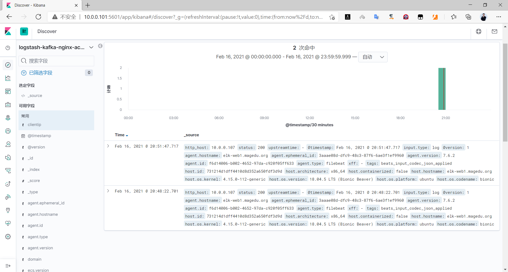
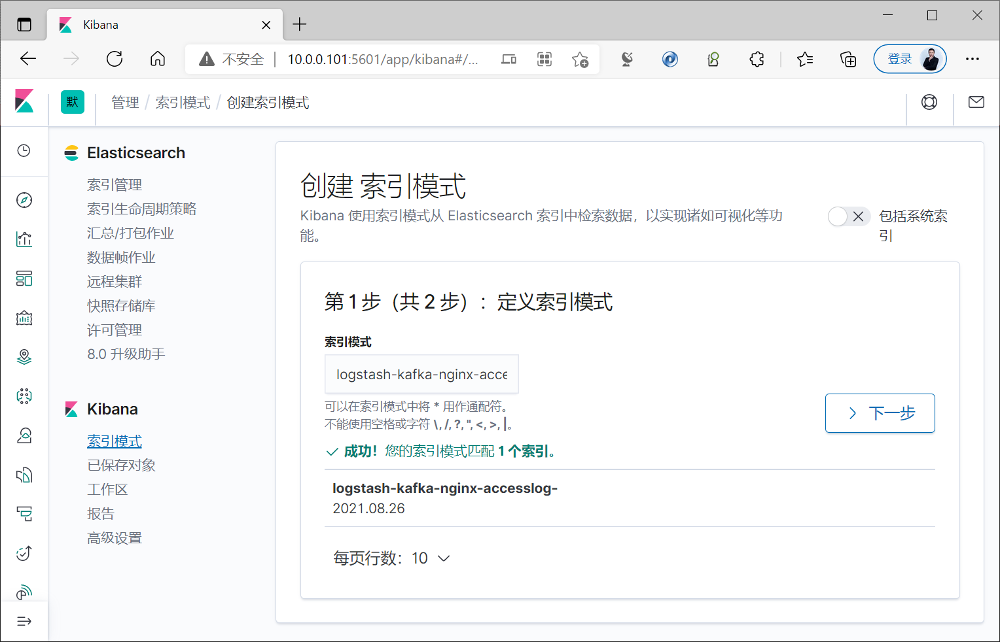
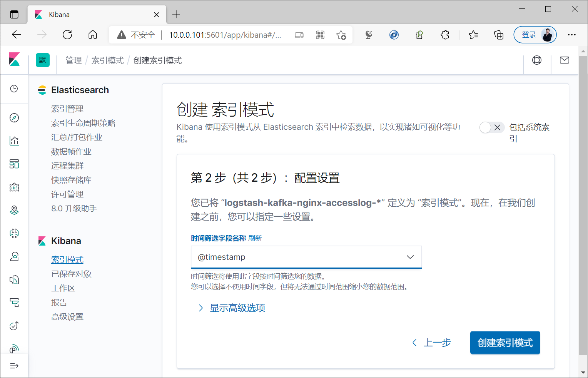

[← 返回ELK 日志分析目录]({{ '/subjects/ELK/' | relative_url }})



# 27 Filebeat 收集Nginx日志并写入 Kafka 缓存发送至 Elasticsearch
### 6.2 Filebeat 收集Nginx日志并写入 Kafka 缓存发送至 Elasticsearch

本例的数据流是 **Nginx 日志 → Filebeat → Kafka → Logstash → Elasticsearch → Kibana**。Kafka 用于缓冲和解耦：当 Elasticsearch 暂时写入变慢时，事件可以先保留在 Kafka 中。能否容忍节点故障取决于 Kafka 的副本数、最小同步副本数与确认策略；“用了三台 Kafka 就自动无单点”并不成立。参考 [Filebeat Kafka 输出文档](https://www.elastic.co/guide/en/beats/filebeat/current/kafka-output.html)。

### 6.2.1 组件与数据格式



| 组件 | 示例地址或位置 | 职责 |
| --- | --- | --- |
| Nginx + Filebeat | `10.0.0.106` | 采集 JSON 格式访问日志和文本错误日志。 |
| Kafka 集群 | `10.0.0.201:9092`、`10.0.0.202:9092`、`10.0.0.203:9092` | 保存 `filebeat-log` 主题中的事件。 |
| Logstash | `10.0.0.104`、`10.0.0.105` | 同一消费组读取事件并解析字段。 |
| Elasticsearch | `10.0.0.101` 等节点 | 建索引、检索与聚合。 |

这些地址仅是示例。正式部署还需配置 TLS、身份认证、主题分区与副本、保留时间和消费组。旧资料中的 ZooKeeper 状态输出仅对应特定 Kafka 部署方式；新集群可采用 KRaft，不能把 ZooKeeper 命令当成必备验证步骤。



### 6.2.2 Filebeat 写入 Kafka

下面假设 `/var/log/nginx/access_json.log` 的每行都是合法 JSON，包含 `clientip` 等字段。错误日志仍按文本采集；`filestream` 输入及其 `ndjson` 解析器的字段名称需按所用 Filebeat 版本核对。

```yaml
filebeat.inputs:
  - type: filestream
    id: nginx-access
    enabled: true
    paths:
      - /var/log/nginx/access_json.log
    parsers:
      - ndjson:
          target: ""
          add_error_key: true
    tags: [nginx-access]

  - type: filestream
    id: nginx-error
    enabled: true
    paths:
      - /var/log/nginx/error.log
    tags: [nginx-error]

output.kafka:
  hosts: ["10.0.0.201:9092", "10.0.0.202:9092", "10.0.0.203:9092"]
  topic: filebeat-log
  required_acks: -1
  compression: gzip
```

`required_acks: -1` 要求按 Kafka 主题设置等待同步副本，但最终持久性仍受主题副本与 `min.insync.replicas` 约束。不要同时启用另一种 Filebeat output；检查配置后再重启：

```bash
sudo filebeat test config -e
sudo filebeat test output -e
sudo systemctl restart filebeat
sudo journalctl -u filebeat -n 50 --no-pager
```

### 6.2.3 Logstash 消费并分类写入

把两台 Logstash 设为**相同的消费组**，它们会按分区分担处理，而不是每台都收到一份相同消息。以下管道保留访问日志的 GeoIP 处理，并按标签选择索引名；仅当 `clientip` 存在且可解析时才运行 GeoIP，避免把缺失字段当作有效地址。

```text
input {
  kafka {
    bootstrap_servers => "10.0.0.201:9092,10.0.0.202:9092,10.0.0.203:9092"
    topics => ["filebeat-log"]
    group_id => "logstash-nginx"
    codec => json
    auto_offset_reset => "earliest"
  }
}

filter {
  if "nginx-access" in [tags] {
    if [clientip] {
      geoip { source => "clientip" target => "geoip" }
    }
    mutate { add_field => { "[@metadata][target_index]" => "nginx-access" } }
  } else if "nginx-error" in [tags] {
    mutate { add_field => { "[@metadata][target_index]" => "nginx-error" } }
  } else {
    mutate { add_field => { "[@metadata][target_index]" => "other" } }
  }
}

output {
  elasticsearch {
    hosts => ["https://es.example.org:9200"]
    user => "<专用写入账号>"
    password => "<账号密码>"
    ssl_certificate_authorities => ["/etc/logstash/http_ca.crt"]
    index => "logs-%{[@metadata][target_index]}-%{+YYYY.MM.dd}"
  }
}
```

示例需要替换主机、凭据和 CA，并按实际 Elasticsearch/Logstash 版本核对插件 TLS 参数与索引模板。生产中不要把密码直接提交到配置仓库，可用 Logstash keystore 等机制。`auto_offset_reset: earliest` 只影响**没有已提交位点的新消费组**；已有消费组不会因重启就从最早事件重放。

### 6.2.4 分层验证

1. 在 Filebeat 所在主机检查输入文件是否增加新行，`filebeat test config` 与输出连接是否正常。
2. 在 Kafka 检查 `filebeat-log` 主题、分区、最新位点及消费组滞后量；确认消息已到达，而不是只看进程状态。
3. 在 Logstash 检查管道启动日志、解析失败标签与输出重试；两台实例应使用相同消费组。
4. 在 Elasticsearch 检查新索引和近期文档，再在 Kibana 创建匹配 `logs-nginx-*` 的数据视图。

以下截图展示了从 Kafka 到 Kibana 的不同验证界面。若只看到旧数据，应先核对消费组位点、日志时间戳和 Kibana 查询时间范围，而不是默认“Logstash 必须先启动，否则消息永久丢失”。



















<nav class="article-end" aria-label="章节导航">
  <a href="{{ '/subjects/ELK/26-collecting-nginx-logs-with-filebeat-and-redis-buffering.html' | relative_url }}">← 上一篇：Filebeat 经 Redis 缓冲采集 Nginx 日志</a>
  <a href="{{ '/subjects/ELK/' | relative_url }}">返回 ELK 日志分析目录</a>
  <a href="{{ '/subjects/ELK/28-mapping-visitor-cities-by-ip-address.html' | relative_url }}">下一篇：通过坐标地图统计网站访问用户的 IP 所在城市 →</a>
</nav>
