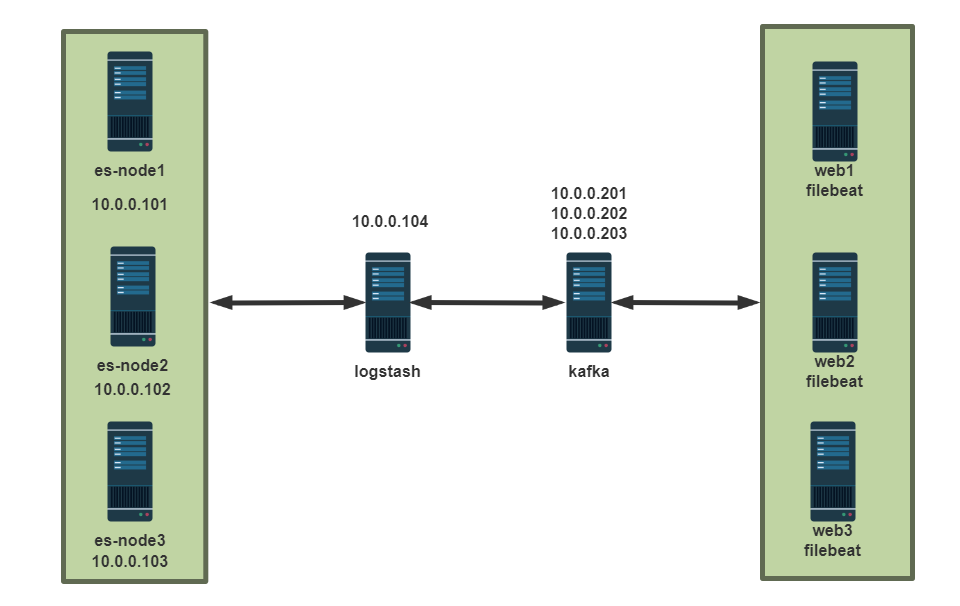
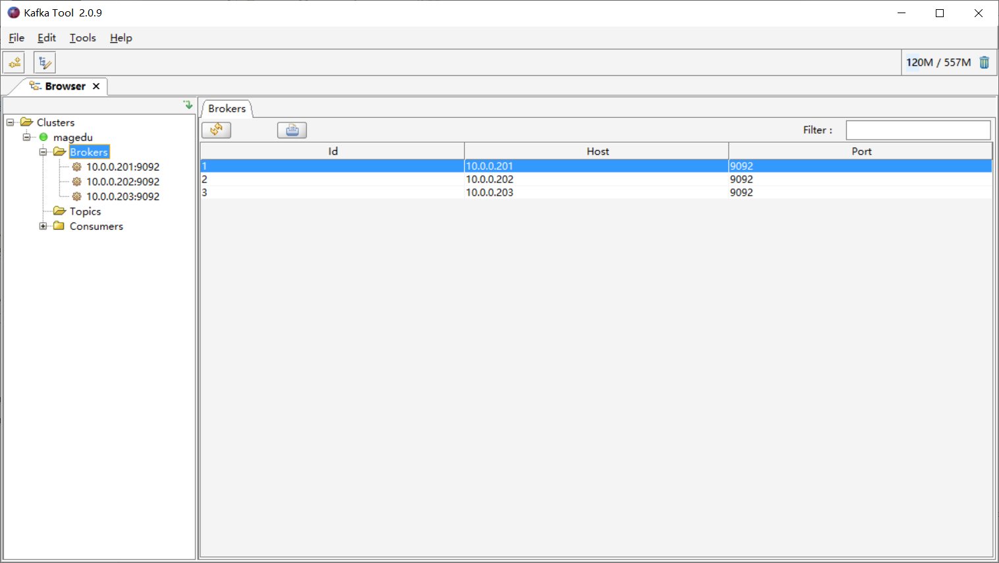
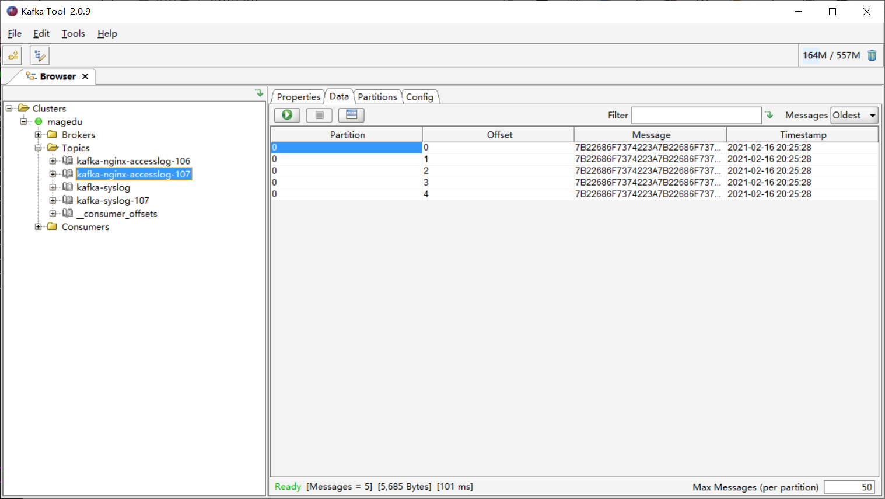
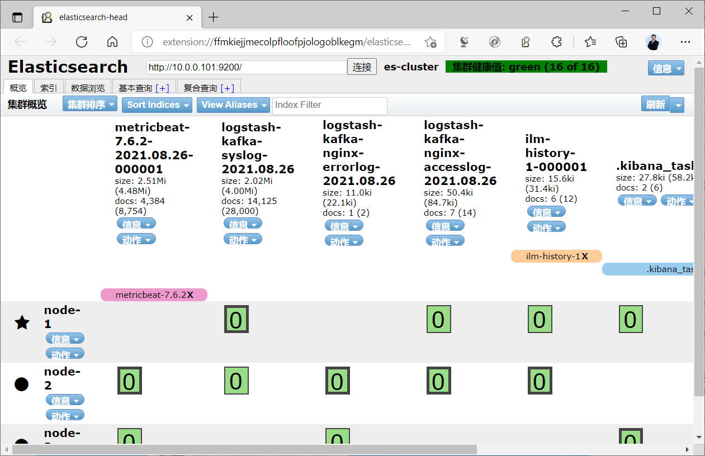
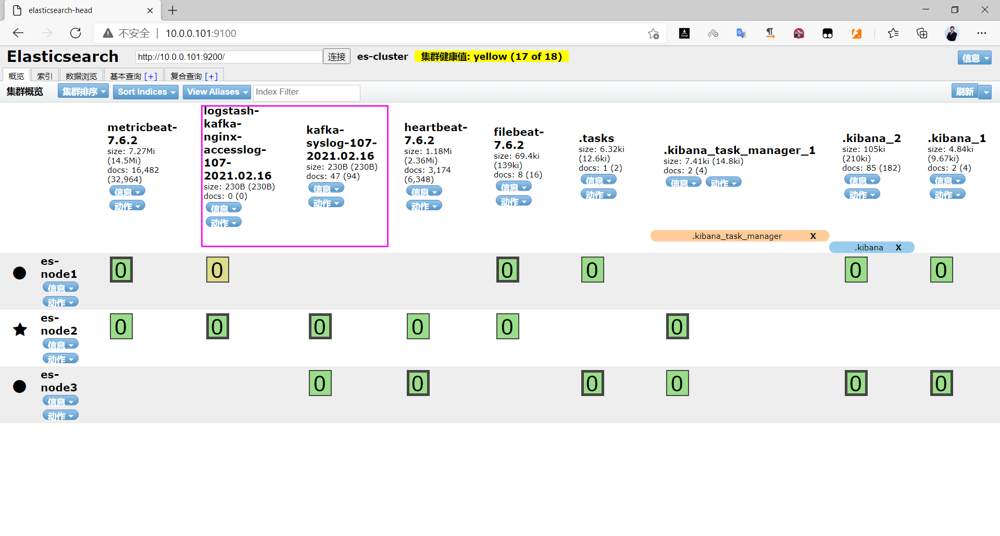
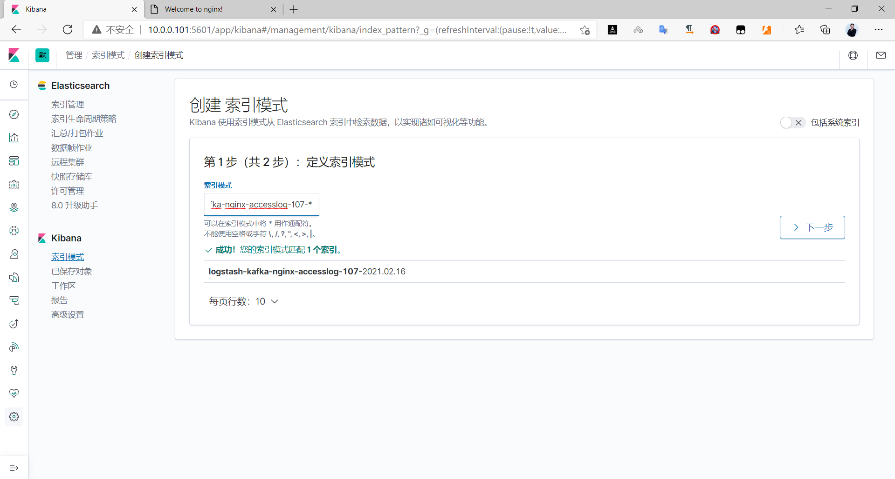
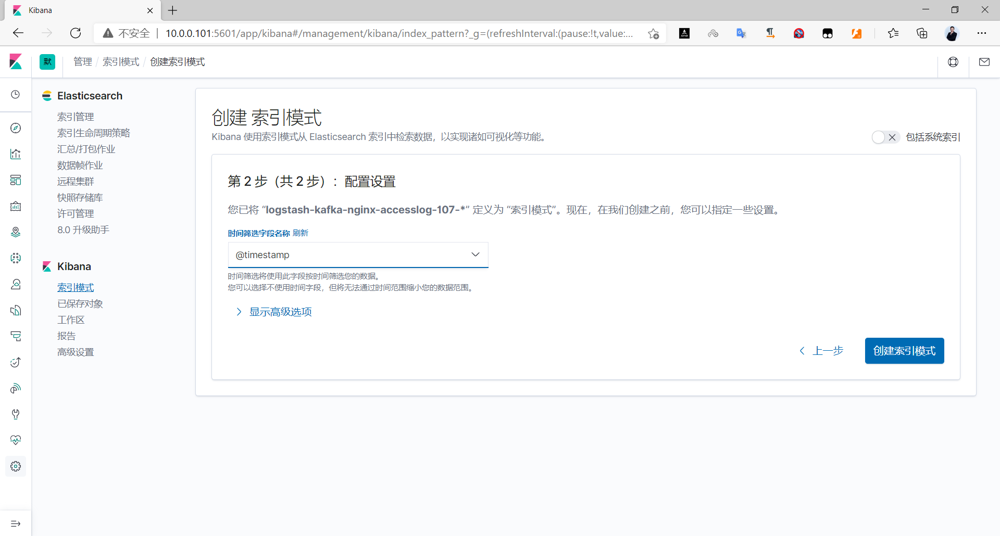
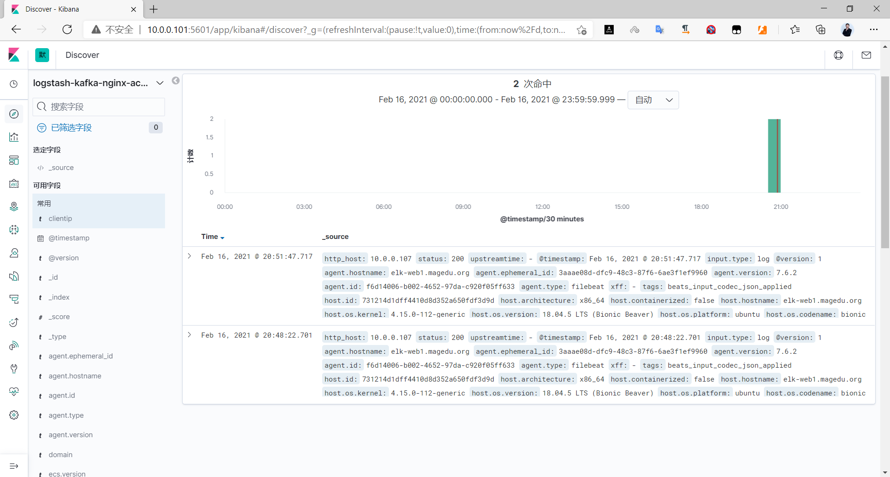
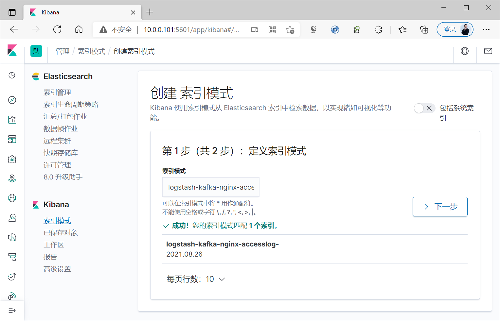
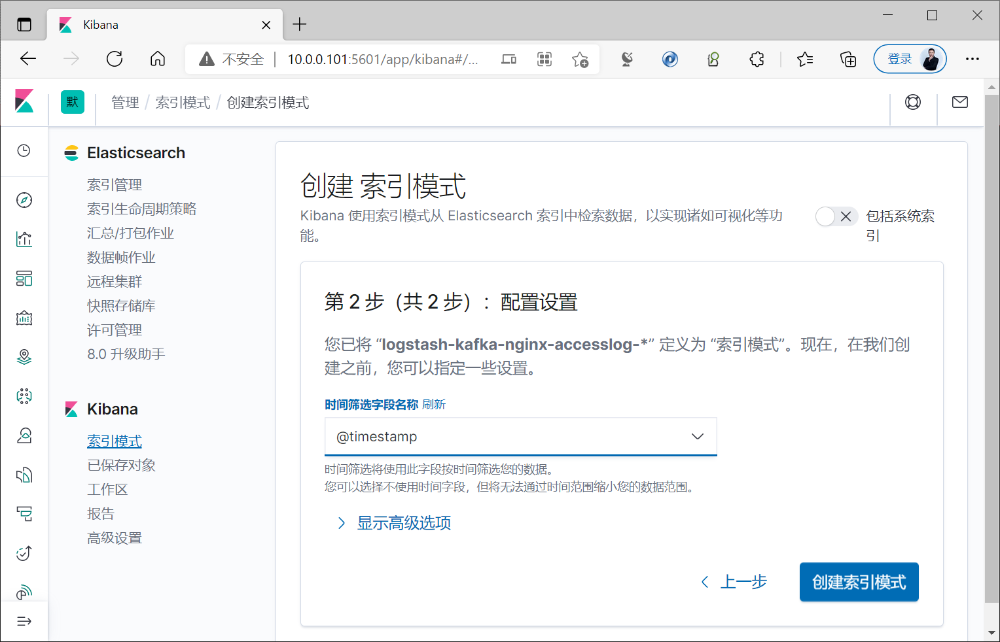

[← Back to ELK Log Analytics Index]({{ '/subjects/ELK/' | relative_url }})



# 27 Collecting Nginx Logs with Filebeat and Kafka Buffering
### 6.2 Filebeat 收集Nginx日志并写入 Kafka 缓存发送至 Elasticsearch

虽然利用redis 可以实现elasticsearch 缓存功能,减轻elasticsearch的压力,但不支持的redis集群,存在单点问题,可以利用kafka代替redis,且支持kafka集群,消除单点故障隐患

官方文档

<https://www.elastic.co/guide/en/beats/filebeat/7.6/kafka-output.html>

### 环境准备



```text
#三台ES集群
10.0.0.101
10.0.0.102
10.0.0.103
#logstash
10.0.0.104 logstash1
10.0.0.105 logstash2
#准备三台kafka,安装过程略
10.0.0.201
10.0.0.202
10.0.0.203
#filebeat和nginx
10.0.0.106
```



```bash
[root@node1 ~]#zkServer.sh status
/usr/bin/java
ZooKeeper JMX enabled by default
Using config: /usr/local/zookeeper/bin/../conf/zoo.cfg
Client port found: 2181. Client address: localhost. Client SSL: false.
Mode: follower
[root@node2 ~]#zkServer.sh status
/usr/bin/java
ZooKeeper JMX enabled by default
Using config: /usr/local/zookeeper/bin/../conf/zoo.cfg
Client port found: 2181. Client address: localhost. Client SSL: false.
Mode: leader
[root@node3 ~]#zkServer.sh status
/usr/bin/java
ZooKeeper JMX enabled by default
Using config: /usr/local/zookeeper/bin/../conf/zoo.cfg
Client port found: 2181. Client address: localhost. Client SSL: false.
Mode: follower
```

### Filebeat 收集 Nginx 的访问和错误日志并发送至 kafka

```bash
[root@web1 ~]#grep -Ev "#|^$" /etc/filebeat/filebeat.yml
filebeat.inputs:
- type: log
enabled: true
paths:
- /var/log/nginx/access_json.log
json.keys_under_root: true
json.overwrite_keys: true
tags: ["nginx-access"]
- type: log
enabled: true
paths:
- /var/log/nginx/error.log
tags: ["nginx-error"]
- type: log
enabled: true
paths:
- /var/log/syslog
tags: ["syslog"]
output.kafka:
hosts: ["10.0.0.201:9092", "10.0.0.202:9092", "10.0.0.203:9092"]
topic: filebeat-log   #指定kafka的topic
partition.round_robin:
reachable_only: true #true表示只发布到可用的分区，false时表示所有分区，如果一个节点
down会导致block
required_acks: 1  #如果为0，表示不确认，错误消息可能会丢失，1等待写入主分区（默认），-1等
待写入副本分区
compression: gzip
max_message_bytes: 1000000 #每条消息最大长度，以字节为单位，如果超过将丢弃
[root@web1 ~]#systemctl restart filebeat.service
#在kafka查看是否有数据
[root@node1 ~]#/usr/local/kafka/bin/kafka-topics.sh --list --bootstrap-server
10.0.0.201:9092
[root@node1 ~]#/usr/local/kafka/bin/kafka-console-consumer.sh --topic filebeat-
log --bootstrap-server 10.0.0.201:9092 --from-beginning
```

### 配置 Logstash 读取 Kafka 日志发送到 Elasticsearch

范例：if 指令

```bash
[root@logstash ~]#cat /etc/logstash/conf.d/kafka-to-es.conf
input {
kafka {
bootstrap_servers => "10.0.0.201:9092,10.0.0.202:9092,10.0.0.203:9092"
topics => "filebeat-log"
codec => "json"
#group_id => "logstash"  #消费者组的名称
#consumer_threads => "3" #建议设置为和kafka的分区相同的值为线程数
#topics_pattern => "nginx-.*" #通过正则表达式匹配topic，而非用上面topics=>指定固定
值
}
}
filter {
if "nginx-access" in [tags] {
geoip {
source => "clientip"
target => "geoip"
add_field => ["[geoip][coordinates]","%{[geoip][geo][location][lon]}"]
add_field => ["[geoip][coordinates]","%{[geoip][geo][location][lat]}"]
}
mutate {
convert => [ "[geoip][coordinates]", "float"]
}
}
mutate {
convert => ["upstreamtime","float"]
}
}
```

```text
output {
#stdout {}   #调试使用
if "nginx-access" in [tags] {
elasticsearch {
hosts => ["10.0.0.101:9200"]
index => "logstash-kafka-nginx-accesslog-%{+YYYY.MM.dd}"
}
}
if "nginx-error" in [tags] {
elasticsearch {
hosts => ["10.0.0.101:9200"]
index => "logstash-kafka-nginx-errorlog-%{+YYYY.MM.dd}"
}
}
if "syslog" in [tags] {
elasticsearch {
hosts => ["10.0.0.101:9200"]
index => "logstash-kafka-syslog-%{+YYYY.MM.dd}"
}
}
}
[root@logstash ~]#systemctl restart logstash.service
```

范例：if {} else if {} 指令

```bash
[root@logstash ~]#cat /etc/logstash/conf.d/kafka-to-es.conf
input {
kafka {
bootstrap_servers => "10.0.0.201:9092,10.0.0.202:9092,10.0.0.203:9092"
topics => "filebeat-log"
codec => "json"
#group_id => "logstash"  #消费者组的名称
#consumer_threads => "3" #建议设置为和kafka的分区相同的值为线程数
#topics_pattern => "nginx-.*" #通过正则表达式匹配topic，而非用上面topics=>指定固定
值
}
}
output {
#stdout {}   #调试使用
if "nginx-access" in [tags] {
elasticsearch {
hosts => ["10.0.0.101:9200"]
index => "logstash-kafka-nginx-accesslog-%{+YYYY.MM.dd}"
}
} else if "nginx-error" in [tags] {
elasticsearch {
hosts => ["10.0.0.101:9200"]
index => "logstash-kafka-nginx-errorlog-%{+YYYY.MM.dd}"
}
} else if "syslog" in [tags] {
elasticsearch {
hosts => ["10.0.0.101:9200"]
index => "logstash-kafka-syslog-%{+YYYY.MM.dd}"
}
}
}
[root@logstash ~]#systemctl restart logstash.service
```

### 验证结果

注意：Logstash先启动订阅kafka，再生成新数据才能采集

利用 kafka tool 工具查看



















<nav class="article-end" aria-label="章节导航">
  <a href="{{ '/subjects/ELK/26-collecting-nginx-logs-with-filebeat-and-redis-buffering.html' | relative_url }}">← Previous: Collecting Nginx Logs with Filebeat and Redis Buffering</a>
  <a href="{{ '/subjects/ELK/' | relative_url }}">Back to ELK Log Analytics Index</a>
  <a href="{{ '/subjects/ELK/28-mapping-visitor-cities-by-ip-address.html' | relative_url }}">Next: Mapping Visitor Cities by IP Address →</a>
</nav>
