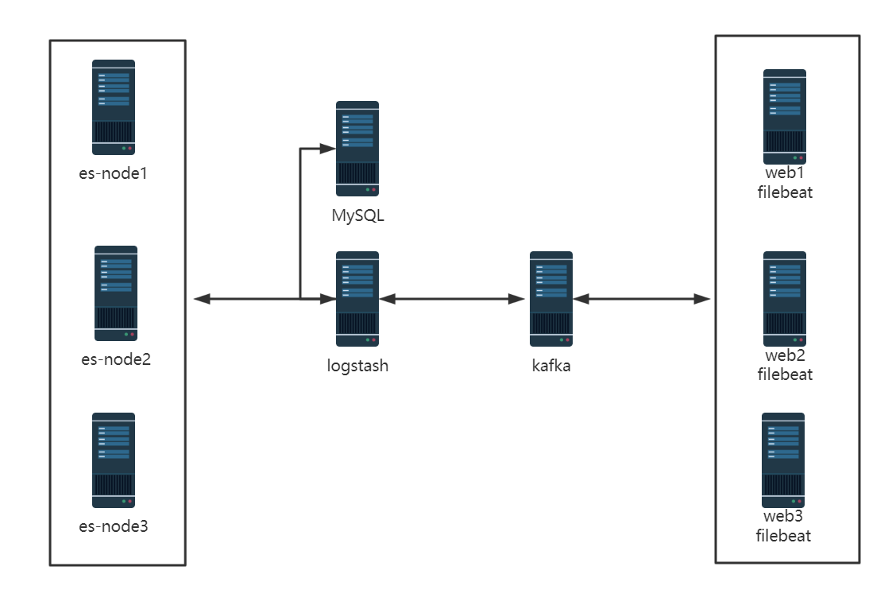
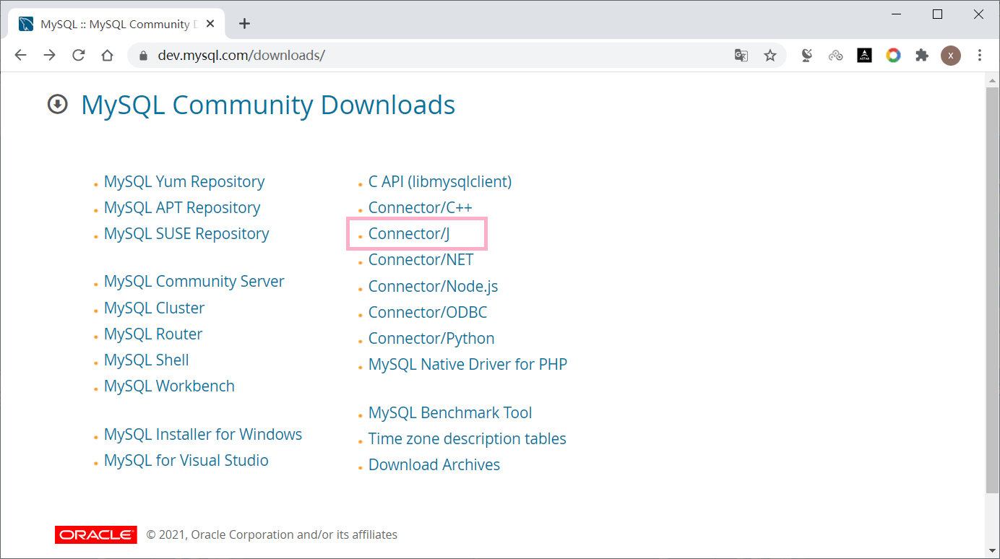
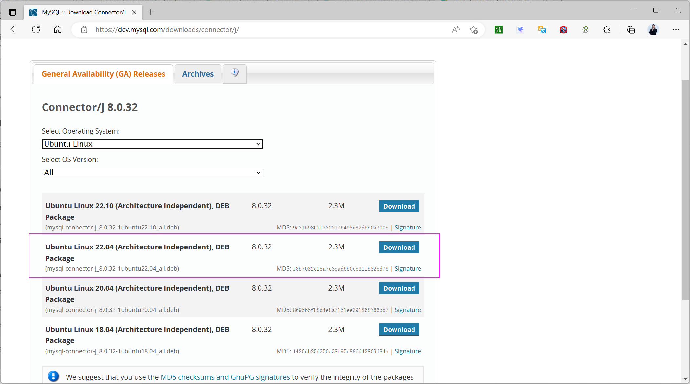
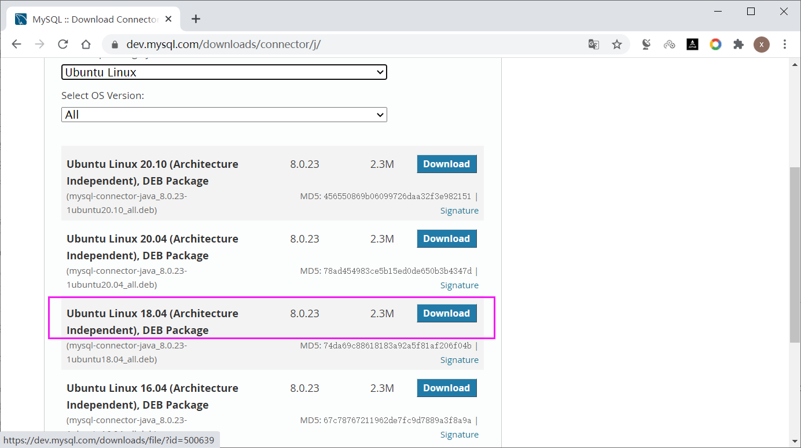

[← Back to ELK Log Analytics Index]({{ '/subjects/ELK/' | relative_url }})



# 29 Writing Collected Logs to MySQL with Logstash
### 6.4 Logstash收集日志写入 MySQL 数据库

ES中的日志后续会被删除,但有些重要数据,比如状态码、客户端IP、客户端浏览器版本等，后期可以会按月或年做数据统计等,因此需要持久保存

可以将重要数据写入数据库达到持久保存目的



### 安装 MySQL 数据库

```bash
[root@es-node1 ~]#apt update && apt -y install mysql-server
[root@es-node1 ~]#ss -ntl|grep 3306
LISTEN   0         80                  127.0.0.1:3306             0.0.0.0:*
[root@es-node1 ~]#sed -i  '/127.0.0.1/s/^/#/' /etc/mysql/mysql.conf.d/mysqld.cnf
[root@es-node1 ~]#vim /etc/mysql/mysql.conf.d/mysqld.cnf
bind-address        = 0.0.0.0
mysqlx-bind-address = 0.0.0.0
[root@es-node1 ~]#systemctl restart mysql.service
[root@es-node1 ~]#ss -ntl|grep 3306
LISTEN   0         80                  0.0.0.0:3306             0.0.0.0:*
```

### 创建库和表并授权用户登录

```bash
[root@es-node1 ~]#mysql
mysql> create database elk ;                                      #MySQL8.0以上默
认就支持
mysql> create database elk character set utf8 collate utf8_bin;   #MySQL5.7以下需
要显示指定
mysql> create user elk@"10.0.0.%" identified by '123456';
mysql> grant all privileges on elk.* to elk@"10.0.0.%";
mysql> flush privileges;
```

```text
#创建表,字段对应需要保存的数据字段
mysql> use elk
mysql> create table elklog (clientip varchar(39),responsetime float(10,3),uri
varchar(256),status  char(3),time timestamp default current_timestamp );
mysql> desc elklog;
+--------------+--------------+------+-----+-------------------+-------+
| Field        | Type         | Null | Key | Default           | Extra |
+--------------+--------------+------+-----+-------------------+-------+
| clientip     | varchar(39)  | YES  |     | NULL              |       |
| responsetime | float(10,3)  | YES  |     | NULL              |       |
| uri          | varchar(256) | YES  |     | NULL              |       |
| status       | char(3)      | YES  |     | NULL              |       |
| time         | timestamp    | NO   |     | CURRENT_TIMESTAMP |       |
+--------------+--------------+------+-----+-------------------+-------+
5 rows in set (0.00 sec)
```

### 测试用户从 Logstash 主机远程登录(可选)

```bash
[root@logstash1 ~]#apt -y install mysql-client
[root@logstash1 ~]#mysql -uelk -p123456 -h10.0.0.101 -e 'show databases'
mysql: [Warning] Using a password on the command line interface can be insecure.
+--------------------+
| Database           |
+--------------------+
| information_schema |
| elk                |
+--------------------+
[root@logstash1 ~]#
```

### Logstash 配置 mysql-connector-java 包

MySQL Connector/J是MySQL官方JDBC驱动程序，JDBC（Java Data Base Connectivity,java数据库连接）是一种用于执行SQL语句的Java API，可以为多种关系数据库提供统一访问，它由一组用Java语言编写的类和接口组成。

官方下载地址：

<https://dev.mysql.com/downloads/connector/>







范例：Ubuntu24.04 安装 mysql-connector

```bash
#当前2025-03-19 还不支持Ubunt24.04,可以下载23.04的包进行安装或者下载平台无关包mysql-
connector-j-8.0.33.tar.gz
[root@ubuntu2404 ~]#dpkg -i mysql-connector-j_8.0.33-1ubuntu23.04_all.deb
[root@ubuntu2404 ~]#ll /usr/share/java/mysql-connector-j-8.0.33.jar
drwxr-xr-x 2 root root    4096 Mar 19 11:37 ./
drwxr-xr-x 3 root root    4096 Mar 19 11:37 ../
-rw-r--r-- 1 root root 2481541 Apr  4  2023 mysql-connector-j-8.0.33.jar
[root@ubuntu2404 ~]#tar tvf mysql-connector-j-8.0.33.tar.gz |grep jar
-rw-r--r-- 0/0         2481560 2023-03-08 00:15 mysql-connector-j-8.0.33/mysql-
connector-j-8.0.33.jar
```

范例：Ubuntu22.04 安装 mysql-connector

```bash
#1）Ubuntu22.04安装mysql-connector
[root@logstash-ubuntu2204 ~]#dpkg -i mysql-connector-j_8.0.32-
1ubuntu22.04_all.deb
[root@logstash-ubuntu2204 ~]#dpkg -L mysql-connector-j
/.
/usr
/usr/share
/usr/share/doc
/usr/share/doc/mysql-connector-j
/usr/share/doc/mysql-connector-j/CHANGES.gz
/usr/share/doc/mysql-connector-j/INFO_BIN
/usr/share/doc/mysql-connector-j/INFO_SRC
/usr/share/doc/mysql-connector-j/LICENSE.gz
/usr/share/doc/mysql-connector-j/README
/usr/share/doc/mysql-connector-j/changelog.Debian.gz
/usr/share/doc/mysql-connector-j/copyright
/usr/share/java
/usr/share/java/mysql-connector-j-8.0.32.jar
[root@logstash-ubuntu2204 ~]#ll /usr/share/java/mysql-connector-j-8.0.33.jar
/usr/share/java/mysql-connector-java-8.0.33.jar
-rw-r--r-- 1 root root 2481543  3月  8 00:16 /usr/share/java/mysql-connector-j-
8.0.33.jar
lrwxrwxrwx 1 root root      28  3月  8 00:16 /usr/share/java/mysql-connector-
java-8.0.33.jar -> mysql-connector-j-8.0.33.jar
```

```bash
#2）复制jar文件到logstash指定的目录下
[root@logstash-ubuntu2204 ~]#mkdir -p  /usr/share/logstash/vendor/jar/jdbc
[root@logstash-ubuntu2204 ~]#cp /usr/share/java/mysql-connector-j-8.0.32.jar
/usr/share/logstash/vendor/jar/jdbc/
#此步可选
[root@logstash-ubuntu2204 ~]#ll  /usr/share/logstash/vendor/jar/ -h
总用量 12K
drwxr-xr-x 3 root root 4.0K  2月 19 17:55 ./
drwxr-xr-x 5 root root 4.0K  2月 19 17:55 ../
drwxr-xr-x 2 root root 4.0K  2月 19 17:55 jdbc/
[root@logstash-ubuntu2204 ~]#chown -R logstash.logstash
/usr/share/logstash/vendor/jar/
[root@logstash-ubuntu2204 ~]#ll  /usr/share/logstash/vendor/jar/jdbc/ -h
总用量 2.4M
drwxr-xr-x 2 logstash logstash 4.0K  2月 19 17:55 ./
drwxr-xr-x 3 logstash logstash 4.0K  2月 19 17:55 ../
-rw-r--r-- 1 logstash logstash 2.4M  2月 19 17:55 mysql-connector-j-8.0.32.jar
```

范例：Ubuntu20.04 安装 mysql-connector

```bash
[root@logstash1--ubuntu2004 ~]#dpkg -i mysql-connector-java_8.0.23-
1ubuntu18.04_all.deb
[root@logstash1 ~]#dpkg -L mysql-connector-java
/.
/usr
/usr/share
/usr/share/doc
/usr/share/doc/mysql-connector-java
/usr/share/doc/mysql-connector-java/CHANGES.gz
/usr/share/doc/mysql-connector-java/INFO_BIN
/usr/share/doc/mysql-connector-java/INFO_SRC
/usr/share/doc/mysql-connector-java/LICENSE.gz
/usr/share/doc/mysql-connector-java/README
/usr/share/doc/mysql-connector-java/changelog.Debian.gz
/usr/share/doc/mysql-connector-java/copyright
/usr/share/java
/usr/share/java/mysql-connector-java-8.0.23.jar
[root@logstash1 ~]#mkdir -p  /usr/share/logstash/vendor/jar/jdbc
[root@logstash1 ~]#cp /usr/share/java/mysql-connector-java-8.0.23.jar
/usr/share/logstash/vendor/jar/jdbc/
#如果logstash以root运行,下面可不做
[root@logstash1 ~]#chown -R logstash.logstash /usr/share/logstash/vendor/jar/
[root@logstash1 ~]#ll -h /usr/share/logstash/vendor/jar/jdbc/
total 2.4M
drwxr-xr-x 2 logstash logstash 4.0K Aug 27 20:25 ./
drwxr-xr-x 3 logstash logstash 4.0K Aug 27 20:25 ../
-rw-r--r-- 1 logstash logstash 2.4M Aug 27 20:25 mysql-connector-java-8.0.23.jar
```

### 更改 Gem 源 (可选)

Logstash 基于 Ruby 语言实现 , 后续需要安装相关插件，需要从 gem 源下载依赖包

ruby 语言使用国外的gem源, 由于网络原因，从国内访问很慢而且不稳定

其官方介绍推荐使用

<https://gems.ruby-china.com>


```bash
[root@logstash1 ~]#apt update && apt -y install ruby
[root@logstash-ubuntu2204 ~]#gem -v
3.3.5
[root@logstash-ubuntu2004 ~]#gem -v
3.1.2
[root@logstash-ubuntu1804 ~]#gem -v
2.7.6
[root@logstash ~]#gem sources -l
*** CURRENT SOURCES ***
https://rubygems.org/
#修改指定国内的源
[root@logstash1 ~]#gem sources --add https://gems.ruby-china.com/ --remove
https://rubygems.org/
[root@logstash1 ~]#gem sources -l
*** CURRENT SOURCES ***
https://gems.ruby-china.com/
```

### 安装logstash-output-jdbc插件

```sql
#查看logstash-plugin帮助
[root@logstash1 ~]#/usr/share/logstash/bin/logstash-plugin --help
.......
Usage:
bin/logstash-plugin [OPTIONS] SUBCOMMAND [ARG] ...
Parameters:
SUBCOMMAND                    subcommand
[ARG] ...                     subcommand arguments
Subcommands:
list                          List all installed Logstash plugins
install                       Install a Logstash plugin
remove                        Remove a Logstash plugin
update                        Update a plugin
pack                          Package currently installed plugins,
Deprecated: Please use prepare-offline-pack instead
unpack                        Unpack packaged plugins, Deprecated: Please use
prepare-offline-pack instead
generate                      Create the foundation for a new plugin
uninstall                     Uninstall a plugin. Deprecated: Please use
remove instead
prepare-offline-pack          Create an archive of specified plugins to use
for offline installation
Options:
-h, --help                    print help
#查看安装拆插件,默认只有input-jdbc插件,需要安装output-jdbc插件
[root@logstash1 ~]#/usr/share/logstash/bin/logstash-plugin list|grep jdbc
......
logstash-integration-jdbc
├── logstash-input-jdbc
├── logstash-filter-jdbc_streaming
└── logstash-filter-jdbc_static
#方法1：在线安装output-jdbc插件,可能会等较长时间,20240524花10分钟
[root@logstash1 ~]#/usr/share/logstash/bin/logstash-plugin install  logstash-
output-jdbc
......
Validating logstash-output-jdbc
Installing logstash-output-jdbc
Installation successful
#方法2：离线安装
#如果无法在线安装,可以先从已经安装的主机导出插件,再导入
#导出插件
[root@ubuntu2204 ~]#/usr/share/logstash/bin/logstash-plugin prepare-offline-pack
logstash-output-jdbc
Using bundled JDK: /usr/share/logstash/jdk
Offline package created at: /usr/share/logstash/logstash-offline-plugins-
8.6.1.zip
You can install it with this command `bin/logstash-plugin install
file:///usr/share/logstash/logstash-offline-plugins-8.6.1.zip`
#离线导入插件
[root@ubuntu2204 ~]#/usr/share/logstash/bin/logstash-plugin install
file:///usr/share/logstash/logstash-offline-plugins-8.6.1.zip
Using bundled JDK: /usr/share/logstash/jdk
Installing file: /usr/share/logstash/logstash-offline-plugins-8.6.1.zip
Resolving dependencies..................................
Install successful
#检查插件安装成功
[root@logstash1 ~]#/usr/share/logstash/bin/logstash-plugin list|grep jdbc
.....
logstash-integration-jdbc
├── logstash-input-jdbc
├── logstash-filter-jdbc_streaming
└── logstash-filter-jdbc_static
logstash-output-jdbc
#删除插件
[root@logstash1 ~]#/usr/share/logstash/bin/logstash-plugin remove logstash-
output-jdbc
Using bundled JDK: /usr/share/logstash/jdk
Resolving
dependencies....................................................................
.................
Resolving dependencies.........................
Successfully removed logstash-output-jdbc
```

### 配置 Filebeat 配置文件

```bash
[root@centos8 ~]#cat /etc/filebeat/filebeat.yml
filebeat.inputs:
- type: log
enabled: true
paths:
- /var/log/nginx/access_json.log
json.keys_under_root: true
json.overwrite_keys: true
tags: ["nginx-access"]
- type: log
enabled: true
paths:
- /var/log/nginx/error.log
tags: ["nginx-error"]
- type: log
enabled: true
paths:
- /var/log/syslog
tags: ["syslog"]
output.kafka:
hosts: ["10.0.0.201:9092", "10.0.0.202:9092", "10.0.0.203:9092"]
topic: filebeat-log
partition.round_robin:
reachable_only: true
required_acks: 1
compression: gzip
max_message_bytes: 1000000
```

### 配置 Logstash 将日志写入数据库

```bash
[root@ubuntu1804 ~]#ls -lh /etc/logstash/conf.d/
total 59M
-rw-r--r-- 1 root root  59M Aug 27 08:50 GeoLite2-City.mmdb
-rw-r--r-- 1 root root 1.2K Aug 27 10:59 kafka-to-es.conf
[root@logstash ~]#cat /etc/logstash/conf.d/kafka-to-es.conf
input {
kafka {
bootstrap_servers => "10.0.0.201:9092,10.0.0.202:9092,10.0.0.203:9092"
topics => "filebeat-log"
codec => "json"
}
}
filter {
if "nginx-access" in [tags] {
geoip {
source => "clientip"         #日志必须是json格式且有一个clientip的key
target => "geoip"
#database => "/etc/logstash/conf.d/GeoLite2-City.mmdb"    #指定数据库文件
add_field => ["[geoip][coordinates]","%{[geoip][geo][location][lon]}"]
#8.X添加经纬度字段包括经度
add_field => ["[geoip][coordinates]","%{[geoip][geo][location][lat]}"]
#8.X添加经纬度字段包括纬度
#add_field => [ "[geoip][coordinates]", "%{[geoip][longitude]}" ]   #7.X添
加经纬度字段包括经度
#add_field => [ "[geoip][coordinates]", "%{[geoip][latitude]}" ]    #7.X添
加经纬度字段包括经度
}
mutate {
convert => [ "[geoip][coordinates]", "float"]
}
}
}
output {
#stdout {}   #调试使用
if "nginx-access" in [tags] {
elasticsearch {
hosts => ["10.0.0.101:9200"]
index => "logstash-kafka-nginx-accesslog-%{+YYYY.MM.dd}"
}
jdbc {
connection_string => "jdbc:mysql://10.0.0.101/elk?
user=elk&password=123456&useUnicode=true&characterEncoding=UTF8"
statement => ["INSERT INTO elklog (clientip,responsetime,uri,status)
VALUES(?,?,?,?)","clientip","responsetime","uri","status"]
}
stdout {
codec => "rubydebug"
}
}
if "nginx-error" in [tags] {
elasticsearch {
hosts => ["10.0.0.101:9200"]
index => "logstash-kafka-nginx-errorlog-%{+YYYY.MM.dd}"
}
}
if "syslog" in [tags] {
elasticsearch {
hosts => ["10.0.0.101:9200"]
index => "logstash-kafka-syslog-%{+YYYY.MM.dd}"
}
}
}
```

### 检查 Logstash 配置并重启服务

```bash
[root@logstash1 ~]#/usr/share/logstash/bin/logstash -f
/etc/logstash/conf.d/kafka-to-es.conf -t
[root@logstash1 ~]#systemctl restart logstash.service
```

### 访问 Nginx 产生日志

```bash
[root@elk-web1 logs]#tail -n 1000 json.log  >>
/data/nginx/logs/nginx.access_json.log
```

### 验证数据库是否写入数据

```bash
[root@es-node1 ~]#mysql elk
Reading table information for completion of table and column names
You can turn off this feature to get a quicker startup with -A
Welcome to the MySQL monitor.  Commands end with ; or \g.
Your MySQL connection id is 30
Server version: 5.7.33-0ubuntu0.18.04.1 (Ubuntu)
Copyright (c) 2000, 2021, Oracle and/or its affiliates.
Oracle is a registered trademark of Oracle Corporation and/or its
affiliates. Other names may be trademarks of their respective
owners.
Type 'help;' or '\h' for help. Type '\c' to clear the current input statement.
mysql> select * from elklog limit 10;
+----------------+--------------+-------------------------------------------+---
-----+---------------------+
| clientip       | responsetime | uri                                       |
status | time                |
+----------------+--------------+-------------------------------------------+---
-----+---------------------+
| 43.227.255.245 | 0.04         | /index.php                                |
200    | 2021-02-10 23:27:48 |
| 43.227.255.245 | 0.0          | /wp-content/uploads/2020/01/favicon-1.ico |
200    | 2021-02-10 23:27:48 |
| 43.227.255.245 | 0.0          | /wp-content/uploads/2020/01/favicon-1.ico |
200    | 2021-02-10 23:27:48 |
| 43.227.255.245 | 0.0          | /wp-content/uploads/2020/01/favicon-1.ico |
200    | 2021-02-10 23:27:48 |
| 43.227.255.245 | 0.0          | /wp-content/uploads/2020/01/favicon-1.ico |
200    | 2021-02-10 23:27:48 |
| 43.227.255.245 | 0.0          | /wp-content/uploads/2020/01/favicon-1.ico |
200    | 2021-02-10 23:27:48 |
| 43.227.255.245 | 0.0          | /wp-content/uploads/2020/01/favicon-1.ico |
200    | 2021-02-10 23:27:48 |
| 43.227.255.245 | 0.0          | /wp-content/uploads/2020/01/favicon-1.ico |
200    | 2021-02-10 23:27:48 |
| 43.227.255.245 | 0.044        | /wp-content/uploads/2020/01/favicon-1.ico |
200    | 2021-02-10 23:27:48 |
| 123.56.174.200 | 0.0          | /wp-cron.php                              |
499    | 2021-02-10 23:27:48 |
+----------------+--------------+-------------------------------------------+---
-----+---------------------+
10 rows in set (0.00 sec)
mysql> select clientip,count(*) from elklog group by clientip;
+-----------------+----------+
| clientip        | count(*) |
+-----------------+----------+
| 123.56.174.200  |      277 |
| 75.119.145.87   |        2 |
| 84.241.26.14    |        1 |
| 66.23.238.6     |       34 |
| 209.17.96.26    |        2 |
| 60.13.138.145   |        9 |
```

```text
mysql> select clientip,count(*) from elklog group by clientip order by count(*)
desc limit 3;
+----------------+----------+
| clientip       | count(*) |
+----------------+----------+
| 114.115.207.72 |     4372 |
| 150.158.130.59 |     1061 |
| 150.158.91.120 |     1061 |
+----------------+----------+
3 rows in set (0.01 sec)
mysql> select clientip,count(*) as count from elklog group by clientip order by
count  desc limit 3;
+----------------+-------+
| clientip       | count |
+----------------+-------+
| 114.115.207.72 |  4372 |
| 150.158.130.59 |  1061 |
| 150.158.91.120 |  1061 |
+----------------+-------+
3 rows in set (0.00 sec)
mysql> select status ,count(status) from elklog group by status  order by
count(status) desc limit 10;
+--------+---------------+
| status | count(status) |
+--------+---------------+
| 200    |         10011 |
| 301    |          2949 |
| 404    |          1947 |
| 499    |           286 |
| 302    |           145 |
| 400    |            42 |
| 405    |             6 |
| 403    |             1 |
| 500    |             1 |
| 401    |             1 |
+--------+---------------+
10 rows in set (0.01 sec)
```



<nav class="article-end" aria-label="章节导航">
  <a href="{{ '/subjects/ELK/28-mapping-visitor-cities-by-ip-address.html' | relative_url }}">← Previous: Mapping Visitor Cities by IP Address</a>
  <a href="{{ '/subjects/ELK/' | relative_url }}">Back to ELK Log Analytics Index</a>
  <a href="{{ '/subjects/ELK/30-common-interview-questions.html' | relative_url }}">Next: Common Interview Questions →</a>
</nav>
