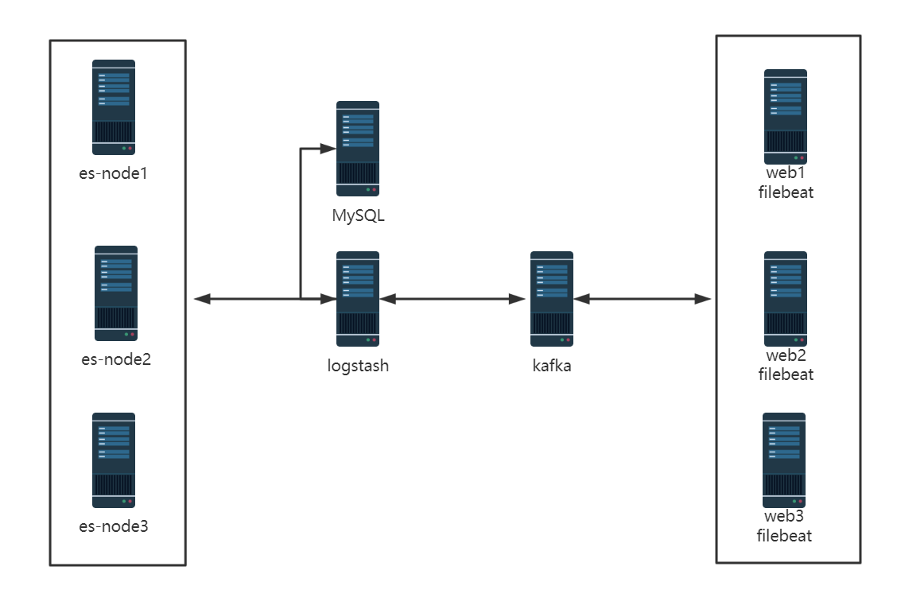
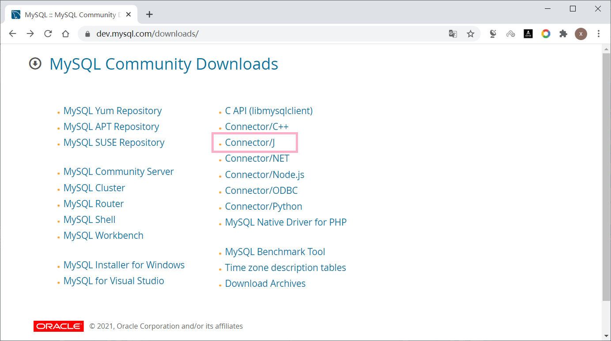
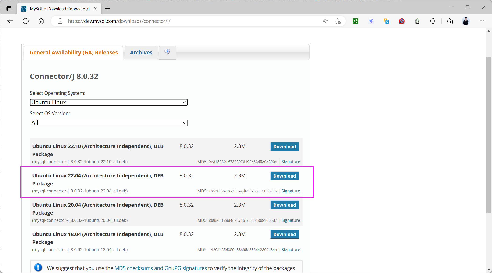
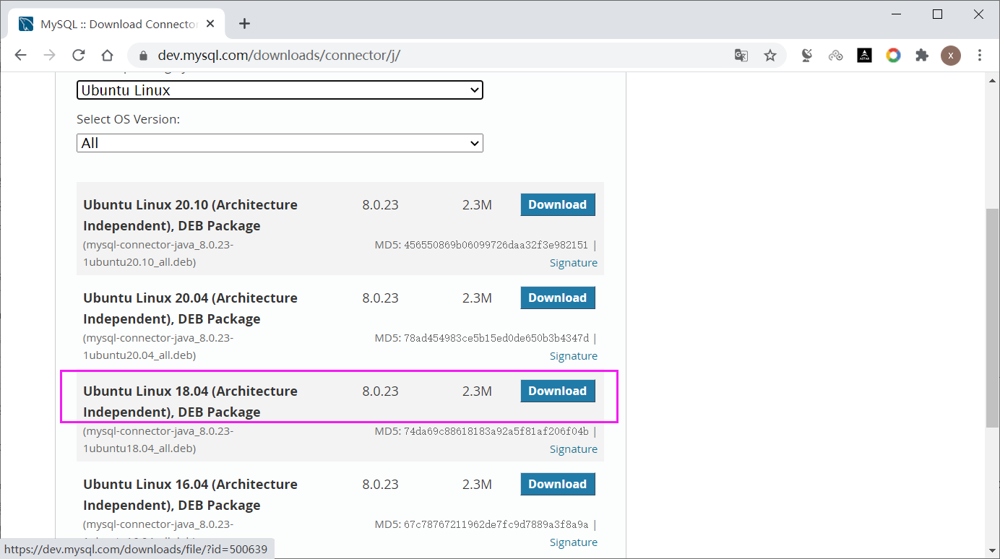
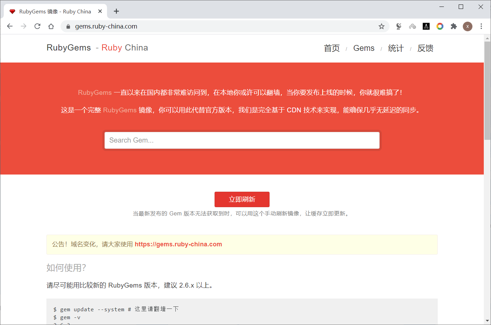

[← 返回ELK 日志分析目录]({{ '/subjects/ELK/' | relative_url }})



# 29 Logstash收集日志写入 MySQL 数据库
### 6.4 Logstash收集日志写入 MySQL 数据库

Elasticsearch 日志索引通常按保留策略清理。如果业务仍需长期汇总少量字段，可以把**经过筛选的事件**另写入 MySQL，供报表或审计查询。但 MySQL 本身也需要备份、权限控制和保留策略；把全量原始日志复制一份到关系库，未必比延长搜索存储更合适。



### 6.4.1 定义需要保留的数据

本例仅保留 Nginx 访问事件的客户端 IP、URI、状态码、响应时间和数据库接收时间。先确认各字段在上游 Filebeat/Logstash 中确实存在，特别是 IP 来源是否经过可信代理解析。关系表结构与字段类型按查询需求设计：

```sql
CREATE DATABASE IF NOT EXISTS elk CHARACTER SET utf8mb4;
USE elk;

CREATE TABLE IF NOT EXISTS elklog (
  id BIGINT UNSIGNED NOT NULL AUTO_INCREMENT PRIMARY KEY,
  client_ip VARCHAR(45) NULL,
  response_time_ms DECIMAL(12,3) NULL,
  uri VARCHAR(2048) NULL,
  status_code SMALLINT UNSIGNED NULL,
  ingested_at TIMESTAMP(3) NOT NULL DEFAULT CURRENT_TIMESTAMP(3),
  INDEX idx_ingested_at (ingested_at),
  INDEX idx_status_time (status_code, ingested_at)
);

CREATE USER 'elk_writer'@'10.0.0.%' IDENTIFIED BY '<独立强密码>';
GRANT INSERT ON elk.elklog TO 'elk_writer'@'10.0.0.%';
```

IP 字符串最多保留 45 字符以覆盖 IPv6 表示；状态码用数值字段便于统计。`<独立强密码>` 是占位值，实际账号来源地址范围也应收紧。MySQL 应只监听允许访问的受控网卡，并配置防火墙与传输加密，不要为图省事把 `bind-address` 改成 `0.0.0.0` 后对外开放。

### 6.4.2 准备 JDBC 驱动与输出插件

`logstash-output-jdbc` 是额外插件，并非所有 Logstash 版本默认包含或持续兼容。部署前要核对插件维护状态、版本和许可证；若当前版本不支持，可考虑将事件送到专门的消费程序或批处理任务，而不是强行安装旧插件。

从 [MySQL Connector/J 官方页面](https://dev.mysql.com/downloads/connector/j/)获取兼容的 JAR 文件，并放在 Logstash 用户可读取的位置。不要把其他 Ubuntu 版本的软件包强行安装到当前系统，也不要依赖带版本号的 Logstash 内部 gem 路径。







```bash
sudo mkdir -p /opt/logstash/lib
sudo install -m 0644 mysql-connector-j-VERSION.jar \
  /opt/logstash/lib/mysql-connector-j.jar
sudo /usr/share/logstash/bin/logstash-plugin install logstash-output-jdbc
sudo /usr/share/logstash/bin/logstash-plugin list | grep logstash-output-jdbc
```

把 `VERSION` 替换为下载的实际文件名。离线环境可按插件文档使用 `prepare-offline-pack` 在相同版本的 Logstash 上打包后安装，不能假定任意版本的插件包通用。更换 RubyGems 源不属于这个数据流的必要步骤。



### 6.4.3 从 Kafka 消费并写入 MySQL

此处沿用前两篇的 `filebeat-log` 主题。若在既有 Logstash 管道中**增加** JDBC 输出，事件可同时写入 Elasticsearch 与 MySQL；若新建另一个消费者并复用原消费组，两个实例只会分担消息，不会各得一份。以下示例使用独立消费组 `logstash-mysql`，因此可独立消费同一主题：

```text
input {
  kafka {
    bootstrap_servers => "10.0.0.201:9092,10.0.0.202:9092,10.0.0.203:9092"
    topics => ["filebeat-log"]
    group_id => "logstash-mysql"
    codec => json
    auto_offset_reset => "earliest"
  }
}

filter {
  if "nginx-access" in [tags] and [responsetime] {
    mutate { convert => { "responsetime" => "float" } }
  }
}

output {
  if "nginx-access" in [tags] {
    jdbc {
      driver_jar_path => "/opt/logstash/lib/mysql-connector-j.jar"
      driver_class => "com.mysql.cj.jdbc.Driver"
      connection_string => "jdbc:mysql://mysql.example.org:3306/elk?user=${MYSQL_USER}&password=${MYSQL_PASSWORD}"
      statement => [
        "INSERT INTO elklog (client_ip, response_time_ms, uri, status_code) VALUES (?, ?, ?, ?)",
        "clientip", "responsetime", "uri", "status"
      ]
    }
  }
}
```

连接字符串及 `statement` 参数格式必须按实际插件版本核对。示例中的 `ingested_at` 由 MySQL 生成，是**数据库接收时间**，不等于日志事件发生时间；若报表必须按真实事件时间统计，应先把 `@timestamp` 明确转换为 MySQL 可接受的时间格式，再增加独立字段。`${MYSQL_USER}` 与 `${MYSQL_PASSWORD}` 应由 Logstash keystore 或受控环境提供，不要硬编码在配置文件或命令行。MySQL 连接需按实际环境启用 TLS。

此类管道涉及 Kafka 消费位点、插件重试和数据库事务，**可能重复写入**。若报表不能容忍重复，应在上游生成稳定事件 ID，在表上设置唯一键并采用可重放、幂等的写入方案。

### 6.4.4 校验与统计

先校验 Logstash 配置并检查服务日志，再生成少量新访问事件；不要盲目把旧日志整批追加到 Nginx 文件中制造重复数据。

```bash
sudo /usr/share/logstash/bin/logstash --path.settings /etc/logstash \
  -f /etc/logstash/conf.d/mysql-output.conf --config.test_and_exit
sudo systemctl restart logstash
sudo journalctl -u logstash -n 50 --no-pager
```

在 MySQL 中执行只读查询，分别核对最近写入、IP 分布和状态码分布：

```sql
SELECT id, client_ip, status_code, ingested_at
FROM elklog ORDER BY id DESC LIMIT 10;

SELECT status_code, COUNT(*) AS requests
FROM elklog GROUP BY status_code ORDER BY requests DESC LIMIT 10;
```

若表没有新行，沿 Filebeat → Kafka 主题/消费组 → Logstash 输出日志 → MySQL 权限与网络的顺序排查。不要只看 Logstash 进程是否存活。



<nav class="article-end" aria-label="章节导航">
  <a href="{{ '/subjects/ELK/28-mapping-visitor-cities-by-ip-address.html' | relative_url }}">← 上一篇：通过坐标地图统计网站访问用户的 IP 所在城市</a>
  <a href="{{ '/subjects/ELK/' | relative_url }}">返回 ELK 日志分析目录</a>
  <a href="{{ '/subjects/ELK/30-common-interview-questions.html' | relative_url }}">下一篇：常见面试题 →</a>
</nav>
