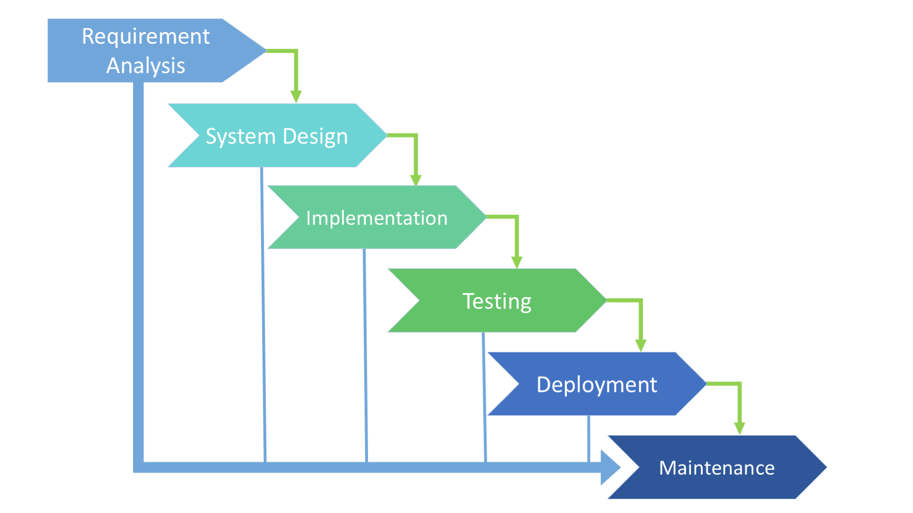
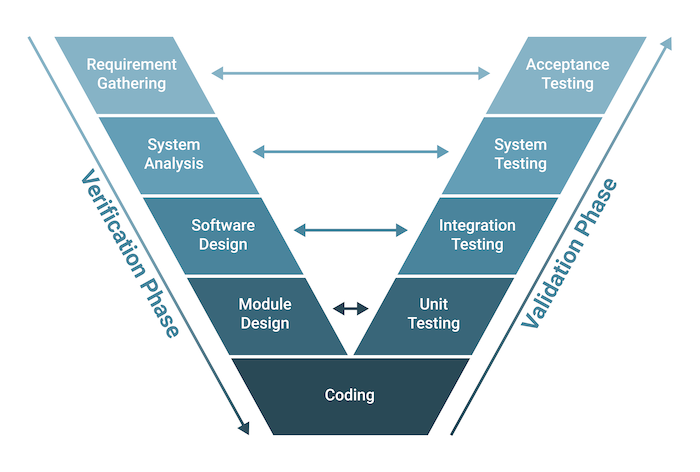
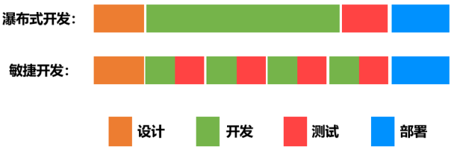

[← Back to Git and GitLab Version Control Index]({{ '/subjects/Git-GitLab/' | relative_url }})



# 01 Traditional Development Models
## 1 DevOps 简介

### 1.1 传统开发模型

### 软件开发生命周期

软件开发生命周期SDLC (Software Development Life Cycle)由计划,分析,设计,实现,测试集成和维护组成

阶段1: 计划和需求分析 (Planning and Requirement Analysis)

每个软件开发生命周期模型都从分析开始，过程的利益相关者讨论对最终产品的要求。此阶段的目标是系统要求的详细定义。此外，还需要确保所有流程参与者都清楚地了解任务以及每个需求将如何实施。通常，讨论涉及质量保证专家，如果有必要，他们甚至可以在开发阶段干预过程中的添加。 阶段2: 设计项目架构 (Project Architecture)

在软件开发生命周期的第二阶段，开发人员实际上正在设计架构。所有利益相关者（包括客户）都会讨论此阶段可能出现的所有不同技术问题。此外，还定义了项目中使用的技术，团队负载，限制，时间范围和预算。最合适的项目决策是根据定义的要求做出的。

阶段3: 开发和编程 (Development and Coding)

在批准要求后，该过程进入下一阶段 - 实际开发。程序员从这里开始编写源代码，同时牢记先前定义的需求。系统管理员调整软件环境，前端程序员开发程序的用户界面以及与服务器交互的逻辑。 编程本身一般会用四个阶段:算法开发,源代码编写,编译,测试和调试

阶段4: 测试 (Testing)

测试阶段包括调试过程。开发过程中遗漏的所有代码缺陷都会在此处检测到，记录下来并传回给开发人员进行修复。重复测试过程，直到删除所有关键问题并且软件工作流程稳定。

阶段5: 部署 (Deployment)

当程序最终确定并且没有关键问题时 - 是时候为最终用户启动它了。新程序版本发布后，技术支持团队加入。该部门提供用户反馈; 在利用期间咨询和支持用户。此外，此阶段还包括所选组件的更新，以确保软件是最新的，并且不会受到安全漏洞的影响。

阶段6: 维护 (Maintenace)

运维工程师维护和管理此软件项目

SDLC 模型 (Software Development Life cycle Model)

从第一个也是最古老的“瀑布式”SDLC模型演变而来，其种类不断扩大。比较常见的SDLC模型如下

瀑布模型 (Waterfall Model) 迭代模型 (Iterative Model) 螺旋模型 (Spiral Model) V形模型 (V-Shape Model)： 单元测试，集成测试，系统测试，验收测试敏捷模型 (Agile Model)

### 瀑布模型

瀑布模型是早期实现的开发模型,是一个级联SDLC模型，其中开发过程看起来像制造业的流水线，一步一步地进行分析，预测，实现，测试，实施和支持阶段。

该SDLC模型包括完全逐步执行每个阶段。该过程严格记录并预定义，具有该软件开发生命周期模型的每个阶段所期望的功能。

类似工厂中流水线的传送带，加工的产品只能按照一道一道的工序向下不断前进，不能后退。

优点缺点

简单易用和理解各个阶段的划分完全固定，阶段之间产生大量的文档，极大地增

加了工作量

当前一阶段完成后，只需要

由于开发模型是线性的，用户只有等到整个过程的末期才能见到

去关注后续阶段

开发成果，从而增加了开发风险

为项目提供了按阶段划分的检查节点不适应用户需求的变化

### V 形模型

### 敏捷开发

Agile Model 敏捷开发的核心是迭代开发(lterative Development)与增量开发 (IncrementalDevelopment) 。

迭代开发:

对于大型软件项目，传统的开发方式是采用一个大周期(比如一年或数年)进行开发，整个过程就是一次"大开发"

迭代开发的方式则不一样，它将开发过程拆分成多个小周期，即一次"大开发"变成多次"小开发"，每次小开发都是同样的流程，所以看上去就好像重复在做同样的步骤

比如: 某米公司生产手机,第一次生产某米1代(比较简陋),逐年再生产某米2代,目前已经到某米1X代

增量开发:

软件的每个版本，都会新增一个可以被用户感知到的完整功能。也就是说，按照新增功能来划分迭代。

比如:

房地产公司开发一个小区。如果采用增量开发的模式，该公司第一个迭代就是交付第一期楼盘，第二个迭代交付第二期楼盘..….每个迭代都是只完成一期完整的楼盘。而不是第一次迭代就挖好所有楼盘的地基，第二个迭代建好所有楼盘的骨架，第三个迭代架设屋顶.….....

虽然敏捷开发将软件开发分成多个迭代，但是也要求，每次迭代都是一个完整的软件开发周期，必须按照软件工程的方法论，进行正规的流程管理。

优势

尽早交付,加快资金回笼降级风险,及时了解市场需求，及时获取问题反馈提高效率,阶段性功能拆分及快速质量反馈

敏捷开发这种小步快跑的方式，大幅提高了开发团队的工作效率，让版本的更新速度变得更快。

更新版本的速度快了，风险不是更大了吗？其实，事实并非如此。

敏捷开发可以帮助更快地发现问题，产品被更快地交付到用户手中，团队可以更快地得到用户的反馈， 从而进行更快地响应。而且，DevOps小步快跑的形式带来的版本变化是比较小的，风险会更小（如下图所示）。即使出现问题，修复起来也会相对容易一些。



<nav class="article-end" aria-label="章节导航">
  <a href="{{ '/subjects/Git-GitLab/' | relative_url }}">Back to Git and GitLab Version Control Index</a>
  <a href="{{ '/subjects/Git-GitLab/02-introduction-to-devops.html' | relative_url }}">Next: Introduction to DevOps →</a>
</nav>
