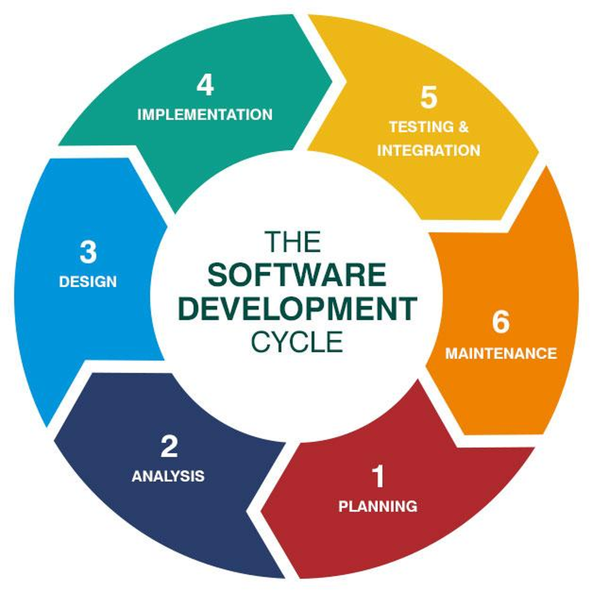
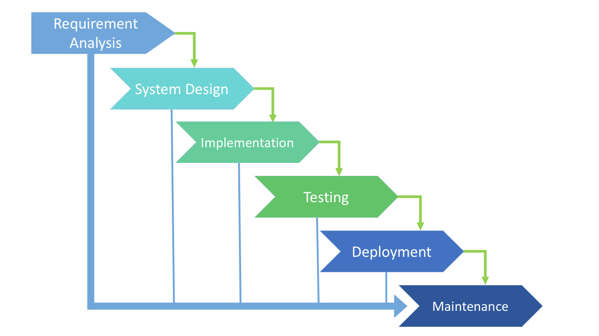
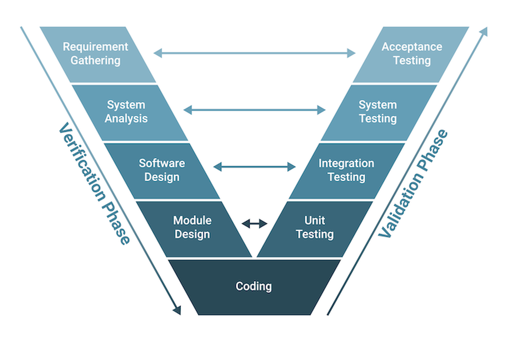
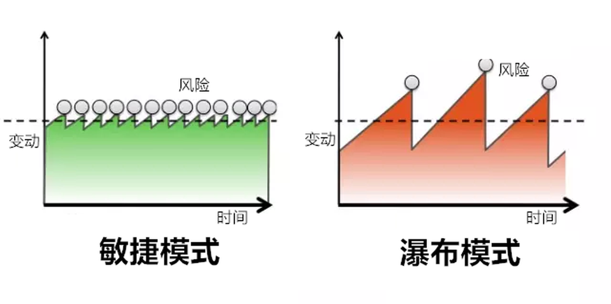

[← 返回Git 与 GitLab 版本控制目录]({{ '/subjects/Git-GitLab/' | relative_url }})



# 01 传统开发模型

在理解 DevOps 和 Git 的协作价值之前，先看软件从需求到维护通常经历哪些阶段，以及传统流程为何难以快速响应变化。

### 1.1 传统开发模型

### 软件开发生命周期

软件开发生命周期（SDLC）描述软件从需求提出到长期维护的全过程。下列阶段是理解流程的参考框架，实际项目中可能并行或反复迭代，而不一定只走一遍。

#### 1. 计划与需求分析（Planning and Requirement Analysis）

业务方、开发和测试共同澄清目标、约束和验收标准，形成可核对的需求。测试人员越早参与，越容易在编码之前发现模糊或相互矛盾的要求。

#### 2. 架构与设计（Project Architecture）

团队根据需求选择系统边界、技术方案、数据结构和部署方式，同时评估人员、时间、预算与非功能性要求。设计的目标不是预知所有变化，而是让关键取舍可解释、可验证。

#### 3. 开发与编码（Development and Coding）

开发人员将需求实现为代码，同时准备开发、测试和运行环境。编码并非只有“写代码”：设计实现、构建、单元测试和调试通常穿插进行，代码也应纳入版本控制以便协作与回溯。

#### 4. 测试（Testing）

通过单元、集成、系统和验收测试验证功能与质量。发现缺陷后记录复现条件并反馈开发修复，再进行回归测试；测试不能保证发现所有问题，因此要结合上线监控。

#### 5. 部署（Deployment）

通过发布流程将经过验证的版本交付给用户。部署前应确认配置、数据迁移、回滚方案和监控；上线后观察错误率与业务指标，确认新版本确实可用。

#### 6. 维护（Maintenance）

运行期间持续处理故障、修复缺陷、更新依赖并收集反馈。反馈会重新进入需求分析，形成下一轮迭代。

### 常见 SDLC 模型

不同模型主要区别在于阶段如何组织、何时验证以及如何处理变化。常见的有瀑布、迭代、螺旋、V 形和敏捷开发模型。其中 V 形模型强调开发阶段与相应测试层级的对应关系；敏捷开发则强调短周期交付与反馈。

### 瀑布模型

瀑布模型按需求、设计、实现、测试和交付等阶段推进，通常要求前一阶段的成果经过确认后再进入下一阶段。它强调文档、阶段边界和审核节点，但需求若在后期发生变化，返工成本往往较高；“不能后退”是对其代价的比喻，而非实际流程的绝对限制。

| 优点 | 局限 |
| --- | --- |
| 阶段边界清晰，便于分工与审核。 | 跨阶段文档和交接成本较高。 |
| 每一阶段都有可检查的交付物。 | 用户可能到较晚阶段才看到可用产品，问题暴露较迟。 |
| 需求稳定、合规要求明确时容易规划。 | 需求频繁变化时，返工和调整成本较高。 |

### V 形模型

V 形模型在瀑布式阶段安排上更突出验证：需求对应验收测试，系统设计对应系统测试，模块设计对应集成或单元测试。测试方案应尽早设计，而不是等开发结束后才考虑如何检验。

### 敏捷开发

敏捷开发强调以较短周期持续交付可用成果，并依据反馈调整后续工作。迭代开发（Iterative Development）侧重反复改进产品；增量开发（Incremental Development）侧重每次交付新增的可用能力，两者常结合使用。

**迭代开发。**

相较于一次长周期开发，迭代开发将工作拆为多个短周期，每轮都围绕明确目标设计、实现、测试并复盘。例如先交付核心登录流程，再根据使用反馈改善体验和性能，而不是等全部功能完成才首次交付。

**增量开发。**

每次交付增加一部分可独立使用的功能。例如先交付查询，再增加导出；用户在第二次交付前就能使用查询。增量应能端到端工作，而不只是完成一半的界面或后台。

短周期不等于省略工程实践。每轮仍需明确验收标准、测试和交付方式。较小的变更通常更容易定位问题、回滚和依据反馈调整，但发布频率高也要求自动化测试、监控和可靠的部署流程；否则风险仍会累积。



<nav class="article-end" aria-label="章节导航">
  <a href="{{ '/subjects/Git-GitLab/' | relative_url }}">返回 Git 与 GitLab 目录</a>
  <a href="{{ '/subjects/Git-GitLab/02-introduction-to-devops.html' | relative_url }}">下一篇：DevOps 简介 →</a>
</nav>
