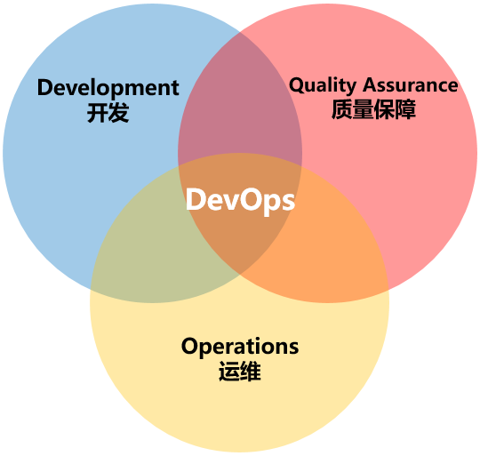
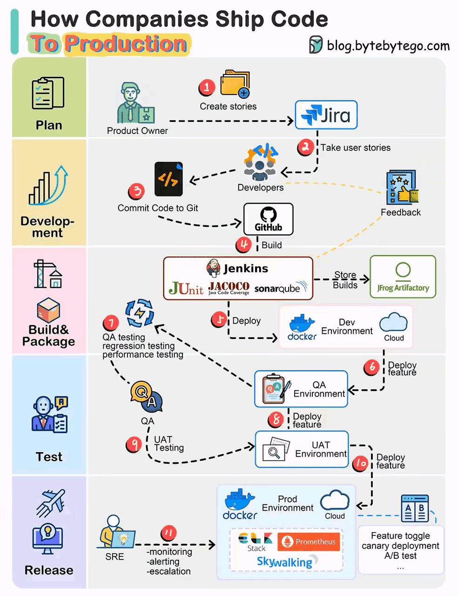
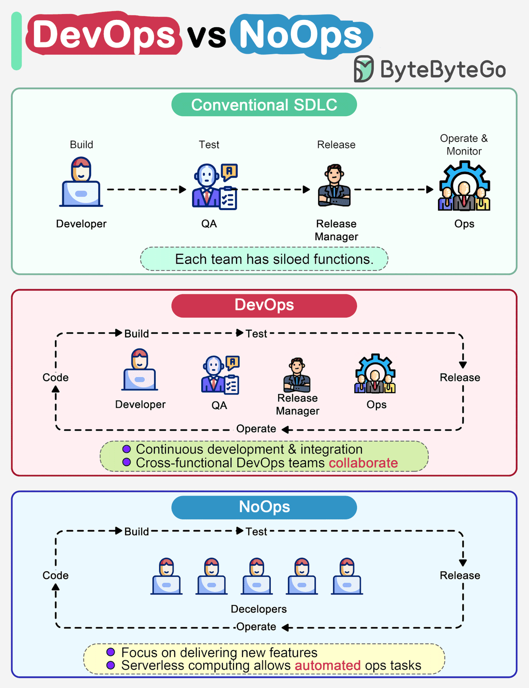
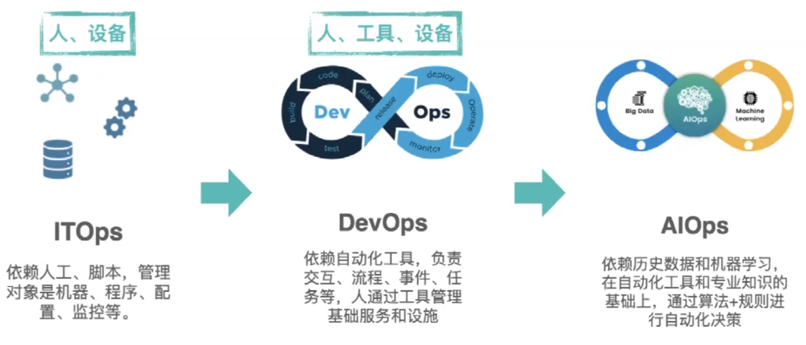

[← 返回Git 与 GitLab 版本控制目录]({{ '/subjects/Git-GitLab/' | relative_url }})



# 02 DevOps 介绍
### 1.2 DevOps 介绍

### 什么是 DevOps

DevOps 即开发 Development 和 Operations运维的缩写。

DevOps的维基百科定义是这样的：

DevOps是一组过程、方法与系统的统称，用于促进开发、技术运营和质量保障（QA）部门之间的沟通、协作与整合。 DevOps 是针对开发人员、运维人员和测试人员的一种工作理念，是软件在应用开发、代码部署和质量测试等整条生命周期中协作和沟通的最佳实践

DevOps 强调整个组织的所有相关部门的紧密合作以及交付和基础设施变更的自动化、从而实现持续集成、持续部署和持续交付的目标

### 为什么要 DevOps

传统的模式是开发人员只关心开发程序，追求功能的变化和实现

运维只负责基础环境管理和代码部署及监控等，更看重应用的稳定运行

双方缺少一个共同的目标

DevOps 强调团队协作、相互协助、持续发展，实现团队作战，即无论是开发、运维还是测试，都为了最终的代码发布、持续部署和业务稳定而付出各自的努力，从而实现产品设计、开发、测试和部署的良性循环，实现产品的最终持续交付。

想要将DevOps真正落地，首先第一点，是思维转变，也就是“洗脑”。不仅是运维的要洗，开发的也要洗。员工要洗，领导更要洗。

DevOps并不仅仅是组织架构变革，更是企业文化和思想观念的变革。如果不能改变观念，即使将员工放在一起，也不会产生火花。

除了洗脑之外，就是根据DevOps思想重新梳理全流程的规范和标准。

在DevOps的流程下，运维人员会在项目开发期间就介入到开发过程中，了解开发人员使用的系统架构和技术路线，从而制定适当的运维方案。而开发人员也会在运维的初期参与到系统部署中，并提供系统部署的优化建议。

DevOps的实施，促进开发和运维人员的沟通，增进彼此的理（gan）解（qing）。

DevOps组织优先推动的目标

一组标准化的环境降低新版本的失败率缩短版本之间的交付时间更快的平均版本恢复时间

DevOps的关键指标

平均恢复时间: Mean-time to recovery (MTTR) 平均投产时间: Mean-time to production 平均提前时间:Average lead-time，比计划时间提前部署速度:Deployment speed 部署频率:Deployment frequency 生产失败率:Production failure rate

### DevOps 相关的软件

DevOps 有多个不同的阶段：计划，构建，持续集成，部署，运维，持续反馈

在思维和流程改变的同时，想要充分落地DevOps，当然离不开软件和平台的支持。目前支持DevOps的软件很多了。

DevOps 涉及的四大相关平台

项目管理：如：Jira,禅道代码托管：如：Gitlab,SVN 持续交付：如：Jenkins,Gitlab 运维平台：如：腾讯蓝鲸,Spug等

### DevOps 流水线模型

在当今快节奏的软件开发环境中，将代码交付到生产环境需要一个定义明确且高效的流程。

无论规模大小，公司都依靠结构化的工作流程来确保代码更改在到达生产环境之前符合质量标准。

通常大厂 DevOps 流程通常涵盖了从需求定义到代码开发、构建、测试、部署以及监控的完整生命周期。

具体来说，这个流程包括了敏捷开发，以及持续集成和持续部署的实践等。同时，它还考虑了多个环境以及相应的测试阶段。

第 1 步：需求和用户故事

该过程从产品所有者根据业务需求创建用户情景开始。这些用户故事是开发团队工作的基础。

第 2 步：冲刺计划

开发团队从待办事项中获取用户故事，并将它们组织到冲刺中，通常遵循敏捷方法。每个冲刺可能跨越一个固定的时间段，例如两周的开发周期。

第 3 步：源代码提交

开发人员将他们的源代码提交到 Git 等版本控制系统中。这可确保跟踪更改，并且可以管理不同版本的代码。

步骤 4：持续集成 （CI） 生成过程是使用 CI 工具（如 Jenkins）启动的。源代码经过严格的测试，包括单元测试、代码覆盖率检查和代码质量门。

SonarQube 等工具有助于维护代码质量标准。

第 5 步：工件管理

成功的生成存储在项目存储库中，例如 Artifactory。此存储库允许轻松检索以前的构建和项目。

步骤 6：部署到开发环境

新代码将部署到开发环境中进行初始测试和集成。这种环境有助于发现不同开发分支之间的早期问题和冲突。

第 7 步：隔离测试

在多个开发团队处理不同功能的情况下，单独测试这些功能至关重要。因此，代码被部署到单独的 QA1 和 QA2 环境中以避免干扰。

第 8 步：QA 测试

质量保证 （QA） 团队接管新的 QA 环境并执行各种测试，包括功能测试、回归测试和性能测试。目标是在继续操作之前识别并解决任何问题。

步骤 9：用户验收测试 （UAT）

QA 测试成功通过后，代码将继续进入用户验收测试 （UAT） 环境。利益干系人验证它是否满足他们的要求和期望。

第 10 步：准备生产

如果 UAT 测试成功，则内部版本将成为候选版本。根据发布计划，计划将它们部署到生产环境。

第 11 步：站点可靠性工程 （SRE）

站点可靠性工程 （SRE） 团队承担着监控生产环境的关键责任。他们确保其稳定性和可靠性，并及时响应任何问题。

总的来说，以上这个流程展示了一个高度自动化、协调一致、质量保障的 DevOps 实践，符合一般的大厂在软件开发和部署方面的要求。

这种结构化的发布过程可确保代码更改在到达生产环境之前经过全面测试并满足业务要求。

虽然具体的工具和方法可能因公司而异，具体的流程可能因组织和项目的不同而有所调整，但在许多软件开发组织中，发布过程的核心结构保持一致。

### DevOps 和 NoOps,AIOps



<nav class="article-end" aria-label="章节导航">
  <a href="{{ '/subjects/Git-GitLab/01-traditional-development-models.html' | relative_url }}">← Previous: Traditional Development Models</a>
  <a href="{{ '/subjects/Git-GitLab/' | relative_url }}">Back to Git and GitLab Version Control Index</a>
  <a href="{{ '/subjects/Git-GitLab/03-continuous-integration-delivery-and-deployment.html' | relative_url }}">Next: Continuous Integration, Delivery, and Deployment →</a>
</nav>
