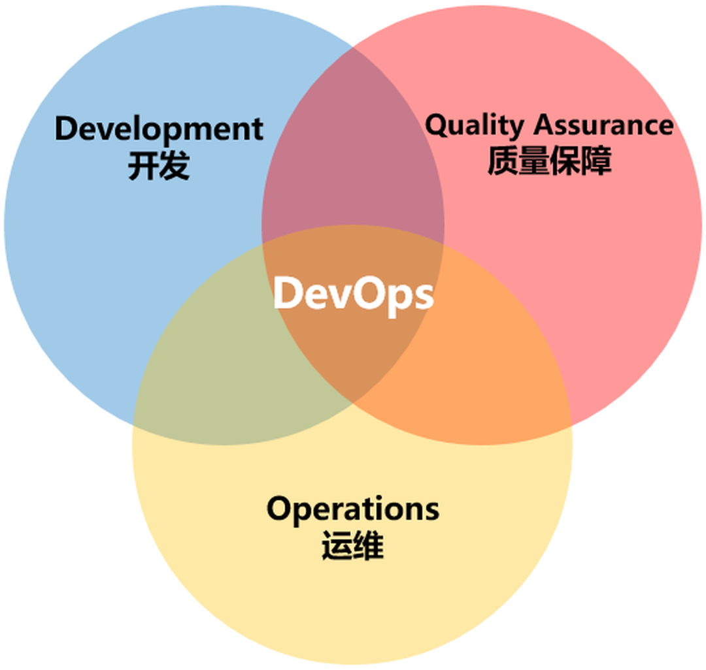
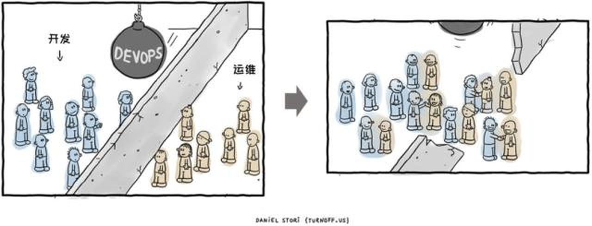
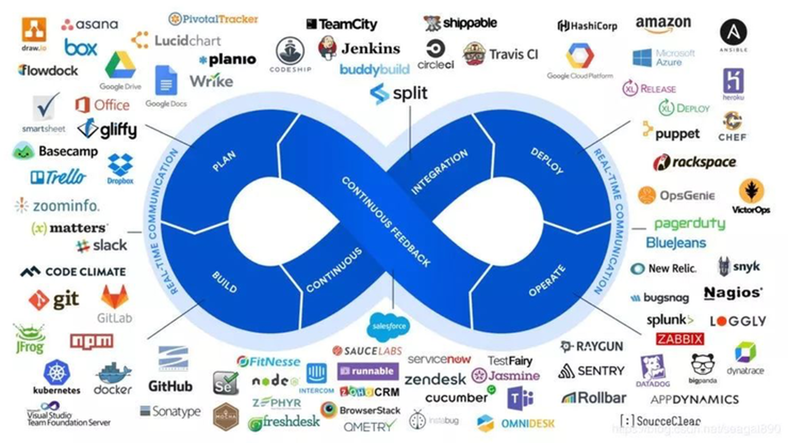
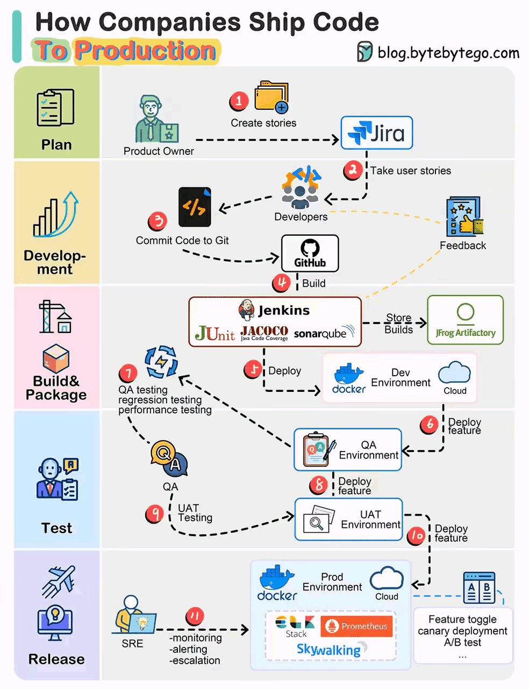
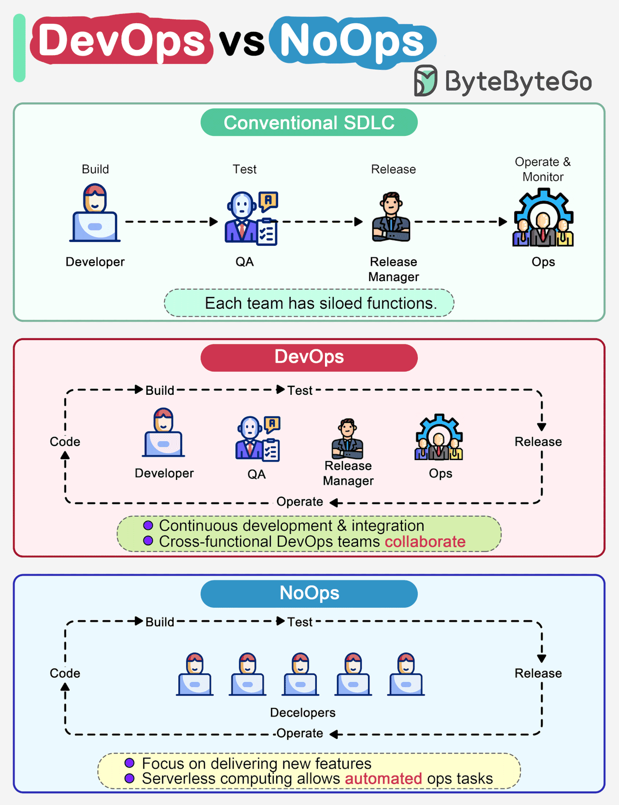
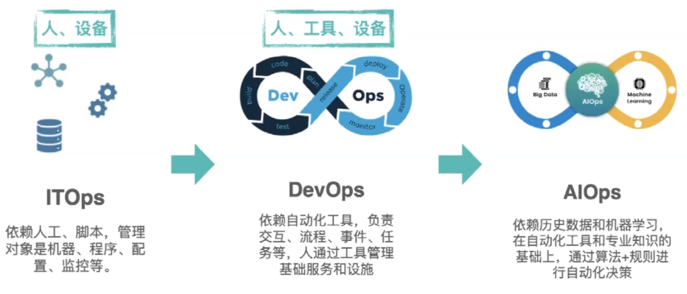

[← 返回Git 与 GitLab 版本控制目录]({{ '/subjects/Git-GitLab/' | relative_url }})



# 02 DevOps 介绍

上一篇介绍了开发生命周期；本篇说明为什么仅靠分工和交接难以持续交付，以及 DevOps 如何把开发、测试和运维连接起来。

### 什么是 DevOps

DevOps 由 Development（开发）和 Operations（运维）组成，指跨角色协作、自动化和持续改进的一组实践。开发、测试和运维共同对软件从设计到运行的结果负责，而不是把代码交接视为工作的终点。CI/CD 是常见的技术实践，但引入工具本身并不等于完成 DevOps 转型。

### 为什么要 DevOps

传统分工中，开发团队重视功能交付，运维团队重视环境稳定。如果双方只在上线时交接，部署要求、监控指标和故障处理方案常常发现得太晚。共同的目标应是**稳定地向用户交付价值**：开发时考虑可部署性和可观测性，运维则尽早参与架构与发布设计。

DevOps 强调团队协作、相互协助、持续发展，实现团队作战，即无论是开发、运维还是测试，都为了最终的代码发布、持续部署和业务稳定而付出各自的努力，从而实现产品设计、开发、测试和部署的良性循环，实现产品的最终持续交付。

落地 DevOps 首先要改变协作方式：团队共享目标、及时反馈问题，再据此梳理从需求到运行的流程。仅把不同岗位安排在同一团队，若仍各自优化局部指标，交接壁垒并不会消失。

在DevOps的流程下，运维人员会在项目开发期间就介入到开发过程中，了解开发人员使用的系统架构和技术路线，从而制定适当的运维方案。而开发人员也会在运维的初期参与到系统部署中，并提供系统部署的优化建议。

落地时可以先关注四类可衡量的结果：

| 指标 | 含义 | 希望改善的方向 |
| --- | --- | --- |
| 部署频率 | 成功发布到生产环境的频率 | 在质量可控的前提下提高 |
| 变更前置时间 | 从代码提交到投入生产所需的时间 | 缩短 |
| 变更失败率 | 导致回滚、修复或故障的生产变更比例 | 降低 |
| 服务恢复时间（MTTR） | 故障发生后恢复服务所需的时间 | 缩短 |

这些指标应结合业务和质量一起看：单纯追求发布次数并不代表交付能力提升。

### DevOps 相关的软件

DevOps 有多个不同的阶段：计划，构建，持续集成，部署，运维，持续反馈

在思维和流程改变的同时，想要充分落地DevOps，当然离不开软件和平台的支持。目前支持DevOps的软件很多了。

常见工具按用途可分为：项目管理（如 Jira、禅道）、代码托管（如 GitLab）、构建与交付（如 Jenkins、GitLab CI/CD）以及运行管理与监控平台。Git、SVN 是版本控制工具，不等同于代码托管平台；同一平台也可能覆盖多个环节。

### DevOps 流水线模型

在当今快节奏的软件开发环境中，将代码交付到生产环境需要一个定义明确且高效的流程。

无论规模大小，公司都依靠结构化的工作流程来确保代码更改在到达生产环境之前符合质量标准。

通常大厂 DevOps 流程通常涵盖了从需求定义到代码开发、构建、测试、部署以及监控的完整生命周期。

具体来说，这个流程包括了敏捷开发，以及持续集成和持续部署的实践等。同时，它还考虑了多个环境以及相应的测试阶段。

第 1 步：需求和用户故事

该过程从产品所有者根据业务需求创建用户情景开始。这些用户故事是开发团队工作的基础。

第 2 步：冲刺计划

开发团队从待办事项中获取用户故事，并将它们组织到冲刺中，通常遵循敏捷方法。每个冲刺可能跨越一个固定的时间段，例如两周的开发周期。

第 3 步：源代码提交

开发人员将他们的源代码提交到 Git 等版本控制系统中。这可确保跟踪更改，并且可以管理不同版本的代码。

第 4 步：持续集成（CI）。代码提交触发构建和自动化检查，包括单元测试、代码质量检查等。失败时应尽快反馈给提交者，而不是把未验证的构建继续送往下游。

SonarQube 等工具有助于维护代码质量标准。

第 5 步：工件管理

将通过检查的构建产物保存到制品库（例如 Artifactory），并记录其版本与来源提交。后续环境复用同一制品，避免重复构建产生差异。

第 6 步：部署到开发环境

新代码将部署到开发环境中进行初始测试和集成。这种环境有助于发现不同开发分支之间的早期问题和冲突。

第 7 步：隔离测试

在多个开发团队处理不同功能的情况下，单独测试这些功能至关重要。因此，代码被部署到单独的 QA1 和 QA2 环境中以避免干扰。

第 8 步：QA 测试

质量保证 （QA） 团队接管新的 QA 环境并执行各种测试，包括功能测试、回归测试和性能测试。目标是在继续操作之前识别并解决任何问题。

第 9 步：用户验收测试（UAT）

QA 测试成功通过后，代码将继续进入用户验收测试 （UAT） 环境。利益干系人验证它是否满足他们的要求和期望。

第 10 步：准备生产

如果 UAT 测试成功，则内部版本将成为候选版本。根据发布计划，计划将它们部署到生产环境。

第 11 步：站点可靠性工程 （SRE）

站点可靠性工程 （SRE） 团队承担着监控生产环境的关键责任。他们确保其稳定性和可靠性，并及时响应任何问题。

总的来说，以上这个流程展示了一个高度自动化、协调一致、质量保障的 DevOps 实践，符合一般的大厂在软件开发和部署方面的要求。

这种结构化的发布过程可确保代码更改在到达生产环境之前经过全面测试并满足业务要求。

虽然具体的工具和方法可能因公司而异，具体的流程可能因组织和项目的不同而有所调整，但在许多软件开发组织中，发布过程的核心结构保持一致。

### DevOps、NoOps 与 AIOps

NoOps 通常指通过平台和自动化减少应用团队直接处理基础设施的工作，并不意味着运行维护责任消失。AIOps 则尝试利用数据分析与机器学习辅助告警聚合、异常检测和故障定位。两者是运行方式或技术能力的讨论，不能替代前述跨团队协作。



<nav class="article-end" aria-label="章节导航">
  <a href="{{ '/subjects/Git-GitLab/01-traditional-development-models.html' | relative_url }}">← 上一篇：传统开发模型</a>
  <a href="{{ '/subjects/Git-GitLab/' | relative_url }}">返回 Git 与 GitLab 版本控制目录</a>
  <a href="{{ '/subjects/Git-GitLab/03-continuous-integration-delivery-and-deployment.html' | relative_url }}">下一篇：持续集成、持续交付与持续部署（CI/CD） →</a>
</nav>
