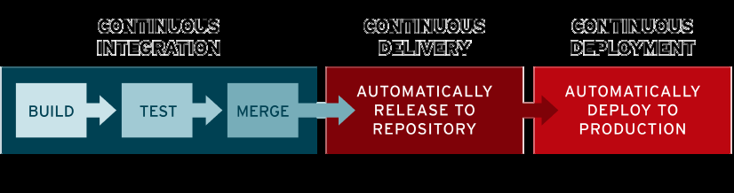
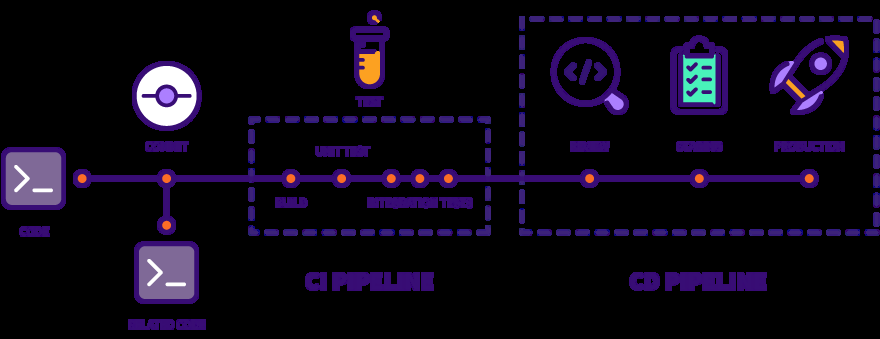
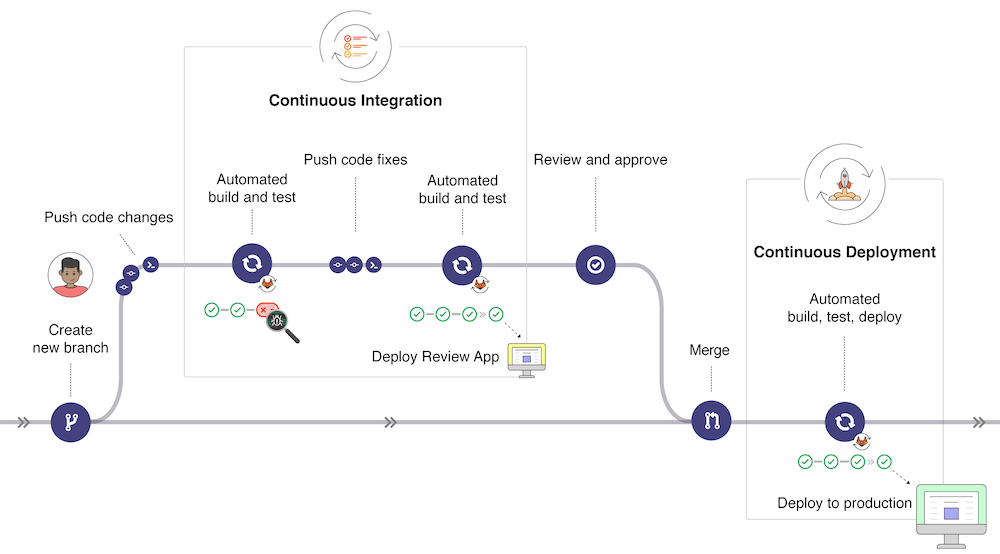
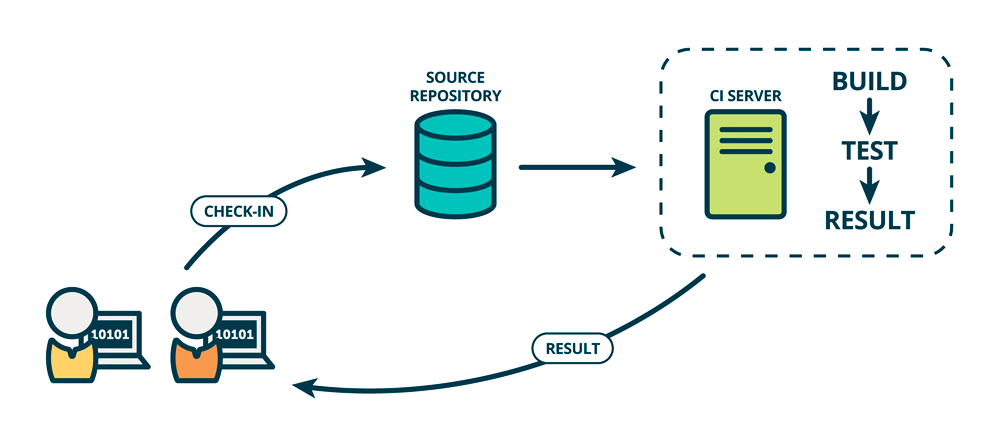
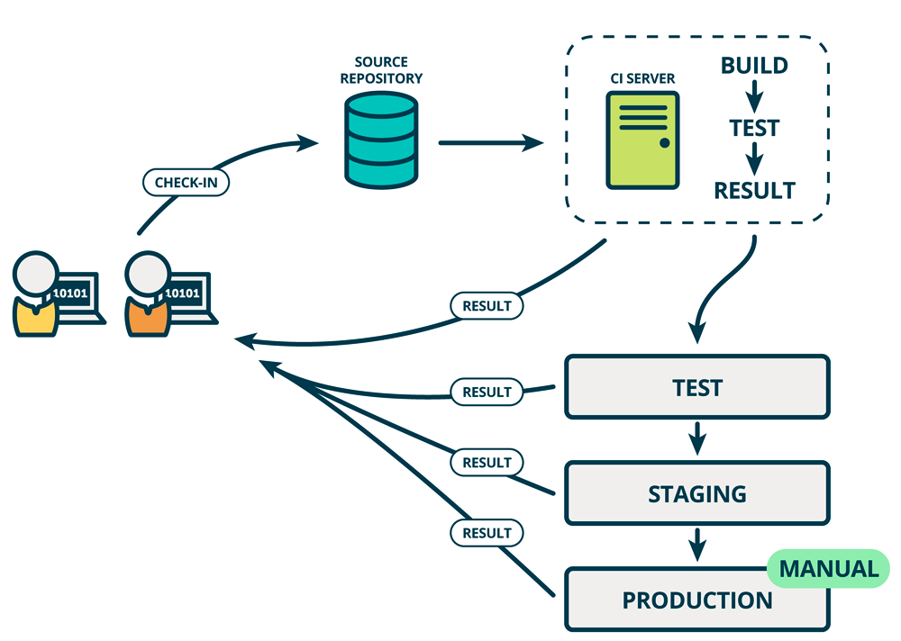
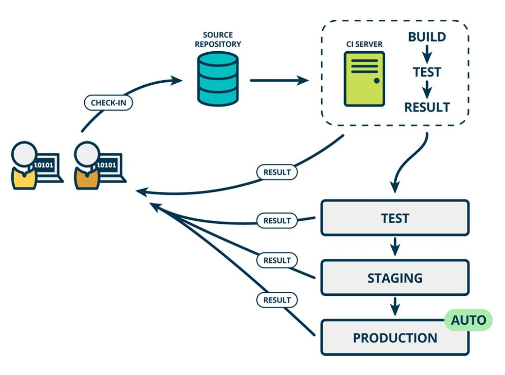

[← 返回Git 与 GitLab 版本控制目录]({{ '/subjects/Git-GitLab/' | relative_url }})



# 03 持续集成、持续交付与持续部署（CI/CD）

瀑布、敏捷与 DevOps 不是必须依次替代的三个时代：它们分别描述不同的流程组织方式和协作实践。CI/CD 是 DevOps 中常用的自动化手段，帮助团队缩短从代码变更到用户反馈的周期。

发布频率取决于产品类型、风险与组织能力。在线服务可能一天发布多次，而受监管或依赖硬件交付的产品可能采用较长周期；关键不是追求特定次数，而是让每次变更都可验证、可追踪、可回滚。

在线服务能够通过发布流水线把小批量变更逐步送到用户面前。流水线串联构建、测试、制品保存、环境部署和验证；失败的阶段阻止后续发布。桌面软件或嵌入式产品同样可以使用 CI/CD，只是最后的分发方式不同。

参考资料：Red Hat 的 CI/CD 概述。

<https://www.redhat.com/zh/topics/devops/what-is-ci-cd>

<https://docs.gitlab.com/ee/ci/introduction/>

### 持续集成 (CI-Continuous Integration)

持续集成要求开发者频繁将小批量变更集成到共享分支，并由自动化构建和测试尽早发现冲突。它并不保证“相互不影响”；恰恰是通过尽早暴露影响，降低长期分支合并的成本。
典型流程是提交代码后触发编译、静态检查与单元测试，再报告结果。若检查失败，应先修复共享分支，而不是继续交付不可靠的制品。签名、打包可以接在 CI 后面，但并非判断是否实施 CI 的必要条件。

### 持续交付(CD-Continuous Delivery)

持续交付在 CI 基础上继续自动化制品生成、环境部署和发布前验证，使合格版本保持“可按需发布”状态。是否真正推送到生产环境，通常仍由人员或发布策略决定；制品库只是交付链的一环，不是持续交付的终点。

例如，代码提交后完成编译和单元测试，再把同一制品部署到预发布环境做集成与验收测试。验证通过后由负责人选择发布时间，这就是持续交付；若流水线自动完成最后的生产发布步骤，则属于持续部署。

### 持续部署(CD-Continuous Deployment)

持续部署将通过全部自动化检查的版本自动发布到生产环境，而无需每次人工批准。因此需要可靠的测试、渐进式发布、监控和快速回滚能力。

自动发布并不意味着变更一定在几分钟内生效，也不能保证零故障：流水线时长、发布窗口、灰度策略和观察期都会影响生效时间。选择持续交付还是持续部署，应根据业务风险、测试覆盖率与故障恢复能力决定。

### DevOps 和 CICD

**DevOps** 涵盖开发到运行的共同目标、协作方式和持续反馈；**CI/CD** 聚焦其中的代码集成、质量检查、制品和发布自动化。团队可以先建立小而可靠的 CI，再按业务风险选择人工确认的持续交付或自动发布的持续部署。自动化缩短反馈时间，但不能替代需求澄清、设计评审和生产监控。



<nav class="article-end" aria-label="章节导航">
  <a href="{{ '/subjects/Git-GitLab/02-introduction-to-devops.html' | relative_url }}">← 上一篇：DevOps 介绍</a>
  <a href="{{ '/subjects/Git-GitLab/' | relative_url }}">返回 Git 与 GitLab 版本控制目录</a>
  <a href="{{ '/subjects/Git-GitLab/04-ci-cd-process-and-architecture.html' | relative_url }}">下一篇：CI/CD 流程与架构 →</a>
</nav>
