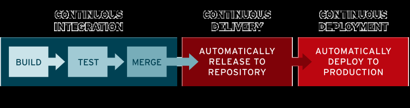
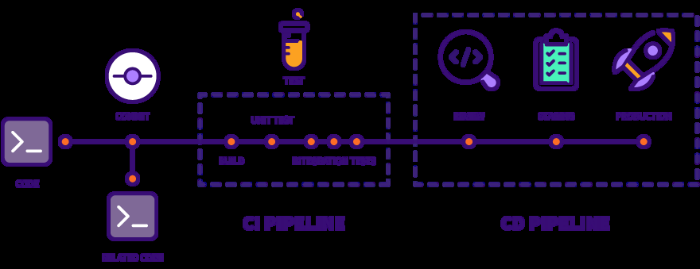
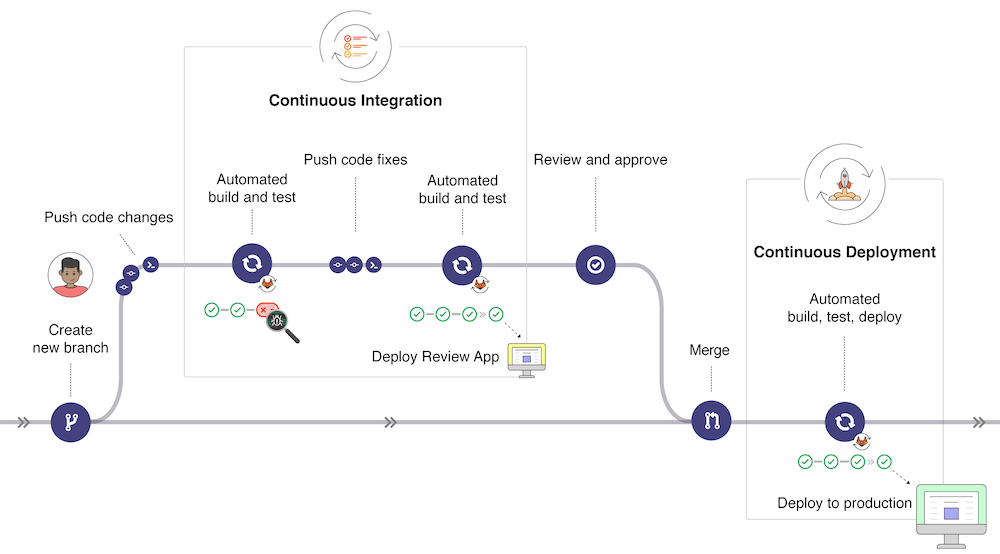
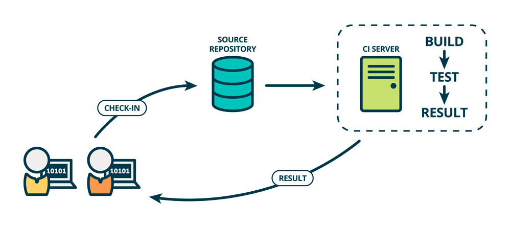
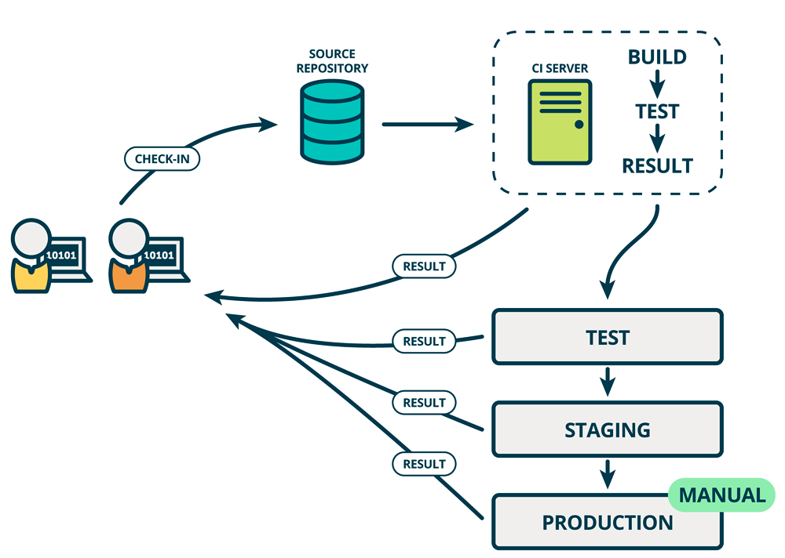
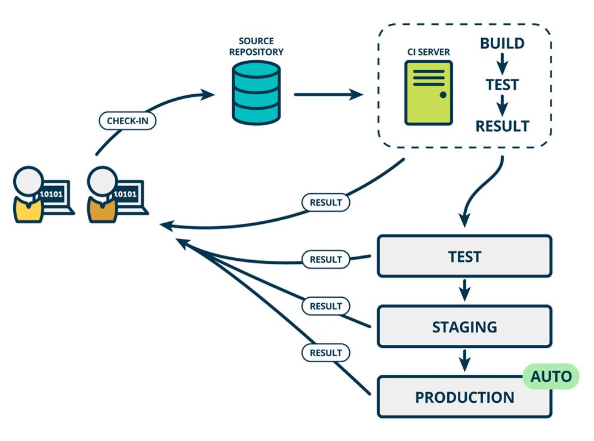

[← Back to Git and GitLab Version Control Index]({{ '/subjects/Git-GitLab/' | relative_url }})



# 03 Continuous Integration, Delivery, and Deployment
### 1.3 持续集成、持续交付和持续部署 CICD

最初是瀑布模型，后来是敏捷开发，现在是DevOps，这是现代开发人员构建出色的产品的技术路线。 随着DevOps的兴起，出现了持续集成（Continuous Integration）、持续交付（Continuous Delivery） 、持续部署（Continuous Deployment） 的新方法。

传统的软件开发和交付方法正在迅速变得过时。从以前的敏捷时代，大多数公司会每月，每季度，每两年甚至每年发布部署/发布软件。然而现在在DevOps时代，每周，每天，甚至每天多次是常态。

当SaaS正在占领世界时，尤其如此，您可以轻松地动态更新应用程序，而无需强迫客户下载新组件。很多时候，他们甚至都不会意识到正在发生变化。开发团队通过软件交付流水线（Pipeline）实现自动化，以缩短交付周期，大多数团队都有自动化流程来检查代码并部署到新环境。

CI/CD 是一种通过在应用开发阶段引入自动化来频繁向客户交付应用的方法。CI/CD 的核心概念是持续集成、持续交付和持续部署。作为一个面向开发和运营团队的解决方案，CI/CD 主要针对在集成新代码时所引发的问题

具体而言，CI/CD 可让持续自动化和持续监控贯穿于应用的整个生命周期（从集成和测试阶段，到交付和部署）。这些关联的事务通常被统称为“CI/CD 管道”，由开发和运维团队以敏捷方式协同支持。

CICD 红帽参考连接

<https://www.redhat.com/zh/topics/devops/what-is-ci-cd>

<https://docs.gitlab.com/ee/ci/introduction/>

### 持续集成 (CI-Continuous Integration)

集成指将多位开发者的开发代码提交后,合并集成在一起,存放在代码库的过程,并且后续还会不断的迭代更新代码

持续集成是指多名开发者在开发不同功能代码的过程当中，可以频繁的将代码行合并到一起并切相互不影响工作。很多情况下每天都要进行几次，主要目的是尽早发现集成错误，使团队更加紧密结合，更好地协作。

CI属于开发人员的自动化流程。成功的 CI 意味着应用代码的新更改会定期构建、测试并合并到共享存储库中。该解决方案可以解决在一次开发中有太多应用分支，从而导致相互冲突的问题。

持续集成强调开发人员提交了新代码之后，立刻进行构建、（单元）测试。

根据测试结果，可以确定新代码和原有代码能否正确地集成在一起。通过持续集成可以自动编译、打包、签名项目，配合单元测试可以实现持续集成+自动化测试。让工程师从重复而又枯燥的手动打包完全解放出来，让工程师能更加专注于代码本身，最大限度的减少误操作风险，降低修复错误代码的成本， 大幅提高工作效率。

### 持续交付(CD-Continuous Delivery)

完成 CI 中构建及单元测试和集成测试的自动化流程后，持续交付可以自动的将已验证的代码发布到存储库。为了实现高效的持续交付流程，务必要确保 CI 已内置于开发管道。持续交付的目标是拥有一个可随时部署到生产环境的代码库。

在持续交付中，每个阶段（从代码更改的合并，到生产就绪型构建版本的交付）都涉及测试自动化和代码发布自动化。在流程结束时，运维团队可以快速、轻松地将应用部署到生产环境中。

持续交付完成了构建和测试过程细致的自动化，但是如何发布以及发布什么仍然是需要人工操作，持续部署可以改变这一点。

持续集成（CONTINUOUS INTEGRATION，CI）指的是开发人员频繁的（一天多次的）将所有开发者的工作合并到主干上。这些新提交在最终合并到主线之前，都需要通过编译和自动化测试流进行验证，以保障所有的提交在合并主干之后的质量问题，对可能出现的一些问题进行预警。持续集成的核心在于确保新增的代码能够与原先代码正确的集成。

持续交付在持续集成的基础上，将集成后的代码部署到更贴近真实运行环境的「类生产环境」 （production-like environments）中。比如，我们完成单元测试后，可以把代码部署到连接数据库的 Staging 环境中更多的测试。如果代码没有问题，可以继续手动部署到生产环境中。此方式是当前普遍采用的方式

### 持续部署(CD-Continuous Deployment)

对于一个成熟的 CI/CD 管道来说，最后的阶段是持续部署。作为持续交付(自动将生产就绪型构建版本发布到代码存储库)的进一步延伸，持续部署可以自动将应用发布到生产环境。由于在生产之前的管道阶段没有手动风控，因此持续部署在很大程度上都得依赖精心设计的测试自动化。

实际上，持续部署意味着开发人员对应用的更改在编写后的几分钟内就能生效（假设它通过了自动化测试）。这更加便于持续接收和整合用户反馈。总而言之，所有这些 CI/CD 的关联步骤都有助于降低应用的部署风险，因此更便于以小件的方式（而非一次性）发布对应用的更改。不过，由于还需要编写自动化测试以适应 CI/CD 管道中的各种测试和发布阶段，因此前期投资还是会很大。 持续部署是基于某种工具或平台实现代码自动化的构建、测试和部署到线上环境以实现交付高质量的产品,持续部署在某种程度上代表了一个开发团队的更新迭代速率。

与持续集成相比，持续交付（CONTINUOUS DELIVERY）的侧重点在于交付，其核心对象不在于代码， 而在于可交付的产物。由于持续集成仅仅针对于新旧代码的集成过程执行了一定的测试，其变动到持续交付后还需要一些额外的流程。与持续集成相比较，持续交付添加了测试Test->模拟Staging->生产 Production的流程，也就是为新增的代码添加了一个保证：确保新增的代码在生产环境中是可用的。

在持续交付的基础上，把部署到生产环境的过程自动化。如果你对比上图持续部署就可以发现持续部署和持续交付的区别就是最终部署到生产环境是自动化的。因为自动发布存在较大的风险,当前采用此方式较少.

### DevOps 和 CICD

DevOps：

是一种涵盖文化、流程和工具的方法论，目的在于打破开发团队和运维团队之间的壁垒，促进双方协作与沟通，实现软件的高效交付与快速迭代。

其核心目标是提升团队间的协作效率，优化整个软件交付流程，缩短从开发到上线的周期，同时保证软件质量的稳定性。

贯穿于软件开发生命周期（SDLC）的全过程，从需求分析开始，历经开发、测试、部署，直至上线后的监控和反馈。

CI/CD：

属于 DevOps 方法论中的具体技术实践，它借助自动化手段来达成软件开发流程中的持续集成 （CI）、持续交付（CD）以及持续部署（CD）。

主要聚焦于自动化构建、测试和部署流程，减少人工干预，提高软件交付的频率和可靠性。

主要集中在开发和部署阶段，强调代码变更的自动化处理。



<nav class="article-end" aria-label="章节导航">
  <a href="{{ '/subjects/Git-GitLab/02-introduction-to-devops.html' | relative_url }}">← Previous: Introduction to DevOps</a>
  <a href="{{ '/subjects/Git-GitLab/' | relative_url }}">Back to Git and GitLab Version Control Index</a>
  <a href="{{ '/subjects/Git-GitLab/04-ci-cd-process-and-architecture.html' | relative_url }}">Next: CI/CD Process and Architecture →</a>
</nav>
