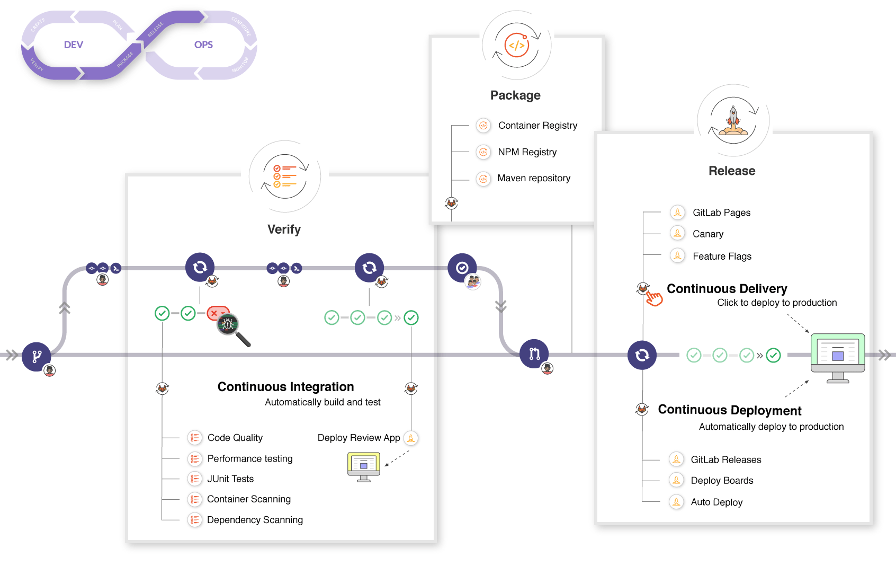
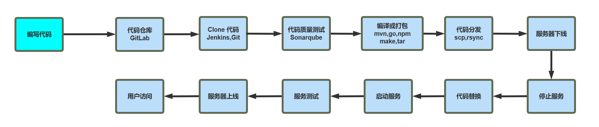
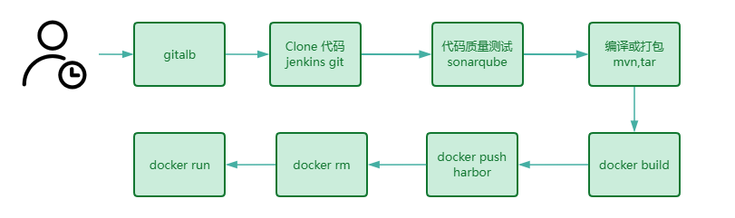
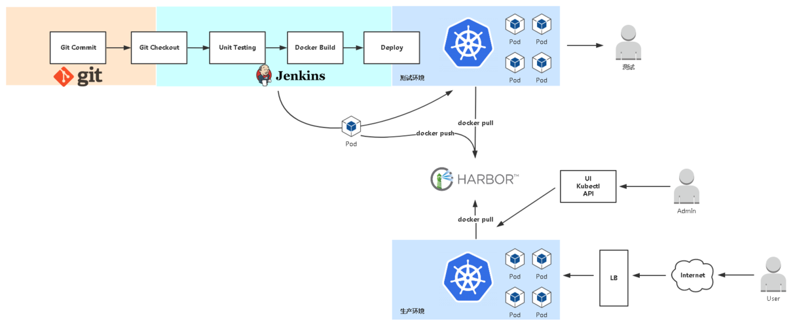
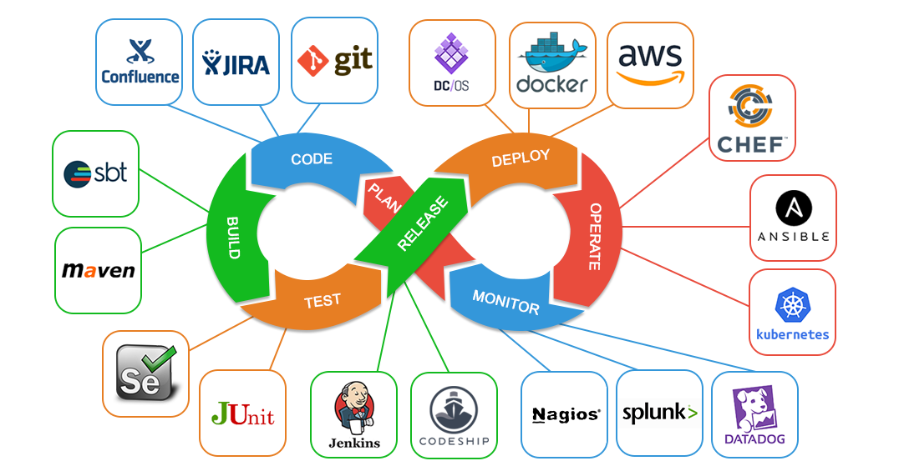
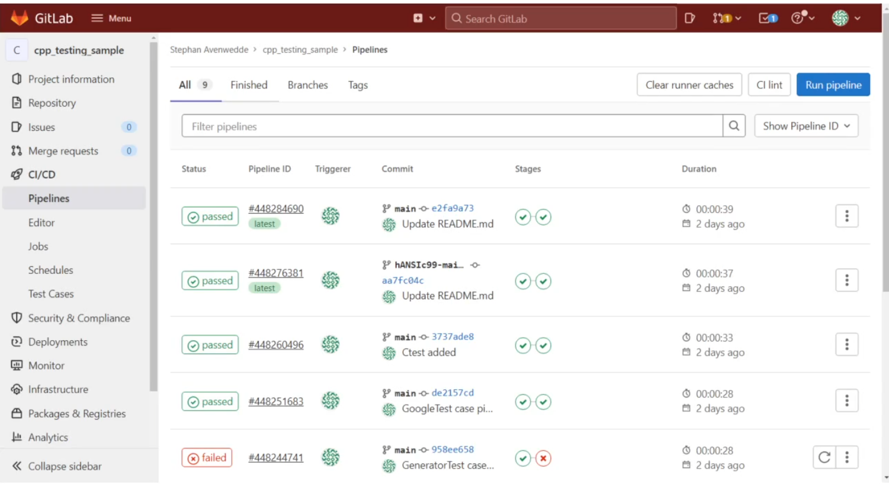
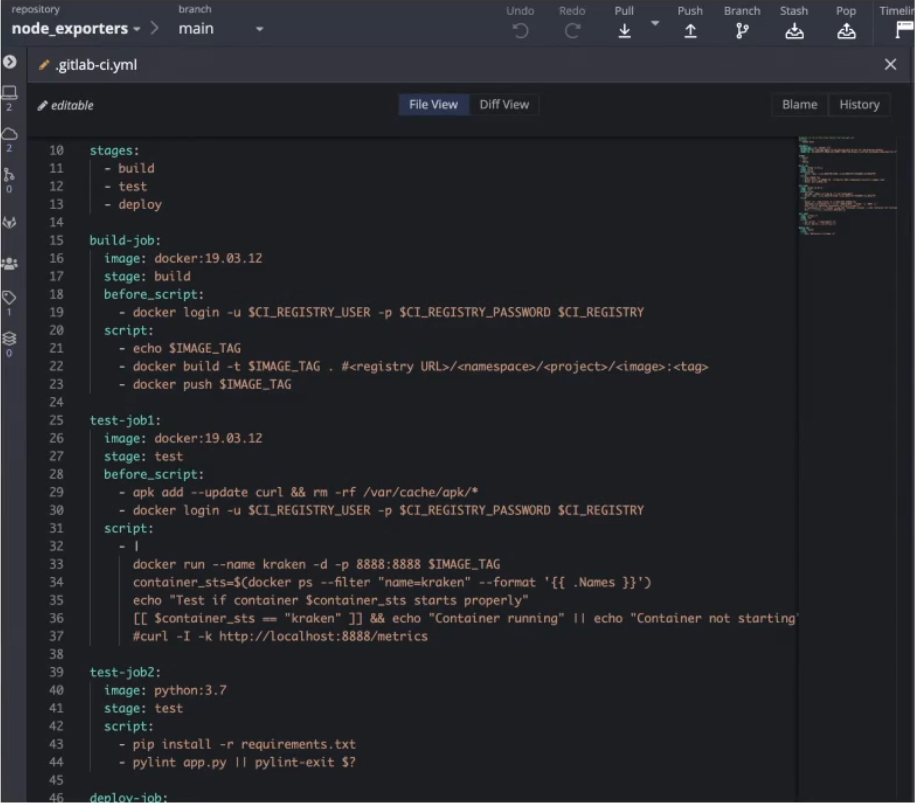
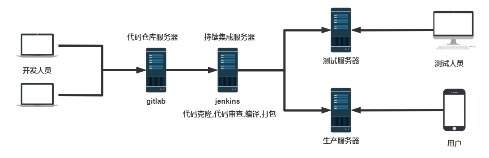

[← Back to Git and GitLab Version Control Index]({{ '/subjects/Git-GitLab/' | relative_url }})



# 04 CI/CD Process and Architecture
### 1.4 CICD 流程过程和架构

### 应用部署发展阶段

开发人员自行手动上传构建并部署代码

早期项目,没有专业的运维人员,运维的工作由开发兼职完成,项目发布很不专业,很容易出错,也是最原始的方式

开发人员先将代码发给运维,再由运维人员手动上传至生产环境

专业的运维人员完成应用的部署,每次项目发布都由运维人员一步一步手动实现,效率低下且容易出错

运维利用脚本和自动化运维工具实现部署

由运维人员编写Shell,Python等脚本或利用自动化运维工具,如Ansible等实现半自动化应用部署,效率很高,但对技术专业性有较高要求

通过 Web 等 GUI 界面实现一键自动化部署

可以通过开源或自研的运维平台实现方便的应用部署,操作容易,效率高,但需要提前构建运维平台， 比如，Jenkins等

### CICD 流程

### 传统方式的CICD 流程

开发人员不断的进行代码提交到本地，再提交到运程的代码仓库服务器 Jenkins作为持续集成工具，使用Git工具到Git仓库拉取代码到集成服务器，代码测试与审查，再配合JDK，Maven，Go等软件完成代码编译，测试，打包等工作，在这个过程中每一步如果出错，都需要重新再执行一次整个流程。 Jenkins把生成的软件jar或war包等分发到测试服务器或者生产服务器，测试人员或用户就可以访问应用。

### 容器化方式的 CICD 流程

### Kubernetes 环境的 CICD 流程

### CICD 相关工具

Gitlab 实现CICD

### CICD 基础架构



<nav class="article-end" aria-label="章节导航">
  <a href="{{ '/subjects/Git-GitLab/03-continuous-integration-delivery-and-deployment.html' | relative_url }}">← Previous: Continuous Integration, Delivery, and Deployment</a>
  <a href="{{ '/subjects/Git-GitLab/' | relative_url }}">Back to Git and GitLab Version Control Index</a>
  <a href="{{ '/subjects/Git-GitLab/05-version-control-systems.html' | relative_url }}">Next: Version Control Systems →</a>
</nav>
