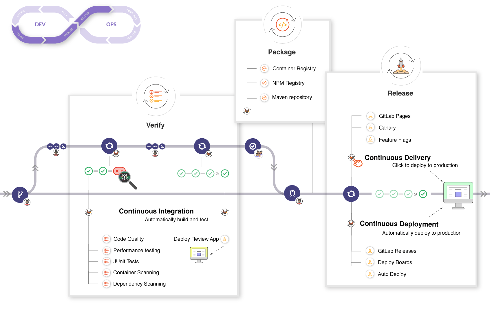
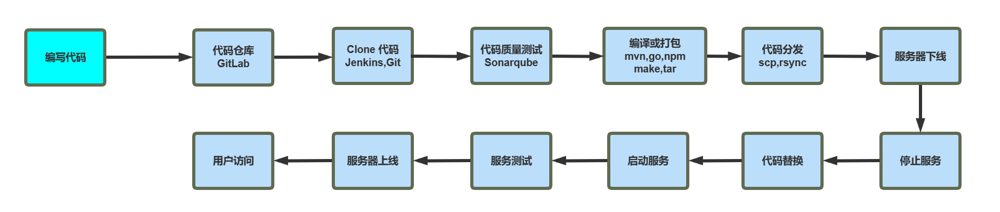
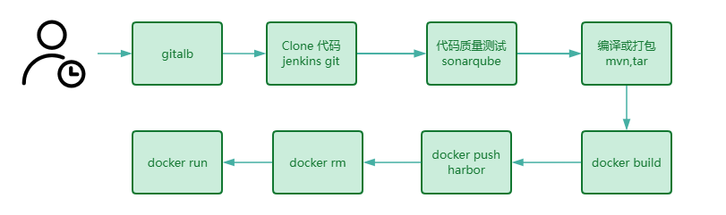
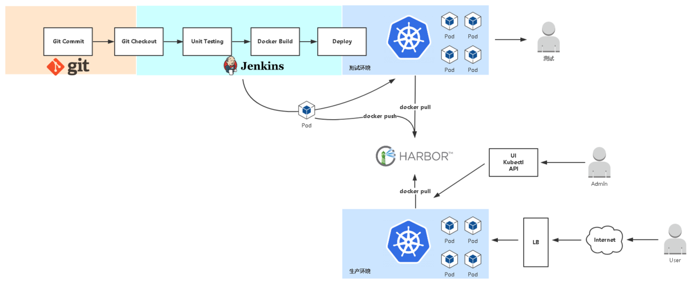
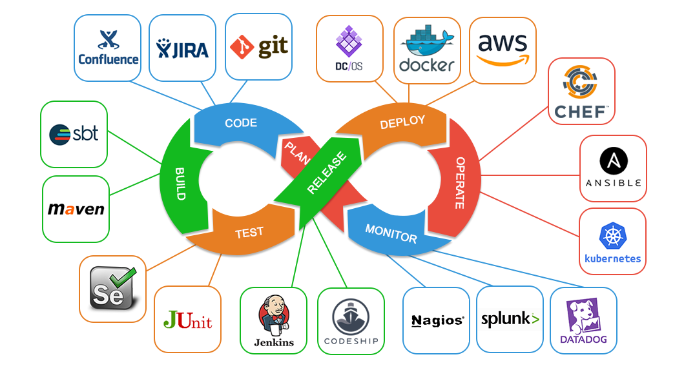
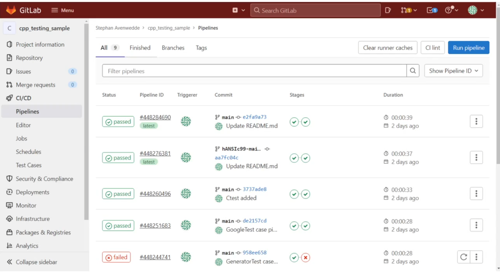
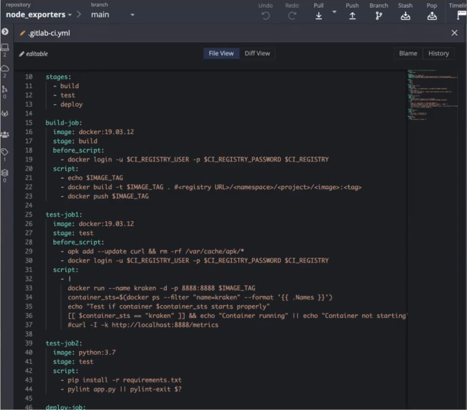
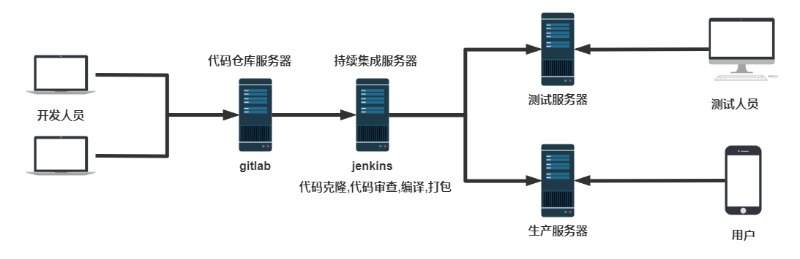

[← 返回Git 与 GitLab 版本控制目录]({{ '/subjects/Git-GitLab/' | relative_url }})



# 04 CI/CD 流程与架构

上一章区分了 CI、持续交付与持续部署；本章把这些概念放进实际发布流程，比较手动、脚本化和平台化部署。

### 应用部署发展阶段

**开发人员手动部署。** 开发人员自己构建、上传并启动应用。

早期项目,没有专业的运维人员,运维的工作由开发兼职完成,项目发布很不专业,很容易出错,也是最原始的方式

**开发与运维交接后手动部署。** 开发交付代码或制品，运维按操作步骤上传并发布。

专业的运维人员完成应用的部署,每次项目发布都由运维人员一步一步手动实现,效率低下且容易出错

**脚本和配置管理工具部署。** 运维将重复步骤写入脚本或自动化工具，减少手工差异。

由运维人员编写Shell,Python等脚本或利用自动化运维工具,如Ansible等实现半自动化应用部署,效率很高,但对技术专业性有较高要求

**平台化部署。** 通过 Web 界面触发经过审批和验证的流水线，而非把“点击一次”视作完整的发布保障。

可以通过开源或自研的运维平台实现方便的应用部署,操作容易,效率高,但需要提前构建运维平台， 比如，Jenkins等

### CICD 流程

### 传统方式的CICD 流程

传统流水线中，开发人员把代码推送到 Git 仓库，Jenkins 拉取指定提交，执行构建、测试和打包，再将制品部署到测试环境。验证通过后才发布到生产环境。某一步失败时应停止下游发布、保留日志并从失败阶段或修复后的新提交重新运行，而不是把未经验证的制品继续分发。

### 容器化方式的 CICD 流程

容器化流程通常把构建结果制作成带版本标识的镜像，推送到镜像仓库，再用同一镜像部署到测试及生产环境。镜像扫描、配置与密钥管理、部署后健康检查都应纳入流水线。

### Kubernetes 环境的 CICD 流程

在 Kubernetes 中，流水线可更新 Deployment 的镜像版本，由控制器滚动替换 Pod。发布是否成功不能只看命令退出码，还要检查就绪探针、滚动状态和业务指标；异常时回滚到上一版本。

### CICD 相关工具

### 使用 GitLab 实现 CI/CD

GitLab CI/CD 通过仓库中的流水线配置定义作业，并由 Runner 执行。常见阶段包括检查、测试、构建和部署；每一阶段的制品与结果应可追溯到具体提交。

### CICD 基础架构

阅读架构图时可沿“代码仓库 → 流水线执行器 → 制品仓库 → 目标环境 → 监控反馈”的路径追踪：代码决定构建来源，制品保持环境间一致，部署策略控制风险，监控将运行结果反馈到下一轮开发。



<nav class="article-end" aria-label="章节导航">
  <a href="{{ '/subjects/Git-GitLab/03-continuous-integration-delivery-and-deployment.html' | relative_url }}">← 上一篇：持续集成、持续交付与持续部署（CI/CD）</a>
  <a href="{{ '/subjects/Git-GitLab/' | relative_url }}">返回 Git 与 GitLab 版本控制目录</a>
  <a href="{{ '/subjects/Git-GitLab/05-version-control-systems.html' | relative_url }}">下一篇：版本控制系统（VCS） →</a>
</nav>
