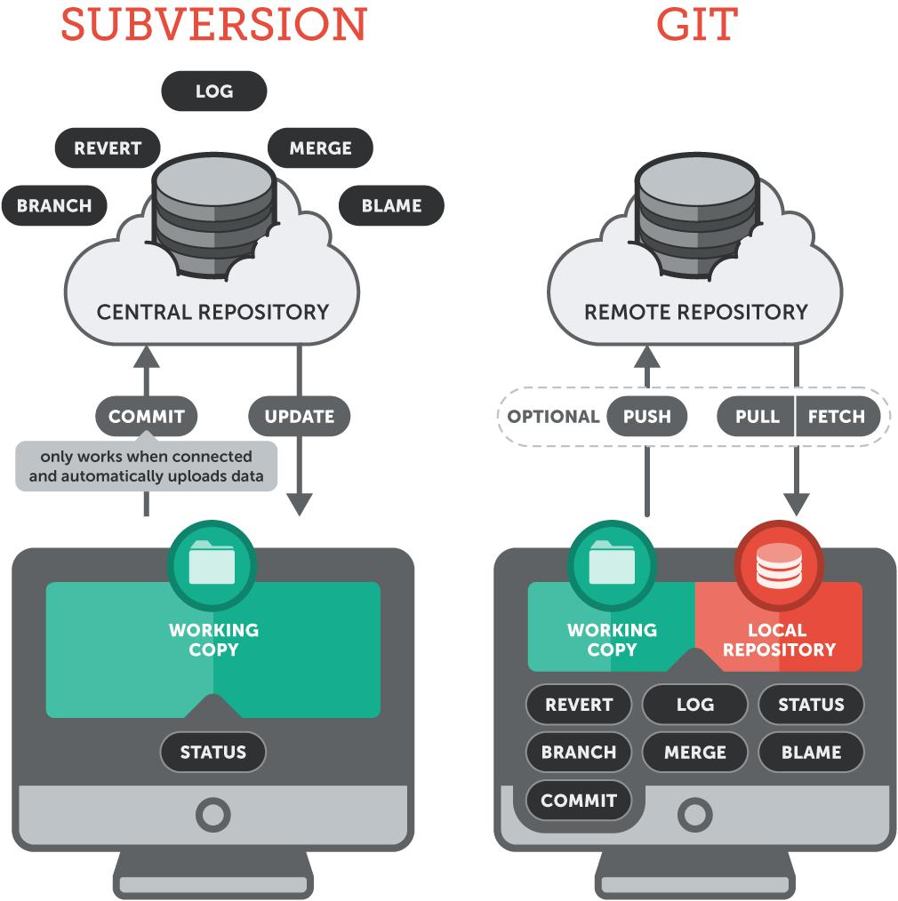
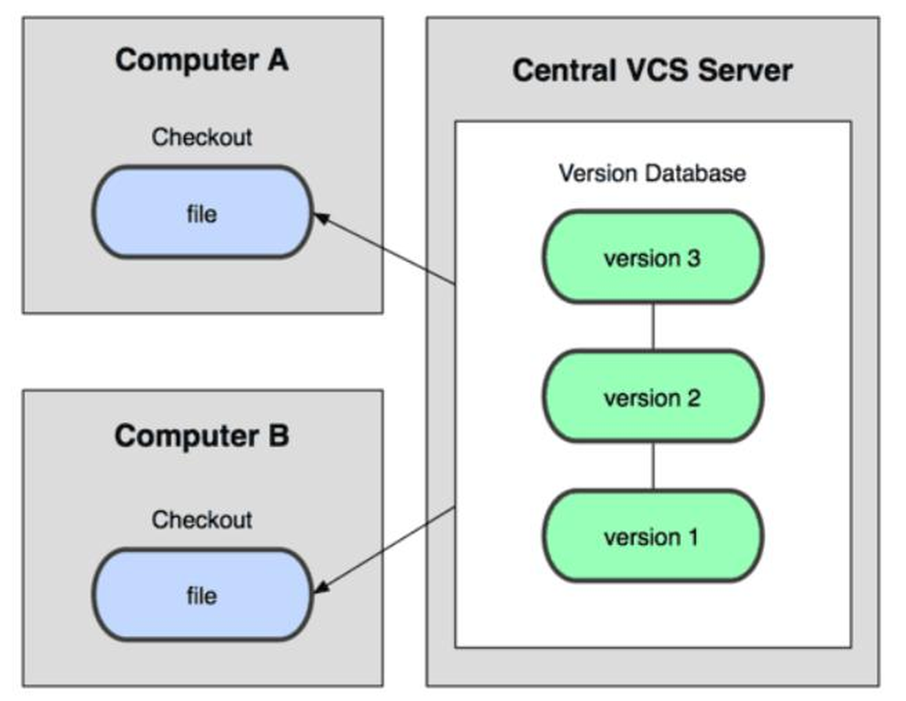
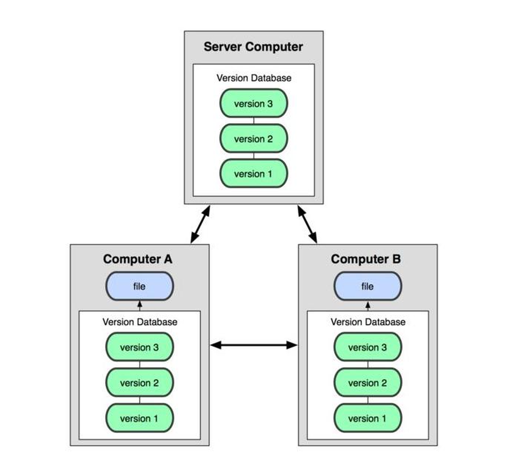
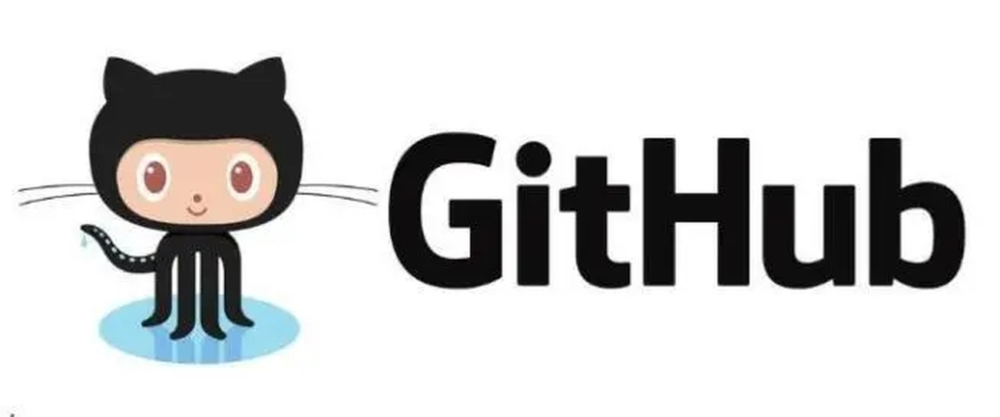
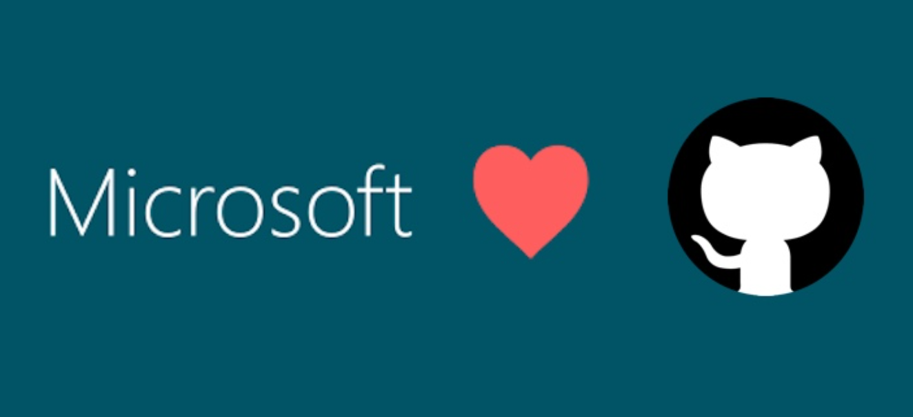
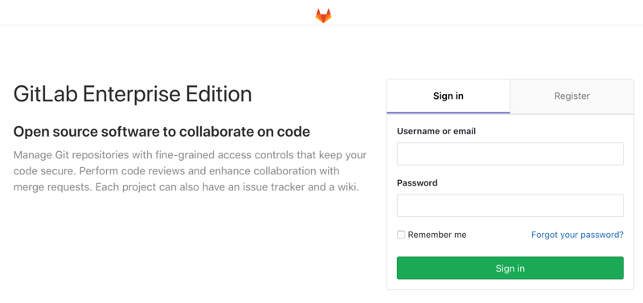

[← 返回Git 与 GitLab 版本控制目录]({{ '/subjects/Git-GitLab/' | relative_url }})



# 05 版本控制系统（VCS）

版本控制系统（Version Control System，VCS）记录文件从一个版本演变到下一个版本的过程。开发者可以查看差异、定位引入问题的修改、恢复旧版本，也能在分支上并行工作。它解决的是**可追踪的修改与协作**，不是自动备份、自动消除冲突或自动保证代码质量。

### 从手工备份到版本控制

手工复制“项目-最终版-修改版”等目录，虽然保存了若干快照，却难以说明每次改动的原因，也不方便比较或合并。VCS 将修改组织为有标识、作者和说明的版本，团队可以围绕某次提交讨论和审查。需要注意，仓库若被误删或损坏仍可能丢失数据，重要项目还应有独立备份。

### 本地、集中式与分布式

**本地 VCS。** RCS 等早期工具在单机保存文件修订记录，适合个人追踪，但不直接提供现代团队使用的共享仓库与合并流程。

**集中式 VCS。** SVN 等系统把主要历史放在中央服务器。开发者可在工作副本中离线编辑，但向共享仓库提交新版本通常需要连接服务器。中央服务有利于统一管理权限，同时也需要高可用与备份；已有工作副本能否离线比较、还原，取决于具体工具和本地数据，不应一概而论。

**分布式 VCS。** Git 的完整克隆含有可用的版本历史，开发者可离线提交、建分支、查看历史，再与远端交换提交。团队常约定一个中心托管仓库，但它不是 Git 工作原理中必须存在的主服务器。

| 关注点 | 集中式（以 SVN 为例） | 分布式（以 Git 为例） |
| --- | --- | --- |
| 历史位置 | 主要由中央仓库管理 | 完整克隆持有仓库历史 |
| 离线提交 | 一般不能提交到中央仓库 | 可在本地仓库提交 |
| 协作方式 | 向中央仓库更新与提交 | 本地提交后推送、拉取并合并 |
| 权限与风险 | 中央服务器便于统一控制，也需防范单点故障 | 托管端可控制访问，但已克隆的历史无法远程收回 |

不论使用哪种模型，**冲突仍需由人理解并解决**；敏感信息一旦进入提交历史，也不能仅靠删除当前文件消除传播风险。

### CVS、SVN 与 Git 的定位

CVS 是较早的集中式版本控制系统，推动了多人共享代码；SVN 在此基础上提供了更完整的目录、修订和权限管理。它们并非“过时到无法使用”，但新项目选型应结合团队协作方式、已有系统与迁移成本。

Git 在 2005 年开始开发，用于满足 Linux 内核协作对速度、分支和分布式工作的需求。Git 把提交组织为可追溯的历史，并提供轻量分支；开发者可以先在本地提交，再在有网络时同步。

这种能力并不意味着“任意两人的冲突都很容易解决”：同一逻辑被不同分支修改时，合并仍需理解业务含义并运行测试。Git 对频繁变化的大型二进制文件也不理想，可考虑 Git LFS 或制品仓库。

### Git 与代码托管平台的关系

Git 是版本控制工具；GitHub、GitLab 是围绕 Git 仓库提供权限、代码审查、议题、流水线等能力的平台。没有这些平台，Git 仍能在本地或自建远端工作；反过来，托管平台也不能替代对分支、提交和合并的理解。

#### GitHub

GitHub 提供远程 Git 仓库，以及 Pull Request、代码审查、Issue、Actions 等协作功能。个人和团队都可建立公开或私有仓库，具体功能和限制应以当前套餐文档为准，不能沿用早期“私有仓库必须付费”的说法。

下列原课程图片展示 GitHub 早期创立与平台发展背景；它们是历史资料，不代表当前产品界面或套餐。

#### GitLab

GitLab 可使用托管服务，也可按产品版本自行部署。除 Git 仓库管理外，它提供 Merge Request、Issue 和 CI/CD 等功能。自建方式给团队更多基础设施控制权，同时带来升级、备份、安全配置与监控责任；不能笼统认为自建一定更简单或更便宜。

选择平台时应比较托管方式、权限粒度、审查流程、流水线、合规要求及维护成本。两者都能托管私有仓库；已获权限的用户若克隆过历史，撤销远端访问并不会收回其本地副本。实际协作流程将在后续章节展开。



<nav class="article-end" aria-label="章节导航">
  <a href="{{ '/subjects/Git-GitLab/04-ci-cd-process-and-architecture.html' | relative_url }}">← 上一篇：CI/CD 流程与架构</a>
  <a href="{{ '/subjects/Git-GitLab/' | relative_url }}">返回 Git 与 GitLab 版本控制目录</a>
  <a href="{{ '/subjects/Git-GitLab/06-common-software-deployment-models.html' | relative_url }}">下一篇：常见的软件部署模式 →</a>
</nav>
