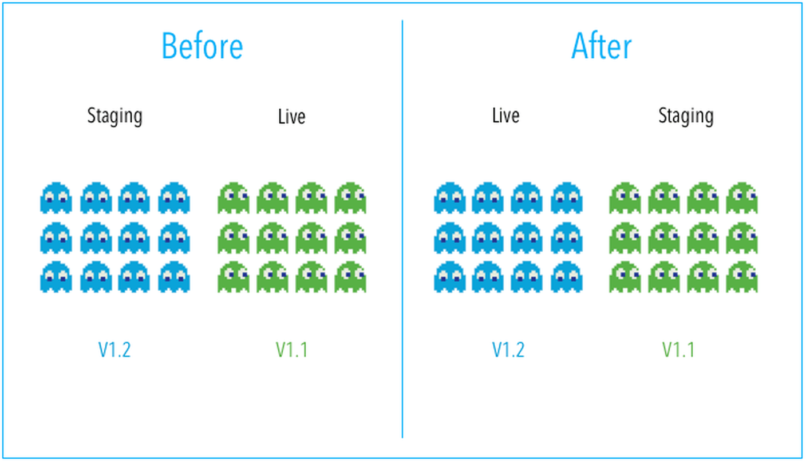
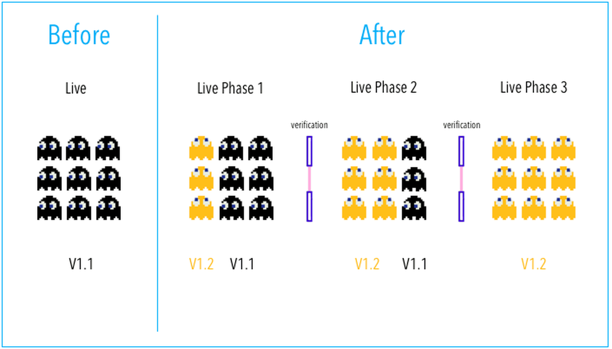
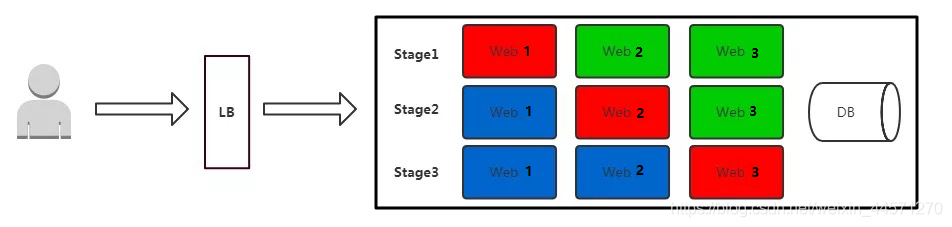

[← 返回Git 与 GitLab 版本控制目录]({{ '/subjects/Git-GitLab/' | relative_url }})



# 06 常见的软件部署模式

不同发布策略解决的是不同问题：蓝绿发布便于整体切换，金丝雀发布控制影响范围，滚动发布逐步替换实例，A/B 测试则用于比较产品方案。无论采用哪种策略，都应预先设计数据库兼容、监控与回滚路径。

### 蓝绿部署 Blue-green Deployments

蓝绿部署指的是不停止老版本代码(不影响上一个版本访问)，而是在另外一套环境部署新版本然后进行测试，测试通过后将用户流量切到新版本，其特点为业务无中断，升级风险相对较小。但本方式成本较高, 一般小公司较少使用

“蓝”和“绿”只是两个可互换的生产候选环境的名称，并非固定代表预发布与生产。旧环境承载当前流量，新环境部署并验证新版本；切换流量后保留旧环境一段时间，便于观察和回切。

具体过程：

1、当前版本(V1)业务正常访问

2、在另外一套环境部署新代码版本(V2)，代码可能是增加了功能或者是修复了某些bug

3、测试通过之后将用户请求流量切到新版本环境

4、观察一段时间，如有异常直接切换旧版本

5、下次升级时，利用空闲环境部署下一版本，再重复验证与切换。

蓝绿部署适用的场景：

1、不停止老版本，额外部署一套新版本，等测试确认新版本正常后，才将用户请求切换至新版本，如果有问题，切换回老版本

2、切换粒度可按具体架构选择服务、应用或整个环境，并不固定为“容器”。

3、蓝绿发布对于增量升级有比较好的支持，但是对于涉及数据表结构变更等等不可逆转的升级，并不完全合适用蓝绿发布来实现，需要结合一些业务的逻辑以及数据迁移与回滚的策略才可以完全满足需求。

### 金丝雀(灰度)发布 Canary Deployment

“金丝雀”的由来：17世纪英国矿井工人发现，金丝雀对瓦斯这种气体十分敏感。空气中哪怕有极其微量的瓦斯，金丝雀也会停止歌唱；而当瓦斯含量超过一定限度时，虽然人类毫无察觉，金丝雀却早已毒发身亡。当时在采矿设备相对简陋的条件下，工人每次下井都会带上一只金丝雀作为“瓦斯检测指标”，以便在危险状况下紧急撤离。

金丝雀发布先将少量真实流量导向新版本，再根据错误率、延迟和业务指标逐步扩大比例，例如 2% → 25% → 75% → 100%。它能限制早期问题的影响范围，但不能“保证”稳定：指标缺失、数据不兼容或依赖共享资源时仍可能影响所有用户。

此方式在实际生产中使用较为普遍

金丝雀/灰度发布步骤组成：

1、准备好部署各个阶段的工件，包括：构建组件，测试脚本，配置文件和部署清单文件。

2、从负载均衡列表中移除掉“金丝雀”服务器（选择全部服务器中的一部分）。

3、升级“金丝雀”应用（排掉原有流量并进行部署）。

4、对应用进行自动化测试。

5、将“金丝雀”服务器重新添加到负载均衡列表中（连通性和健康检查）。

6、如果“金丝雀”在线使用测试成功，升级剩余的其他服务器。否则就回滚回旧版本

金丝雀/灰度发布部署适用的场景：

1、不停止老版本，额外搞一套新版本，不同版本应用共存。

2、灰度发布中，常常按照用户设置路由权重，例如90%的用户维持使用老版本，10%的用户尝鲜新版本。

3、经常与A/B测试一起使用，用于测试选择多种方案。

灰度发布的关键是**流量控制、阶段性观察和快速回退**。每次扩大流量前，应确认新旧版本可同时运行，并规定触发暂停或回滚的阈值。

### 滚动发布(更新)

滚动发布即逐步升级服务中的节点

滚动发布是指每次只升级一个或多个服务实例，升级完成后加入生产环境，不断执行这个过程，直到集群中的全部旧版本升级新版本。

红色：正在更新的实例，正在升级过程中间状态

蓝色：更新完成并加入集群的实例,升级完成的新版本

绿色：正在运行的实例，升级前的旧版本

滚动发布过程

1. 先升级1个服务实例，主要做部署验证

2. 每次升级1个服务实例，自动从LB上摘掉，升级成功后自动加入集群

3. 事先需要有自动更新策略，分为若干次，每次数量/百分比可配置

4. 回滚可将新实例替换为旧版本，或通过版本化部署配置撤销更新；恢复时间取决于镜像、实例启动速度和数据变更，不能只把它理解为发布的简单逆过程。

5. 自动化要求高

### A/B测试 A/B Testing

A/B 测试让不同用户群同时看到不同方案，通过预先定义的指标比较其效果。它可以与灰度发布使用同一流量分配能力，但目标是产品实验，而不是单纯降低发布风险。

A/B 测试是用来测试应用功能表现的方法，例如可用性、受欢迎程度、可见性等等

蓝绿发布主要解决版本切换和回切；A/B 测试主要回答“哪个方案对目标用户更有效”。蓝绿切换期间也可能短时保留两套环境，因此不能用“只有一套在线”作为绝对区分。



<nav class="article-end" aria-label="章节导航">
  <a href="{{ '/subjects/Git-GitLab/05-version-control-systems.html' | relative_url }}">← 上一篇：版本控制系统（VCS）</a>
  <a href="{{ '/subjects/Git-GitLab/' | relative_url }}">返回 Git 与 GitLab 版本控制目录</a>
  <a href="{{ '/subjects/Git-GitLab/07-git-concepts-and-principles.html' | relative_url }}">下一篇：Git 相关概念和原理 →</a>
</nav>
