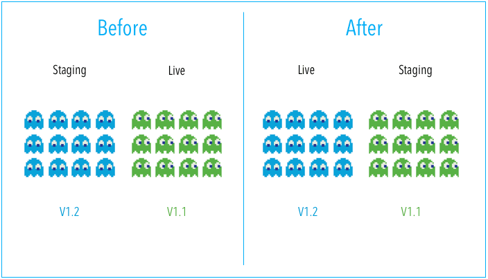
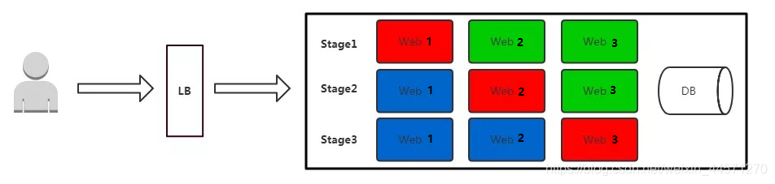
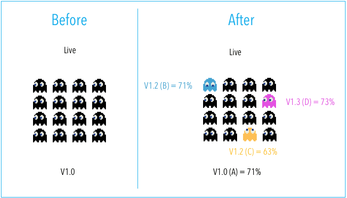

[← Back to Git and GitLab Version Control Index]({{ '/subjects/Git-GitLab/' | relative_url }})



# 06 Common Software Deployment Models
### 1.6 常见的软件部署模式

### 蓝绿部署 Blue-green Deployments

蓝绿部署指的是不停止老版本代码(不影响上一个版本访问)，而是在另外一套环境部署新版本然后进行测试，测试通过后将用户流量切到新版本，其特点为业务无中断，升级风险相对较小。但本方式成本较高, 一般小公司较少使用

蓝绿色部署是一种部署策略，利用两种相同的环境，即"蓝色"（又名预发布）环境和"绿色"（又名生产） 环境，具有不同版本的应用程序或服务。质量保证和用户接受度测试通常在承载新版本或更改的蓝色环境中进行。一旦蓝色环境中测试并接受新的变化，用户流量就会从绿色环境切换为蓝色环境。然后，一旦部署成功，您可以切换到新环境。

具体过程：

1、当前版本(V1)业务正常访问

2、在另外一套环境部署新代码版本(V2)，代码可能是增加了功能或者是修复了某些bug

3、测试通过之后将用户请求流量切到新版本环境

4、观察一段时间，如有异常直接切换旧版本

5、下次升级，将旧版本(V2)升级到新版本(V3)

蓝绿部署适用的场景：

1、不停止老版本，额外部署一套新版本，等测试确认新版本正常后，才将用户请求切换至新版本，如果有问题，切换回老版本

2、蓝绿发布是一种用于升级与更新的发布策略，部署的最小维度是容器，而发布的最小维度是应用。

3、蓝绿发布对于增量升级有比较好的支持，但是对于涉及数据表结构变更等等不可逆转的升级，并不完全合适用蓝绿发布来实现，需要结合一些业务的逻辑以及数据迁移与回滚的策略才可以完全满足需求。

### 金丝雀(灰度)发布 Canary Deployment

“金丝雀”的由来：17世纪英国矿井工人发现，金丝雀对瓦斯这种气体十分敏感。空气中哪怕有极其微量的瓦斯，金丝雀也会停止歌唱；而当瓦斯含量超过一定限度时，虽然人类毫无察觉，金丝雀却早已毒发身亡。当时在采矿设备相对简陋的条件下，工人每次下井都会带上一只金丝雀作为“瓦斯检测指标”，以便在危险状况下紧急撤离。

金丝雀发布也叫灰度发布，是指在黑与白之间，能够平滑过渡的一种发布方式，灰度发布是增量发布 （例如：2%、25%、75%、100%）进行更新)的一种类型，灰度发布是在原有版本可用的情况下，同时部署一个新版本应用作为“金丝雀”(小白鼠)，测试新版本的性能和表现，以保障整体系统稳定的情况下， 尽早发现、调整问题。因此，灰度发布可以保证整体系统的稳定，在初始灰度的时候就可以发现、调整问题，以保证其影响度。

此方式在实际生产中使用较为普遍

金丝雀/灰度发布步骤组成：

1、准备好部署各个阶段的工件，包括：构建组件，测试脚本，配置文件和部署清单文件。

2、从负载均衡列表中移除掉“金丝雀”服务器（选择全部服务器中的一部分）。

3、升级“金丝雀”应用（排掉原有流量并进行部署）。

4、对应用进行自动化测试。

5、将“金丝雀”服务器重新添加到负载均衡列表中（连通性和健康检查）。

6、如果“金丝雀”在线使用测试成功，升级剩余的其他服务器。否则就回滚回旧版本

金丝雀/灰度发布部署适用的场景：

1、不停止老版本，额外搞一套新版本，不同版本应用共存。

2、灰度发布中，常常按照用户设置路由权重，例如90%的用户维持使用老版本，10%的用户尝鲜新版本。

3、经常与A/B测试一起使用，用于测试选择多种方案。

灰度发布可以在发布新版本应用时:

自定义控制新版本应用流量比重渐进式完成新版本应用的全量上线最大限度地控制新版本发布带来的业务风险降低故障带来的影响同时支持快速回滚

### 滚动发布(更新)

滚动发布即逐步升级服务中的节点

滚动发布是指每次只升级一个或多个服务实例，升级完成后加入生产环境，不断执行这个过程，直到集群中的全部旧版本升级新版本。

红色：正在更新的实例，正在升级过程中间状态

蓝色：更新完成并加入集群的实例,升级完成的新版本

绿色：正在运行的实例，升级前的旧版本

滚动发布过程

1. 先升级1个服务实例，主要做部署验证

2. 每次升级1个服务实例，自动从LB上摘掉，升级成功后自动加入集群

3. 事先需要有自动更新策略，分为若干次，每次数量/百分比可配置

4. 回滚是发布的逆过程，先从LB摘掉新版本，再升级老版本，这个过程一般时间比较长

5. 自动化要求高

### A/B测试 A/B Testing

A/B测试即同时对外提供两个APP运行环境，这和蓝绿部署的同时只有一个版本在线是不同的

A/B 测试是用来测试应用功能表现的方法，例如可用性、受欢迎程度、可见性等等

蓝绿部署和A/B测试是不同的,蓝绿部署的目的是安全稳定地发布新版本应用，并在必要时回滚即蓝绿部署是同一时间只有一套正式环境在线，而A/B测试是两套正式环境同时在线，一般用于多个产品竟争时使用



<nav class="article-end" aria-label="章节导航">
  <a href="{{ '/subjects/Git-GitLab/05-version-control-systems.html' | relative_url }}">← Previous: Version Control Systems</a>
  <a href="{{ '/subjects/Git-GitLab/' | relative_url }}">Back to Git and GitLab Version Control Index</a>
  <a href="{{ '/subjects/Git-GitLab/07-git-concepts-and-principles.html' | relative_url }}">Next: Git Concepts and Principles →</a>
</nav>
