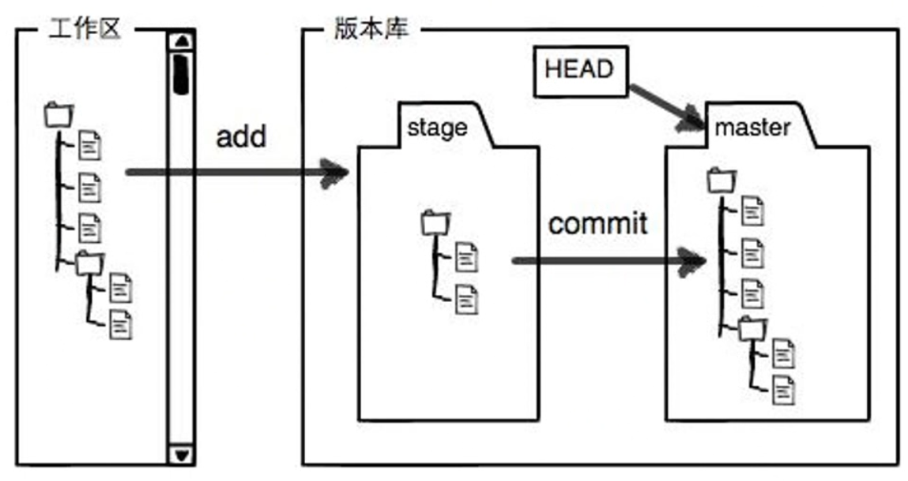
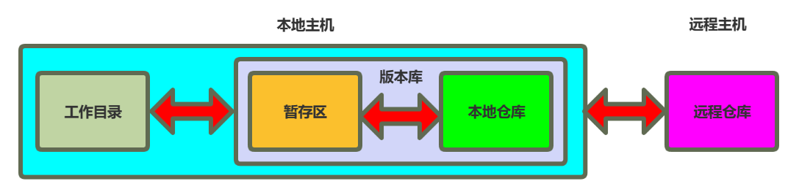
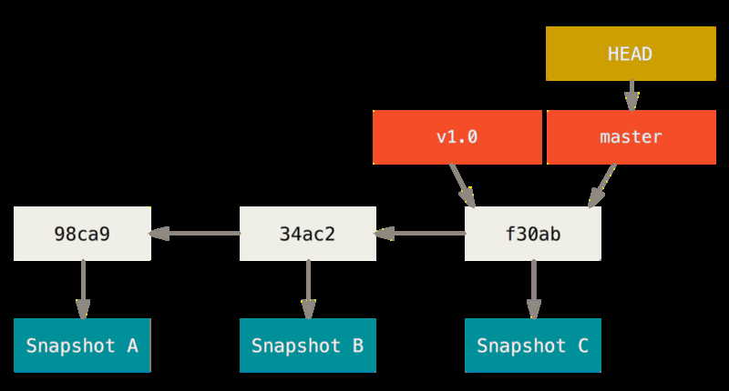
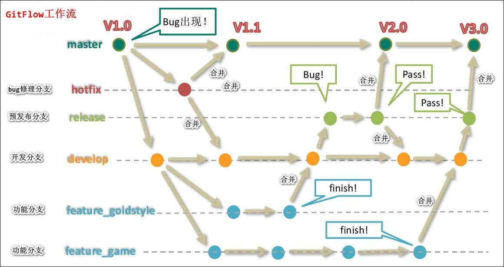
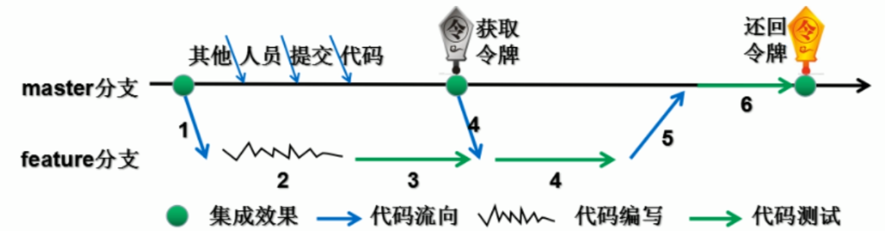
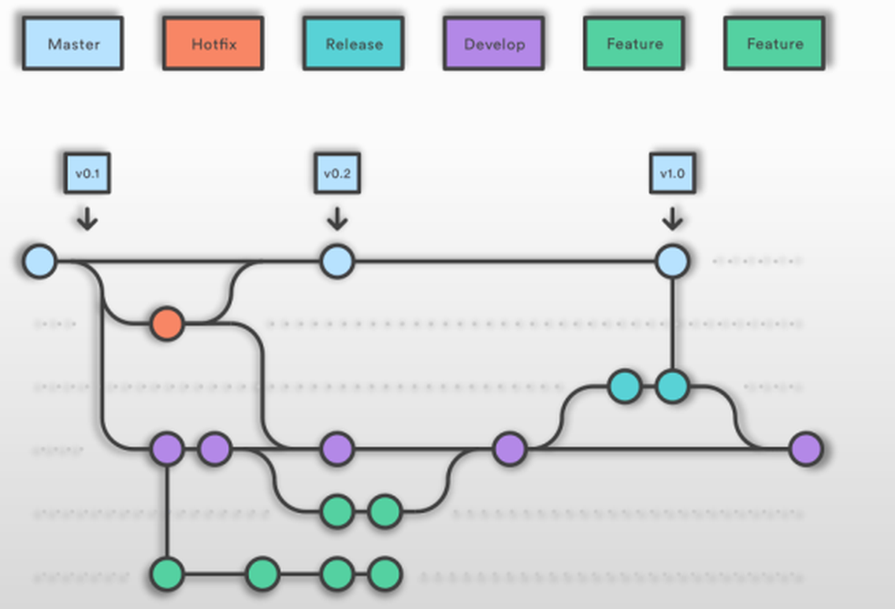
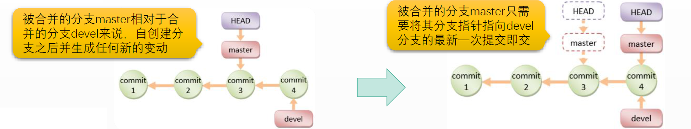
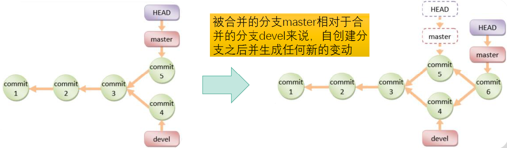
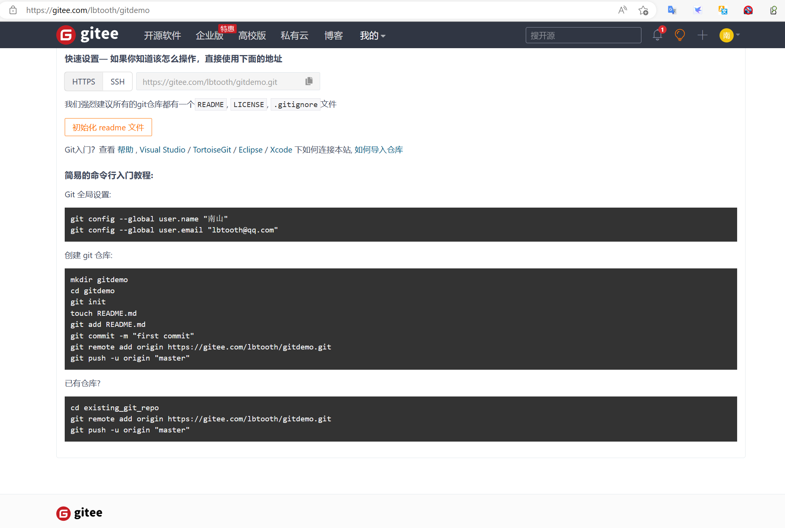

[← 返回Git 与 GitLab 版本控制目录]({{ '/subjects/Git-GitLab/' | relative_url }})



# 07 Git 相关概念和原理

理解 Git 时，先分清“正在编辑的文件”“准备提交的快照”和“已经写入历史的提交”，再看分支、标签和远端如何引用这些提交。下面的示例均以已初始化的 Git 仓库为前提。

### 工作区、暂存区与本地仓库



**工作区（working tree）**是当前检出的项目文件。编辑、删除文件后，变更先出现在工作区；新文件在加入暂存区前属于未跟踪文件。`git status` 能帮助确认两类状态。

**暂存区（index）**记录下一次提交将包含的文件快照。`git add <文件>` 更新暂存区；继续修改同一文件后，工作区和暂存区可能同时存在不同版本。提交前可用 `git diff` 看未暂存差异，用 `git diff --cached` 看将进入提交的差异。

**本地仓库**位于 `.git` 中，保存提交对象、引用和配置。`git commit` 将暂存区快照写入历史，生成一个提交 ID；未暂存的修改不会自动进入该次提交。远程仓库是其他位置的 Git 仓库，用于共享和同步，并非本地提交的必需条件。



旧命令 `git checkout` 同时承担切换分支和恢复文件的用途，容易混淆；新版本可分别使用 `git switch` 和 `git restore`。执行会覆盖文件的操作之前，应先查看 `git status`，必要时提交或暂存工作。

### 提交与引用



一个提交包含文件树、作者、说明以及父提交引用。初始提交没有父提交；普通提交通常有一个父提交；合并提交可有多个父提交。因此历史是提交组成的有向图，而不总是一条直线。

分支名（如 `main`）通常指向该分支最新提交。`HEAD` 通常指向当前分支；在分离 HEAD 状态下则直接指向某个提交。`HEAD~` 表示第一个父提交，`git show HEAD` 可查看当前提交。默认分支名由仓库初始化配置决定，可以是 `main`、`master` 或其他名称。

### 分支与标签


分支是**可移动的引用**，不是完整复制出来的项目目录。在分支上创建新提交后，该分支引用向前移动；其他分支仍可保持原位置。开发新功能时，先从稳定分支创建功能分支，便能频繁提交中间进度而不把未完成变更直接放进稳定分支。


标签通常用于给特定提交命名，例如发布 `v1.3.2`。普通使用中标签保持不动，适合作为版本里程碑；若要从旧标签继续开发，应从该标签创建**新分支**，而不是在分离 HEAD 状态下长期工作。轻量标签只是引用，附注标签还保存创建者、日期与说明，并可签名。

参考：[Git 分支](https://git-scm.com/book/zh/v2/Git-%E5%88%86%E6%94%AF-%E5%88%86%E6%94%AF%E7%AE%80%E4%BB%8B) · [Git 标签](https://git-scm.com/book/en/v2/Git-Basics-Tagging)。

### 如何选择分支流程

分支策略应服务于发布节奏，而不是把分支数量当成成熟度。团队首先要明确：稳定分支由谁维护、变更如何审查、何时测试和发布、线上修复怎样同步回正在开发的分支。





**单主干。** 以 `main` 作为集成与发布来源，短期功能分支经测试和代码审查后尽快合并。它并不只适用于“单功能、无构建”项目；关键是保持主干可用，并用自动化检查和功能开关控制未开放的功能。

**开发分支。** 部分团队保留长期 `develop` 承接日常集成，发布时再合并到 `main`。这样可以区分正在集成和已发布代码，但两条长期分支需要持续同步，发布越不频繁，差异与冲突可能越大。


**发布分支。** 发布窗口较长时，可从 `develop` 创建短期 `release/*`，仅修复发布所需问题；完成后把修复同时带回 `main` 和 `develop`，避免修复遗失。发布分支存在越久，后续同步成本越高。


**热修复分支。** 线上故障可从当前生产提交创建 `hotfix/*`，修复并验证后合并到发布主线，还要将同一修复同步到 `develop` 或相关发布分支。是否直接合并、挑选提交或重新实现，取决于各分支的代码差异，不能套用固定命令序列。



例如一个从 `main` 开始的短期功能分支，可以按以下顺序工作；实际分支名和审查步骤以团队约定为准：

```bash
git switch main
git pull --ff-only origin main
git switch -c feature/example
# 完成并测试功能后，选择要提交的文件
git add <文件>
git commit -m "完成示例功能"
git push -u origin feature/example
```

之后在托管平台发起代码审查，检查通过才合并到 `main`。不要在示例中把 `git rebase master` 当作“完成开发、测试”的命令：变基只重排提交，不会替团队运行测试。

### 合并：快进与三路合并

`git merge <来源分支>` 将来源分支合入**当前分支**。若当前分支从分叉点以来没有新提交，可直接把引用前移，称为快进合并。



若两个分支都继续提交，Git 会以共同祖先和两侧最新提交做三路合并，并在需要时创建合并提交。出现冲突并不等于仓库损坏；应阅读冲突文件、理解两侧意图、修正代码并测试，然后完成合并。



### 与远程仓库协作



`origin` 只是常用的远程名称，不是 Git 特殊关键字。`git fetch` 获取远端新提交和远程跟踪引用，不会自动改写当前工作；`git pull` 在抓取后按配置执行合并或变基；`git push` 则将本地提交送往远端。同步前先确认当前分支和远端地址。

| 任务 | 命令示例 |
| --- | --- |
| 查看远端与状态 | `git remote -v`、`git status` |
| 添加远端 | `git remote add origin <远端 URL>` |
| 克隆仓库 | `git clone <远端 URL> [目录]` |
| 获取并查看远端更新 | `git fetch origin`、`git branch -r` |
| 拉取当前分支更新 | `git pull --ff-only origin main`（仅允许快进时） |
| 推送本地分支 | `git push -u origin main` |

表中的 `main` 必须替换为实际分支名。远端不是独立备份策略：共享仓库同样可能遭遇误删、权限误配或服务故障。



<nav class="article-end" aria-label="章节导航">
  <a href="{{ '/subjects/Git-GitLab/06-common-software-deployment-models.html' | relative_url }}">← 上一篇：常见的软件部署模式</a>
  <a href="{{ '/subjects/Git-GitLab/' | relative_url }}">返回 Git 与 GitLab 版本控制目录</a>
  <a href="{{ '/subjects/Git-GitLab/08-installing-git.html' | relative_url }}">下一篇：Git 安装 →</a>
</nav>
