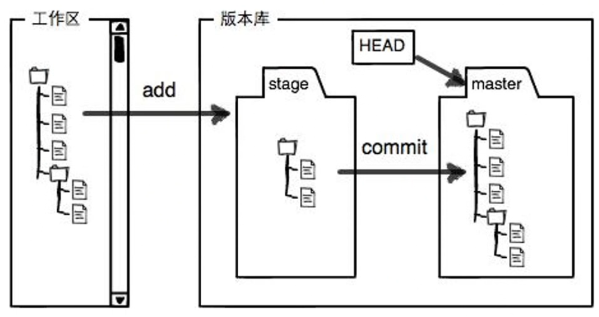
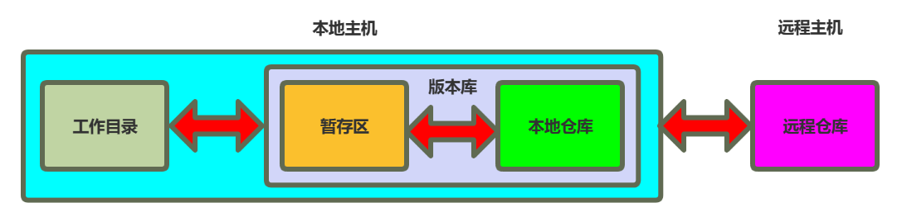
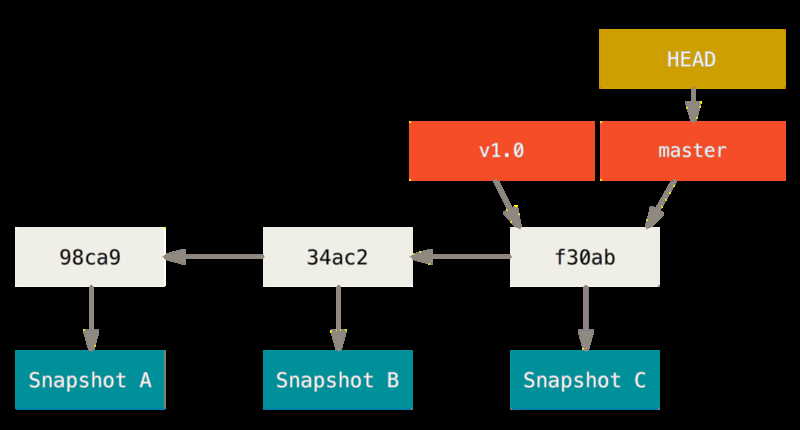
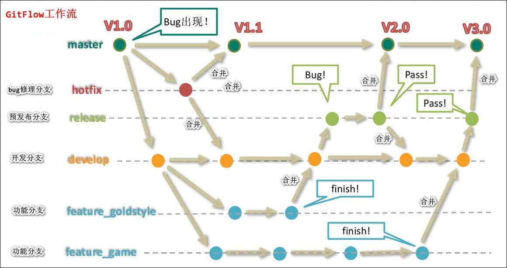
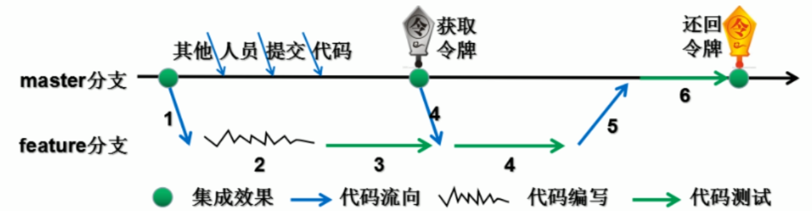
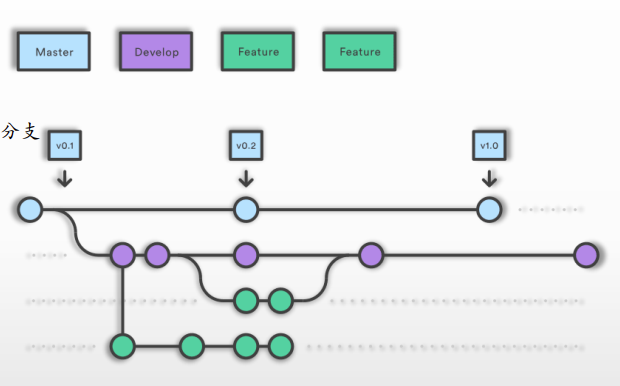
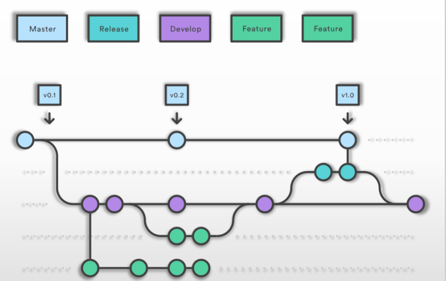
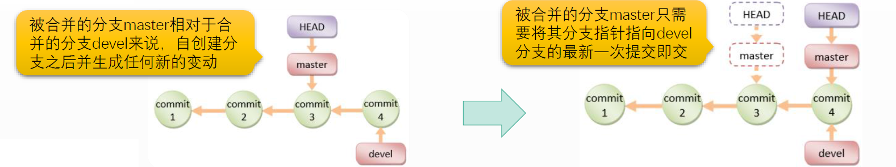
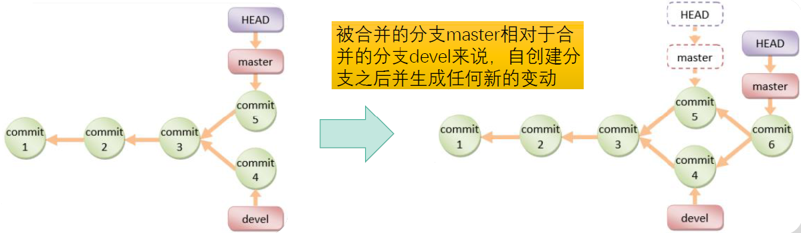
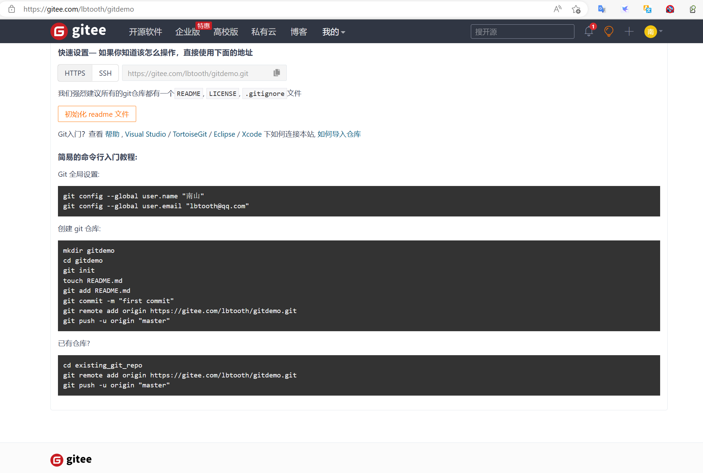

[← 返回Git 与 GitLab 版本控制目录]({{ '/subjects/Git-GitLab/' | relative_url }})



# 07 Git 相关概念和原理
## 2 版本控制系统 Git

### 2.1 Git 相关概念和原理

### Git 的区域

Git 的数据存储从物理上分为当前项目目录和当前项目目录下的隐藏子目录.git，分别称为工作区和版本库

Git 版本库逻辑上又分为暂存区和本地仓库



工作区 Workspace：

工作区是你当前正在编辑和修改文件的地方。它是你的项目目录 ，通常是对应于<项目目录>

在这里你可以添加、修改或删除文件。工作区中的文件可以是已被Git跟踪的文件，也可以是未被跟踪的文件。

工作区中的文件的变更不受Git的跟踪和管理，无法实现版本回滚等功能

需要将工作的的变更，通过 git add 命令加入暂存区后，才可纳入Git 的版本管理控制的范畴

暂存区 Staging Area/Index/Cached：

也称为索引区,缓存区，用于存储在工作区中对代码进行修改后的文件所保存的地方，只有放入此区的文件才能被git进行管理,使用 git add添加,对应为<项目目录>/.git/index文件

暂存区主要用于临时保存文件少量变更，类似于邮件中的草稿箱

当变更累积到一定阶段，希望生成里程碑式的结果时，会使用commit，将暂存区的变更一次性的批量提交到本地仓库

本地仓库 Local Repository：

用于存储在工作区和暂存区中改过并提交的文件地方，使用 git commit 提交,对应于/<项目目录 >/.git/

每一次commit 会生成一个唯一的ID，通常用于表示一个阶段性的新的版本

checkout命令执行了同commit命令相反的操作，它将版本中存储的commit所代表着的某个版本恢复至工作区中 checkout命令完成后，工作区中的文件内容与其检出的提交那一刻的状态相同

若工作区中存储此前未被提交的新文件，这些文件的未被提交的新的更改会被存储仓库的旧内容覆盖

当然，用户也可以暂存这些新文件，并将带有新文件的工作区提交到版本库中，这将是新的暂存和提交循环

远程仓库 Remote Repository ：

多个开发人员共同协作提交代码的仓库，即私有 gitlab 服务器或公有云github,gitee网站等

利用远程仓库，可以实现异地备份和远程协作



### Git 提交历史和提交链



版本库上的commit历史组合起来会形成一个提交链

除了初始commit，每个commit都会都会有一个父commit，也可能会有多个父commit(比如：分支合并)

除了最新一次的commit，每个commit都会有一个子commit，也可能会有多个子commit(比如：创建新分支)

这个提交链上的commit还可以使用字符串进行引用

通常，Git会为默认创建的提交链上的最新一次提交创建一个基于字符串的引用master/main

而该提交链也称为版本库的一个分支（Branch），master/main 也是分支的名称标识

另外自动创建的还有一个HEAD引用，它代表提交链的“头”，表示当前工作区所关联到的提交链上的特定提交，通常是最新一次提交

基于HEAD指向的commit，还能够以相对方式引用历史中的提交，例如HEAD~表示前一个提交 git show HEAD命令可以查看HEAD当前所指向的commit的信息

### Git 分支和标签

<https://git-scm.com/book/zh/v2/Git-%E5%88%86%E6%94%AF-%E5%88%86%E6%94%AF%E7%AE%80%E4%BB%8B>

branch 分支

<https://git-scm.com/book/en/v2/Git-Branching-Branches-in-a-Nutshell>


Git 的分支，其实本质上仅仅是指向提交对象的可变指针

Git 的默认分支名字是 master/main 。 在多次提交操作之后，你其实已经有一个指向最后那个提交对象的 master/main 分支。 master 分支会在每次提交时自动向前移动。

Git的分支实现对文件的多个副本,可以实现多个不同用途的软件版本同时的演进,实现多个开发版本的隔离


假设你准备开发一个新功能，但是需要两周才能完成，第一周你写了50%的代码，如果立刻提交， 由于代码还没写完，不完整的代码库会导致别人不能测试等工作。如果等代码全部写完再一次提交，又存在丢失每天进度的巨大风险。

现在有了分支，就不用担心了。你创建了一个独立的分支，对其他人是透明的,没有影响,他们还继续在原来的分支上正常工作，而你在自己的分支上工作，想提交就提交，直到开发完毕后，再一次性合并到原来的分支上，这样既安全，又不影响别人工作。

tag 标签

<https://git-scm.com/book/en/v2/Git-Basics-Tagging>

给某个状态打个标签用于记录当前状态,相当于里程碑性的提交

tag是git版本库的一个标记，指向某个commit的指针。为某个commit添加一个标签，从而对其完成特殊标记，例如标记特定的版本信息

tag主要用于发布版本的管理，一个版本发布之后，可以为git打上 v1.0.1,v1.0.2 ...这样的类似的标签。

通常，用户应该每天下班前提交代码并完成推送，以备份代码；只有待需要发一个版本时，才会基于tag对相应commit进行标记

tag跟branch有点相似，但是本质上和分工上是不同的：

tag 对应某次commit, 是一个点，是不可移动的。

branch 对应一系列commit，是很多提交点连成的一根线形成的，有一个HEAD 指针，是可以依靠 HEAD 指针移动的。

所以，两者的区别决定了使用方式，改动代码用 branch ,不改动只查看用 tag。

tag 和 branch 的相互配合使用，有时候起到非常方便的效果

例如：已经发布了 v1.0 v2.0 v3.0 三个版本，这个时候，我突然想不改现有代码的前提下，在 v2.0 的基础上加个新功能，作为 v4.0 发布。就可以检出 v2.0 的代码作为一个 branch ，然后作为开发分支。

常用的版本标记格式

version-number.release-no.modificaton-no (e.g., v1.3.2) version-number.release-no.upgrade-no_modificaton-no (e.g., v1.9.3_6)

Git支持使用两种标签：轻量标签（lightweight）与附注标签（annotated）

轻量标签：仅为某个commit的引用附注标签：存储在 Git 数据库中的一个完整对象，其中包含打标签者的名字、电子邮件地址、 日期时间， 此外还会包含一个message

### Git 开发分支流程

分支管理是现代版本控制系统在记录版本和变更记录之外的另一个非常重要的功能

团队于同一个项目上协作时，分支管理是不可或缺的重要功能，因为它

隔离不同开发人员的改动，为每个人提供一个相对独立的空间

隔离团队根据布节奏要实现的代码提交、审核、集成和测试等工作

“如果说多人软件协作项目中有一个灵魂的话，我认为，这个灵魂就是分支策略。可以说，分支策略就是软件协作模式和发布模式的风向标。选择一种符合 DevOps 开发模式的分支策略，对于 DevOps 的实践落地也会大有帮助。” —— 石雪峰





几种常见的分支模型

master：开发、测试和发布都在master分支上完成

简单，但开发、测试和发布彼此影响，仅适用于单feature且无构建过程的场景

master/develop： 在开发分支开发，完成后合并至master分支，并删除develop分支

master 长期分支，记录发布历史

develop 短期分支，完成开发后合并至master分支

develop分支的开发不会影响到master分支的构建过程，但不利于同时开发多个feature；适用于单feature，可从master执行构建的场景

工作流程

```text
~$ git checkout -b develop # from master
~$ git rebase master    #完成开发、测试
~$ git checkout master
~$ git merge develop    #发布
~$ git branch --delete develop
```

master/develop/feature



master和develop 都是长期分支

开发人员工作在各自的feature分支上，feature分支经过开发、模块测试后合并到develop分支

develop分支代码经过系统测试，release之后合并到master分支，release是短期分支

多个feature有利于更大规模的合作，但release独立分支中的bug修复变更与develop上的变更可能会导致冲突；因而，适用于多feature，develop在release过程中不会修改的场景

feature短期分支，保存研发人员研发过程

开作流程

```text
git chechout -b feature #from develop，完成开发和特性测试
git checkout develop
git merge feature
git branch --delete feature #完成集成测试和发布
git checkout master
git merge develop
```

master/develop/feature/release



在前一分支模型的基础上，使用单独的release分支进行构建和bug修复

避免了因发布操作而阻塞了develop分支上的变更，但release分支存在的时间越长，导致develop 合并冲突的可能性越大；因此，适用于多feature开发，但develop功能不受release影响的场景

release：短期分支，承载发布过程

工作流程

```text
git chechout -b feature #from develop，完成开发和特性测试
git checkout develop
git merge feature
git branch --delete feature
git checkout -b release # from develop，完成测试、bug修复和发布
git checkout develop
git merge release   #将release合并至develop
git checkout master
git merge release #将release合并至master
git branch --delete release #删除releae分支
```

master/develop/feature/release/hotfix


从master单独拉一个短期的hotfix分支进行问题修复

hotfix: 从master拉出来的分支，短期分支

解决了前一模型中hotfix和develop冲突的问题

适用于多feature开发的场景，release不受线上版本hotfix的影响

工作流程

```text
git checkout -b hotfix # from master,完成修复和测试
git checkout master
git merge hotfix #合并hotfix分支至master
git checkout develop
git merge hotfix #合并hotfix分支至develop
git branch --delete hotfix #删除hotfix分支
git checkout release # from devclop
git rebasc develop # releasc分支变基,在release分支上完成测试和发布
git checkout develop
git merge relcasc  #将relcasc分支合并至develop
git checkout master
git merge release #将releasc分支合并至master
git branch --delete release #删除relcasc分支
```

### Git 分支合并

分支合并，即将多个分支合并成一个分支

利用 git merge   命令将指定的其它分支合并至当前分支

注意：先切换至需要合并的目标分支，再将其它分支合并至当前的目标分支

分支合并存在两种情形

快进式合并（Fast-Forward Merge） 三路合并（3-Way Merge）

快进式合并



三路合并

两个分支各自沿着自己的演进路线分别创建了新的提交

合并时需要共同的祖先提交，以及各分支的最新一次提交进行合并

如图，它需要commit3、commit4和commit5参与合并操作

合并时，若某文件存在无法合并的修改，则意味着存在“冲突”的可能，如果冲突，需要用户手动解决冲突后创建提交完成合并



### Git 使用远程仓库



通过远程仓库，基于HTTP、SSH 及 Git 多种传输协议可以实现异地备份和远程协作

推送代码至远程仓库的步骤

在某个Git托管服务上注册一个账号，比如：GitHub，Gitee，GitLAB

在Git托管服务上创建一个仓库在本地版本库上，使用git remote add  命令添加关联的远程库

远程仓库，一般默认名称为origin 相关的url在远程库上可以直接获取到

git push 推送本地仓库到远程仓库，git pull 可以拉取远程仓库代码到本地现在仓库中

没有本地仓库的其它主机通过git clone 可以将远程仓库克隆到本地

设定远程仓库

添加： git remote add 列出： git remote -v 删除： git remote rm 重命名： git remote rename

克隆远程仓库

克隆： git clone 克隆到指定工作目录： git clone

远程协作

抓取远程仓库所有分支上的变更： git fetch

抓取远程仓库指定分支上的变更： git fetch

列出所有远程分支：git branch -r

将远程分支合并至本地分支，通常应该将存在映射关系（通常为同一个分支名称）的分支进行合并

git checkout git merge origin/

拉取远程仓库上的变更

拉取并合并当前分支映射的远程分支上的变更至本地工作区：git pull

git pull 相当于如下两个命令生成的结果

git fetch git merge

推送本地变更到远程仓库

推送指定的分支：git push 推送本地仓库中的所有分支：git push  --all 推送本地仓库中的所有标签：git push  --tag



<nav class="article-end" aria-label="章节导航">
  <a href="{{ '/subjects/Git-GitLab/06-common-software-deployment-models.html' | relative_url }}">← Previous: Common Software Deployment Models</a>
  <a href="{{ '/subjects/Git-GitLab/' | relative_url }}">Back to Git and GitLab Version Control Index</a>
  <a href="{{ '/subjects/Git-GitLab/08-installing-git.html' | relative_url }}">Next: Installing Git →</a>
</nav>
